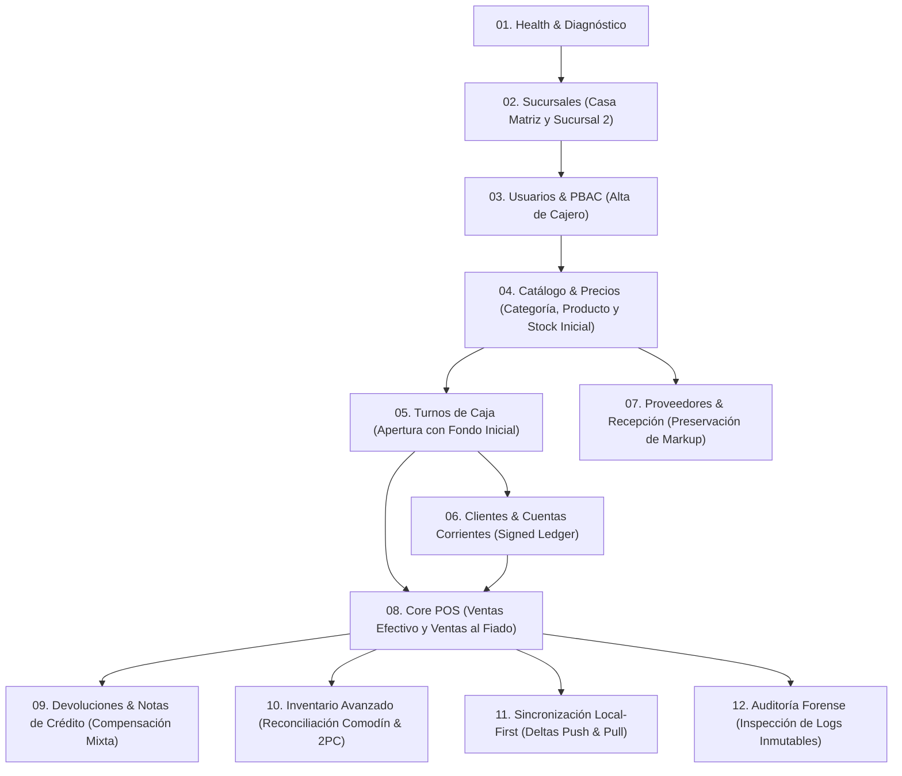

# 🚀 **Guía Maestra de Pruebas en Insomnia — POSLyon Backend Cloud**
> **Autor:** Agente de Arquitectura de Software y Mentor Universitario  
> **Destinatario:** Desarrollador y Líder de Proyecto  
> **Versión del Sistema:** Backend Cloud v1.0 (Niveles 0, 1, 2, 3 y 4 Completados)  
> **Archivo de Colección listo para importar:** [`docs/insomnia/POSLyon_Insomnia_Collection.json`](file:///d:/Contr/Archivos/POSLyon-Monolitico/docs/insomnia/POSLyon_Insomnia_Collection.json)

---

## 🎯 **Propósito de esta Guía**

Esta guía está diseñada **exclusivamente para ti**, para que puedas encender y probar con tus propias manos cada uno de los módulos transaccionales, casos de uso y reglas de negocio del backend de **POSLyon** utilizando **Insomnia**.

Aprenderás no solo a disparar peticiones HTTP, sino a entender **el orden lógico de negocio** de un sistema transaccional de retail profesional: por qué no puedes vender sin abrir un turno de caja, cómo se preservan los precios históricos con *Price Snapshotting*, cómo funciona el *Merge Aditivo* ante ventas offline y cómo auditar la caja negra del sistema.

---

## 🛠️ **Paso 0: Preparativos del Entorno Local (Windows)**

Antes de abrir Insomnia, debemos asegurarnos de que la base de datos PostgreSQL y el servidor NestJS estén corriendo.

### **0.1. Asegurar el Archivo de Configuración `.env`**
En la raíz del proyecto (`POSLyon-Monolitico/`), crea el archivo `.env` basándote en `.env.example` (si no lo tienes aún). Puedes hacerlo ejecutando en PowerShell:
```powershell
Copy-Item .env.example .env
```
Verifica que contenga:
```ini
DB_HOST=localhost
DB_PORT=5432
DB_USER=poslyon_admin
DB_PASSWORD=poslyon_secret_2026
DB_NAME=poslyon_cloud
PORT=3000
NODE_ENV=development
```

### **0.2. Levantar Docker Desktop y la Base de Datos PostgreSQL**
1. Abre **Docker Desktop** en Windows y espera a que el motor se inicialice (ícono de Docker en verde en la barra de tareas).
2. En la terminal de PowerShell en la raíz del proyecto, ejecuta:
   ```powershell
   npm run db:up
   ```
   *Esto descargará (si es la primera vez) y levantará el contenedor `poslyon_postgres_cloud` en el puerto `5432` con zona horaria UTC estricta.*
3. Para comprobar que el contenedor está saludable:
   ```powershell
   docker ps
   ```

### **0.3. Compilar e Iniciar el Servidor Backend**
1. Compila los paquetes del monorepo:
   ```powershell
   npm run build
   ```
2. Inicia el servidor backend en modo desarrollo:
   ```powershell
   npm run start:dev
   ```
3. Verás en la consola los mensajes de arranque de NestJS y finalmente:
   ```log
   [Nest] INFO [BootstrapBackendCloud] Servidor @poslyon/backend-cloud escuchando en http://localhost:3000/api/health
   ```
> [!NOTE]  
> Deja esta terminal abierta para poder ver los logs estructurados y de auditoría en tiempo real mientras realizas las pruebas en Insomnia.

---

## 📥 **Paso 1: Importar la Colección en Insomnia en 1-Click**

He generado para ti una colección completa en formato estándar **Insomnia v4** con todas las peticiones, URLs, headers y cuerpos JSON preconfigurados.

1. Abre la aplicación de escritorio **Insomnia**.
2. En la esquina superior izquierda o en la pantalla de bienvenida, haz clic en **Create** $\to$ **Import** (o ve a **Preferences / Data** $\to$ **Import Data** $\to$ **From File**).
3. Selecciona el archivo:
   ```
   d:\Contr\Archivos\POSLyon-Monolitico\docs\insomnia\POSLyon_Insomnia_Collection.json
   ```
4. Haz clic en **Scan** y luego en **Import**.
5. ¡Listo! Verás el workspace llamado **"POSLyon — Backend Cloud API"** con 12 carpetas organizadas en la secuencia cronológica exacta de un ciclo comercial de retail.

---

## ⚙️ **Paso 2: Comprensión del Entorno y Variables en Insomnia**

En Insomnia, en la parte superior verás el entorno **"Entorno Local (Docker + NestJS)"**.

Las peticiones utilizan variables dinámicas entre llaves dobles, por ejemplo:
- `{{ _.base_url }}` $\to$ Se traduce automáticamente en `http://localhost:3000/api`.
- `{{ _.default_user_id }}` $\to$ UUID del operador enviado en el header obligatorio `x-user-id`.
- `{{ _.sucursal_id }}`, `{{ _.categoria_id }}`, `{{ _.producto_id }}`, etc.

> [!TIP]  
> **Flujo Recomendado de Copia y Pegado de IDs:**  
> Cuando ejecutes un `POST` (por ejemplo, crear una sucursal o crear un producto), la respuesta devolverá un JSON con el `id` asignado.  
> Ve a la configuración de Environment en Insomnia (o haz clic en el selector de entorno $\to$ *Manage Environments*) y pega ese `id` en la variable correspondiente (`sucursal_id`, `producto_id`, `turno_id`, etc.) para que las siguientes peticiones lo tomen automáticamente.

---

## 🧭 **Paso 3: El Flujo Maestro de Negocio (Orden Lógico de 0 a 100)**

Para experimentar el poder del sistema, sigue las carpetas en este orden. Cada carpeta representa una etapa viva de la arquitectura:



---

### **Módulo 01: Healthcheck y Diagnóstico**
- **1.1 Healthcheck General (`GET /api/health`):**
  - *Propósito:* Verificar que el servidor NestJS esté respondiendo.
  - *Respuesta esperada:* `200 OK` $\to$ `{"status": "ok", "service": "@poslyon/backend-cloud", "timestamp": "..."}`.
- **1.2 Diagnóstico Base de Datos (`GET /api/health/db`):**
  - *Propósito:* Comprobar que TypeORM y PostgreSQL estén conectados con zona horaria UTC (`UTC`).
  - *Respuesta esperada:* `200 OK` $\to$ `{"status": "healthy", "database": "PostgreSQL", "timezone": "UTC"}`.

---

### **Módulo 02: Sucursales y Configuración N=1 (RF-21)**
- **2.1 Crear Sucursal Central (`POST /api/sucursales`):**
  - *Payload:*
    ```json
    {
      "nombre": "Casa Central Lyon",
      "direccion": "Av. Corrientes 1234, CABA",
      "telefono": "+54 11 4000-1111",
      "es_casa_matriz": true
    }
    ```
  - *Respuesta esperada:* `201 Created` con el objeto sucursal creado y su `CONFIGURACION_SUCURSAL` inicializada automáticamente por cascada.
  - *Acción:* Copia el `id` de la sucursal y pégalo en la variable `sucursal_id` de Insomnia.
- **2.2 Crear Sucursal 2 Lyon Norte (`POST /api/sucursales`):**
  - *Propósito:* Crear la sucursal de destino para probar más adelante las transferencias de mercadería 2PC.
  - *Acción:* Copia su `id` y pégalo en `sucursal_destino_id`.
- **2.5 Actualizar Configuración Sucursal (`PATCH /api/sucursales/:id/configuracion`):**
  - *Propósito:* Modificar reglas de negocio y feature toggles en caliente (ej. `plan_comercial = "PROFESSIONAL"`).

---

### **Módulo 03: Seguridad, Usuarios y PBAC (RF-20)**
- **3.1 Crear Nuevo Usuario (`POST /api/usuarios`):**
  - *Payload:* Alta del cajero `mariana.caja@poslyon.com`. Observa cómo la contraseña es hasheada automáticamente con KDF scrypt y salt criptográfico antes de guardarse en base de datos.
  - *Acción:* Copia el `id` del usuario en `usuario_id`.
- **3.3 Listar Permisos Granulares (`GET /api/permisos`):**
  - *Propósito:* Inspeccionar el catálogo del Grafo DAG de permisos (ej. `VENTA_CREAR`, `CAJA_ARQUEO_CIEGO`, `STOCK_AJUSTAR`).
- **3.4 Autenticación / Login (`POST /api/usuarios/login`):**
  - *Payload:* Envía el email y la contraseña plana para verificar la validación de hash scrypt.

---

### **Módulo 04: Catálogo e Inventario Base**
- **4.1 Crear Categoría (`POST /api/catalogo/categorias`):**
  - *Payload:* `"nombre": "Almacén y Comestibles"`.
  - *Acción:* Copia el `id` de la categoría en `categoria_id`.
- **4.2 Crear Producto Global (`POST /api/catalogo/productos`):**
  - *Payload:* Creación de `Arroz Gallo Oro Parboil 1kg` con código de barra `7790070412345`.
  - *Acción:* Copia el `id` del producto en `producto_id`.
- **4.3 Asignar Precios y Stock por Sucursal (`POST /api/catalogo/productos/:id/precios`):**
  - *Payload:* Asigna precio costo `$1200`, precio minorista `$1800` y stock físico inicial de `50` unidades para la sucursal `sucursal_id`.
  - *Control OCC:* Incluye `"expected_version": 1`.

---

### **Módulo 05: Turnos de Caja y Arqueo Ciego (RF-17 / O-23)**
- **5.1 Listar Métodos de Pago (`GET /api/caja/metodos-pago`):**
  - *Propósito:* Obtener los UUIDs de medios de pago sembrados (Efectivo con `afecta_caja_fisica = true`, Cuenta Corriente con `afecta_caja_fisica = false`, etc.).
- **5.2 Apertura de Turno (`POST /api/caja/turnos/abrir`):**
  - *Payload:*
    ```json
    {
      "id_sucursal": "{{ _.sucursal_id }}",
      "monto_inicial": 5000
    }
    ```
  - *Respuesta esperada:* `201 Created` en estado `ABIERTO`.
  - *Acción:* Copia el `id` del turno en `turno_id`.
- **5.3 Registrar Movimiento de Caja (`POST /api/caja/movimientos`):**
  - *Payload:* Registra un egreso de `$800` por gastos varios.

---

### **Módulo 06: Clientes y Cuentas Corrientes (Signed Ledger - RF-08 / C-10)**
- **6.1 Crear Cliente con Límite de Crédito (`POST /api/clientes`):**
  - *Payload:* Cliente `Carlos Alberto Gomez` con límite de fiado de `$25000`.
  - *Acción:* Copia el `id` del cliente en `cliente_id`.
- **6.3 Consultar Libro Mayor Inmutable (`GET /api/clientes/:id/cuenta-corriente`):**
  - *Propósito:* Ver la sábana de asientos append-only del cliente (inicialmente vacía).

---

### **Módulo 07: Proveedores y Recepción de Mercadería (RF-14 / RF-15)**
- **7.1 Registrar Proveedor Comercial (`POST /api/proveedores`):**
  - *Payload:* `Molinos Río de la Plata S.A.`. Copia su `id` en `proveedor_id`.
- **7.2 Vincular Alias de Factura (`POST /api/proveedores/:id/diccionario`):**
  - *Propósito:* Mapear cómo llama el proveedor a nuestro producto en sus facturas electrónicas (`"ARR.GALLO.ORO.PB.1K"` $\to$ `producto_id`).
- **7.3 Crear Recepción de Factura (`POST /api/proveedores/recepciones`):**
  - *Payload:* Factura por 20 unidades con nuevo costo `$1350`. Copia su `id` en `recepcion_id`.
- **7.4 Confirmar Recepción con Preservación de Markup (`POST /api/proveedores/recepciones/:id/confirmar`):**
  - *Magia Arquitectónica:* El backend calcula automáticamente el nuevo precio de venta minorista para mantener intacto el margen de ganancia bruto del comerciante (**RF-15**), suma las 20 unidades al `stock_fisico` y audita la mutación.

---

### **Módulo 08: Core POS y Promociones (Ventas - RF-01 / RF-05 / RF-06)**
- **8.1 Crear Promoción Aditiva (`POST /api/ventas/promociones`):**
  - *Payload:* Promo 2x `$3200` para el arroz.
- **8.2 Emitir Venta en Mostrador en Efectivo (`POST /api/ventas`):**
  - *Payload:* Venta de 2 unidades de arroz. El motor aplica la promoción descontando `$400` del total sin modificar el precio unitario base de `$1800`.
  - *Respuesta:* `201 Created` con número de comprobante formal (ej. `B-0001-00000001`), deducción automática de stock (`50 - 2 = 48`) e ingreso de dinero en la gaveta del turno.
  - *Acción:* Copia el `id` de la venta en `venta_id`.
- **8.3 Emitir Venta al Fiado en Cuenta Corriente (`POST /api/ventas`):**
  - *Payload:* Venta con medio de pago `CUENTA_CORRIENTE`. El backend valida preventivamente que el cliente no supere su cupo de `$25000` (**RF-07**) y crea el asiento inmutable en el Libro Mayor.

---

### **Módulo 09: Devoluciones y Notas de Crédito (RF-09 / RF-10 / S-08)**
- **9.1 Emitir Nota de Crédito con Prorrateo Promocional (`POST /api/devoluciones`):**
  - *Payload:* Devolución de 1 unidad de la venta con promo.
  - *Resultado:* El sistema deduce proporcionalmente `$200` del descuento original de `$400`, devolviéndole al cliente exactamente `$1600` netos y evitando el arbitraje (**RF-09**). Si el cliente posee deuda en cuenta corriente, compensa la deuda primero (**RF-10**).
  - *Desacoplamiento Temporal (S-08):* El egreso de caja asienta en el turno de hoy (`turno_id`).

---

### **Módulo 10: Inventario Avanzado (Reconciliación & 2PC)**
- **10.1 Listar Huérfanos Comodín (`GET /api/inventario/huerfanos?id_sucursal=...`):**
  - *Propósito:* Ver qué productos se vendieron como comodín sin registrar.
- **10.2 Reconciliar Código Huérfano (`POST /api/inventario/reconciliar`):**
  - *Payload:* Oficializa `"Yerba Mate Playadito 500g"` informando que hay 14 unidades en góndola.
  - *Ecuación C-18:* El backend calcula el stock inicial sumando las ventas pasadas y reasigna los tickets históricos sin descuadrar el estante.
- **10.5 Iniciar Transferencia Inter-Sucursal 2PC (`POST /api/inventario/transferencias`):**
  - *Payload:* Envío de 10 paquetes desde Casa Matriz a Sucursal Norte. Copia su `id` en `transferencia_id`.
- **10.6 Fase 1 2PC: Despachar (`POST /api/inventario/transferencias/:id/despachar`):**
  - *Efecto:* Descuenta 10 unidades de Casa Matriz y pasa la orden a `EN_TRANSITO`.
- **10.7 Fase 2 2PC: Recepción en Destino (`POST /api/inventario/transferencias/:id/recibir`):**
  - *Payload:* La Sucursal Norte constata que llegaron 9 unidades conformes y 1 rota.
  - *Incondicionalidad Física (O-18):* Solo ingresan 9 unidades al stock de destino y la orden finaliza en `DISCREPANCIA` con auditoría forense.

---

### **Módulo 11: Sincronización Local-First (RF-18 / O-25)**
- **11.1 Subir Lote de Deltas Offline (`POST /api/sync/push`):**
  - *Propósito:* Simular una caja registradora que estuvo desconectada y sube sus ventas en lote junto a su cursor `last_pulled_at`.
  - *Merge Aditivo C-10:* Si un cliente excedió su cupo mientras ambas cajas estaban offline, la venta es aceptada, pero se enciende el flag `requiere_revision = true` con la alerta `EXCESO_LIMITE_CREDITO_POST_SYNC`.
- **11.2 Descargar Novedades Catch-Up (`GET /api/sync/pull`):**
  - *Propósito:* Descargar solo lo que cambió en la nube desde la fecha y hora UTC exacta del cursor.

---

### **Módulo 12: Auditoría Forense y Trazabilidad (RF-19)**
- **12.1 Consultar Registros Forenses (`GET /api/auditoria`):**
  - *Propósito:* Inspeccionar el registro inmutable de auditoría forense. Verás cada mutación, quién la hizo, fecha exacta UTC, valor previo y valor nuevo en formato JSONB.

---

## 🧪 **Paso 4: Pruebas de Estrés y Guardas de Negocio (¡Intenta Romper el Sistema!)**

Un buen arquitecto de software no solo prueba el camino feliz (*Happy Path*), sino que verifica que las guardas y validaciones defensivas rechacen operaciones ilegales. ¡Prueba estos 4 experimentos en Insomnia!

| Experimento | Petición en Insomnia | Acción Provocadora | Respuesta Esperada | Regla de Negocio Validada |
| :--- | :--- | :--- | :--- | :--- |
| **1. Venta en Turno Cerrado** | `8.2 Emitir Venta` | Cierra primero el turno con `5.4` y luego intenta vender con `8.2`. | `400 Bad Request` | **RF-17:** *"Solo se pueden procesar ventas en turnos en estado ABIERTO."* |
| **2. Exceso de Cupo al Fiado** | `8.3 Venta al Fiado` | Modifica el total a `$99999` (muy superior al límite de crédito de Carlos). | `400 Bad Request` | **RF-07:** *"Límite de crédito superado para el cliente."* |
| **3. Colisión de Concurrencia OCC** | `4.3 Asignar Precios` | Envía `"expected_version": 99` (versión obsoleta). | `409 Conflict` | **Control OCC:** Previene escrituras desfasadas o pérdidas de datos concurrentes. |
| **4. Doble Devolución Fraudulenta** | `9.1 Devolución` | Intenta devolver 5 unidades cuando en la venta solo se compraron 2. | `400 Bad Request` | **O-19:** *"La cantidad devuelta supera la cantidad neta disponible para devolución."* |

---

## 💡 **Consejos y Atajos en Insomnia**

1. **Ver Cookies y Headers de Respuesta:** En la pestaña derecha de Insomnia, puedes ver el tiempo de respuesta en milisegundos (nuestro backend responde en menos de 20 ms en local) y el tamaño del payload.
2. **Revisar Logs en la Terminal:** Mantén a la vista la terminal donde corre `npm run start:dev`. Cada vez que ejecutes una transacción auditada, verás cómo el interceptor global captura la traza y emite logs limpios y formateados.
3. **Formateo JSON:** Si modificas un body a mano y queda desalineado, presiona `Ctrl + Shift + I` (o `Cmd + Shift + I` en Mac) para embellecer (*Beautify JSON*) automáticamente.

¡Disfruta probando tu backend! Cuando estés listo para ver cómo se conecta todo esto a la pantalla táctil y a la interfaz de usuario en el **Nivel 5**, avísame y continuaremos la marcha. 🚀
