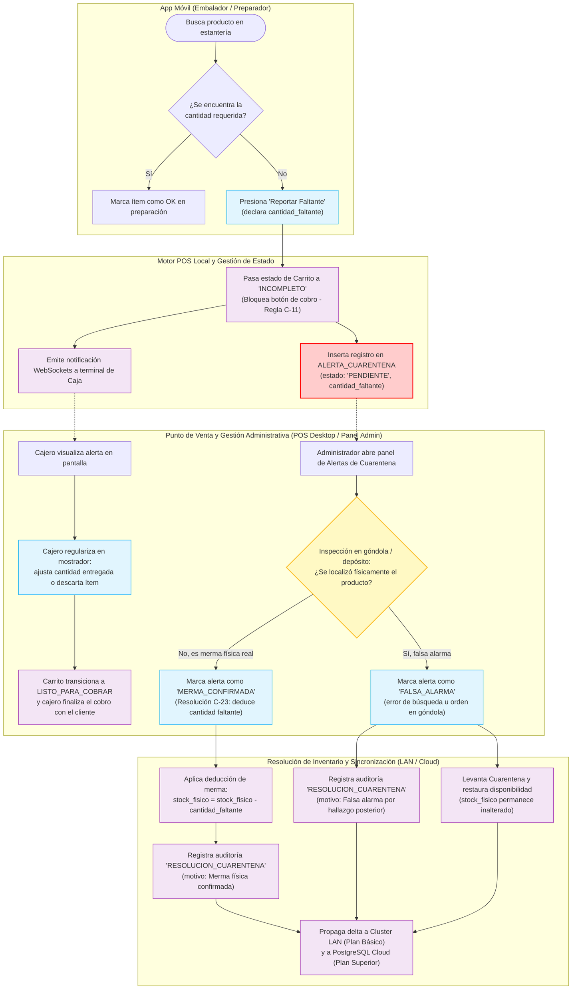

# Diagrama de Actividad: Reconciliación de Stock y Cuarentena de Faltantes

Este diagrama modela el flujo de trabajo desacoplado para la detección de productos faltantes durante la preparación de pedidos en tienda, la contención del carrito para evitar cobros erróneos, y la resolución administrativa de alertas de cuarentena distinguiendo entre **Merma Física Confirmada** y **Falsa Alarma** (Resolución C-23, ERS RF-14 y RF-21).
- **En Plan Básico (`BASICO_LOCAL`):** La resolución administrativa se ejecuta directamente en `pos-desktop` sobre SQLite local y se difunde a las demás cajas y móviles de la tienda vía LAN.
- **En Plan Superior (`SUPERIOR_CLOUD`):** Además de la actualización local, el delta de resolución y su auditoría se sincronizan hacia PostgreSQL Cloud.

---

## Especificaciones y Reglas de Negocio (Trazabilidad PAT)

### 1. Resolución Matemática de la Merma en Cuarentena (Resolución C-23)
- **El Problema del "Ajuste a 0":** Fijar el inventario en cero (`stock_fisico = 0`) ante un reporte de faltante es una práctica destructiva e incorrecta. Si el sistema registraba 10 unidades en stock, un cliente solicitó 2 unidades y el preparador no las halló, la discrepancia probada es de 2 unidades, no de 10. Forzar el stock a cero provocaría la pérdida contable de las 8 unidades restantes que bien podrían estar ubicadas en un pasillo secundario, en depósito o en exhibición.
- **Fórmula Universal y Correcta:**
  $$\text{stock\_fisico} = \text{stock\_fisico} - \text{cantidad\_faltante}$$
  De esta forma:
  - Si el stock registrado era 10 y faltaron 2: $10 - 2 = 8$.
  - Si el stock registrado era 2 y faltaron 2: $2 - 2 = 0$.
  - Si el administrador inspecciona toda la sucursal y constata que el estante está 100% desabastecido, puede ejecutar complementariamente un `AJUSTE_STOCK` a 0 con su debida justificación forense.

### 2. Tratamiento de Falsas Alarmas (Ruta B)
- Cuando el producto es hallado con posterioridad (por ejemplo, detrás de otra marca o mal ordenado por un cliente):
  - El `stock_fisico` **no se modifica** (nunca se había descontado).
  - La reserva temporal del pedido original ya había sido descartada al momento en que el cajero regularizó la venta frente al mostrador.
  - La alerta transiciona a `FALSA_ALARMA`, quedando registrada en `AUDITORIA` para proveer métricas operativas (detección de problemas recurrentes de ordenamiento o capacitación en góndola).
