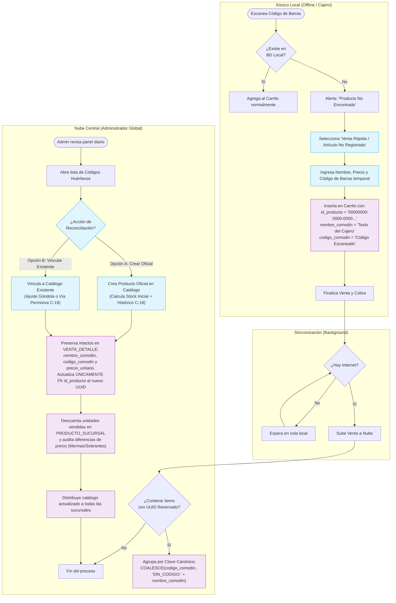

# Diagrama de Actividad: Resolución de Creación Offline — El "Producto Comodín"

Este diagrama modela el flujo de trabajo distribuido y resiliente para la operatoria offline en el punto de venta local (Kiosco / Cajero) ante productos huérfanos o no registrados, su encolamiento y posterior sincronización hacia la Nube Central, y el proceso de reconciliación administrativa garantizando la **inmutabilidad visual y fiscal del historial de ventas**.



---

## Especificaciones y Reglas de Negocio (Trazabilidad PAT)

### 1. Inmutabilidad del Snapshot Histórico y Clave Canónica de Agrupamiento (Resoluciones C-20 y O-27)
- **Principio Rector:** La tabla `VENTA_DETALLE` representa el testimonio fáctico e inmutable de una transacción comercial ya acontecida. 
- **Preservación Estricta:** Bajo ninguna circunstancia el proceso de reconciliación ejecuta un vaciado (`SET NULL`), borrado o alteración de los atributos descriptivos ingresados por el cajero:
  - `nombre_comodin`: Se mantiene inalterado para preservar la descripción textual original tipeada por el cajero.
  - `codigo_comodin`: Se mantiene inalterado para auditoría forense del código de barras escaneado físicamente.
  - `precio_unitario`: Se mantiene inalterado como congelamiento de precio exacto pactado y cobrado al cliente.
- **Clave Canónica de Agrupamiento (Resolución O-27):** Para evitar que comodines ingresados en mostrador sin código de barras queden huérfanos e invisibles, el panel de administración agrupa mediante la clave unificada:
  $$\text{clave\_agrupamiento} = \text{COALESCE}(\text{codigo\_comodin}, \text{'SIN\_CODIGO:'} \mathbin{\Vert} \text{TRIM}(\text{LOWER}(\text{nombre\_comodin})))$$
- **Mutación Exclusiva de Clave Foránea (FK):** La única modificación autorizada en `VENTA_DETALLE` durante la reconciliación es la actualización de la FK `id_producto`:
  ```sql
  UPDATE venta_detalle
  SET id_producto = :nuevo_id_producto_oficial
  WHERE id_producto = '00000000-0000-0000-0000-000000000000'
    AND (
      (:codigo_huerfano IS NOT NULL AND codigo_comodin = :codigo_huerfano)
      OR
      (:codigo_huerfano IS NULL AND codigo_comodin IS NULL AND TRIM(LOWER(nombre_comodin)) = TRIM(LOWER(:nombre_comodin)))
    );
  ```
- **Reimpresión Idéntica de Tickets:** Esta preservación garantiza que si un cliente solicita la reimpresión o consulta de un ticket emitido hace semanas bajo la figura del comodín, el comprobante conserve el texto exacto, precio original y código impreso en su momento, sin deformar la realidad histórica.

### 2. Integración con el Módulo de Inventario (Resoluciones C-18 y C-19)
- **Opción A (Creación de Producto Nuevo - C-18):** El Administrador declara el conteo físico real en góndola (`stock_fisico_actual`). El backend calcula el stock de inserción:
  $$\text{stock\_inicial\_calculado} = \text{stock\_fisico\_actual} + \text{vendidos\_historicos}$$
  Al consolidar la transacción, se inserta dicha cantidad en `PRODUCTO_SUCURSAL` y se restan las unidades vendidas, dejando las existencias finales exactamente iguales a lo contado en góndola.
- **Opción B (Vinculación a Catálogo Existente - C-19):** Si las existencias actuales no alcanzan para cubrir lo vendido, no se bloquea la operatoria. El Administrador cuenta con doble vía de acción:
  - **Vía A:** Ajuste manual del estante previo a la deducción con auditoría `AJUSTE_STOCK`.
  - **Vía B (Permisiva - Política C-12):** Deducción directa permitiendo stock negativo momentáneo y generando automáticamente una auditoría `DESCUADRE_STOCK_RECONCILIACION`.
