# Diagrama de Entidad-Relación (ERD) — Modelo Canónico de Datos

```mermaid
erDiagram

SUCURSAL {

uuid id PK

string nombre

string direccion

boolean en_linea

boolean activo

datetime created_at

datetime updated_at

datetime deleted_at

}

CONFIGURACION_SUCURSAL {

uuid id PK

uuid id_sucursal FK

string plan_activo

string modo_nodo_lan

string licencia_token

string lan_master_url

string cloud_endpoint_url

jsonb reglas_negocio

datetime ultima_modificacion

int version

datetime created_at

datetime updated_at

}

USUARIO {

uuid id PK

string nombre

string email

string password_hash

boolean es_dueno

boolean activo

datetime created_at

datetime updated_at

datetime deleted_at

}

USUARIO_SUCURSAL {

uuid id PK

uuid id_usuario FK

uuid id_sucursal FK

boolean activo

datetime created_at

datetime updated_at

}

PERMISO {

uuid id PK

string codigo

string modulo

string nombre

string descripcion

jsonb dependencias

boolean activo

}

USUARIO_PERMISO {

uuid id PK

uuid id_usuario FK

uuid id_sucursal FK

uuid id_permiso FK

datetime created_at

}

CATEGORIA {

uuid id PK

string nombre

}

PRODUCTO_GLOBAL {

uuid id PK

string nombre

string descripcion

uuid id_categoria FK

string tipo_venta

uuid id_producto_base FK

decimal multiplicador_stock

int version

boolean activo

datetime created_at

datetime updated_at

datetime deleted_at

}

CODIGO_BARRA {

string codigo PK

uuid id_producto FK

string tipo

boolean activo

datetime created_at

}

PRODUCTO_SUCURSAL {

uuid id PK

uuid id_sucursal FK

uuid id_producto FK

decimal precio_costo

decimal precio_minorista

decimal precio_mayorista

decimal precio_minorista_pendiente

decimal precio_mayorista_pendiente

datetime fecha_vigencia_pendiente

decimal stock_fisico

decimal stock_reservado

decimal stock_minimo

int version

boolean activo

datetime created_at

datetime updated_at

datetime deleted_at

}

PROMOCION {

uuid id PK

uuid id_sucursal FK

string nombre

string descripcion

datetime fecha_inicio

datetime fecha_fin

int cantidad_minima

int cantidad_maxima

string tipo_efecto

decimal valor_efecto

int version

boolean activo

datetime created_at

datetime updated_at

datetime deleted_at

}

PROMOCION_PRODUCTO {

uuid id PK

uuid id_promocion FK

uuid id_producto FK

decimal cantidad_requerida

datetime created_at

}

PROVEEDOR {

uuid id PK

string razon_social

string cuit

boolean activo

datetime created_at

datetime updated_at

datetime deleted_at

}

DICCIONARIO_PROVEEDOR {

uuid id PK

uuid id_proveedor FK

uuid id_producto FK

string nombre_en_factura

datetime created_at

datetime updated_at

}

TRANSFERENCIA_STOCK {

uuid id PK

uuid id_sucursal_origen FK

uuid id_sucursal_destino FK

uuid id_usuario_envia FK

uuid id_usuario_recibe FK

string estado

datetime fecha_envio

datetime fecha_recepcion

string motivo_discrepancia

datetime fecha_resolucion_discrepancia

uuid id_usuario_resuelve_discrepancia FK

int version

datetime created_at

datetime updated_at

}

TRANSFERENCIA_DETALLE {

uuid id PK

uuid id_transferencia FK

uuid id_producto FK

decimal cantidad_enviada

decimal cantidad_recibida

string estado_item

datetime created_at

}

CLIENTE {

uuid id PK

uuid id_sucursal FK

string nombre

decimal limite_credito

decimal saldo_deudor

boolean requiere_revision

int version

boolean activo

datetime created_at

datetime updated_at

datetime deleted_at

}

CUENTA_CORRIENTE {

uuid id PK

uuid id_cliente FK

uuid id_venta FK

uuid id_nota_credito FK

uuid id_metodo_pago FK

decimal monto

string tipo_movimiento

datetime fecha

datetime created_at

datetime updated_at

}

VENTA {

uuid id PK

string numero_comprobante

uuid id_sucursal FK

uuid id_turno_caja FK

uuid id_usuario FK

uuid id_cliente FK

decimal total

datetime fecha

string estado_logistico

string estado_financiero

string estado_general

boolean tiene_devolucion_parcial

boolean es_compartido

datetime fecha_expiracion_reserva

int version

datetime created_at

datetime updated_at

datetime deleted_at

}

VENTA_DETALLE {

uuid id PK

uuid id_venta FK

uuid id_producto FK

decimal cantidad

decimal precio_unitario

uuid id_promocion_aplicada FK

decimal monto_descuento

string tipo_precio

string codigo_comodin

string nombre_comodin

datetime created_at

}

PAGO_VENTA {

uuid id PK

uuid id_venta FK

uuid id_metodo_pago FK

decimal monto

datetime created_at

}

METODO_PAGO {

uuid id PK

string nombre

boolean afecta_caja_fisica

boolean activo

datetime created_at

datetime updated_at

}

TURNO_CAJA {

uuid id PK

uuid id_sucursal FK

uuid id_usuario FK

datetime fecha_apertura

datetime fecha_cierre

decimal monto_inicial_efectivo

decimal efectivo_declarado

decimal diferencia_caja

string estado

decimal efectivo_rectificado

datetime fecha_rectificacion

uuid id_usuario_rectifica FK

datetime created_at

datetime updated_at

}

MOVIMIENTO_CAJA {

uuid id PK

uuid id_turno_caja FK

uuid id_metodo_pago FK

string tipo_movimiento

decimal monto

string concepto

boolean afecta_caja_fisica

datetime fecha

datetime created_at

datetime updated_at

}

AUDITORIA {

uuid id PK

uuid id_usuario FK

string tabla_afectada

uuid id_registro_afectado

string accion

jsonb valor_anterior

jsonb valor_nuevo

datetime fecha

string motivo

}

%% --- DEVOLUCIONES (Notas de Crédito) ---

NOTA_CREDITO {

uuid id PK

string numero_comprobante

uuid id_venta FK

uuid id_cliente FK

uuid id_usuario FK

uuid id_turno_caja FK

decimal monto_total

string tipo_devolucion

string motivo

datetime fecha

datetime created_at

datetime updated_at

}

NOTA_CREDITO_DETALLE {

uuid id PK

uuid id_nota_credito FK

uuid id_producto FK

decimal cantidad

decimal precio_unitario_momento

decimal monto_descuento

decimal subtotal

boolean devuelto_a_inventario

datetime created_at

}

%% --- RECEPCIÓN DE MERCADERÍA (WIP / Offline Proof) ---

RECEPCION_MERCADERIA {

uuid id PK

uuid id_sucursal FK

uuid id_proveedor FK

uuid id_usuario FK

string estado

string numero_remito

decimal total_bultos

datetime fecha_inicio

datetime fecha_completado

int version

datetime created_at

datetime updated_at

}

RECEPCION_MERCADERIA_DETALLE {

uuid id PK

uuid id_recepcion_mercaderia FK

uuid id_producto FK

decimal cantidad_declarada

decimal cantidad_recibida

decimal costo_unitario

decimal costo_anterior

decimal precio_venta_sugerido

boolean aplicar_precio_sugerido

string estado_discrepancia

datetime created_at

}

%% --- INVENTARIO Y RECONCILIACIÓN ---

ALERTA_CUARENTENA {

uuid id PK

uuid id_sucursal FK

uuid id_producto FK

uuid id_venta FK

decimal cantidad_faltante

string estado

uuid id_usuario_reporta FK

uuid id_usuario_resuelve FK

datetime fecha_reporte

datetime fecha_resolucion

datetime created_at

datetime updated_at

}

%% --- SINCRONIZACIÓN LOCAL-FIRST ---

SYNC_CURSOR {

uuid id PK

uuid id_sucursal FK

string nodo_destino

datetime last_pulled_at

datetime last_pushed_at

int schema_version

datetime updated_at

}

%% --- Relaciones originales ---

SUCURSAL ||--o{ USUARIO_SUCURSAL : "tiene"

USUARIO ||--o{ USUARIO_SUCURSAL : "trabaja en"

SUCURSAL ||--o{ CLIENTE : "tiene"

CATEGORIA ||--o{ PRODUCTO_GLOBAL : "clasifica"

PRODUCTO_GLOBAL ||--o{ PRODUCTO_GLOBAL : "es pack de (recursiva)"

PRODUCTO_GLOBAL ||--o{ CODIGO_BARRA : "identifica"

PRODUCTO_GLOBAL ||--o{ PRODUCTO_SUCURSAL : "instancia local"

PROMOCION ||--|{ PROMOCION_PRODUCTO : "aplica a"

PRODUCTO_GLOBAL ||--o{ PROMOCION_PRODUCTO : "incluido en"

SUCURSAL |o--o{ PROMOCION : "aplica en (NULL = global)"

SUCURSAL ||--o{ PRODUCTO_SUCURSAL : "almacena"

PROVEEDOR ||--o{ DICCIONARIO_PROVEEDOR : "utiliza"

PRODUCTO_GLOBAL ||--o{ DICCIONARIO_PROVEEDOR : "mapea a"

%% --- Transferencias desdobladas (Resolución O-06 y O-08) ---

SUCURSAL ||--o{ TRANSFERENCIA_STOCK : "origen de despacho"

SUCURSAL ||--o{ TRANSFERENCIA_STOCK : "destino de recepción"

USUARIO ||--o{ TRANSFERENCIA_STOCK : "despacha"

USUARIO |o--o{ TRANSFERENCIA_STOCK : "recibe"

USUARIO |o--o{ TRANSFERENCIA_STOCK : "resuelve discrepancia de"

TRANSFERENCIA_STOCK ||--|{ TRANSFERENCIA_DETALLE : "contiene"

PRODUCTO_GLOBAL ||--o{ TRANSFERENCIA_DETALLE : "involucra"

CLIENTE |o--o{ VENTA : "realiza"

CLIENTE ||--o{ CUENTA_CORRIENTE : "posee historial en"

VENTA ||--o{ CUENTA_CORRIENTE : "genera cargo en"

NOTA_CREDITO |o--o{ CUENTA_CORRIENTE : "restituye saldo en"

VENTA ||--|{ VENTA_DETALLE : "compuesta por"

VENTA ||--o{ PAGO_VENTA : "se compone de"

PRODUCTO_GLOBAL ||--o{ VENTA_DETALLE : "vendido en"

PROMOCION |o--o{ VENTA_DETALLE : "generó descuento en"

SUCURSAL ||--o{ VENTA : "registra"

USUARIO ||--o{ VENTA : "cobra"

METODO_PAGO ||--o{ PAGO_VENTA : "clasifica"

METODO_PAGO ||--o{ MOVIMIENTO_CAJA : "clasifica medio de"

METODO_PAGO |o--o{ CUENTA_CORRIENTE : "medio de abono en"

SUCURSAL ||--o{ TURNO_CAJA : "aloja"

USUARIO ||--o{ TURNO_CAJA : "abre/cierra"

TURNO_CAJA ||--o{ VENTA : "agrupa"

TURNO_CAJA ||--o{ MOVIMIENTO_CAJA : "registra eventos de"

SUCURSAL ||--|| CONFIGURACION_SUCURSAL : "posee reglas de"

%% --- [NUEVO] Relaciones de permisos y modelo PBAC ---

USUARIO ||--o{ USUARIO_PERMISO : "posee"

SUCURSAL ||--o{ USUARIO_PERMISO : "delimita ámbito de"

PERMISO ||--o{ USUARIO_PERMISO : "otorgado en"

%% --- Relaciones de Notas de Crédito ---

VENTA ||--o{ NOTA_CREDITO : "sufre devoluciones en"

CLIENTE |o--o{ NOTA_CREDITO : "recibe compensación"

USUARIO ||--o{ NOTA_CREDITO : "emite"

TURNO_CAJA ||--o{ NOTA_CREDITO : "extrae dinero de"

NOTA_CREDITO ||--|{ NOTA_CREDITO_DETALLE : "detalla artículos"

PRODUCTO_GLOBAL ||--o{ NOTA_CREDITO_DETALLE : "es devuelto en"

%% --- Relaciones de Recepción de Proveedores ---

SUCURSAL ||--o{ RECEPCION_MERCADERIA : "ingresa stock a"

PROVEEDOR ||--o{ RECEPCION_MERCADERIA : "abastece"

USUARIO ||--o{ RECEPCION_MERCADERIA : "procesa"

RECEPCION_MERCADERIA ||--|{ RECEPCION_MERCADERIA_DETALLE : "contiene bultos"

PRODUCTO_GLOBAL ||--o{ RECEPCION_MERCADERIA_DETALLE : "es ingresado por"

%% --- Relaciones de Auditoría, Cuarentena y Sincronización ---

USUARIO ||--o{ AUDITORIA : "registra mutación en"

SUCURSAL ||--o{ ALERTA_CUARENTENA : "registra faltantes en"

PRODUCTO_GLOBAL ||--o{ ALERTA_CUARENTENA : "sufre faltante en"

VENTA ||--o{ ALERTA_CUARENTENA : "asociada a preparación de"

USUARIO ||--o{ ALERTA_CUARENTENA : "reporta/resuelve"

SUCURSAL ||--o{ SYNC_CURSOR : "mantiene progreso en"
```

---

## Especificación de Entidades de Planes Comerciales y Sincronización Polimórfica (RF-18, RF-21)

### 1. Entidad `CONFIGURACION_SUCURSAL`

| Columna | Tipo | Restricción | Explicación Conceptual y Regla de Negocio |
| :--- | :--- | :--- | :--- |
| `id` | `uuid` | `PK, NOT NULL` | Identificador único universal (UUIDv4) del registro de configuración. |
| `id_sucursal` | `uuid` | `FK, UNIQUE, NOT NULL` | Sucursal física a la que pertenece esta configuración (relación 1:1). |
| `plan_activo` | `string` | `NOT NULL` | Nivel comercial activo: `'BASICO_LOCAL'` (Monosucursal Autónomo con Cluster LAN Multi-Caja) o `'SUPERIOR_CLOUD'` (Multisucursal Distribuido Híbrido). |
| `modo_nodo_lan` | `string` | `NOT NULL` | Rol de la terminal dentro del Cluster LAN de la sucursal: `'MAESTRO_LAN'` (PC Caja Principal que aloja el Hub SQLite y Gateway WebSocket LAN) o `'SECUNDARIO_LAN'` (cajas adicionales que sincronizan contra el Maestro LAN). |
| `licencia_token` | `string` | `NULLABLE` | Token criptográfico firmado (JWT RS256/Ed25519) verificado offline por `pos-desktop` para habilitar el Plan Superior y desbloquear *Feature Flags*. |
| `lan_master_url` | `string` | `NULLABLE` | Dirección IP/Puerto en la red local del Nodo Maestro LAN (ej. `http://192.168.1.100:4000`) consumida por las cajas `SECUNDARIO_LAN` y móviles `embalador-mobile`. |
| `cloud_endpoint_url` | `string` | `NULLABLE` | URL del backend NestJS en la nube (`NULL` en Plan Básico; obligatorio en Plan Superior). |
| `reglas_negocio` | `jsonb` | `NOT NULL` | Objeto JSONB tipado (`IReglasNegocioSucursal`) que contiene las políticas operativas (`comportamiento_precios`, `ttl_carrito_minutos`, `politica_stock: 'UNIVERSAL_PERMISIVO'`) y el diccionario `feature_toggles` (`sincronizacion_cloud`, `sincronizacion_lan_multicaja`, `catalogo_multisucursal`, `transferencias_inter_sucursal`, `clientes_inter_sucursal`, `reconciliacion_local`). |
| `ultima_modificacion` | `datetime` | `NOT NULL` | Marca de tiempo ISO-8601 UTC de la última modificación administrativa. |
| `version` | `int` | `NOT NULL` | Entero secuencial para Control de Concurrencia Optimista (OCC - RNF-04). |
| `created_at` / `updated_at` | `datetime` | `NOT NULL` | Marcas temporales de auditoría y sincronización por cursores. |

### 2. Entidad `SYNC_CURSOR`

| Columna | Tipo | Restricción | Explicación Conceptual y Regla de Negocio |
| :--- | :--- | :--- | :--- |
| `id` | `uuid` | `PK, NOT NULL` | Identificador único universal (UUIDv4) del puntero de sincronización. |
| `id_sucursal` | `uuid` | `FK, NOT NULL` | Sucursal titular del cursor de sincronización. |
| `nodo_destino` | `string` | `NOT NULL` | Discriminador del destino de sincronización: `'LAN_MASTER'` (usado por cajas `SECUNDARIO_LAN` sincronizando contra el `MAESTRO_LAN` en Plan Básico o Superior) o `'CLOUD_CENTRAL'` (usado para sincronizar la sucursal contra PostgreSQL en el Plan Superior). |
| `last_pulled_at` | `datetime` | `NULLABLE` | Marca de tiempo ISO-8601 UTC de alta precisión (con milisegundos) del último *Pull* exitoso (`NULL` antes del *Bootstrap Catch-Up* inicial). |
| `last_pushed_at` | `datetime` | `NULLABLE` | Marca de tiempo ISO-8601 UTC del último *Push* de deltas confirmado. |
| `schema_version` | `int` | `NOT NULL` | Versión del esquema de WatermelonDB/SQLite sincronizado. |
| `updated_at` | `datetime` | `NOT NULL` | Timestamp de la última actualización del cursor. |

### 3. Invariancia de Esquema Relacional entre Planes Comerciales ($N = 1$ vs. $N \ge 1$)

El modelo de datos de 24 tablas es **100% invariante** entre el Plan Básico y el Plan Superior:
1. **Sucursal por Defecto ($N = 1$) en Plan Básico:** Toda instalación en `BASICO_LOCAL` inicializa automáticamente una única fila en `SUCURSAL` y separa los metadatos de catálogo (`PRODUCTO_GLOBAL`, `CODIGO_BARRA`) de las existencias y precios operativos (`PRODUCTO_SUCURSAL`).
2. **Escalabilidad Transparente (*Zero-Migration Upgrade*):** Como todos los registros creados en las terminales del Plan Básico utilizan identificadores `UUIDv4` y control OCC (`version`), activar el Plan Superior mediante `licencia_token` no requiere ninguna migración estructural (`ALTER TABLE`). El Nodo Maestro LAN simplemente ejecuta un *Bootstrap Catch-Up Push* inicial (`last_pulled_at = NULL` hacia `nodo_destino = 'CLOUD_CENTRAL'`) volcando sus registros a PostgreSQL y habilitando de inmediato la creación de las sucursales $2..N$.

