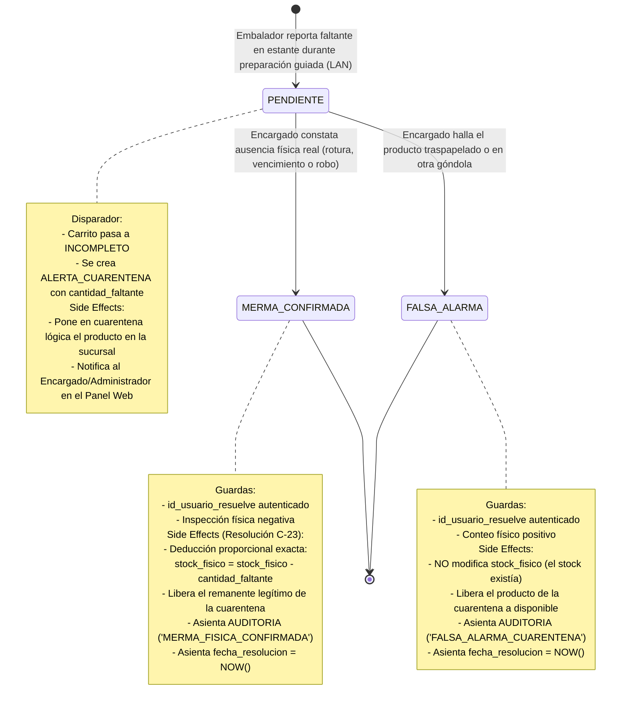

# Diagrama de Máquina de Estados: Ciclo de Vida de Alerta de Cuarentena

Este diagrama formaliza el ciclo de vida de la entidad `ALERTA_CUARENTENA`, vinculando la detección de faltantes durante la preparación guiada de pedidos en terminal móvil con la resolución forense en mostrador/depósito conforme a **ERS RF-03**, **RF-13**, **RF-19** y la resolución arquitectónica **C-23**.

## Reglas de Negocio del Flujo de Cuarentena

1. **Aislamiento por Sucursal (C-22 y C-23):** La alerta y su eventual merma aplican exclusivamente a `PRODUCTO_SUCURSAL` del local emisor (`WHERE id_producto = :id AND id_sucursal = :sucursal`).
2. **Deducción No Destructiva (C-23):** Se prohíbe terminantemente "ajustar a 0" las existencias si faltaban menos unidades de las que figuraban en el sistema (ej. si el sistema marcaba 10 y faltaron 2, el stock se ajusta a 8, preservando las 8 unidades reales encontradas).
3. **Auditoría Forense Obligatoria:** Tanto la confirmación de merma como la falsa alarma exigen registrar al usuario responsable y un motivo textual explicativo en la tabla `AUDITORIA`.
