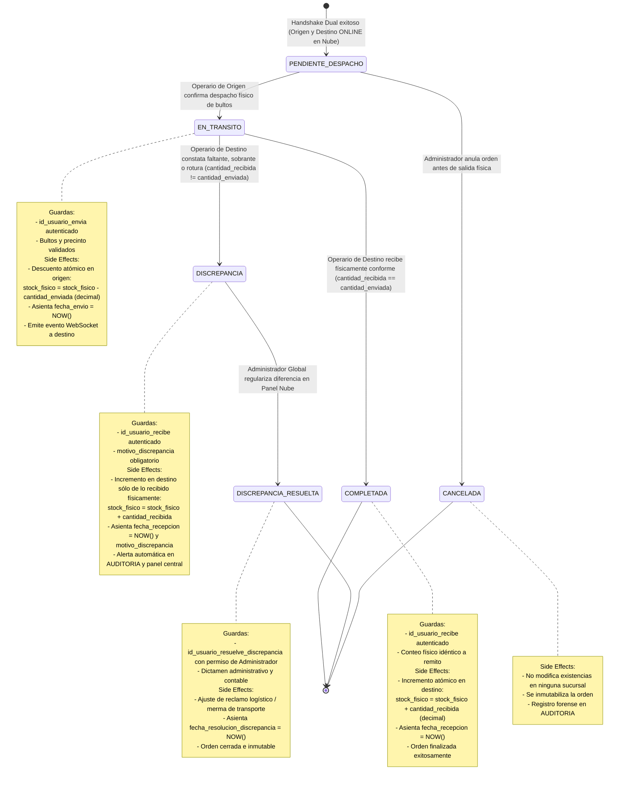

# Diagrama de Máquina de Estados: Ciclo de Vida de Transferencia de Stock

> **Alcance por Plan Comercial (ERS RF-16 y RF-21):** `[Exclusivo Plan Superior — plan_activo = 'SUPERIOR_CLOUD' y feature_toggles.transferencias_inter_sucursal = true]`. En el Plan Básico Monosucursal (`BASICO_LOCAL`, $N = 1$), la tabla `TRANSFERENCIA_STOCK` permanece vacía (0 filas) en SQLite local para preservar invariancia de esquema sin costo de almacenamiento.

Este diagrama modela el ciclo de vida riguroso de una transferencia física de stock entre sucursales (`TRANSFERENCIA_STOCK`), formalizando las transiciones de estado, condiciones de guarda y efectos colaterales (*Side Effects*) en cumplimiento estricto de **ERS RF-16**, **RNF-03**, y las resoluciones de arquitectura **C-24** (Handshake Dual Online) y **O-08** (Soporte Decimal y Cierre de Discrepancias).

## Reglas de Integridad y Transiciones

1. **Precondición Dual (C-24):** El estado `PENDIENTE_DESPACHO` únicamente puede generarse si la API central confirma que `SUCURSAL.en_linea = true` para ambas tiendas involucradas.
2. **Inexistencia de Re-enrutamiento:** Una orden `EN_TRANSITO` jamás puede cambiar de destino en vuelo. Si la carga física debe redirigirse a una tercera sucursal, primero debe completarse la recepción en destino y luego emitir una nueva orden.
3. **Precisión Decimal (O-08):** Todo cálculo de descuento e incremento en `PRODUCTO_SUCURSAL.stock_fisico` respeta el tipo de dato `decimal`, asegurando trazabilidad para productos a granel o pesables sin pérdida de precisión.
