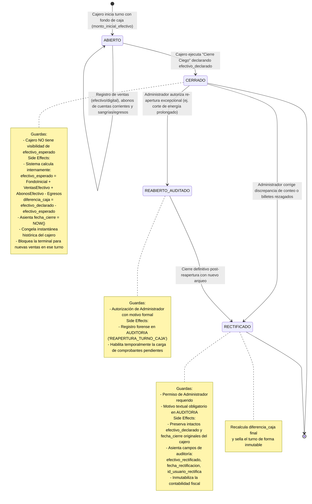

# Diagrama de Máquina de Estados: Ciclo de Vida de Turno de Caja

Este diagrama formaliza el ciclo de vida de la entidad `TURNO_CAJA`, garantizando la coexistencia armoniosa entre el principio de **Instantánea Contable Inmutable** (POSLyon.md) y la capacidad de **Rectificación y Re-apertura Auditada por Administrador** (ERS RF-17), eliminando la ambigüedad señalada en el hallazgo **O-16**.

## Principios Arquitectónicos del Ciclo de Turno

1. **Cierre Ciego Estricto (RF-17):** El cajero declara el monto físico en gaveta sin conocer el valor esperado calculado por el software, impidiendo la sustracción o compensación manual de sobrantes.
2. **Inmutabilidad de la Declaración Original:** El paso al estado `RECTIFICADO` jamás sobrescribe lo que el cajero declaró al cerrar su turno. Ambas cifras (lo declarado originalmente por el operario y lo rectificado por la supervisión) se conservan con fines forenses y análisis de desempeño.
3. **Vínculo Transaccional con Ventas (C-06):** Toda venta confirmada referencia obligatoriamente `id_turno_caja`, permitiendo reconstruir en cualquier momento el libro diario y arqueo del turno.
