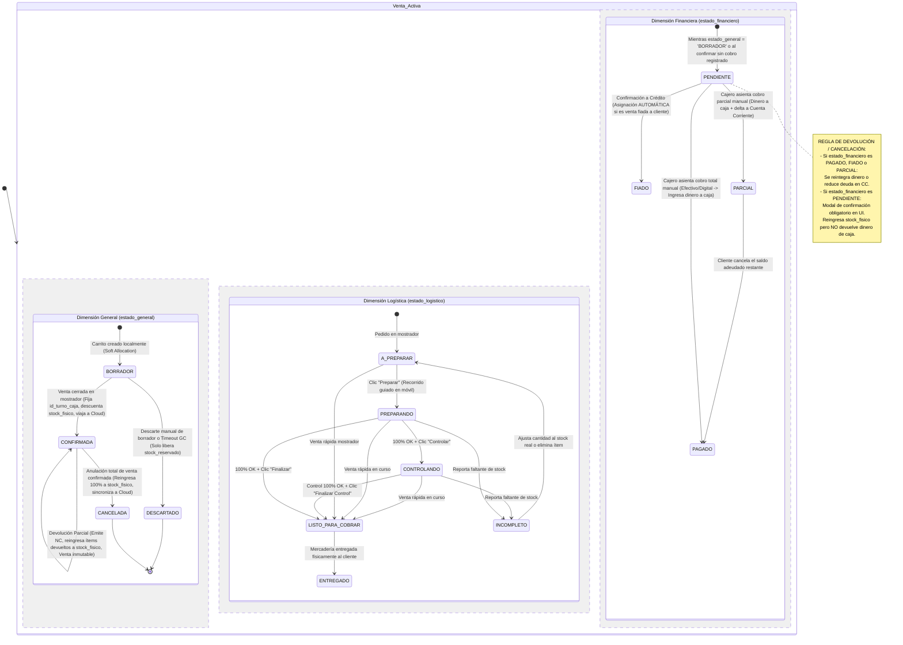

# Diagrama de Máquina de Estados de Venta (Dimensiones Ortogonales)

## 1. Propósito Arquitectónico

Para evitar una explosión combinatoria de estados interdependientes y eliminar inconsistencias entre el cobro, la logística y la anulación, la entidad `VENTA` implementa el patrón de **Máquinas de Estado Ortogonales**, segmentando su ciclo de vida en tres columnas independientes y concurrentes en la base de datos:

1. **`estado_general`:** Refleja la validez transaccional y persistencia base de la venta (`BORRADOR`, `CONFIRMADA`, `CANCELADA`, `DESCARTADO`).
   - `BORRADOR`: Carrito en preparación o edición en mostrador. Reside únicamente en SQLite local.
   - `DESCARTADO`: Carrito en borrador abandonado o expirado por Garbage Collection. Libera `stock_reservado`; nunca tocó `stock_fisico` ni dinero.
   - `CONFIRMADA`: Venta cerrada legal y operativamente. Fija `id_turno_caja`, descuenta `stock_fisico` y viaja vía Push Delta a PostgreSQL en la Nube.
   - `CANCELADA`: **Anulación formal de una venta previamente `CONFIRMADA`**. Reingresa el 100% de los productos al `stock_fisico`, evalúa reintegro monetario y sincroniza la anulación a la Nube.
2. **`estado_logistico`:** Refleja el proceso operativo de preparación, control y entrega física (`A_PREPARAR`, `PREPARANDO`, `CONTROLANDO`, `INCOMPLETO`, `LISTO_PARA_COBRAR`, `ENTREGADO`).
3. **`estado_financiero`:** Refleja la situación contable histórica del cobro (`PENDIENTE`, `PAGADO`, `FIADO`, `PARCIAL`).
   - **Momento de Impacto en Caja:** La confirmación de la venta **no genera movimiento de caja automático**. La caja se impacta **únicamente cuando el cajero manualmente asienta el pago** pasando la venta a `PAGADO` o `PARCIAL`.
   - **Asignación Automática de `FIADO`:** Si la venta se cierra a crédito sobre un cliente (`id_cliente != null`), el sistema asigna automáticamente `estado_financiero = 'FIADO'` (asentando el cargo en `CUENTA_CORRIENTE`), sin impacto en caja física.
   - **Guarda de Devolución/Cancelación en `PENDIENTE`:** Si una venta está en `PENDIENTE`, el sistema advierte mediante un modal de confirmación que no hubo dinero ingresado en su momento; al confirmar la anulación o devolución, se reingresa el stock físico pero **jamás se extrae dinero de caja**.

---

## 2. Diagrama de Estados Ortogonales (Mermaid.js)



---

## 3. Matriz de Estados Ortogonales y Transiciones Válidas

| Dimensión | Estados Válidos | Momento de Transición | Regla de Negocio / Efecto Secundario |
|---|---|---|---|
| **`estado_general`** | `BORRADOR` | Creación de carrito en mostrador o móvil | Mercadería en `stock_reservado`. Reside únicamente en SQLite local. |
| | `DESCARTADO` | Descarte manual de borrador o timeout de GC | Libera `stock_reservado`. No altera `stock_fisico` ni finanzas. Permanece 100% local. |
| | `CONFIRMADA` | Cierre formal de la venta | Atómico en SQLite, fija `id_turno_caja`, descuenta `stock_fisico` y viaja vía Push Delta a PostgreSQL. |
| | `CANCELADA` | Anulación formal de venta confirmada | **Solo transiciona desde `CONFIRMADA`**. Reingresa el 100% de productos a `stock_fisico`, evalúa dinero según `estado_financiero` y sincroniza a Cloud. |
| **`estado_logistico`** | `A_PREPARAR` | Inicio de carga de artículos | Carrito editable en mostrador. |
| | `PREPARANDO` | Operador abre pedido en celular | UI guiada con *highlight* sobre el producto activo, opacando el resto. |
| | `CONTROLANDO` | Segunda revisión por otro operador | Verificación cruzada ítem por ítem antes del despacho. |
| | `INCOMPLETO` | Se detecta stock físico menor al pedido | **Bloqueo estricto de cobro (C-11)**. Requiere rectificar el carrito en mostrador. |
| | `LISTO_PARA_COBRAR` | Ítems 100% conformes (OK) | Pedido cerrado en bolsa, esperando al cajero para el pago. |
| | `ENTREGADO` | Entrega de artículos al cliente | Despacho físico de mercadería. |
| **`estado_financiero`**| `PENDIENTE` | Al abrir borrador o al confirmar sin cobro inmediato | **No genera movimiento de caja**. Dinero aún no recibido. |
| | `FIADO` | Al confirmar venta a cuenta corriente | **Asignación automática**. Asienta débito en `CUENTA_CORRIENTE`. No mueve caja física. |
| | `PAGADO` | Al asentar cobro total manual en caja | Cajero registra el cobro. Inserta en `PAGO_VENTA` e impacta efectivo en `TURNO_CAJA`. |
| | `PARCIAL` | Al asentar cobro parcial manual en caja | Inserta pago en `PAGO_VENTA` y delta residual a deuda en `CUENTA_CORRIENTE`. |

---

## 4. Protocolo de Devolución y Cancelación según `estado_financiero`

Al anular totalmente una venta (`CONFIRMADA -> CANCELADA`) o al emitir una Nota de Crédito por devolución parcial de productos:

```typescript
function evaluarImpactoMonetarioDevolucion(venta: IVenta, montoDevolucion: number): AccionFinancieraDevolucion {
  switch (venta.estado_financiero) {
    case EstadoFinanciero.PAGADO:
      // El dinero ingresó físicamente o digitalmente en su momento
      return { devolverDineroCaja: true, montoCaja: montoDevolucion, ajustarCuentaCorriente: 0, requiereConfirmacionPendiente: false };

    case EstadoFinanciero.FIADO:
      // El cliente no entregó efectivo; se amortiza su saldo deudor en cuenta corriente
      return { devolverDineroCaja: false, montoCaja: 0, ajustarCuentaCorriente: montoDevolucion, requiereConfirmacionPendiente: false };

    case EstadoFinanciero.PARCIAL:
      // Se evalúa cuánto pagó en efectivo vs cuánto quedó adeudado
      return { devolverDineroCaja: true, montoCaja: montoDevolucion, ajustarCuentaCorriente: 0, requiereConfirmacionPendiente: false };

    case EstadoFinanciero.PENDIENTE:
      // El dinero NUNCA ingresó a caja. No se debe reintegrar efectivo para no descuadrar el arqueo.
      return {
        devolverDineroCaja: false,
        montoCaja: 0,
        ajustarCuentaCorriente: 0,
        requiereConfirmacionPendiente: true, // Dispara modal de confirmación en UI
        mensajeAlerta: 'Atención: Esta venta se encuentra en estado financiero PENDIENTE. El dinero no ingresó a caja en su momento. Los productos reingresarán al stock físico pero NO se registrará egreso de dinero en caja.'
      };
  }
}
```
