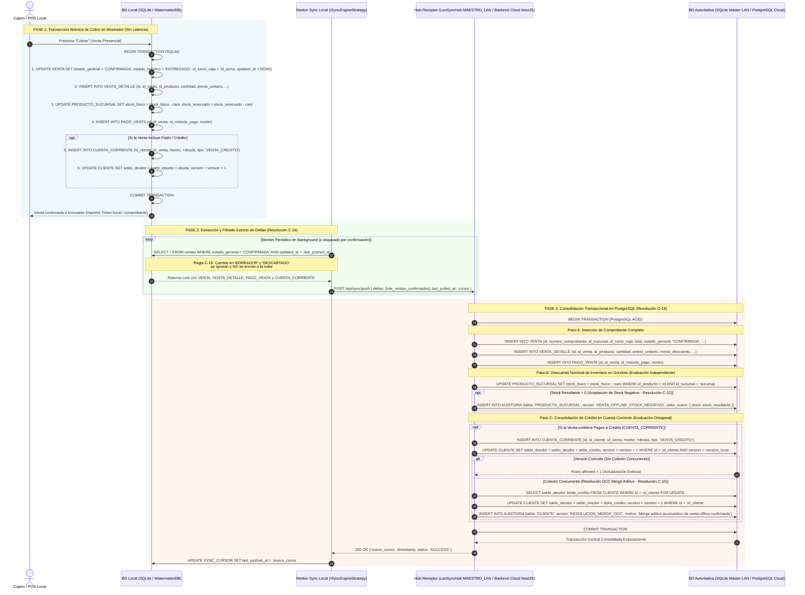

# Diagrama de Secuencia: Flujo de Sincronización Local-First y Push Delta (Cluster LAN / Nube)

## 1. Propósito Arquitectónico

Este diagrama formaliza el flujo de sincronización asíncrona por deltas (*Push Delta*) desde la base de datos local SQLite (WatermelonDB) hacia el nodo autoritativo correspondiente según el Plan Comercial activo (**ERS RF-21**), resolviendo íntegramente las ambigüedades arquitectónicas documentadas en **C-10**, **C-12**, **C-16** y **O-18**:
- **En Plan Básico Monosucursal (`BASICO_LOCAL` Multi-Caja):** Las terminales `SECUNDARIO_LAN` sincronizan mediante `LanClusterSyncStrategy` (`SYNC_CURSOR.nodo_destino = 'LAN_MASTER'`) hacia el `LanSyncHub` embebido en la Caja Maestra (`MAESTRO_LAN`, SQLite WAL), sin tráfico hacia internet.
- **En Plan Superior Multisucursal (`SUPERIOR_CLOUD`):** El nodo sincroniza mediante `CloudMultiBranchSyncStrategy` (`SYNC_CURSOR.nodo_destino = 'CLOUD_CENTRAL'`) hacia el backend central PostgreSQL (`backend-cloud` en NestJS). Cuando un comercio sube desde el Plan Básico al Plan Superior, el cursor para `'CLOUD_CENTRAL'` inicia en `null` y este mismo flujo ejecuta el **Bootstrap Catch-Up Push** inicial subiendo todo el catálogo e historial confirmado sin migración de tablas.

Garantiza:
1. **Filtrado Estricto de Carga (Resolución C-16):** El worker de sincronización escanea y sube **únicamente** transacciones con `estado_general = 'CONFIRMADA'`. Los carritos en `BORRADOR` y las reservas expiradas en `DESCARTADO` residen y fenecen exclusivamente en el almacenamiento local de la terminal.
2. **Evaluación Ortogonal e Independiente de Conflictos (Resolución O-18):** El impacto en el inventario y la actualización de crédito a clientes son tratados como **dos flujos concurrentes e independientes** dentro de la misma transacción ACID del nodo autoritativo, desterrando el antipatrón de modelarlos como ramas `alt/else` mutuamente excluyentes (una venta puede tener simultáneamente stock negativo y colisión de crédito).
3. **Persistencia Completa y Descuento Nominal de Stock (Resolución O-18):** Se ilustra explícitamente la inserción de cabecera `VENTA`, renglones `VENTA_DETALLE` y pagos `PAGO_VENTA`, así como el descuento normal de existencias físicas (`UPDATE PRODUCTO_SUCURSAL SET stock_fisico = stock_fisico - cantidad`), registrando alertas forenses solo si el stock resultante pasa a valores negativos.
4. **Merge Aditivo Acumulativo OCC (Resolución C-10):** Si la venta incluye pagos a crédito (`CUENTA_CORRIENTE`), el nodo receptor valida el campo `version` del cliente. Si detecta una colisión concurrente, ejecuta un bloqueo transaccional y aplica un merge aditivo acumulativo (`saldo_deudor = saldo_deudor + delta`), protegiendo la integridad del libro mayor.

---

## 2. Diagrama de Secuencia (Mermaid.js)

---

## 3. Matriz de Filtrado y Persistencia según Dimensión General

| Estado General | ¿Se persiste en SQLite Local? | ¿Se sincroniza a PostgreSQL Nube? | Justificación Arquitectónica (C-16 y Ciclo de Vida) |
|---|---|---|---|
| `BORRADOR` | **SÍ** | **NO** | Reside estrictamente en SQLite local. Evita saturar la base central con carritos temporales o en armado. Solo reserva stock (`stock_reservado`). |
| `DESCARTADO` | **SÍ** (marca local) | **NO** | Carrito en borrador cancelado por el cajero o purgado por Garbage Collection. Solo libera `stock_reservado`; nunca afectó `stock_fisico` ni dinero. Permanece local. |
| `CONFIRMADA` | **SÍ** | **SÍ** | Venta legal, fiscal y físicamente consumada. Descuenta `stock_fisico`, fija `id_turno_caja` y viaja vía Push Delta a PostgreSQL. |
| `CANCELADA` | **SÍ** | **SÍ** | **Anulación formal de una venta previamente `CONFIRMADA`**. Reingresa el 100 % de los productos al `stock_fisico`, evalúa reintegro monetario según `estado_financiero` y se sincroniza a la Nube para anular la transacción remota y registrar la auditoría forense. |
