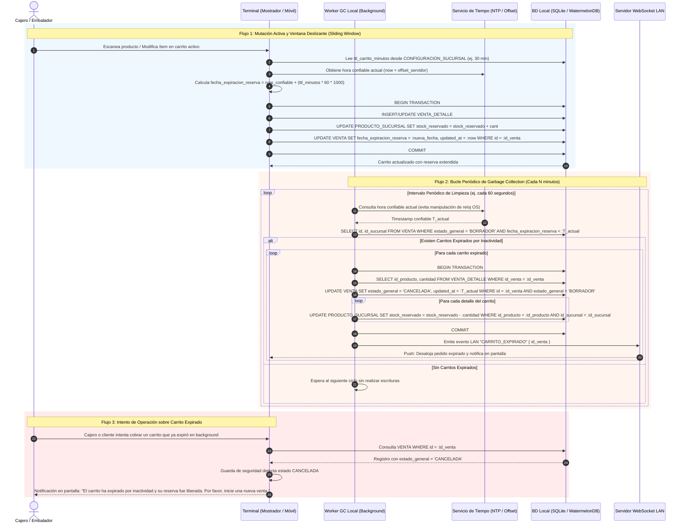

# Diagrama de Secuencia: Proceso de Garbage Collection y Expiración de Carritos

## 1. Propósito Arquitectónico

Este diagrama formaliza el mecanismo de limpieza automática de carritos abandonados (*Garbage Collection*) en la arquitectura Local-First de POSLyon, resolviendo de forma conjunta los hallazgos **C-13** y **C-14**.

Garantiza:
1. **Configuración Dinámica del TTL (Resolución C-13):** El tiempo de vida de la reserva se calcula dinámicamente mediante `CONFIGURACION_SUCURSAL.reglas_negocio.ttl_carrito_minutos` (ej. 30 minutos) descargado en la sucursal, eliminando cualquier referencia errónea a la hora de actualización diferida de precios.
2. **Alcance Universal sobre Estados en Borrador (Resolución C-14):** La expiración aplica universalmente a toda venta en `estado_general = 'BORRADOR'`, sin importar si su `estado_logistico` es `A_PREPARAR`, `PREPARANDO`, `CONTROLANDO`, `INCOMPLETO` o `LISTO_PARA_COBRAR`.
3. **Mecanismo de Ventana Deslizante (*Sliding Window*):** Cada interacción activa (escaneo, modificación de cantidad o avance en preparación guiada) refresca la `fecha_expiracion_reserva`. Solo los carritos efectivamente inactivos alcanzan el umbral de purga.
4. **Protección de Reloj (Clock Skew / NTP):** La evaluación temporal neutraliza manipulaciones o desfases del reloj del sistema operativo local utilizando el delta sincronizado con el servidor NTP / backend central (ERS RF-02 Escenario 10).
5. **Atomicidad y Reversión Incondicional:** La transición a `CANCELADA` revierte en una única transacción SQL en SQLite el `stock_reservado` en `PRODUCTO_SUCURSAL`, liberando de inmediato la mercadería para otros carritos.

---

## 2. Diagrama de Secuencia (Mermaid.js)

---

## 3. Matriz de Estados de Venta y Aplicación del Garbage Collection

| Estado General | Estado Logístico | ¿Aplica Garbage Collection? | Comportamiento al Expirar |
|---|---|---|---|
| `BORRADOR` | `A_PREPARAR` | **SÍ** | Cancela venta y libera `stock_reservado` si el cajero deja el carrito abandonado en mostrador. |
| `BORRADOR` | `PREPARANDO` | **SÍ** | Cancela venta y libera `stock_reservado` si el preparador abandona el recorrido móvil. |
| `BORRADOR` | `CONTROLANDO` | **SÍ** | Cancela venta y libera `stock_reservado` si se abandona la verificación física. |
| `BORRADOR` | `INCOMPLETO` | **SÍ** | Cancela venta y libera `stock_reservado` si no se regulariza en mostrador antes del TTL. |
| `BORRADOR` | `LISTO_PARA_COBRAR` | **SÍ** | Cancela venta y libera `stock_reservado` si el cliente no se presenta en caja a pagar. |
| `CONFIRMADA` | Cualquiera (`ENTREGADO`) | **NO** | Inmutable. La venta fue cobrada, el `stock_fisico` fue descontado y no expira jamás. |
| `CANCELADA` | Cualquiera | **NO** | Ya fue cancelada y su stock reservado ya fue liberado. |
