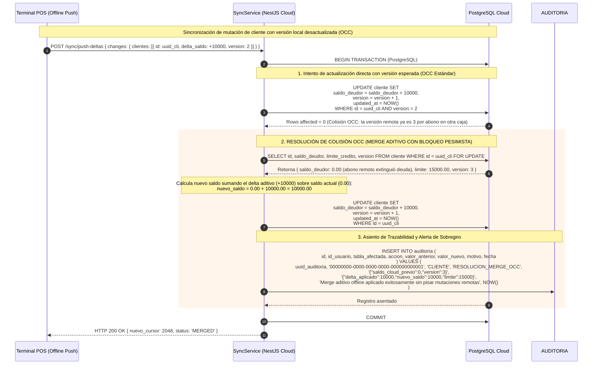

# Diagrama de Secuencia: Resolución de Conflicto OCC con Merge Aditivo

## 1. Propósito Arquitectónico

Este diagrama especifica la mecánica de resolución de colisiones concurrentes (OCC - Optimistic Concurrency Control) cuando una terminal offline sincroniza ventas a fiado o abonos que impactan en la cuenta corriente de un cliente, cuya versión en la nube ha sido modificada remotamente durante el periodo de desconexión.

Garantiza:
1. **Principio de No Pérdida de Asientos (Merge Aditivo):** El backend en la nube **jamás pisa** el saldo central con el saldo absoluto local. En su lugar, aplica el delta neto ($\Delta = \text{delta\_monto}$) sobre el saldo vivo actual de la nube.
2. **Aislamiento Pesimista durante el Merge:** Ante colisión (`rowsAffected == 0`), el servidor toma un bloqueo de fila con `SELECT ... FOR UPDATE` en PostgreSQL para consolidar el merge aditivo de forma estrictamente serializable.
3. **Prioridad de la Venta Presencial y Trazabilidad Forense:** Si el saldo acumulado tras el merge supera el límite de crédito vigente en la nube, la venta presencial consumada no se cancela, registrándose automáticamente un evento en `AUDITORIA` (`RESOLUCION_MERGE_OCC` / `EXCESO_LIMITE_CREDITO_POST_SYNC`) para revisión administrativa.

---

## 2. Diagrama de Secuencia (Mermaid.js)



---

## 3. Puntos Clave de Control Arquitectónico

- **Preservación Incondicional del Libro Mayor:** Dado que los asientos en `CUENTA_CORRIENTE` son inmutables (`VENTA_CREDITO` con monto positivo y `ABONO` con monto negativo), el merge aditivo garantiza que la suma de movimientos de la cuenta corriente siempre coincida exactamente con `CLIENTE.saldo_deudor`.
- **Inmunidad ante Desconexiones Prolongadas:** Si una sucursal pasa varios días offline y procesa múltiples ventas fiadas a clientes habituales, cada venta aporta su delta aditivo $\Delta_i$ al sincronizar, evitando que los abonos cobrados en otras sucursales se sobreescriban destructivamente.

---

## 4. Código y Lógica SQL de Referencia (`SyncService`)

```typescript
// Fragmento transaccional de resolución aditiva en SyncService.procesarPushDeltas
if (res[1] === 0) {
  this.logger.warn(`Conflicto OCC en cliente ${cli.id}. Aplicando merge aditivo auditado.`);

  // Bloqueo pesimista para lectura y cálculo atómico
  const clienteCloud = await queryRunner.manager.query(
    `SELECT id, saldo_deudor, limite_credito, version FROM cliente WHERE id = $1 FOR UPDATE`,
    [cli.id]
  );

  if (clienteCloud.length > 0) {
    const saldoActualCloud = Number(clienteCloud[0].saldo_deudor);
    const limite = Number(clienteCloud[0].limite_credito);
    const deltaMonto = Number(cli.delta_saldo ?? (cli.saldo_deudor - (cli.saldo_anterior ?? 0)));
    const nuevoSaldoCalculado = saldoActualCloud + deltaMonto;

    // Mutación aditiva acumulativa: nunca pisa el saldo central
    await queryRunner.manager.query(
      `UPDATE cliente 
       SET saldo_deudor = saldo_deudor + $1, version = version + 1, updated_at = NOW() 
       WHERE id = $2`,
      [deltaMonto, cli.id]
    );

    // Registro forense inmutable
    await queryRunner.manager.query(
      `INSERT INTO auditoria (id, id_usuario, tabla_afectada, accion, valor_anterior, valor_nuevo, motivo, fecha)
       VALUES ($1, $2, 'CLIENTE', 'RESOLUCION_MERGE_OCC', $3, $4, $5, NOW())`,
      [
        crypto.randomUUID(),
        this.SYSTEM_BOT_UUID,
        JSON.stringify({ saldo_cloud_previo: saldoActualCloud, version_cloud: clienteCloud[0].version }),
        JSON.stringify({ delta_aplicado: deltaMonto, nuevo_saldo: nuevoSaldoCalculado, limite_credito: limite }),
        nuevoSaldoCalculado > limite
          ? `Merge aditivo offline excedió límite de crédito vigente ($${nuevoSaldoCalculado} > $${limite})`
          : 'Merge aditivo OCC aplicado exitosamente sin pisar mutaciones remotas',
      ]
    );
  }
}
```
