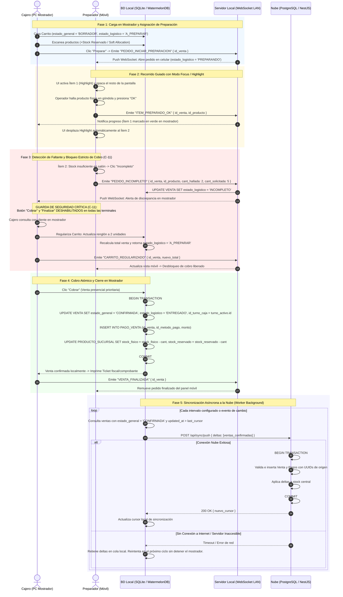

# Diagrama de Secuencia: Preparación Guiada Local-First, WebSockets y Sincronización

## 1. Propósito Arquitectónico

Este diagrama modela la interacción en tiempo real entre la **Terminal de Mostrador (Caja)** y la **Terminal Móvil (Embalador / Preparador)** dentro de la red de área local (LAN) de la sucursal mediante WebSockets, junto con el mecanismo de persistencia local en SQLite (WatermelonDB) y sincronización asíncrona hacia la Nube (PostgreSQL).

Garantiza:
1. **Flujo Guiado de Preparación (Focus / Highlight):** Orientación visual producto por producto en el móvil del preparador.
2. **Detección de Faltantes y Bloqueo Estricto de Cobro (Resolución C-11):** Transición inmediata a `INCOMPLETO` ante faltantes de mercadería y deshabilitación inquebrantable del cobro hasta su regularización en mostrador.
3. **Resiliencia Local-First y Operación sin Internet:** Todas las operaciones críticas de mostrador y preparación operan sin depender de la nube.

---

## 2. Diagrama de Secuencia (Mermaid.js)

---

## 3. Matriz de Eventos WebSocket LAN

| Evento WebSocket | Emisor | Receptores | Payload Clave | Comportamiento en Receptor |
|---|---|---|---|---|
| `PEDIDO_INICIAR_PREPARACION` | Mostrador (PC) | Embaladores (Móviles) | `{ id_venta, items }` | Abre la pantalla de preparación guiada con focus en ítem 0. |
| `ITEM_PREPARADO_OK` | Embalador (Móvil) | Mostrador (PC) | `{ id_venta, id_producto }` | Pinta el ítem en verde y actualiza barra de progreso en mostrador. |
| `PEDIDO_INCOMPLETO` | Embalador (Móvil) | Mostrador (PC) | `{ id_venta, id_producto, cant_hallada }` | Activa alerta roja y **bloquea el botón de cobro** en ambas pantallas. |
| `CARRITO_REGULARIZADO` | Mostrador (PC) | Embaladores (Móviles) | `{ id_venta, items_actualizados, total }` | Vuelve el pedido a estado regular y **desbloquea el cobro**. |
| `VENTA_FINALIZADA` | Mostrador (PC) | Embaladores (Móviles) | `{ id_venta }` | Cierra la vista del pedido en móvil y retorna a la lista de espera. |
