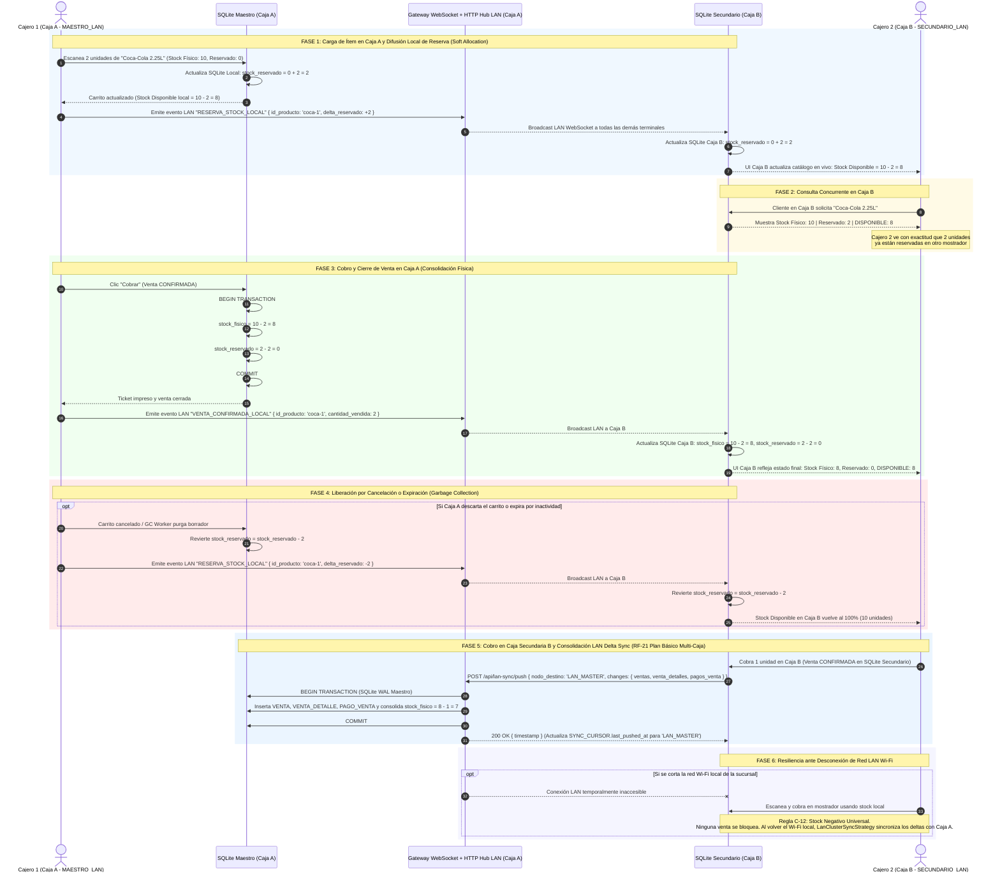

# Diagrama de Secuencia: Sincronización de Reservas (Soft Allocation) entre Cajas en LAN

## 1. Propósito Arquitectónico

Este diagrama modela la sincronización en tiempo real de la reserva dinámica de stock (*Soft Allocation*) entre múltiples puntos de venta concurrentes en una misma sucursal, resolviendo el hallazgo **C-15**.

Garantiza:
1. **Sincronización Local sin Dependencia de Internet (Resolución C-15 y RF-21):** En una sucursal con dos o más cajas (`Caja A: MAESTRO_LAN`, `Caja B: SECUNDARIO_LAN`) y terminales móviles (`embalador-mobile`), los eventos de reserva de stock se propagan a través de la red de área local (LAN) mediante WebSockets (Socket.io), y las transacciones confirmadas en cajas secundarias se consolidan contra el SQLite de la Caja Maestra vía HTTP LAN (`/api/lan-sync/push`). No se requiere conexión a la nube ni consultas remotas a PostgreSQL para mantener la coherencia del stock disponible ni la contabilidad del local en el **Plan Básico Monosucursal (`BASICO_LOCAL`)**.
2. **Cálculo de Stock Disponible Distribuido:**
   $$\text{StockDisponible} = \text{StockFisico} - \text{StockReservado}$$
   Cuando la Caja A escanea un producto en un carrito borrador, la Caja B refleja inmediatamente el incremento en `stock_reservado`, evitando prometer mercadería ya retenida en el mostrador contiguo.
3. **Resiliencia ante Caídas de Red Wi-Fi LAN:** Si la red local se interrumpe y las terminales quedan aisladas, ninguna venta se detiene. En virtud de la regla **C-12 (Stock Negativo Universal)**, el cajero puede cobrar de inmediato y cualquier colisión física es absorbida en mostrador y regularizada posteriormente mediante auditoría.

---

## 2. Diagrama de Secuencia (Mermaid.js)

---

## 3. Matriz de Eventos y Endpoints LAN en Sucursal

| Canal / Evento LAN | Emisor | Receptores | Payload Clave | Efecto en Receptor |
|---|---|---|---|---|
| `RESERVA_STOCK_LOCAL` (WS) | Caja que muta carrito / GC | Demás Cajas y Móviles | `{ id_producto, delta_reservado }` | Aplica `stock_reservado = stock_reservado + delta_reservado` en SQLite local. |
| `VENTA_CONFIRMADA_LOCAL` (WS) | Caja que consuma cobro | Demás Cajas y Móviles | `{ id_producto, cantidad_vendida }` | Aplica `stock_fisico = stock_fisico - cant` y `stock_reservado = stock_reservado - cant`. |
| `CARRITO_EXPIRADO` (WS) | GC Worker local | Pantallas mostrador y móvil | `{ id_venta }` | Desaloja el pedido expirado de la vista del operador. |
| `POST /api/lan-sync/push` (HTTP) | Caja `SECUNDARIO_LAN` | Caja `MAESTRO_LAN` | `{ sucursal_id, nodo_destino: 'LAN_MASTER', changes }` | Persiste atómicamente en el SQLite Maestro las ventas confirmadas, pagos y saldos de clientes sin usar Nube. |
| `GET /api/lan-sync/pull` (HTTP) | Caja `SECUNDARIO_LAN` | Caja `MAESTRO_LAN` | `?last_pulled_at=:cursor&sucursal_id=:id` | Descarga cambios de catálogo, precios y clientes efectuados en la Caja Maestra. |
