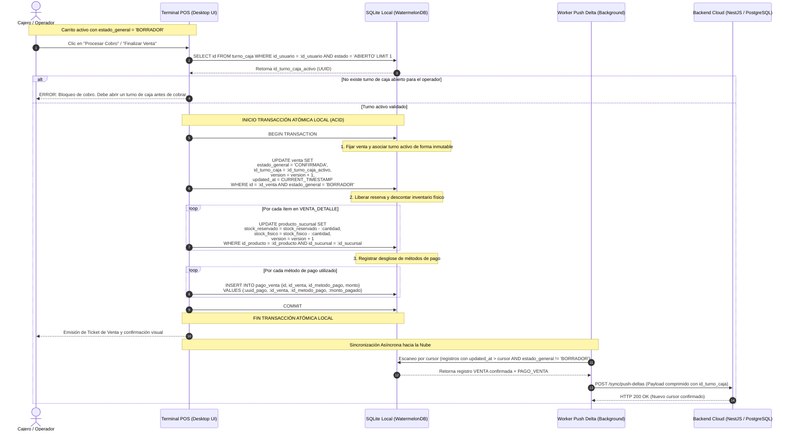

# Diagrama de Secuencia: Transición Atómica a CONFIRMADA con Fijación de Turno

## 1. Propósito Arquitectónico

Este diagrama documenta la transición crítica de una venta desde el estado `BORRADOR` (carrito activo en memoria / persistido localmente) al estado `CONFIRMADA` en la terminal POS. 

Garantiza:
1. **Fijación Inmutable de Turno (`id_turno_caja`):** Se asocia la venta al turno de caja abierto del operador que procesa el cobro, satisfaciendo el Arqueo Ciego de Caja (**RF-17**) y la Auditoría de Mermas/Sobrantes (**RF-13**).
2. **Atomicidad Local (ACID):** En un único bloque transaccional (`BEGIN TRANSACTION ... COMMIT`) en SQLite local (WatermelonDB), se fija el estado de la venta, se decrementa tanto el `stock_fisico` como el `stock_reservado` en góndola (*Soft Allocation Release*), y se registran los renglones de `PAGO_VENTA`.
3. **Sincronización Asíncrona (Local-First):** Una vez commiteada la transacción local, el worker en segundo plano detecta el cambio (`estado_general = 'CONFIRMADA'`) y envía el delta a la nube (NestJS / PostgreSQL).

---

## 2. Diagrama de Secuencia (Mermaid.js)

---

## 3. Puntos Clave de Control Arquitectónico

- **Resiliencia ante Cortes de Energía:** SQLite configurado con `journal_mode = WAL` y `synchronous = FULL`. Si la energía se corta antes del `COMMIT`, la venta permanece en `BORRADOR` con su reserva activa. Si se corta después, la venta queda confirmada con su `id_turno_caja` intacto.
- **Desacoplamiento de Turnos en Operaciones Posteriores:** Las eventuales notas de crédito posteriores vincularán el `id_venta` original para conocer precios históricos, pero impactarán en el `TURNO_CAJA` activo del día de la devolución, sin mutar el `id_turno_caja` fijado en esta venta.
