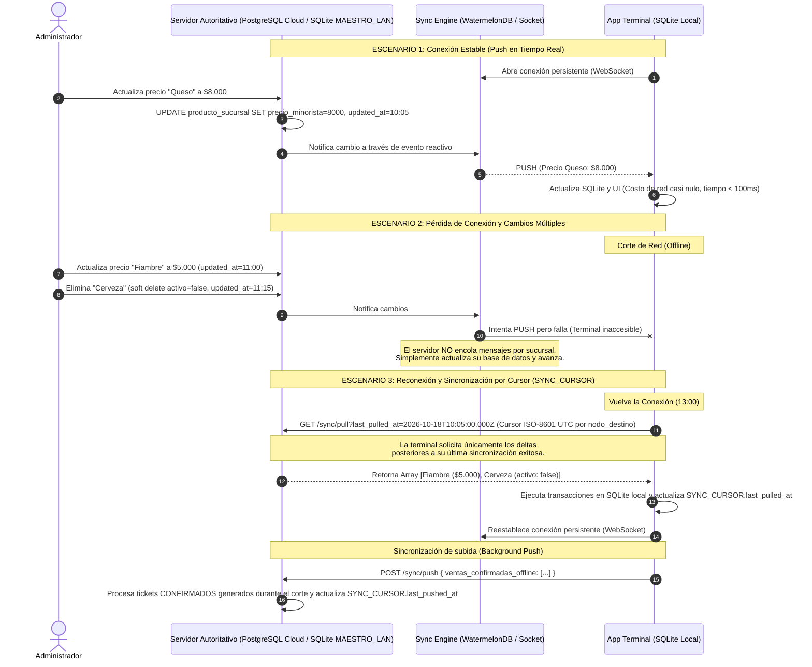

# Diagrama de Secuencia: Sincronización Push en Tiempo Real y Catch-Up por Cursor

> **Alcance por Plan Comercial (ERS RF-21):**
> - **Plan Superior (`SUPERIOR_CLOUD`):** El cursor en `SYNC_CURSOR` utiliza `nodo_destino = 'CLOUD_CENTRAL'` contra PostgreSQL (`backend-cloud`). Al realizar un Upgrade desde el Plan Básico mediante `licencia_token`, `last_pulled_at` nace en `null` (`0`), disparando un **Bootstrap Catch-Up inicial** que sube todo el catálogo e historial local a la nube sin migración de esquema.
> - **Plan Básico Multi-Caja (`BASICO_LOCAL`):** Las cajas `SECUNDARIO_LAN` aplican este mismo mecanismo de cursores (`nodo_destino = 'LAN_MASTER'`) contra el `LanSyncHub` de la Caja `MAESTRO_LAN` dentro de la red local.

