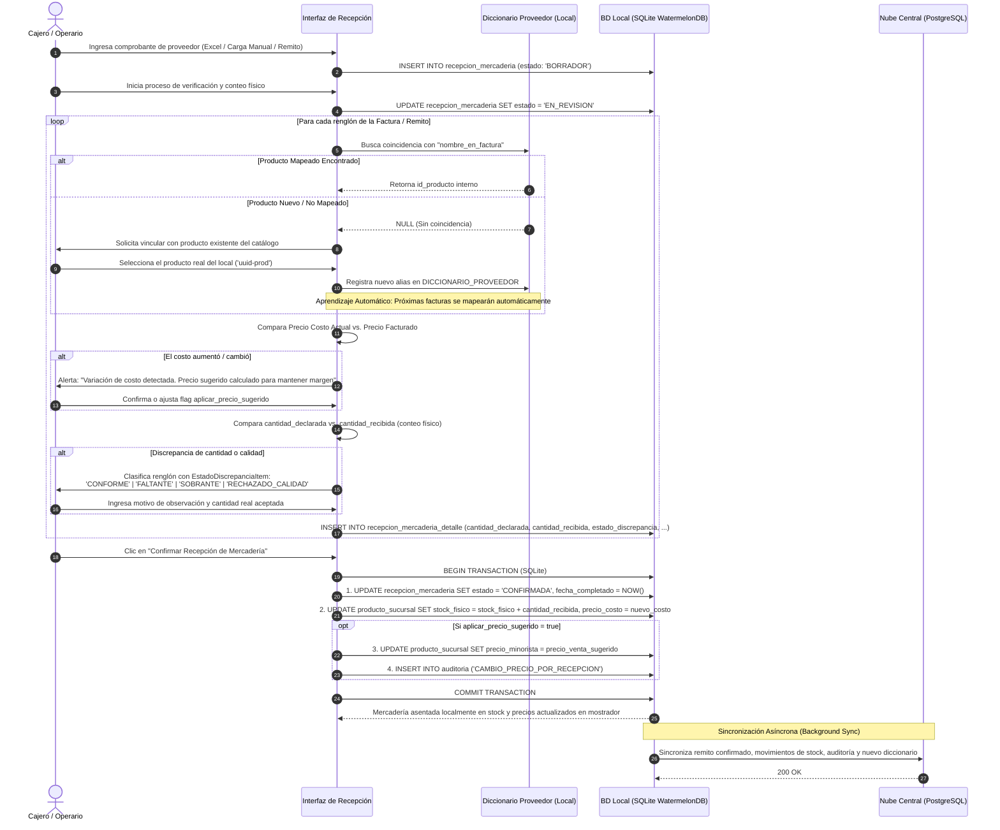

# Diagrama de Secuencia: Módulo de Recepción de Mercadería y Control de Proveedores

Este diagrama detalla la interacción entre el Cajero/Operario, la Interfaz de Usuario, el Motor de Diccionario de Proveedores y la Persistencia Local/Cloud, formalizando las transiciones de estado de la recepción (`BORRADOR → EN_REVISION → CONFIRMADA`), el aprendizaje automático de alias y el registro de discrepancias con el enum tipado `EstadoDiscrepanciaItem`, en estricta subsanación de los hallazgos **O-12** y **O-17**.

## Reglas de Transición y Trazabilidad

1. **Ciclo de Estados Formal (O-17):** La recepción inicia en `BORRADOR` al pre-cargar o abrir el comprobante. Al comenzar la revisión física de bultos transiciona a `EN_REVISION`. Al confirmarse el ingreso pasa a `CONFIRMADA` (impactando stock exclusivamente por `cantidad_recibida`), o a `RECHAZADA` si la carga se devuelve íntegramente al transportista sin modificar existencias.
2. **Enum de Discrepancias Tipado:** Cada renglón de `RECEPCION_MERCADERIA_DETALLE` se tipa estrictamente mediante `EstadoDiscrepanciaItem`:
   - `CONFORME`: Cantidad recibida idéntica a lo declarado y en óptimo estado.
   - `FALTANTE`: Se recibieron menos unidades que las facturadas.
   - `SOBRANTE`: Llegaron más unidades que las declaradas.
   - `RECHAZADO_CALIDAD`: Mercadería dañada, vencida o en mal estado rechazada al transportista (no ingresa al inventario vendible).
