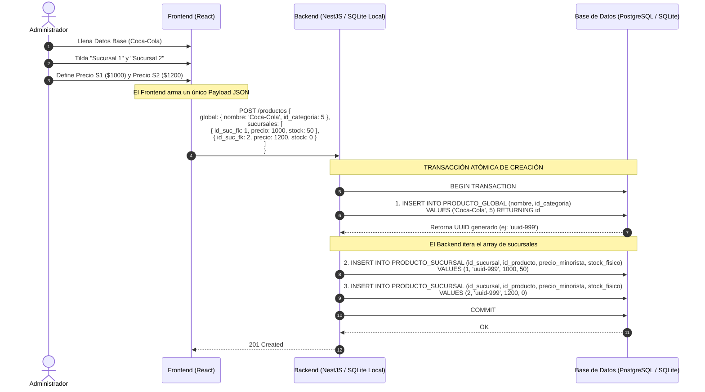

# Diagrama de Secuencia: Gestión de Productos entre Sucursales — Escenario 1 (Alta de Producto)

> **Alcance y Comportamiento por Plan Comercial (ERS RF-21):**
> - **En Plan Básico (`BASICO_LOCAL`, $N = 1$, `catalogo_multisucursal = false`):** El formulario en `pos-desktop` oculta los checkboxes de selección de sucursales. Al guardar, ejecuta esta misma transacción atómica (`BEGIN ... COMMIT`) directamente sobre SQLite local insertando en `PRODUCTO_GLOBAL` y auto-asignando la única sucursal local en `PRODUCTO_SUCURSAL`.
> - **En Plan Superior (`SUPERIOR_CLOUD`, $N \ge 1$, `catalogo_multisucursal = true`):** Se despliega la grilla de selección y propagación de precios entre múltiples sucursales contra PostgreSQL (`backend-cloud`), como se ilustra a continuación.

