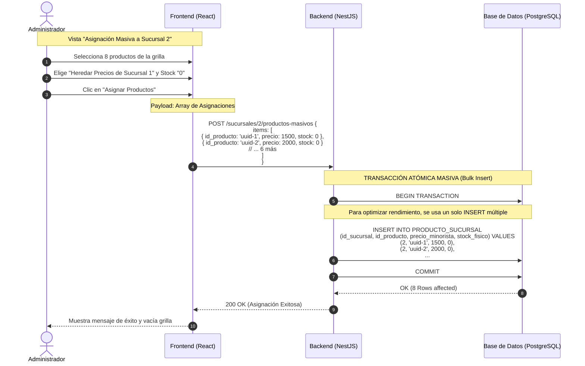

# Diagrama de Secuencia: Gestión de Productos entre Sucursales — Escenario 2 (Clonación Masiva a Nueva Sucursal)

> **Alcance por Plan Comercial (ERS RF-15 y RF-21):** `[Exclusivo Plan Superior — plan_activo = 'SUPERIOR_CLOUD' y feature_toggles.catalogo_multisucursal = true]`. Habilita la apertura de nuevas franquicias o sucursales ($N \ge 2$) heredando el catálogo maestro existente en `PRODUCTO_GLOBAL` con `stock_fisico = 0`.

