# Diagrama de Secuencia: Limpieza y Reconciliación de Productos de Venta Rápida (Comodín)

## 1. Propósito Arquitectónico

Este diagrama especifica el proceso formal mediante el cual el Administrador o Dueño audita y regulariza las ventas históricas efectuadas mediante el **Artículo Comodín** (`codigo_comodin` / `nombre_comodin`), operando de forma polimórfica según el Plan Comercial activo (**ERS RF-13 y RF-21**):
- **En Plan Básico Monosucursal (`BASICO_LOCAL`, `reconciliacion_local = true`):** Se ejecuta 100% localmente desde el panel administrativo integrado en `pos-desktop` (`ReconciliacionLocalService`) contra la base SQLite del nodo `MAESTRO_LAN` y se propaga por LAN a las cajas secundarias.
- **En Plan Superior Multisucursal (`SUPERIOR_CLOUD`):** Se ejecuta contra el servidor central (`ReconciliacionService` en NestJS + PostgreSQL) y se sincroniza a todas las sucursales de la cadena.

Garantiza:
1. **Desacoplamiento Estricto entre Catálogo y Stock (Resolución C-17):**
   - La tabla `PRODUCTO_GLOBAL` almacena los metadatos descriptivos del catálogo (`id`, `nombre`, `id_categoria`, `unidad_medida`, `es_pesable`). **No almacena stock físico.**
   - La tabla `PRODUCTO_SUCURSAL` almacena de forma aislada las existencias reales (`stock_fisico`, `stock_reservado`) y precios para la sucursal de origen (`id_sucursal`).
2. **Inmutabilidad Forense de Tickets:** `VENTA_DETALLE` conserva inalterados `nombre_comodin`, `codigo_comodin` y el `precio_unitario` efectivamente cobrado en su momento. Únicamente se actualiza la clave foránea `id_producto` apuntando al UUID oficial del producto.
3. **Detección Automática de Mermas/Sobrantes:** Si el precio histórico cobrado difiere del precio oficial de lista, se asienta una discrepancia contable en `AUDITORIA` sin corromper los cierres de caja pasados.
4. **Sintaxis Mermaid 100% Válida (Resolución S-01):** Eliminación de negritas Markdown y escapes incorrectos para garantizar renderizado nativo.

---

## 2. Diagrama de Secuencia (Mermaid.js)

```mermaid
sequenceDiagram
    autonumber
    actor Admin as Administrador / Dueño
    participant UI as UI Admin (POS Desktop / Panel Web)
    participant API as Servicio Reconciliación (LocalService / Backend NestJS)
    participant DB as Base de Datos (SQLite MAESTRO_LAN / PostgreSQL Cloud)

    Note over Admin,UI: FASE 1: Detección y Análisis de Huérfanos
    Admin->>UI: Abre vista "Reconciliación de Códigos Huérfanos"
    UI->>API: GET /ventas/huerfanos?id_sucursal=:id_sucursal
    API->>DB: SELECT vd.codigo_comodin, vd.nombre_comodin, SUM(vd.cantidad) as vendidos, AVG(vd.precio_unitario) FROM venta_detalle vd INNER JOIN venta v ON vd.id_venta = v.id WHERE vd.id_producto = '00000000-0000-0000-0000-000000000000' AND v.id_sucursal = 'uuid-suc' GROUP BY vd.codigo_comodin, vd.nombre_comodin
    DB-->>API: Retorna filas agrupadas de la sucursal (Ej: Cód '12345' | Vendidos: 3 unidades)
    API-->>UI: Muestra grilla consolidada de productos huérfanos

    Note over Admin,UI: FASE 2: Decisión y Validación de Stock
    Admin->>UI: Selecciona ítem huérfano (Cód '12345' | 3 unidades vendidas)
    UI->>Admin: Opciones: ¿Crear Nuevo Producto o Vincular a Existente?

    alt Opción A: Crear Nuevo Producto Oficial
        Admin->>UI: Ingresa Nombre, Categoría, Precio Oficial ($1200) y Conteo Físico Actual en Góndola (10)
        UI->>UI: Calcula Stock de Inserción: 10 (conteo) + 3 (vendidos) = 13 (Sin bloqueos si conteo < vendidos)
        Admin->>UI: Clic en "Crear y Reconciliar"
        UI->>API: POST /reconciliar { accion: 'CREAR', id_sucursal: 'uuid-suc', codigo_comodin: '12345', nombre: 'Yerba Mate Playadito 500g', precio_oficial: 1200, stock_fisico_actual: 10 }
    else Opción B: Vincular a Producto Existente en Catálogo
        Admin->>UI: Busca y selecciona producto existente ("uuid-yerba")
        UI->>API: GET /productos/uuid-yerba?id_sucursal=:id_sucursal
        API->>DB: SELECT stock_fisico, precio_minorista FROM producto_sucursal WHERE id_producto = 'uuid-yerba' AND id_sucursal = 'uuid-suc'
        DB-->>API: Retorna { stock_fisico: 2, precio_minorista: 1200 }
        API-->>UI: Datos vigentes en sucursal (Stock Actual: 2)
        UI->>UI: Evalúa: Stock Actual (2) < Vendidos (3)
        UI-->>Admin: Advertencia: "Stock en sistema (2) es menor a los vendidos (3). Elija cómo proceder:"

        alt Sub-opción B1: Ajuste Físico en Góndola (Cuadre Inmediato)
            Admin->>UI: Ingresa conteo físico real en estantería (ej. 5)
            Admin->>UI: Clic en "Vincular con Ajuste"
            UI->>API: POST /reconciliar { accion: 'VINCULAR', id_sucursal: 'uuid-suc', codigo_comodin: '12345', id_producto_existente: 'uuid-yerba', ajuste_stock: 5 }
        else Sub-opción B2: Vinculación Directa Permisiva (Política C-12)
            Admin->>UI: Selecciona "Vincular sin ajustar ahora (aceptar stock negativo)"
            Admin->>UI: Clic en "Vincular Directo"
            UI->>API: POST /reconciliar { accion: 'VINCULAR', id_sucursal: 'uuid-suc', codigo_comodin: '12345', id_producto_existente: 'uuid-yerba' }
        end
    end

    Note over API,DB: FASE 3: Transacción ACID Atómica (Catálogo vs Sucursal)
    API->>DB: BEGIN TRANSACTION

    alt Si la acción es 'CREAR'
        Note over API: stock_inicial_calculado = stock_fisico_actual (10) + vendidos (3) = 13
        API->>DB: INSERT INTO producto_global (id, nombre, id_categoria, unidad_medida, es_pesable) VALUES (gen_random_uuid(), 'Yerba...', 'cat-1', 'UNIDAD', false) RETURNING id
        DB-->>API: Retorna 'uuid-nuevo'
        API->>DB: INSERT INTO codigo_barra (codigo, id_producto, tipo, activo) VALUES ('12345', 'uuid-nuevo', 'PRINCIPAL', true)
        API->>DB: INSERT INTO producto_sucursal (id_sucursal, id_producto, stock_fisico, stock_reservado, precio_minorista, version) VALUES ('uuid-suc', 'uuid-nuevo', 13, 0, 1200, 1)
    else Si la acción es 'VINCULAR' (Sub-opción B1: con ajuste)
        API->>DB: UPDATE producto_sucursal SET stock_fisico = 5, version = version + 1 WHERE id_producto = 'uuid-yerba' AND id_sucursal = 'uuid-suc'
        API->>DB: INSERT INTO auditoria (id_usuario, tabla_afectada, id_registro_afectado, accion, motivo, valor_anterior, valor_nuevo, fecha) VALUES (:admin_id, 'PRODUCTO_SUCURSAL', 'uuid-yerba', 'AJUSTE_STOCK', 'Ajuste manual previo a reconciliación', '{"stock": 2, "id_sucursal": "uuid-suc"}', '{"stock": 5}', NOW())
    else Si la acción es 'VINCULAR' (Sub-opción B2: directa permisiva sin ajuste)
        Note over API: Política C-12: Permite que el stock resultante quede negativo (-1) sin bloquear
        API->>DB: INSERT INTO auditoria (id_usuario, tabla_afectada, id_registro_afectado, accion, motivo, valor_anterior, valor_nuevo, fecha) VALUES (:admin_id, 'PRODUCTO_SUCURSAL', 'uuid-yerba', 'DESCUADRE_STOCK_RECONCILIACION', 'Vinculación directa de comodín con stock insuficiente (2 - 3 = -1)', '{"stock_previo": 2, "id_sucursal": "uuid-suc"}', '{"stock_proyectado": -1}', NOW())
    end

    Note over API,DB: Mapeo de Identificador y Deducción de Stock en Sucursal
    API->>DB: UPDATE venta_detalle SET id_producto = :UUID_DESTINO WHERE codigo_comodin = '12345' AND id_venta IN (SELECT id FROM venta WHERE id_sucursal = 'uuid-suc')

    loop Evaluación de Discrepancias de Precio por Renglón (C-21)
        API->>API: Calcula: diferencia_total = (precio_cobrado - precio_oficial) * cantidad
        opt Si diferencia_total != 0
            API->>DB: INSERT INTO auditoria (id_usuario, tabla_afectada, id_registro_afectado, accion, motivo, valor_anterior, valor_nuevo, fecha) VALUES (:admin_id, 'VENTA_DETALLE', :id_renglon, 'RECONCILIACION_DISCREPANCIA', 'Discrepancia detectada en venta comodín', :snapshot_cobrado_con_turno_y_sucursal, :analisis_merma_multiplicada_por_cantidad, NOW())
        end
    end

    Note over API,DB: Consolidación Neta por Turno de Caja (RF-13 y Escenario 6)
    API->>DB: INSERT INTO auditoria (id_usuario, tabla_afectada, id_registro_afectado, accion, motivo, valor_anterior, valor_nuevo, fecha) VALUES (:admin_id, 'TURNO_CAJA', :id_turno, 'RECONCILIACION_DISCREPANCIA_TURNO', 'Balance neto consolidado de discrepancias en turno', :ref_turno, :balance_neto_turno, NOW())

    Note over API,DB: Deducción de Unidades Vendidas en Góndola
    API->>DB: UPDATE producto_sucursal SET stock_fisico = stock_fisico - 3, version = version + 1 WHERE id_producto = :UUID_DESTINO AND id_sucursal = 'uuid-suc'
    Note over DB: Resultado final: stock_fisico queda en 10 (13 - 3 = 10, exacto al conteo físico actual en góndola)

    API->>DB: COMMIT
    DB-->>API: Transacción confirmada exitosamente
    API-->>UI: 200 OK { status: 'RECONCILIACION_COMPLETA', id_producto: :UUID_DESTINO }
    UI-->>Admin: Notificación de éxito: Catálogo y Stock regularizados
```

---

## 3. Matriz de Trazabilidad de Entidades Impactadas

| Entidad | Campos Afectados | Justificación de Arquitectura |
|---|---|---|
| `PRODUCTO_GLOBAL` | `id`, `nombre`, `id_categoria`, `unidad_medida`, `es_pesable` | **Catálogo maestro centralizado.** No posee columnas de stock ni precios (Resolución C-17). |
| `PRODUCTO_SUCURSAL` | `id_sucursal`, `id_producto`, `stock_fisico`, `precio_minorista`, `version` | **Inventario y precios por sucursal.** Es donde se inyecta el stock inicial y se descuentan las unidades vendidas (Resolución C-17 y C-22). |
| `CODIGO_BARRA` | `codigo`, `id_producto`, `tipo`, `activo` | Registra el código escaneado para que en futuras ventas la búsqueda sea automática. |
| `VENTA_DETALLE` | `id_producto` | Actualiza la FK del producto comodín al producto oficial. Conserva intactos `codigo_comodin`, `nombre_comodin` y `precio_unitario`. |
| `AUDITORIA` | `tabla_afectada`, `accion`, `valor_anterior`, `valor_nuevo` | Asienta ajustes manuales de stock y discrepancias de precio (Merma/Sobrante lógico). |
