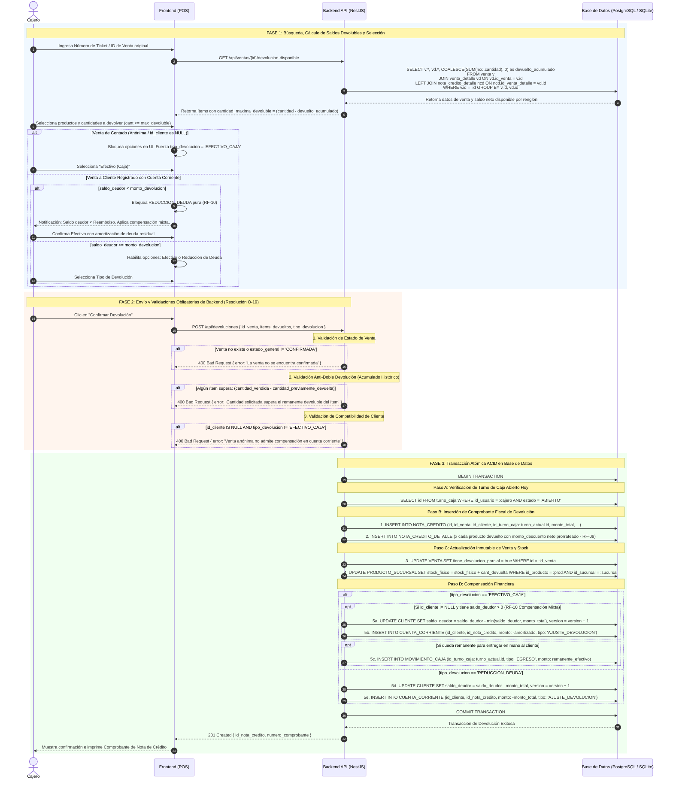

# Diagrama de Secuencia: Emisión de Notas de Crédito y Devoluciones

## 1. Propósito Arquitectónico

Este diagrama formaliza el flujo de devoluciones de mercadería y emisión de notas de crédito en cumplimiento estricto de **ERS RF-09**, **RF-10**, **RNF-03** y las resoluciones arquitectónicas **C-01**, **C-02**, **C-03**, **C-04** y **O-19**.

Garantiza:
1. **Validaciones Obligatorias de Backend Post-POST (Resolución O-19):** Las validaciones de negocio e integridad se ejecutan obligatoriamente en el servidor tras recibir el `POST /devoluciones`, desterrando el antipatrón de diagramarlas antes del envío HTTP o dentro de bloques opcionales.
2. **Control Anti-Doble Devolución (Resolución O-19):** El backend consulta el histórico de `NOTA_CREDITO_DETALLE` vinculadas a la venta para calcular la cantidad neta devoluble ($\text{devoluble} = \text{vendida} - \sum \text{devuelta\_previa}$), impidiendo que un producto sea devuelto más de una vez.
3. **Desacoplamiento Temporal de Caja (Resolución C-06):** El egreso de efectivo impacta en el `TURNO_CAJA` abierto hoy por el cajero que efectúa la devolución, preservando la inmutabilidad contable del turno en que se originó la venta pasada.
4. **Garantía de Reembolso Neto Promocional (Resolución C-04):** Si el producto se vendió con descuento o en combo, el importe a reintegrar deduce el descuento unitario proporcional, evitando devolver más dinero del efectivamente cobrado.

---

## 2. Diagrama de Secuencia (Mermaid.js)

---

## 3. Puntos de Control y Reglas de Negocio

1. **Inmutabilidad del Snapshot Histórico:** La tabla `VENTA` jamás modifica sus totales ni borra filas de `VENTA_DETALLE`. Únicamente conmuta el flag booleano `tiene_devolucion_parcial = true` para auditoría contable.
2. **Trazabilidad de Descuentos (RF-09):** `NOTA_CREDITO_DETALLE.subtotal` calcula el valor efectivo desembolsado por el cliente, deduciendo la proporción de descuento de promociones de catálogo ([Resolución C-04](file:///d:/Contr/Downloads/POSLyon/auditoria_trazabilidad_poslyon.md#L39)).
3. **Caja Afectada:** Todo egreso de efectivo físico (`MOVIMIENTO_CAJA` de tipo 'EGRESO') se asocia indefectiblemente al `id_turno_caja` del cajero presente, garantizando que el arqueo de hoy cuadre con exactitud sin modificar la historia de turnos pasados.
