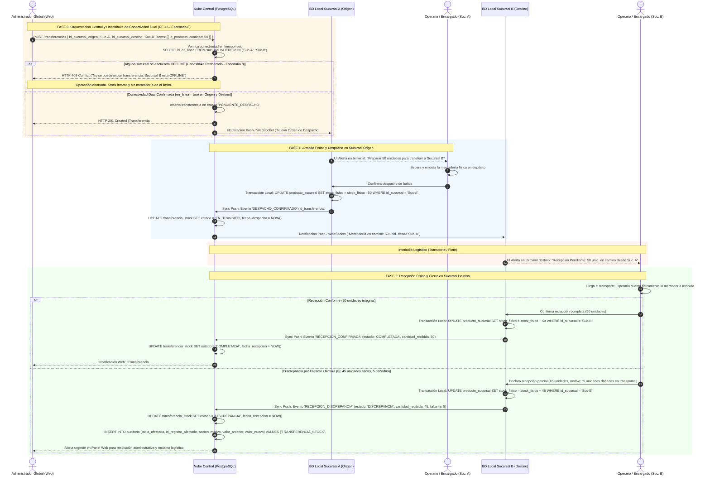

# Diagrama de Secuencia: Transferencia de Stock entre Sucursales con Handshake de Conectividad Dual

> **Alcance por Plan Comercial (ERS RF-16 y RF-21):** `[Exclusivo Plan Superior — plan_activo = 'SUPERIOR_CLOUD' y feature_toggles.transferencias_inter_sucursal = true]`. En el Plan Básico Monosucursal (`BASICO_LOCAL`), este módulo no se carga en memoria (*React Lazy Code Splitting*) y sus rutas permanecen desactivadas.

Este diagrama modela el flujo logístico y transaccional para la transferencia de mercadería entre sucursales, implementando el patrón *Two-Phase Commit* (2PC) a nivel de negocio y exigiendo la **precondición de conectividad dual activa** (Handshake Obligatorio) para prevenir mercadería en tránsito hacia o desde sucursales desconectadas (Resolución C-24, ERS RF-16 y Escenario 8).

---

## Especificaciones y Reglas de Negocio (Trazabilidad PAT)

### 1. Precondición de Conectividad Dual (Handshake Obligatorio - Resolución C-24)
- **Principio Rector:** A diferencia de las ventas presenciales en mostrador (que son 100% *offline-first* para no demorar la fila de clientes), las transferencias entre sucursales involucran movimiento de activos físicos entre dos puntos geográficos distintos y son orquestadas exclusivamente por el **Administrador Global desde el Panel Web**.
- **Validación Previa en Nube:** El backend verifica en `SUCURSAL.en_linea` que tanto el nodo origen como el nodo destino mantengan conectividad activa mediante sus WebSockets/Heartbeats vigentes.
- **Rechazo Atómico (HTTP 409 Conflict):** Si la sucursal de origen o la de destino están desconectadas, el sistema rechaza la solicitud de creación con código HTTP 409 Conflict (o 503 Service Unavailable, conforme a RFC 9110, ERS RF-16 y Escenario 8). Esto indica que la solicitud choca con el estado operativo offline del nodo destino, garantizando que no existan órdenes huérfanas en el limbo ni mercadería despachada hacia locales incomunicados que no puedan recibirla.

### 2. Ciclo de Vida de la Transferencia (Máquina de 4 Estados)
1. `PENDIENTE_DESPACHO`: Orden creada en la Nube y notificada a la Sucursal Origen. El stock aún reside físicamente en Origen.
2. `EN_TRANSITO`: El operario de Origen empaquetó y confirmó el despacho físico. El stock se descuenta en la base local de Origen (`stock_fisico = stock_fisico - cantidad`) y la mercadería viaja en el transporte.
3. `COMPLETADA`: El operario de Destino recibió el 100% de los bultos conformes. El stock se incrementa en la base local de Destino (`stock_fisico = stock_fisico + cantidad_recibida`).
4. `DISCREPANCIA`: Se detectaron diferencias físicas (rotura, extravío o robo en transporte). Destino ingresa a stock únicamente lo recibido en buen estado y el sistema genera una alerta en `AUDITORIA` para intervención del Administrador.

### 3. Reglas de Inmutabilidad Logística
- **Sin Re-enrutamiento Físico:** Una vez que la transferencia pasa a `EN_TRANSITO`, no se permite re-enrutar la carga a una tercera sucursal C. Toda redistribución requiere cerrar formalmente la recepción en B y generar una nueva orden de B a C.
- **Deducción e Incremento Desacoplados:** El origen descuenta existencias al momento fáctico del despacho; el destino suma existencias únicamente al momento fáctico de la recepción y conteo en depósito, impidiendo duplicidad o stocks fantasmas durante el trayecto.
