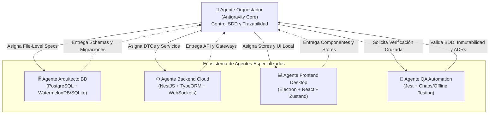
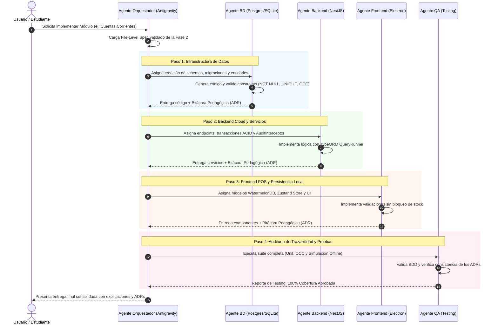

# 🤖 Fase 3: Sistema de Agentes, Subagentes y Skills (MCP)
## POSLyon — Spec-Driven Development & Agentic Architecture

Este documento formaliza la **Fase 3 del proyecto POSLyon**: la definición del ecosistema de **Agentes Especializados**, asignación de contextos atómicos, integración de herramientas **Model Context Protocol (MCP)** y el protocolo de **Bitácoras Pedagógicas de Decisiones Arquitectónicas (ADRs)** para garantizar trazabilidad técnica y aprendizaje de ingeniería de software.

---

## 🎓 1. Filosofía de Desarrollo Agéntico y Enfoque Pedagógico

### ¿Por qué Desarrollo Guiado por Especificaciones (SDD) con Agentes?
En sistemas de misión crítica (como un Punto de Venta donde un error de centavos o pérdida de red paraliza una tienda), delegar código a una Inteligencia Artificial sin especificación previa genera **deuda técnica, inconsistencias en el modelo de datos y falta de trazabilidad**. 

Bajo **Spec-Driven Development (SDD)**:
1. **La Especificación es la Única Fuente de la Verdad:** Ningún agente inventa tablas, campos o reglas de negocio; todo emana de los *File-Level Specs* completados en la Fase 2.
2. **Principio de Responsabilidad Única para Agentes (SRP):** Un único modelo no debe intentar resolver base de datos, frontend, lógica de negocio y pruebas simultáneamente. Se crean roles hiperespecializados con ventanas de contexto limpias.
3. **Bitácora Pedagógica Obligatoria (ADR - Architecture Decision Records):** Cada agente debe explicitar el **porqué** técnico de sus decisiones y **por qué descartó las alternativas**, permitiendo a estudiantes y desarrolladores auditar y comprender los trade-offs de la ingeniería del sistema.

---

## 📝 2. Estándar de Bitácora Pedagógica de Decisiones (ADR)

Cada subagente, al completar la implementación de un archivo o servicio, debe emitir obligatoriamente en su reporte final una sección estructurada con el siguiente formato:

```markdown
### 🎓 Bitácora Pedagógica & Decisión Arquitectónica (ADR)
- **Componente / Archivo:** `apps/.../nombre-archivo.ts`
- **Requisito SDD Vinculado:** [Referencia al punto exacto del File-Level Spec]
- **Decisión Tomada:** Explicación precisa de la técnica o patrón implementado.
- **Alternativas Descartadas y Justificación Técnica:**
  - *Alternativa A:* ¿Por qué no se usó? (ej. Descartado por consumo de memoria, latencia o riesgo de bloqueo).
  - *Alternativa B:* ¿Por qué no se usó? (ej. Descartado por incompatibilidad con el teorema CAP / modo offline).
- **Fundamento Teórico de Sistemas:** Principio aplicado (ej. ACID, Concurrencia Optimista vs Pesimista, Inversión de Control, Write-Ahead Logging).
- **Riesgo / Trade-off Aceptado:** ¿Qué limitación conocida tiene esta solución y cómo se mitiga?
```

---

## 👥 3. Perfiles de Agentes Especializados



---

### 🗄️ Agente 1: Arquitecto de Base de Datos y Persistencia (`db-architect`)

#### Rol y Misión:
Garantizar la integridad referencial, el diseño físico relacional en la Nube y la persistencia local de ultra-baja latencia en las cajas físicas, manteniendo simetría total entre el modelo SQLite local y PostgreSQL central.

#### Herramientas MCP y Permisos:
- `mcp-postgres-inspector`: Análisis de esquemas, índices, restricciones compuestas y planes de ejecución (`EXPLAIN ANALYZE`).
- `mcp-sqlite-tools`: Inspección de esquemas locales WatermelonDB, comandos de configuración `PRAGMA` y análisis de performance.
- `file-write / file-edit`: Modificación exclusiva de `schema.ts`, migraciones SQL y entidades TypeORM.

#### Decisiones Arquitectónicas Clave y Enseñanza Teórica:
1. **¿Por qué UUIDv4 en lugar de enteros autoincrementales (SERIAL / BIGINT)?**
   - *Fundamento:* En un sistema *Offline-First*, las ventas se crean en terminales desconectadas. Si dos cajas generan el ticket `id = 1001` sin conexión a internet, al sincronizar colisionarían violentamente. El estándar UUIDv4 (128 bits aleatorios) garantiza unicidad global probabilísticamente perfecta sin requerir coordinación con un servidor central.
2. **¿Por qué SQLite con `journal_mode = WAL` y `synchronous = FULL` en la caja física?**
   - *Fundamento:* En comercios de mostrador ocurren cortes de luz imprevistos. El modo tradicional *Rollback Journal* bloquea lecturas mientras escribe y puede corromper el archivo `.sqlite` ante un apagón repentino. *Write-Ahead Logging (WAL)* escribe las transacciones en un log secuencial separado, permitiendo concurrencia lector-escritor simultánea y autosanación al reiniciar el equipo.
3. **¿Por qué Control de Concurrencia Optimista (OCC) en lugar de Bloqueos Pesimistas en clientes?**
   - *Fundamento:* Si una terminal local bloqueara al cliente en la Nube con `SELECT FOR UPDATE` mientras atiende en mostrador, una pérdida de red dejaría al cliente bloqueado indefinidamente para las demás sucursales. Con OCC (`version = version + 1`), el cliente puede ser operado libremente y los conflictos se detectan y resuelven en la fase de sincronización.

---

### ⚙️ Agente 2: Ingeniero Backend Cloud NestJS (`backend-nestjs`)

#### Rol y Misión:
Implementar la lógica transaccional en la Nube, el motor de sincronización de deltas basado en cursores, los endpoints REST con validaciones estrictas y el interceptor global de auditoría.

#### Herramientas MCP y Permisos:
- `mcp-nestjs-dev`: Scaffolding y validación de módulos, providers, guards e interceptores.
- `mcp-api-tester`: Ejecución de pruebas HTTP locales con payloads JSON tipificados.
- `file-write / file-edit`: Modificación en `apps/backend-cloud` y contratos en `libs/domain-core`.

#### Decisiones Arquitectónicas Clave y Enseñanza Teórica:
1. **¿Por qué NestJS en lugar de Express o FastAPI?**
   - *Fundamento:* Express es minimalista pero carece de estructura predeterminada, llevando a desorganización en proyectos grandes. NestJS impone una arquitectura modular orientada a objetos con **Inversión de Control (IoC) e Inyección de Dependencias (DI)** similar a Spring Boot o Angular, permitiendo desacoplar fácilmente la lógica de negocio de la persistencia de datos y facilitando la creación de pruebas unitarias mediante *Mocking*.
2. **¿Por qué Interceptor Global (`AuditInterceptor`) en vez de triggers en base de datos?**
   - *Fundamento:* Los triggers SQL en PostgreSQL no tienen acceso al contexto HTTP de la aplicación (como el token JWT del usuario conectado, su IP o el motivo ingresado en el formulario). El interceptor de NestJS captura el estado previo, el nuevo estado y los metadatos del usuario autenticado, orquestando la auditoría sin ensuciar los controladores de negocio.
3. **¿Por qué Transacciones Explícitas (`queryRunner.startTransaction()`) en Reconciliación?**
   - *Fundamento:* La reconciliación de un producto comodín involucra crear el producto, vincular códigos de barra, actualizar cientos de tickets pasados en `venta_detalle`, descontar stock histórico y asentar mermas lógicas. Si la base fallara a mitad del proceso sin una transacción ACID, los tickets quedarían desvinculados del stock. El bloque `BEGIN ... COMMIT / ROLLBACK` asegura atomicidad total (todo se aplica o nada cambia).

---

### 💻 Agente 3: Ingeniero Frontend Electron & POS Desktop (`frontend-electron`)

#### Rol y Misión:
Construir la experiencia del Cajero en la aplicación de escritorio (`apps/pos-desktop`), garantizando tiempo de respuesta menor a 50ms al escanear productos, operación fluida offline y comunicación WebSockets en LAN con la app de empaque.

#### Herramientas MCP y Permisos:
- `mcp-electron-debugger`: Diagnóstico de procesos Principal (Main) y Renderizado (Renderer), comunicación IPC y ciclo de vida de ventanas.
- `mcp-react-state`: Inspección de stores de Zustand y ciclos de renderizado.
- `file-write / file-edit`: Modificación en `apps/pos-desktop`.

#### Decisiones Arquitectónicas Clave y Enseñanza Teórica:
1. **¿Por qué WatermelonDB sobre SQLite en lugar de IndexedDB o LocalStorage?**
   - *Fundamento:* Los navegadores web y Electron limitan la memoria y performance de IndexedDB cuando el catálogo supera los 50.000 artículos. WatermelonDB utiliza un motor nativo en C++ sobre SQLite con **Carga Perezosa (Lazy Loading)**: no carga todos los registros en la memoria RAM de JavaScript; sólo carga bajo demanda los artículos mostrados en pantalla mediante observables RxJS, logrando arranques instantáneos incluso en computadoras antiguas de punto de venta.
2. **¿Por qué Zustand en lugar de Redux Toolkit?**
   - *Fundamento:* Redux requiere un boilerplate significativo (acciones, reducers, dispatchers tipificados) que ralentiza el desarrollo y agrega overhead de procesamiento en cada evento de escaneo. Zustand proporciona un estado reactivo basado en hooks, sin proveedores (`Providers`) envolventes en el árbol de componentes de React, permitiendo mutaciones de alta frecuencia (como escanear 3 productos por segundo) sin re-renderizar componentes innecesarios.
3. **¿Por qué Gateway WebSocket en Red Local (LAN) para la App de Embalador?**
   - *Fundamento:* Si el Cajero y el Embalador están físicamente a 5 metros de distancia en el mismo local, pasar cada escaneo por la Nube (Internet) agregaría 200ms a 500ms de latencia por viaje de ida y vuelta (*round-trip*), y si se corta la fibra óptica el embalaje se detendría. Con un servidor WebSocket local en el proceso Node.js de Electron, la comunicación ocurre en la red WiFi interna con latencia inferior a 5ms y 100% de operatividad sin internet.

---

### 🧪 Agente 4: Ingeniero de Automatización de Pruebas y QA (`qa-automation`)

#### Rol y Misión:
Verificar que ningún cambio de código viole las especificaciones BDD ni corrompa la trazabilidad; simular pérdidas de red abruptas (*Chaos Engineering*) y validar la concurrencia OCC bajo estrés.

#### Herramientas MCP y Permisos:
- `mcp-jest-runner`: Ejecución automatizada de suites de pruebas unitarias y de integración.
- `mcp-network-chaos`: Emulación de desconexión de red, alta latencia, jitter y paquetes duplicados en pruebas E2E.
- `file-write / file-edit`: Creación y mantenimiento de tests en `*.spec.ts` y suites de integración.

#### Decisiones Arquitectónicas Clave y Enseñanza Teórica:
1. **¿Cómo probar sincronización Offline-First sin desconectar el cable de red?**
   - *Fundamento:* Mediante pruebas de integración usando interceptores HTTP (como MSW - *Mock Service Worker* o servidores HTTP de prueba que devuelven errores de timeout intencionales). Se ejecutan 10 ventas locales, se verifica que la base SQLite las retenga con `synced = false`, luego se reanuda la conectividad simulada y se comprueba que el worker ejecute el push de deltas y el cursor avance limpiamente.
2. **¿Cómo verificar colisiones de Concurrencia Optimista (OCC)?**
   - *Fundamento:* Mediante promesas concurrentes con `Promise.all()`: dos hilos de test intentan modificar el mismo producto partiendo de la versión `version = 1`. El test exige asertivamente que la primera petición responda HTTP `200 OK` con `version = 2` y la segunda sea interceptada con HTTP `409 Conflict`.

---

## 🔄 4. Flujo de Trabajo Operativo entre Agentes (Orquestación SDD)



---

## 🛠️ 5. Matriz de Asignación de Herramientas MCP por Rol

| Agente / Subagente | Herramientas MCP Clave | Permisos de Sistema | Artefacto de Salida Principal |
| :--- | :--- | :--- | :--- |
| **`db-architect`** | `mcp-postgres-inspector`, `mcp-sqlite-tools` | Creación de esquemas y migraciones | `schema.ts`, `*.entity.ts`, scripts DDL |
| **`backend-nestjs`** | `mcp-nestjs-dev`, `mcp-api-tester` | Lógica de servidor y controladores | `*.controller.ts`, `*.service.ts`, interceptores |
| **`frontend-electron`** | `mcp-electron-debugger`, `mcp-react-state` | Lógica de mostrador y UI de caja | `use*Store.ts`, `*-local.service.ts`, vistas React |
| **`qa-automation`** | `mcp-jest-runner`, `mcp-network-chaos` | Ejecución de pruebas y benchmarking | `*.spec.ts`, suites de integración y reportes |

---

## ✅ 6. Checklist de Validación de la Fase 3

- [ ] Roles de agentes definidos formalmente con ámbitos de responsabilidad independientes.
- [ ] Protocolo de Bitácoras Pedagógicas (ADR) integrado obligatoriamente en cada rol.
- [ ] Mapeo de herramientas MCP para ejecución atómica en Antigravity 2.0.
- [ ] Reglas teóricas de sistemas explicadas con fundamentos (UUIDv4, WAL, OCC, Inversión de Control, Lazy Loading).
- [ ] Diagrama de secuencia de orquestación y flujo de aprobación validado.
