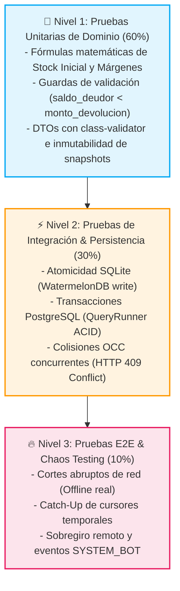

# 🧪 Fase 4: Plantillas de Planificación y Checklists de Testing y Ejecución
## POSLyon — Spec-Driven Development & Quality Assurance

Este documento formaliza la **Fase 4 del proyecto POSLyon**: la definición de estándares de verificación de código, plantillas de **Pull Request y Commits Trazables**, la estrategia de la **Pirámide de Testing para Sistemas Offline-First** (con simulación de caos de red y colisiones de concurrencia), y las checklists de control de calidad para estudiantes y desarrolladores.

---

## 📋 1. Plantilla Estándar de Pull Request / Entrega SDD

Cada agente o desarrollador debe utilizar esta plantilla al proponer cambios en el monorepo, asegurando trazabilidad bidireccional entre la especificación y el código:

```markdown
## 📌 Resumen del Cambio
- **Módulo Afectado:** [Módulo 1: Core POS | Módulo 2: Cuentas Corrientes | Módulo 3: Inventario | Módulo 4: Proveedores | Módulo 5: Sync]
- **Especificación SDD de Referencia:** [Ej: File-Level Specs Módulo 3, Sección 10: ReconciliacionService]
- **Tipo de Cambio:** `feat` (Nueva característica) | `fix` (Corrección) | `refactor` (Refactorización) | `test` (Pruebas)

---

## 🔍 Trazabilidad y Verificación Arquitectónica
- [ ] **Diagrama UML Respaldatorio:** [Indicar si corresponde a Secuencia #2, ERD o Máquina de Estados]
- [ ] **Identificadores Únicos:** Uso exclusivo de UUIDv4 / ULID (sin IDs autoincrementales).
- [ ] **Control de Concurrencia Optimista (OCC):** Entidad incluye columna `version` y control de colisión HTTP 409.
- [ ] **Inmutabilidad y Auditoría:** Cero borrado físico (`Soft Delete`). Mutaciones críticas interceptadas por `AuditInterceptor`.
- [ ] **Resiliencia de Base de Datos:** Transacciones atómicas explícitas (`BEGIN ... COMMIT`) en operaciones compuestas.

---

## 🎓 Bitácora Pedagógica & Decisión Arquitectónica (ADR)
- **Decisión Tomada:** [Explicar brevemente qué se implementó]
- **Alternativas Descartadas y Justificación Técnica:**
  - *Alternativa A:* [Por qué se descartó]
  - *Alternativa B:* [Por qué se descartó]
- **Fundamento Teórico de Sistemas:** [Principio de computación aplicado: ACID, Teorema CAP, OCC, WAL, etc.]
- **Trade-off / Limitación Aceptada:** [Impacto en memoria, latencia o complejidad y cómo se mitiga]

---

## 🧪 Pruebas Realizadas
- [ ] Pruebas unitarias ejecutadas y aprobadas (`npm test -- <path>`).
- [ ] Cobertura de código superior al 85% en lógica de negocio.
- [ ] Prueba de concurrencia o desconexión offline ejecutada satisfactoriamente.
```

---

## 🔺 2. Pirámide de Testing para Arquitectura Offline-First

En arquitecturas distribuidas con capacidad de funcionamiento fuera de línea, la pirámide de testing tradicional se adapta para validar no sólo la lógica pura, sino también el **comportamiento ante desconexión, reconciliación de datos y colisiones concurrentes**:



---

## 🧪 3. Especificación de Suites de Pruebas Automatizadas

### Nivel 1: Pruebas Unitarias de Lógica y Dominio (`libs/domain-core`)

#### Test 1.1: Preservación Exacta del Margen de Ganancia Histórico
- **Objetivo:** Verificar que ante un aumento de costo de reposición, el precio sugerido de góndola conserve el markup histórico.
- **Implementación de Referencia (`margen-precios.service.spec.ts`):**
```typescript
describe('MargenPreciosService - Preservación de Markup', () => {
  it('debe calcular el precio de venta sugerido manteniendo un 50% de margen histórico', () => {
    const costoAnterior = 1000;
    const precioVentaAnterior = 1500; // Markup = (1500 - 1000) / 1000 = 0.50 (50%)
    const costoNuevo = 1400;

    const resultado = MargenPreciosService.calcular(costoAnterior, precioVentaAnterior, costoNuevo);

    expect(resultado.markup_porcentual).toBe(50);
    expect(resultado.precio_minorista_sugerido).toBe(2100); // 1400 * 1.50 = 2100
    expect(resultado.diferencia_costo).toBe(400);
  });
});
```

#### Test 1.2: Guarda Contra Saldo Deudor Negativo en Devoluciones
- **Objetivo:** Verificar que si `saldo_deudor < monto_devolucion`, se arroje excepción impidiendo seleccionar `REDUCCION_DEUDA`.
- **Implementación de Referencia (`devoluciones.spec.ts`):**
```typescript
describe('Devoluciones - Regla de Saldo Deudor', () => {
  it('debe arrojar excepción si el saldo deudor es inferior al monto a devolver', async () => {
    const clienteMock = { saldo_deudor: 5000 };
    const montoADevolver = 12000;

    expect(() => {
      if (clienteMock.saldo_deudor < montoADevolver) {
        throw new Error('Saldo deudor insuficiente. Reembolso forzado en EFECTIVO_CAJA.');
      }
    }).toThrow('Saldo deudor insuficiente. Reembolso forzado en EFECTIVO_CAJA.');
  });
});
```

#### Test 1.2b: Compensación Mixta de Deuda Residual en Devolución en Efectivo (RF-10)
- **Objetivo:** Verificar que si un cliente con `saldo_deudor = $1000` devuelve productos por `$5000` en `EFECTIVO_CAJA`, se absorba la deuda residual a `$0` y se egresen `$4000` en efectivo.
- **Implementación de Referencia (`devoluciones-mixtas.spec.ts`):**
```typescript
describe('Devoluciones - Compensación Mixta RF-10', () => {
  it('debe amortizar deuda previa a $0 y emitir egreso en caja por el saldo remanente', () => {
    const cliente = { saldo_deudor: 1000 };
    const montoTotalCalculado = 5000;

    const montoCompensadoDeuda = Math.min(cliente.saldo_deudor, montoTotalCalculado);
    const montoEgresoEfectivo = montoTotalCalculado - montoCompensadoDeuda;
    cliente.saldo_deudor -= montoCompensadoDeuda;

    expect(montoCompensadoDeuda).toBe(1000);
    expect(cliente.saldo_deudor).toBe(0);
    expect(montoEgresoEfectivo).toBe(4000);
  });
});
```

#### Test 1.2c: Garantía de Reembolso Neto Promocional (RF-09 / Escenario 11)
- **Objetivo:** Verificar que al devolver unidades adquiridas bajo promoción, se deduzca el descuento unitario prorrateado para no reembolsar sobre el precio lista bruto.
- **Implementación de Referencia (`devolucion-promocion.spec.ts`):**
```typescript
describe('Devoluciones - Reembolso Neto Promocional RF-09', () => {
  it('debe deducir el descuento proporcional y calcular el reembolso efectivo', () => {
    // Venta original: 2 Coca-Colas a $1500 (lista), con $500 de descuento total
    const itemOriginal = { cantidad: 2, precio_unitario: 1500, monto_descuento: 500 };
    const cantidadDevuelta = 1;

    const descuentoUnitario = itemOriginal.monto_descuento / itemOriginal.cantidad; // $250
    const descuentoDevuelto = cantidadDevuelta * descuentoUnitario; // $250
    const subtotalReembolso = (cantidadDevuelta * itemOriginal.precio_unitario) - descuentoDevuelto; // $1250

    expect(descuentoUnitario).toBe(250);
    expect(descuentoDevuelto).toBe(250);
    expect(subtotalReembolso).toBe(1250); // Evita reembolsar los $1500 de lista
  });
});
```

#### Test 1.3: Fórmula de Stock Inicial Calculado en Reconciliación
- **Objetivo:** Garantizar que $\text{stock\_inicial\_calculado} = \text{stock\_fisico\_actual} + \text{unidades\_vendidas\_historicas}$.
- **Implementación de Referencia (`reconciliacion-formula.spec.ts`):**
```typescript
describe('Reconciliación - Deducción Matemática de Stock', () => {
  it('debe calcular stock inicial de modo que al restar ventas históricas quede el conteo en góndola', () => {
    const conteoRealEnGondola = 15;
    const ventasHistoricasHuerfanas = 6;

    const stockInicialCalculado = conteoRealEnGondola + ventasHistoricasHuerfanas; // 21
    const stockResultante = stockInicialCalculado - ventasHistoricasHuerfanas;

    expect(stockInicialCalculado).toBe(21);
    expect(stockResultante).toBe(conteoRealEnGondola);
  });
});
```

---

### Nivel 2: Pruebas de Integración y Concurrencia OCC

#### Test 2.1: Detección y Bloqueo de Colisiones OCC (HTTP 409 Conflict)
- **Concepto Teórico:** Dos operadores leen simultáneamente un producto en `version = 1`. El primero guarda con éxito (`version = 2`). El segundo debe ser rechazado inmediatamente porque intenta actualizar sobre un estado desactualizado.
- **Implementación de Referencia (`occ-concurrency.spec.ts`):**
```typescript
describe('Control de Concurrencia Optimista (OCC)', () => {
  it('debe rechazar la segunda modificación concurrente con error 409 Conflict', async () => {
    const productoId = 'uuid-producto-test';
    const versionInicial = 1;

    // Simulación de dos peticiones paralelas que leyeron la misma versión
    const peticionAdminA = service.actualizarPrecio(productoId, 2500, versionInicial);
    const peticionAdminB = service.actualizarPrecio(productoId, 2800, versionInicial);

    const resultados = await Promise.allSettled([peticionAdminA, peticionAdminB]);

    const exitosa = resultados.find((r) => r.status === 'fulfilled');
    const rechazada = resultados.find((r) => r.status === 'rejected');

    expect(exitosa).toBeDefined();
    expect(rechazada).toBeDefined();
    expect((rechazada as PromiseRejectedResult).reason.getStatus()).toBe(409);
  });
});
```

#### Test 2.2: Interceptor de Auditoría y Captura de Snapshots
- **Objetivo:** Verificar que ante un `PUT /productos/:id`, se inserte un registro en `AUDITORIA` con `valor_anterior` y `valor_nuevo`.
- **Implementación de Referencia (`audit-interceptor.spec.ts`):**
```typescript
describe('AuditInterceptor Integration', () => {
  it('debe capturar el estado anterior y nuevo de forma transparente en la base de datos', async () => {
    await request(app.getHttpServer())
      .put('/api/productos/uuid-123')
      .send({ precio_minorista: 3000, motivo: 'Ajuste inflacionario' })
      .expect(200);

    const logsAuditoria = await dataSource.query(
      `SELECT * FROM auditoria WHERE tabla_afectada = 'PRODUCTO_SUCURSAL' ORDER BY fecha DESC LIMIT 1`
    );

    expect(logsAuditoria.length).toBe(1);
    expect(JSON.parse(logsAuditoria[0].valor_nuevo).precio_minorista).toBe(3000);
    expect(logsAuditoria[0].motivo).toBe('Ajuste inflacionario');
  });
});
```

---

### Nivel 3: Pruebas E2E y Chaos Testing (Resiliencia Offline-First)

#### Test 3.1: Venta Offline, Desconexión Prolongada y Catch-Up por Cursor
- **Escenario de Prueba:**
  1. La terminal POS pierde conexión a internet (simulación de corte de enlace).
  2. El cajero realiza 5 ventas presenciales con stock permisivo (`stock_fisico < 0`).
  3. Los registros se asientan en SQLite local con estado `synced = false`.
  4. Se reanuda la conectividad. El `SyncWorker` ejecuta:
     - `GET /api/sync/pull?last_pulled_at=timestamp` (Catch-Up de novedades remotas).
     - `POST /api/sync/push` con los 5 tickets generados.
  5. Se valida que la Nube confirme la recepción, avance el cursor y la base local marque las ventas como sincronizadas.

#### Test 3.2: Sobregiro Remoto de Límite de Crédito (`EXCESO_LIMITE_CREDITO_POST_SYNC`)
- **Escenario de Prueba:**
  1. Terminal sucursal offline tiene registrado cliente con límite de crédito de $100.000 y saldo $30.000.
  2. En la Nube, el Administrador reduce el límite del cliente a $40.000.
  3. La sucursal offline otorga una venta fiada por $45.000 (saldo local resultante: $75.000 $\le$ $100.000).
  4. Al sincronizar con la Nube:
     - La Nube detecta que $75.000 > $40.000.
     - **Asertividad Crítica:** La venta **NO se rechaza** (para proteger la entrega física ya realizada al cliente).
     - Se actualiza `saldo_deudor = $75.000`.
     - Se comprueba la existencia de un registro en `AUDITORIA` con `id_usuario = SYSTEM_BOT` y `accion = 'EXCESO_LIMITE_CREDITO_POST_SYNC'`.

---

## 🗂️ 4. Checklists de Control de Calidad por Fase de Ejecución

### Checklist 1: Pre-Implementación (Antes de escribir código)
- [ ] Leer el **File-Level Spec** correspondiente al módulo asignado.
- [ ] Verificar el diagrama UML (Secuencia y ERD) para no inventar tablas ni columnas.
- [ ] Identificar si la operación requiere una transacción atómica (`BEGIN ... COMMIT`).
- [ ] Confirmar si la entidad involucra edición concurrente para incluir la columna `version`.

### Checklist 2: Durante la Implementación (Estándares de Código Robusto)
- [ ] Todas las claves primarias y foráneas de sincronización son de tipo `UUIDv4`.
- [ ] Prohibido el uso de `DELETE` físico en SQL; implementar borrado lógico (`Soft Delete`).
- [ ] Precios unitarios históricos congelados en `VENTA_DETALLE.precio_unitario` y descuentos en `monto_descuento`.
- [ ] Cero bloqueos de stock negativo en mostrador (`stock_fisico < 0` universal).
- [ ] En SQLite local, utilizar transacciones encapsuladas en `db.write(async () => { ... })`.

### Checklist 3: Post-Implementación (Validación y Entrega)
- [ ] Ejecutar suite de pruebas unitarias y verificar 100% de tests aprobados.
- [ ] Ejecutar prueba de integración o concurrencia OCC según aplique.
- [ ] Redactar la **Bitácora Pedagógica & Decisión Arquitectónica (ADR)** con justificación de trade-offs.
- [ ] Crear el Pull Request utilizando la plantilla estándar SDD.
