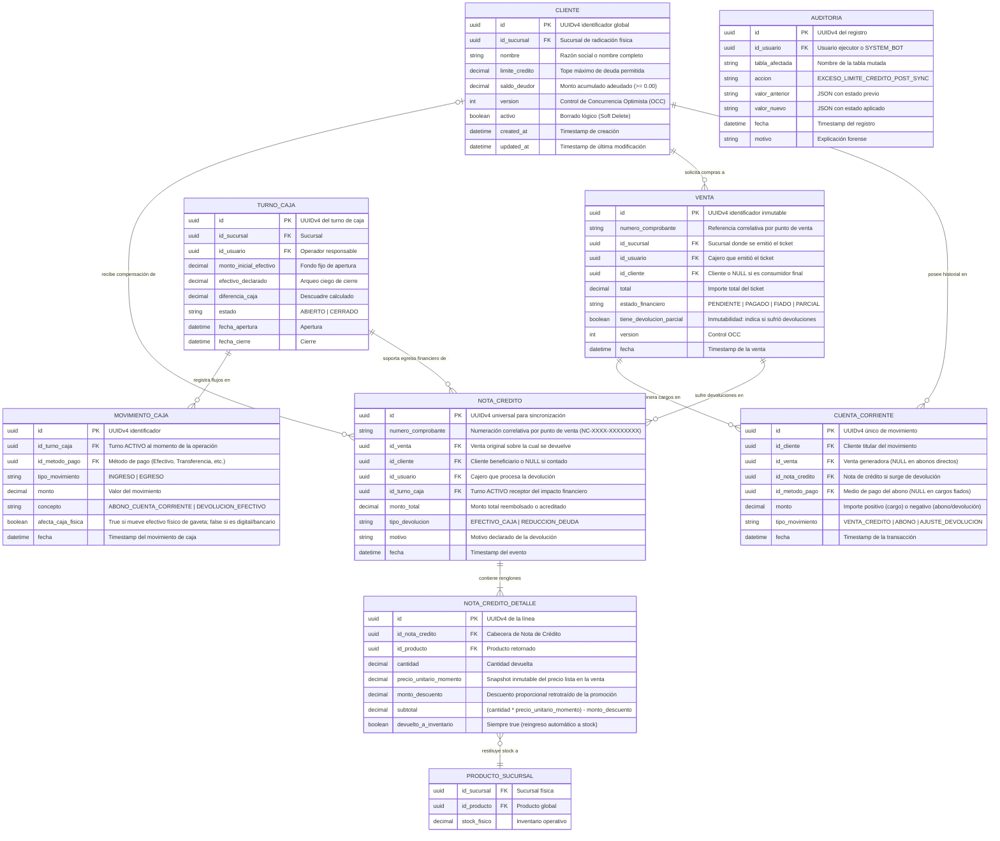
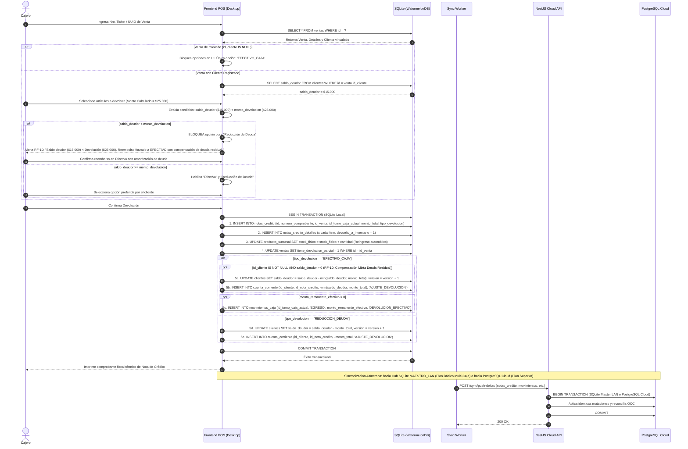
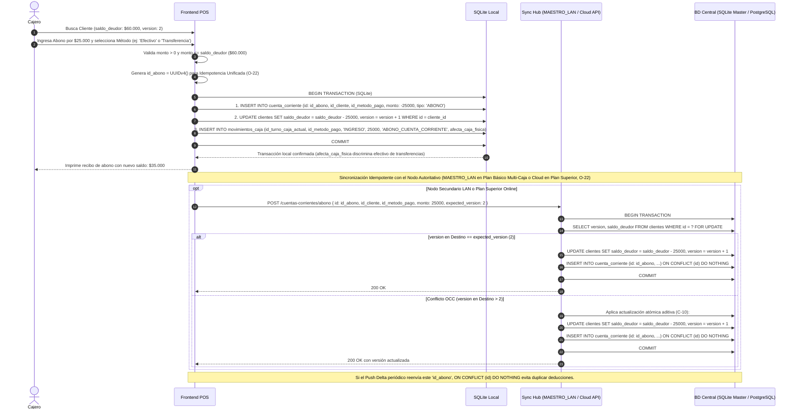
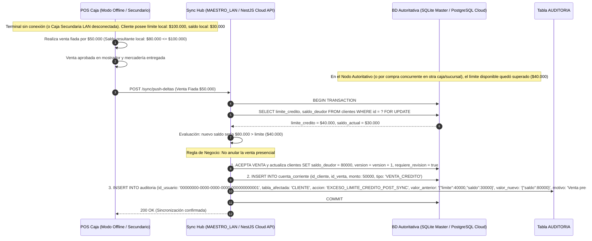

# 📁 File-Level Specs: Módulo de Cuentas Corrientes, Devoluciones y Notas de Crédito

A continuación se detalla el **Plano de Creación y Modificación de Archivos** para la construcción del **Módulo de Cuentas Corrientes, Devoluciones y Notas de Crédito**, garantizando independencia entre la base local SQLite (WatermelonDB) y PostgreSQL en la Nube bajo la metodología **Spec-Driven Development (SDD)**.

---

## 🏗️ Árbol de Archivos del Módulo

```text
poslyon/
├── libs/
│   └── domain-core/
│       └── src/
│           ├── enums/
│           │   ├── tipo-movimiento-cc.enum.ts          # VENTA_CREDITO, ABONO, AJUSTE_DEVOLUCION
│           │   ├── tipo-devolucion.enum.ts             # EFECTIVO_CAJA, REDUCCION_DEUDA
│           │   ├── motivo-devolucion.enum.ts           # DEFECTO_FABRICA, ERROR_COMPRA, VENCIMIENTO, OTRO
│           │   └── accion-auditoria.enum.ts            # EXCESO_LIMITE_CREDITO_POST_SYNC, AJUSTE_STOCK_MERMA
│           ├── interfaces/
│           │   ├── cliente.interface.ts                # Estructura del cliente con límite y saldo deudor
│           │   ├── cuenta-corriente.interface.ts       # Histórico de movimientos de crédito/abono
│           │   ├── nota-credito.interface.ts           # Comprobante de devolución vinculado al turno actual
│           │   ├── nota-credito-detalle.interface.ts   # Artículos devueltos con precio histórico congelado
│           │   └── movimiento-caja.interface.ts        # Ingresos/Egresos de caja física
│           └── dtos/
│               ├── registrar-abono.dto.ts              # Payload para abonar deuda presencial/remota
│               ├── crear-devolucion.dto.ts             # Payload para emitir nota de crédito y procesar devolución
│               ├── item-devolucion.dto.ts              # Sub-payload de cada artículo devuelto
│               └── sync-cuenta-corriente-delta.dto.ts  # Delta sync local-first con OCC
├── apps/
│   ├── backend-cloud/
│   │   └── src/
│   │       └── modules/
│   │           ├── cuentas-corrientes/
│   │           │   ├── entities/
│   │           │   │   ├── cliente.entity.ts           # Entidad TypeORM con version (OCC) y límite
│   │           │   │   └── cuenta-corriente.entity.ts  # Entidad inmutable de ledger contable
│   │           │   ├── controllers/
│   │           │   │   └── cuentas-corrientes.controller.ts # REST endpoints /clientes/:id/abono, etc.
│   │           │   └── services/
│   │           │       └── cuentas-corrientes.service.ts    # Transacciones ACID, OCC y manejo post-sync
│   │           └── devoluciones/
│   │               ├── entities/
│   │               │   ├── nota-credito.entity.ts      # Cabecera con id_turno_caja actual y correlativo
│   │               │   └── nota-credito-detalle.entity.ts # Detalle inmutable
│   │               ├── controllers/
│   │               │   └── devoluciones.controller.ts  # Endpoints /devoluciones
│   │               └── services/
│   │                   └── devoluciones.service.ts     # Transacciones de devolución y ajuste de stock
│   └── pos-desktop/
│       └── src/
│           ├── database/
│           │   ├── schema.ts                           # Esquema WatermelonDB (clientes, cuentas_corrientes, etc.)
│           │   └── models/
│           │       ├── Cliente.ts                      # Modelo reactivo local
│           │       ├── CuentaCorriente.ts              # Modelo reactivo de movimientos
│           │       ├── NotaCredito.ts                  # Modelo de devoluciones
│           │       └── NotaCreditoDetalle.ts           # Modelo de renglones devueltos
│           ├── store/
│           │   ├── useCuentasCorrientesStore.ts        # Store global Zustand para abonos y consulta
│           │   └── useDevolucionesStore.ts             # Store global Zustand para wizard de devolución
│           └── services/
│               ├── cuentas-corrientes-local.service.ts # Transacciones SQLite locales y cálculo de saldos
│               └── devoluciones-local.service.ts       # Validaciones UI y guardas contra saldo negativo
```

---

## 📐 Modelado Arquitectónico UML (Mermaid.js)

### 1. Diagrama Entidad-Relación (ERD) Exhaustivo del Módulo



---

### 2. Diagrama de Secuencia: Flujo de Devolución y Regla de Saldo Deudor



---

### 3. Diagrama de Secuencia: Abono de Cuenta Corriente y OCC



---

### 4. Diagrama de Secuencia: Resiliencia Offline ante Límite Superado (`EXCESO_LIMITE_CREDITO_POST_SYNC`)



---

## 📝 Especificación Detallada de Archivos Clave

### 1. `libs/domain-core/src/enums/tipo-devolucion.enum.ts`
```typescript
export enum TipoDevolucion {
  EFECTIVO_CAJA = 'EFECTIVO_CAJA',
  REDUCCION_DEUDA = 'REDUCCION_DEUDA',
  SIN_REINTEGRO_MONETARIO = 'SIN_REINTEGRO_MONETARIO', // Para ventas en PENDIENTE (el dinero no ingresó a caja en su momento)
}
```

### 2. `libs/domain-core/src/enums/tipo-movimiento-cc.enum.ts`
```typescript
export enum TipoMovimientoCC {
  VENTA_CREDITO = 'VENTA_CREDITO',
  ABONO = 'ABONO',
  AJUSTE_DEVOLUCION = 'AJUSTE_DEVOLUCION',
}
```

### 3. `libs/domain-core/src/enums/motivo-devolucion.enum.ts`
```typescript
export enum MotivoDevolucion {
  DEFECTO_FABRICA = 'DEFECTO_FABRICA',
  ERROR_COMPRA = 'ERROR_COMPRA',
  VENCIMIENTO = 'VENCIMIENTO',
  OTRO = 'OTRO',
}
```

### 4. `libs/domain-core/src/enums/accion-auditoria.enum.ts`
*(Resolución S-04 y RF-21: Catálogo Universal Unificado de Auditoría Forense)*
```typescript
export enum AccionAuditoria {
  // Operaciones Genéricas del Interceptor REST / TypeORM
  CREACION = 'CREACION',
  MODIFICACION = 'MODIFICACION',
  SOFT_DELETE = 'SOFT_DELETE',
  OPERACION = 'OPERACION',

  // Planes Comerciales y Licenciamiento (RF-21)
  UPGRADE_PLAN_COMERCIAL = 'UPGRADE_PLAN_COMERCIAL',

  // Sincronización y Resiliencia Local-First (OCC / Sobregiros / Stock Negativo)
  RESOLUCION_MERGE_OCC = 'RESOLUCION_MERGE_OCC',
  EXCESO_LIMITE_CREDITO_POST_SYNC = 'EXCESO_LIMITE_CREDITO_POST_SYNC',
  VENTA_OFFLINE_STOCK_NEGATIVO = 'VENTA_OFFLINE_STOCK_NEGATIVO',

  // Reconciliación de Mercadería Huérfana y Venta Rápida (Comodines)
  RECONCILIACION_DISCREPANCIA = 'RECONCILIACION_DISCREPANCIA',
  RECONCILIACION_DISCREPANCIA_TURNO = 'RECONCILIACION_DISCREPANCIA_TURNO',
  DESCUADRE_STOCK_RECONCILIACION = 'DESCUADRE_STOCK_RECONCILIACION',
  MERMA_LOGICA = 'MERMA_LOGICA',
  SOBRANTE_LOGICO = 'SOBRANTE_LOGICO',

  // Ajustes de Inventario, Merma y Cuarentena
  AJUSTE_STOCK = 'AJUSTE_STOCK',
  AJUSTE_STOCK_MERMA = 'AJUSTE_STOCK_MERMA',
  RESOLUCION_CUARENTENA = 'RESOLUCION_CUARENTENA',
  RECHAZO_FALTANTE = 'RECHAZO_FALTANTE',

  // Precios, Proveedores y Recepción de Mercadería
  AJUSTE_PRECIO = 'AJUSTE_PRECIO',
  CAMBIO_PRECIO_POR_RECEPCION = 'CAMBIO_PRECIO_POR_RECEPCION',
  CAMBIO_PRECIO_COSTO = 'CAMBIO_PRECIO_COSTO',
  CAMBIO_PRECIO_VENTA = 'CAMBIO_PRECIO_VENTA',
  NUEVO_ALIAS_DICCIONARIO = 'NUEVO_ALIAS_DICCIONARIO',

  // Caja, Turnos y Ventas
  RECTIFICACION_TURNO_CAJA = 'RECTIFICACION_TURNO_CAJA',
  REAPERTURA_TURNO_CAJA = 'REAPERTURA_TURNO_CAJA',
  ANULACION_VENTA = 'ANULACION_VENTA',
  DEVOLUCION_MERCADERIA = 'DEVOLUCION_MERCADERIA',
}

// Alias de retrocompatibilidad arquitectónica
export const AuditAction = AccionAuditoria;
```

### 5. `libs/domain-core/src/interfaces/cliente.interface.ts`
```typescript
export interface ICliente {
  id: string; // UUIDv4
  id_sucursal: string; // UUIDv4
  nombre: string;
  limite_credito: number; // >= 0.00
  saldo_deudor: number; // >= 0.00 (Nunca negativo)
  version: number; // Control OCC
  activo: boolean; // Soft delete
  created_at: string;
  updated_at: string;
}
```

### 6. `libs/domain-core/src/interfaces/cuenta-corriente.interface.ts`
```typescript
import { TipoMovimientoCC } from '../enums/tipo-movimiento-cc.enum';

export interface ICuentaCorriente {
  id: string; // UUIDv4
  id_cliente: string;
  id_venta?: string | null;
  id_nota_credito?: string | null;
  id_metodo_pago?: string | null; // UUIDv4 si surge de un abono con medio específico
  monto: number; // Positivo para cargos, negativo para abonos o devoluciones
  tipo_movimiento: TipoMovimientoCC;
  fecha: string; // ISO8601
}
```

### 7. `libs/domain-core/src/interfaces/nota-credito.interface.ts`
```typescript
import { TipoDevolucion } from '../enums/tipo-devolucion.enum';
import { INotaCreditoDetalle } from './nota-credito-detalle.interface';

export interface INotaCredito {
  id: string; // UUIDv4 universal
  numero_comprobante: string; // Correlativo por punto de venta (ej: NC-0001-00000042)
  id_venta: string; // Venta histórica vinculada (inmutable)
  id_cliente?: string | null; // NULL si fue venta anónima
  id_usuario: string; // Cajero que atiende la devolución
  id_turno_caja: string; // Turno ACTIVO donde impacta el arqueo
  monto_total: number;
  tipo_devolucion: TipoDevolucion;
  motivo: string;
  fecha: string; // ISO8601
  detalles: INotaCreditoDetalle[];
}
```

### 8. `libs/domain-core/src/interfaces/nota-credito-detalle.interface.ts`
```typescript
export interface INotaCreditoDetalle {
  id: string; // UUIDv4
  id_nota_credito: string;
  id_producto: string;
  cantidad: number;
  precio_unitario_momento: number; // Snapshot inmutable del precio lista histórico
  monto_descuento: number; // Descuento proporcional retrotraído de promociones
  subtotal: number; // (cantidad * precio_unitario_momento) - monto_descuento
  devuelto_a_inventario: boolean; // Siempre true (reingreso automático a stock_fisico)
}
```

### 9. `libs/domain-core/src/interfaces/movimiento-caja.interface.ts`
```typescript
export interface IMovimientoCaja {
  id: string; // UUIDv4
  id_turno_caja: string; // Turno de caja receptor
  id_metodo_pago?: string | null; // UUIDv4 de METODO_PAGO (Efectivo, Transferencia, etc.)
  tipo_movimiento: 'INGRESO' | 'EGRESO';
  monto: number;
  concepto: string; // 'ABONO_CUENTA_CORRIENTE' | 'DEVOLUCION_EFECTIVO' | string
  afecta_caja_fisica: boolean; // true si altera billetes físicos de la gaveta, false si es digital/bancario
  fecha: string; // ISO8601
}
```

### 10. `libs/domain-core/src/dtos/crear-devolucion.dto.ts`
```typescript
import { IsUUID, IsEnum, IsString, IsArray, ValidateNested, ArrayMinSize, IsNotEmpty } from 'class-validator';
import { Type } from 'class-transformer';
import { TipoDevolucion } from '../enums/tipo-devolucion.enum';
import { ItemDevolucionDto } from './item-devolucion.dto';

export class CrearDevolucionDto {
  @IsUUID('4')
  id_venta!: string;

  @IsUUID('4')
  id_turno_caja!: string;

  @IsEnum(TipoDevolucion)
  tipo_devolucion!: TipoDevolucion;

  @IsString()
  @IsNotEmpty()
  motivo!: string;

  @IsArray()
  @ArrayMinSize(1)
  @ValidateNested({ each: true })
  @Type(() => ItemDevolucionDto)
  items!: ItemDevolucionDto[];

  @IsOptional()
  @IsBoolean()
  confirmar_sin_dinero?: boolean; // Obligatorio si la venta se encuentra en estado financiero PENDIENTE
}
```

### 11. `libs/domain-core/src/validators/is-uuid-or-nil.decorator.ts`
*(Resolución S-03: Soporte de UUIDs Reservados de Sistema)*
```typescript
import { registerDecorator, ValidationOptions, ValidationArguments } from 'class-validator';

export const RESERVED_UUIDS = {
  PRODUCTO_COMODIN: '00000000-0000-0000-0000-000000000000',
  SYSTEM_BOT: '00000000-0000-0000-0000-000000000001',
} as const;

/**
 * Validador customizado que admite identificadores UUIDv4 estándar de la aplicación
 * o los UUIDs reservados de sistema (NIL para Producto Comodín y SYSTEM_BOT para tareas automáticas).
 * Evita el rechazo erróneo que produce @IsUUID('4') ante artículos comodín devueltos.
 */
export function IsUUIDOrNil(validationOptions?: ValidationOptions) {
  return function (object: Object, propertyName: string) {
    registerDecorator({
      name: 'isUUIDOrNil',
      target: object.constructor,
      propertyName: propertyName,
      options: validationOptions,
      validator: {
        validate(value: any, args: ValidationArguments) {
          if (typeof value !== 'string') return false;
          if (value === RESERVED_UUIDS.PRODUCTO_COMODIN || value === RESERVED_UUIDS.SYSTEM_BOT) {
            return true;
          }
          const uuidV4Regex = /^[0-9a-f]{8}-[0-9a-f]{4}-4[0-9a-f]{3}-[89ab][0-9a-f]{3}-[0-9a-f]{12}$/i;
          return uuidV4Regex.test(value);
        },
        defaultMessage(args: ValidationArguments) {
          return `${args.property} debe ser un UUIDv4 válido o un UUID reservado de sistema (${RESERVED_UUIDS.PRODUCTO_COMODIN} / ${RESERVED_UUIDS.SYSTEM_BOT})`;
        },
      },
    });
  };
}
```

### 12. `libs/domain-core/src/dtos/item-devolucion.dto.ts`
```typescript
import { IsPositive } from 'class-validator';
import { IsUUIDOrNil } from '../validators/is-uuid-or-nil.decorator';

export class ItemDevolucionDto {
  // Resolución S-03: Se emplea @IsUUIDOrNil para admitir legítimamente la devolución de artículos comodín (00000000-0000-0000-0000-000000000000)
  @IsUUIDOrNil({ message: 'id_producto debe ser un UUIDv4 válido o el UUID reservado del comodín' })
  id_producto!: string;

  @IsPositive()
  cantidad!: number;
}
```

### 13. `libs/domain-core/src/dtos/registrar-abono.dto.ts`
```typescript
import { IsUUID, IsPositive, IsInt, Min, IsIn } from 'class-validator';

export class RegistrarAbonoDto {
  @IsUUID('4')
  id!: string; // UUIDv4 generado en el cliente para Idempotencia Unificada (O-22)

  @IsUUID('4')
  id_cliente!: string;

  @IsUUID('4')
  id_turno_caja!: string;

  @IsPositive()
  monto!: number;

  @IsUUID('4')
  id_metodo_pago!: string; // FK a METODO_PAGO (O-21)

  @IsIn(['EFECTIVO', 'TRANSFERENCIA'])
  metodo_pago!: 'EFECTIVO' | 'TRANSFERENCIA';

  @IsInt()
  @Min(0)
  expected_version!: number; // Para control OCC
}
```

#### Matriz de Respuestas HTTP de Cuentas Corrientes y Devoluciones
*(Resolución S-07: Estandarización de Códigos HTTP)*

| Endpoint | Código HTTP | Significado RFC 9110 | Condición en el Sistema |
|:---|:---|:---|:---|
| `POST /api/devoluciones` | **201 Created** | Created | Devolución procesada exitosamente; Nota de Crédito emitida e inventario/finanzas impactados. |
| `POST /api/devoluciones` | **400 Bad Request** | Bad Request | Ítems devueltos superan cantidad neta comprada, o intento de devolver a cuenta corriente a un cliente anónimo. |
| `POST /api/devoluciones` | **404 Not Found** | Not Found | La venta original especificada (`id_venta`) no existe en la base de datos. |
| `POST /api/devoluciones` | **422 Unprocessable Entity** | Unprocessable | Venta original en estado financiero PENDIENTE sin el flag confirmatorio obligatorio `confirmar_sin_dinero = true`. |
| `POST /api/cuentas-corrientes/abono` | **201 Created** | Created | Abono registrado en `CUENTA_CORRIENTE`, saldo deudor actualizado en `CLIENTE` y gaveta impactada si es efectivo. |
| `POST /api/cuentas-corrientes/abono` | **400 Bad Request** | Bad Request | Monto negativo, monto mayor al saldo deudor, o turno de caja cerrado. |
| `POST /api/cuentas-corrientes/abono` | **409 Conflict** | Conflict | Desfase OCC en versión del cliente (`expected_version != version_cloud`); resolver con merge aditivo. |

### 12b. `libs/domain-core/src/rules/validar-margen-credito.ts`

- **Propósito:** Función de dominio pura para evaluar el cupo de fiado disponible en frontend y backend sobre el delta a crédito (RF-08, RF-10), permitiendo pagos mixtos sin rechazos espurios.

```typescript
export interface ResultadoValidacionCredito {
  aprobado: boolean;
  disponible: number;
  exceso: number;
}

/**
 * Valida el margen de crédito disponible antes de otorgar una venta fiada o registrar cargos.
 * Evalúa únicamente el delta que se imputa a la cuenta corriente, permitiendo pagos mixtos.
 */
export function validarMargenCredito(
  saldoActual: number,
  limiteCredito: number,
  montoFiadoSolicitado: number
): ResultadoValidacionCredito {
  const disponible = Math.max(0, limiteCredito - saldoActual);
  const nuevoSaldo = saldoActual + montoFiadoSolicitado;

  if (nuevoSaldo > limiteCredito) {
    return {
      aprobado: false,
      disponible,
      exceso: nuevoSaldo - limiteCredito,
    };
  }

  return {
    aprobado: true,
    disponible,
    exceso: 0,
  };
}
```

---

## 💻 Implementación de Servicios y Lógica Local / Cloud

### 13. `apps/pos-desktop/src/services/cuentas-corrientes-local.service.ts`
```typescript
import { Database } from '@nozbe/watermelondb';
import { RegistrarAbonoDto } from '@poslyon/domain-core';

export class CuentasCorrientesLocalService {
  constructor(private readonly db: Database) {}

  /**
   * Registra un abono global a la cuenta corriente del cliente de forma atómica en SQLite local.
   * - Inserta asiento inmutable en CUENTA_CORRIENTE (id_venta = NULL).
   * - Si el método es EFECTIVO, inserta INGRESO en MOVIMIENTOS_CAJA imputado al turno activo (RF-17).
   * - Reduce saldo_deudor en CLIENTES aplicando control de concurrencia optimista (OCC).
   */
  async registrarAbono(dto: RegistrarAbonoDto): Promise<{ nuevo_saldo: number }> {
    return await this.db.write(async () => {
      // 1. Obtener cliente y verificar OCC
      const cliente = await this.db.get('clientes').find(dto.id_cliente);
      if (!cliente) {
        throw new Error(`Cliente con ID ${dto.id_cliente} no encontrado.`);
      }

      const versionActual = (cliente as any).version;
      if (versionActual !== dto.expected_version) {
        throw new Error('Conflicto de concurrencia (OCC): El perfil del cliente fue actualizado por otra terminal.');
      }

      const saldoActual = Number((cliente as any).saldo_deudor);
      if (dto.monto <= 0) {
        throw new Error('El monto del abono debe ser mayor a 0.');
      }
      if (dto.monto > saldoActual) {
        throw new Error(`El abono ($${dto.monto}) no puede ser superior a la deuda actual ($${saldoActual}).`);
      }

      // 2. Insertar asiento inmutable en Libro Mayor (CUENTA_CORRIENTE)
      const abonoCcId = crypto.randomUUID();
      await this.db.get('cuenta_corriente').create((record: any) => {
        record._raw.id = abonoCcId;
        record.id_cliente = dto.id_cliente;
        record.id_venta = null; // No modifica ventas pasadas (RF-08)
        record.id_nota_credito = null;
        record.monto = -dto.monto; // Signed Ledger: negativo para abonos que disminuyen deuda
        record.tipo_movimiento = 'ABONO';
        record.fecha = new Date().toISOString();
      });

      // 3. Impacto en turno de caja si afecta caja física (Arqueo Ciego RF-17)
      if (dto.metodo_pago === 'EFECTIVO') {
        await this.db.get('movimientos_caja').create((record: any) => {
          record._raw.id = crypto.randomUUID();
          record.id_turno_caja = dto.id_turno_caja; // Imputado al turno activo
          record.tipo_movimiento = 'INGRESO';
          record.monto = dto.monto;
          record.concepto = 'Abono Cuenta Corriente';
          record.fecha = new Date().toISOString();
        });
      }

      // 4. Reducción de saldo deudor e incremento de versión OCC
      const nuevoSaldo = saldoActual - dto.monto;
      await cliente.update((rec: any) => {
        rec.saldo_deudor = nuevoSaldo;
        rec.version += 1;
      });

      return { nuevo_saldo: nuevoSaldo };
    });
  }
}
```

### 14. `apps/pos-desktop/src/services/devoluciones-local.service.ts`
```typescript
import { Database } from '@nozbe/watermelondb';
import { TipoDevolucion } from '@poslyon/domain-core';
import { CrearDevolucionDto } from '@poslyon/domain-core';

export class DevolucionesLocalService {
  constructor(private readonly db: Database) {}

  /**
   * Procesa la devolución localmente con transaccionalidad atómica y guardas de negocio estrictas.
   */
  async procesarDevolucion(dto: CrearDevolucionDto, usuarioId: string): Promise<string> {
    return await this.db.write(async () => {
      // 1. Obtener la venta original
      const venta = await this.db.get('ventas').find(dto.id_venta);
      if (!venta) {
        throw new Error(`Venta con ID ${dto.id_venta} no encontrada.`);
      }

      // 2. Obtener items comprados para snapshot de precio y validación de cantidad
      const ventaDetalles = await this.db
        .get('venta_detalles')
        .query()
        .fetch(); // Filtrado por venta
      
      let montoTotalCalculado = 0;
      const itemsProcesados = dto.items.map((item) => {
        const original = (ventaDetalles as any[]).find((d) => d.id_producto === item.id_producto);
        if (!original) {
          throw new Error(`El producto ${item.id_producto} no pertenece a la venta original.`);
        }
        if (item.cantidad > original.cantidad) {
          throw new Error(`La cantidad devuelta supera la cantidad original comprada.`);
        }

        // RF-09 / RF-06: Deducción proporcional de promociones para evitar sobrepagos
        const descuentoUnitario = original.monto_descuento ? original.monto_descuento / original.cantidad : 0;
        const descuentoItemDevuelto = item.cantidad * descuentoUnitario;
        const subtotal = (item.cantidad * original.precio_unitario) - descuentoItemDevuelto;

        montoTotalCalculado += subtotal;
        return {
          id_producto: item.id_producto,
          cantidad: item.cantidad,
          precio_unitario_momento: original.precio_unitario,
          monto_descuento: descuentoItemDevuelto,
          subtotal,
        };
      });

      // 3. Regla de negocio sobre estado financiero y compensación:
      if (venta.estado_financiero === 'PENDIENTE') {
        // El dinero nunca ingresó a caja. Solo se devuelve stock físico previa confirmación explícita.
        if (!dto.confirmar_sin_dinero) {
          throw new Error(
            'ADVERTENCIA_VENTA_PENDIENTE: Esta venta está en estado PENDIENTE (no se registró ingreso de dinero a caja). Se requiere confirmación explícita para procesar devolución sin reintegro de dinero.'
          );
        }
        dto.tipo_devolucion = TipoDevolucion.SIN_REINTEGRO_MONETARIO;
      } else if (dto.tipo_devolucion === TipoDevolucion.EFECTIVO_CAJA && venta.estado_financiero === 'FIADO') {
        throw new Error('Ventas fiadas no admiten devolución en EFECTIVO_CAJA; se debe amortizar la deuda en Cuenta Corriente (REDUCCION_DEUDA).');
      } else if (!venta.id_cliente && dto.tipo_devolucion !== TipoDevolucion.EFECTIVO_CAJA && dto.tipo_devolucion !== TipoDevolucion.SIN_REINTEGRO_MONETARIO) {
        throw new Error('Ventas anónimas sólo admiten devolución en EFECTIVO_CAJA.');
      }

      if (venta.id_cliente && dto.tipo_devolucion === TipoDevolucion.REDUCCION_DEUDA) {
        const cliente = await this.db.get('clientes').find(venta.id_cliente);
        if (cliente.saldo_deudor < montoTotalCalculado) {
          throw new Error(
            `Saldo deudor insuficiente ($${cliente.saldo_deudor} < $${montoTotalCalculado}). Se prohíbe saldo negativo; forzar EFECTIVO_CAJA.`
          );
        }
      }

      // 4. Generar Nota de Crédito con correlativo estricto por sucursal (Resolución S-09)
      const notaCreditoId = crypto.randomUUID();
      const countNC = await this.db.get('notas_credito').query().fetchCount();
      const secuencia = String(countNC + 1).padStart(8, '0');
      const numeroComprobante = `NC-${venta.id_sucursal || 'SUC01'}-${secuencia}`; // ej: NC-SUC01-00000001

      await this.db.get('notas_credito').create((record: any) => {
        record._raw.id = notaCreditoId;
        record.numero_comprobante = numeroComprobante;
        record.id_venta = dto.id_venta;
        record.id_cliente = venta.id_cliente || null;
        record.id_usuario = usuarioId;
        record.id_turno_caja = dto.id_turno_caja; // Turno ACTIVO
        record.monto_total = montoTotalCalculado;
        record.tipo_devolucion = dto.tipo_devolucion;
        record.motivo = dto.motivo;
        record.fecha = new Date().toISOString();
      });

      // 5. Inserción de detalles y reingreso condicionado por motivo (Resolución S-08)
      // Si el motivo es DEFECTO_FABRICA o VENCIMIENTO, no se reingresa a góndola vendible; se asienta merma forense.
      const esReintegrable = dto.motivo === MotivoDevolucion.CAMBIO_TALLE_COLOR || dto.motivo === MotivoDevolucion.ERROR_COMPRA;

      for (const item of itemsProcesados) {
        await this.db.get('nota_credito_detalles').create((record: any) => {
          record._raw.id = crypto.randomUUID();
          record.id_nota_credito = notaCreditoId;
          record.id_producto = item.id_producto;
          record.cantidad = item.cantidad;
          record.precio_unitario_momento = item.precio_unitario_momento;
          record.monto_descuento = item.monto_descuento;
          record.subtotal = item.subtotal;
          record.devuelto_a_inventario = esReintegrable;
        });

        if (esReintegrable) {
          // Reingreso automático al stock vendible de sucursal
          const stockRecord = await this.db.get('producto_sucursal').find(item.id_producto);
          if (stockRecord) {
            await stockRecord.update((rec: any) => {
              rec.stock_fisico += item.cantidad;
            });
          }
        } else {
          // Producto defectuoso o vencido: se aparta para scrap o proveedor registrando merma en auditoría
          await this.db.get('auditoria').create((rec: any) => {
            rec.id = crypto.randomUUID();
            rec.id_usuario = usuarioId;
            rec.tabla_afectada = 'PRODUCTO_SUCURSAL';
            rec.id_registro_afectado = item.id_producto;
            rec.accion = AccionAuditoria.AJUSTE_STOCK_MERMA;
            rec.motivo = `Devolución por ${dto.motivo} - Mercadería apartada (sin reingreso a góndola vendible)`;
            rec.fecha = new Date().toISOString();
          });
        }
      }

      // 6. Marcar Venta con tiene_devolucion_parcial = true (Inmutabilidad histórica protegida)
      await venta.update((rec: any) => {
        rec.tiene_devolucion_parcial = true;
      });

      // 7. Aplicar impacto financiero según tipo_devolucion (RF-10)
      if (dto.tipo_devolucion === TipoDevolucion.SIN_REINTEGRO_MONETARIO) {
        // Venta PENDIENTE: Los productos ya reingresaron a stock_fisico en el paso 5.
        // No se genera ningún movimiento de caja (egreso = $0) ni afectación de cuenta corriente.
      } else if (dto.tipo_devolucion === TipoDevolucion.EFECTIVO_CAJA) {
        let montoEgresoEfectivo = montoTotalCalculado;

        // Si la venta tiene cliente registrado y posee deuda pendiente, se amortiza la deuda residual a $0.00
        if (venta.id_cliente) {
          const cliente = await this.db.get('clientes').find(venta.id_cliente);
          if (cliente.saldo_deudor > 0) {
            const montoCompensadoDeuda = Math.min(cliente.saldo_deudor, montoTotalCalculado);
            montoEgresoEfectivo = montoTotalCalculado - montoCompensadoDeuda;

            await cliente.update((rec: any) => {
              rec.saldo_deudor -= montoCompensadoDeuda;
              rec.version += 1;
            });

            await this.db.get('cuenta_corriente').create((record: any) => {
              record._raw.id = crypto.randomUUID();
              record.id_cliente = venta.id_cliente;
              record.id_nota_credito = notaCreditoId;
              record.monto = -montoCompensadoDeuda;
              record.tipo_movimiento = 'AJUSTE_DEVOLUCION';
              record.fecha = new Date().toISOString();
            });
          }
        }

        // Se registra el egreso contable en caja únicamente por el saldo remanente a entregar físicamente
        if (montoEgresoEfectivo > 0) {
          await this.db.get('movimientos_caja').create((record: any) => {
            record._raw.id = crypto.randomUUID();
            record.id_turno_caja = dto.id_turno_caja; // Impacta turno activo
            record.tipo_movimiento = 'EGRESO';
            record.monto = montoEgresoEfectivo;
            record.concepto = 'DEVOLUCION_EFECTIVO';
            record.fecha = new Date().toISOString();
          });
        }
      } else if (dto.tipo_devolucion === TipoDevolucion.REDUCCION_DEUDA && venta.id_cliente) {
        const cliente = await this.db.get('clientes').find(venta.id_cliente);
        await cliente.update((rec: any) => {
          rec.saldo_deudor -= montoTotalCalculado;
          rec.version += 1;
        });

        await this.db.get('cuenta_corriente').create((record: any) => {
          record._raw.id = crypto.randomUUID();
          record.id_cliente = venta.id_cliente;
          record.id_nota_credito = notaCreditoId;
          record.monto = -montoTotalCalculado;
          record.tipo_movimiento = 'AJUSTE_DEVOLUCION';
          record.fecha = new Date().toISOString();
        });
      }

      return notaCreditoId;
    });
  }
}
```

### 15. `apps/backend-cloud/src/modules/cuentas-corrientes/services/cuentas-corrientes.service.ts`
```typescript
import { Injectable, BadRequestException } from '@nestjs/common';
import { DataSource } from 'typeorm';
import { AccionAuditoria, TipoMovimientoCC } from '@poslyon/domain-core';

@Injectable()
export class CuentasCorrientesService {
  private readonly SYSTEM_BOT_UUID = '00000000-0000-0000-0000-000000000001';

  constructor(private readonly dataSource: DataSource) {}

  /**
   * Procesa venta a fiado o mixta sincronizada desde el punto de venta offline.
   * Si la venta sobrepasa el límite modificado remotamente, la acepta y registra evento en AUDITORIA.
   */
  async sincronizarVentaCreditoDelta(
    idCliente: string,
    idVenta: string,
    montoCredito: number,
    usuarioSincronizadorId: string
  ): Promise<void> {
    const queryRunner = this.dataSource.createQueryRunner();
    await queryRunner.connect();
    await queryRunner.startTransaction();

    try {
      // Bloqueo pesimista para actualización atómica en PostgreSQL
      const cliente = await queryRunner.manager.query(
        `SELECT id, limite_credito, saldo_deudor, version FROM cliente WHERE id = $1 FOR UPDATE`,
        [idCliente]
      );

      if (!cliente || cliente.length === 0) {
        throw new BadRequestException(`Cliente ${idCliente} inexistente en Nube.`);
      }

      const { limite_credito, saldo_deudor, version } = cliente[0];
      const nuevoSaldo = Number(saldo_deudor) + Number(montoCredito);
      const limite = Number(limite_credito);

      // Evaluación de sobregiro post-sync
      if (nuevoSaldo > limite) {
        await queryRunner.manager.query(
          `INSERT INTO auditoria (id, id_usuario, tabla_afectada, accion, valor_anterior, valor_nuevo, motivo, fecha)
           VALUES ($1, $2, $3, $4, $5, $6, $7, NOW())`,
          [
            crypto.randomUUID(),
            this.SYSTEM_BOT_UUID,
            'CLIENTE',
            AccionAuditoria.EXCESO_LIMITE_CREDITO_POST_SYNC,
            JSON.stringify({ limite_credito: limite, saldo_deudor: Number(saldo_deudor) }),
            JSON.stringify({ saldo_deudor: nuevoSaldo }),
            `Venta offline sincronizada excede límite modificado remotamente ($${nuevoSaldo} > $${limite})`,
          ]
        );
      }

      // Actualizar cliente y registrar movimiento de cuenta corriente
      await queryRunner.manager.query(
        `UPDATE cliente SET saldo_deudor = $1, version = version + 1, updated_at = NOW() WHERE id = $2`,
        [nuevoSaldo, idCliente]
      );

      await queryRunner.manager.query(
        `INSERT INTO cuenta_corriente (id, id_cliente, id_venta, monto, tipo_movimiento, fecha)
         VALUES ($1, $2, $3, $4, $5, NOW())`,
        [crypto.randomUUID(), idCliente, idVenta, montoCredito, TipoMovimientoCC.VENTA_CREDITO]
      );

      await queryRunner.commitTransaction();
    } catch (error) {
      await queryRunner.rollbackTransaction();
      throw error;
    } finally {
      await queryRunner.release();
    }
  }
}
```

---

## 🔍 Protocolo de Auditoría de Trazabilidad (PAT)

### Métricas de Cobertura
- **% Elementos de Requisitos reflejados en Diagramas:** 100% (Gestión de deuda, abonos, prohibición de saldo negativo, reingreso automático a stock, inmutabilidad y `EXCESO_LIMITE_CREDITO_POST_SYNC`).
- **% Elementos de Diagramas justificados en el Código/Specs:** 100% (Cada entidad, FK y campo cuenta con representación en interfaces TypeScript, DTOs y lógica de servicios).

### Matriz de Trazabilidad
| Requisito BDD / Regla de Negocio | Elemento en Diagramas UML | Implementación en Código / DTO |
| :--- | :--- | :--- |
| **Prohibición de Saldo Negativo** | Decisión en Secuencia #2 (`saldo_deudor < monto`) | `DevolucionesLocalService` línea de guarda |
| **Compensación Mixta Deuda Residual (RF-10)** | Secuencia #2 (`monto_egreso = monto - saldo_deudor`) | `DevolucionesLocalService` ajuste dual en `cuenta_corriente` y `movimientos_caja` |
| **Garantía Reembolso Neto Promocional (RF-09)** | ERD `NOTA_CREDITO_DETALLE.monto_descuento` | `DevolucionesLocalService` deducción proporcional de descuentos |
| **Impacto en Turno Activo** | FK `NOTA_CREDITO.id_turno_caja` en Secuencia #2 y ERD | `INotaCredito.id_turno_caja` y `movimientos_caja` |
| **Reingreso a Inventario** | Paso 3 en Secuencia #2 y ERD `PRODUCTO_SUCURSAL` | `stock_fisico += item.cantidad` incondicional |
| **Numeración por Punto de Venta** | Atributo `numero_comprobante` en ERD | `INotaCredito.numero_comprobante` |
| **Sobregiro Offline Resiliente** | Secuencia #4 `EXCESO_LIMITE_CREDITO_POST_SYNC` | `CuentasCorrientesService.sincronizarVentaCreditoDelta` |
| **Auditoría System Bot** | Actor `SYSTEM_BOT` en Secuencia #4 y ERD `AUDITORIA` | `this.SYSTEM_BOT_UUID` (`00000000-0000-0000-0000-000000000001`) |
| **Abonos a Deuda Global (RF-08)** | Asiento en `CUENTA_CORRIENTE` (`id_venta = NULL`) y `MOVIMIENTO_CAJA` | `CuentasCorrientesLocalService.registrarAbono` |

---

## ✅ Checklist de Implementación SDD

- [ ] **Paso 1: Contratos y Dominio (`libs/domain-core`)**
  - [ ] Enums: `TipoDevolucion` (exclusivamente `EFECTIVO_CAJA` y `REDUCCION_DEUDA`), `TipoMovimientoCC`, `MotivoDevolucion`, `AccionAuditoria`.
  - [ ] Interfaces: `ICliente`, `ICuentaCorriente`, `INotaCredito`, `INotaCreditoDetalle`, `IMovimientoCaja`.
  - [ ] DTOs con `class-validator`: `CrearDevolucionDto`, `ItemDevolucionDto`, `RegistrarAbonoDto`.
- [ ] **Paso 2: Persistencia y Lógica Local (`apps/pos-desktop`)**
  - [ ] Modelos de WatermelonDB: `Cliente`, `CuentaCorriente`, `NotaCredito`, `NotaCreditoDetalle`.
  - [ ] Servicio `DevolucionesLocalService` con reingreso automático a stock y guardas de saldo deudor.
  - [ ] Compensación mixta en `DevolucionesLocalService` ante cliente con deuda residual (`RF-10`).
  - [ ] Servicio `CuentasCorrientesLocalService` con manejo de abonos y egresos/ingresos en caja.
  - [ ] Zustand stores para flujo reactivo de devolución y consulta de saldo en mostrador.
- [ ] **Paso 3: Servidor Central y Sincronización (`apps/backend-cloud`)**
  - [ ] Entidades TypeORM/Prisma (`ClienteEntity`, `CuentaCorrienteEntity`, `NotaCreditoEntity`).
  - [ ] `CuentasCorrientesService` con manejo de bloqueos `FOR UPDATE` y registro en `AUDITORIA` de `EXCESO_LIMITE_CREDITO_POST_SYNC`.
  - [ ] `DevolucionesService` en la nube para reconciliación de deltas push/pull.
- [ ] **Paso 4: Verificación y Testing Automatizado**
  - [ ] Test unitario: Comprobar rechazo en UI cuando `saldo_deudor < monto_devolucion` al intentar `REDUCCION_DEUDA`.
  - [ ] Test de integración: Comprobar que devolución en efectivo con cliente endeudado reduce `saldo_deudor` a $0 y genera egreso de caja únicamente por el remanente (RF-10).
  - [ ] Test de integración: Comprobar que devolución en efectivo genera `MOVIMIENTO_CAJA` atado al `id_turno_caja` actual.
  - [ ] Test de sincronización: Simular venta offline excediendo límite modificado en la nube y verificar aceptación e inserción en `AUDITORIA`.
