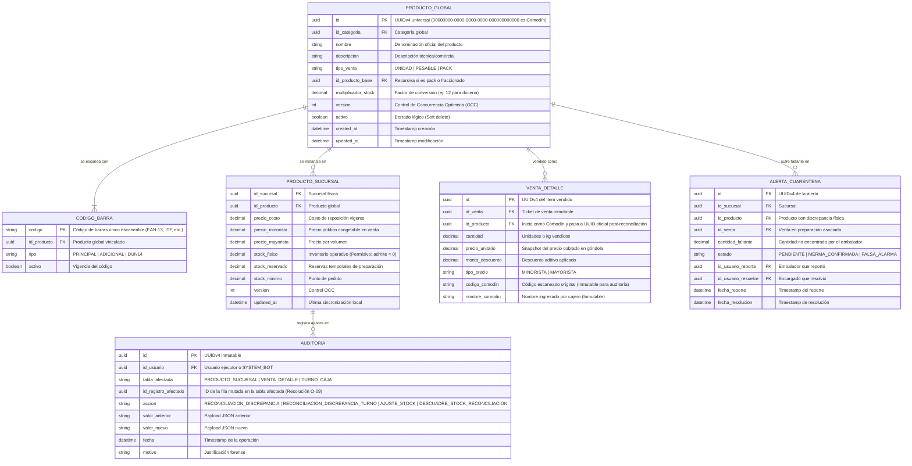
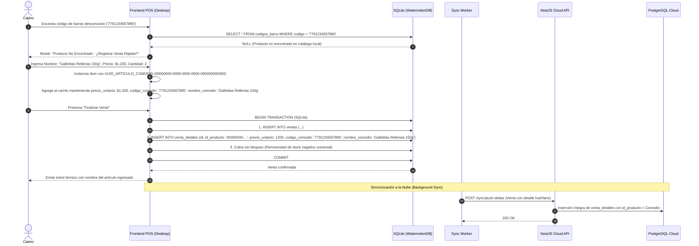
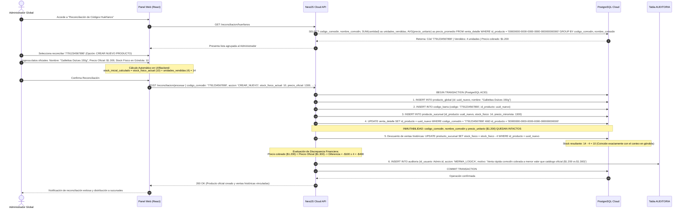
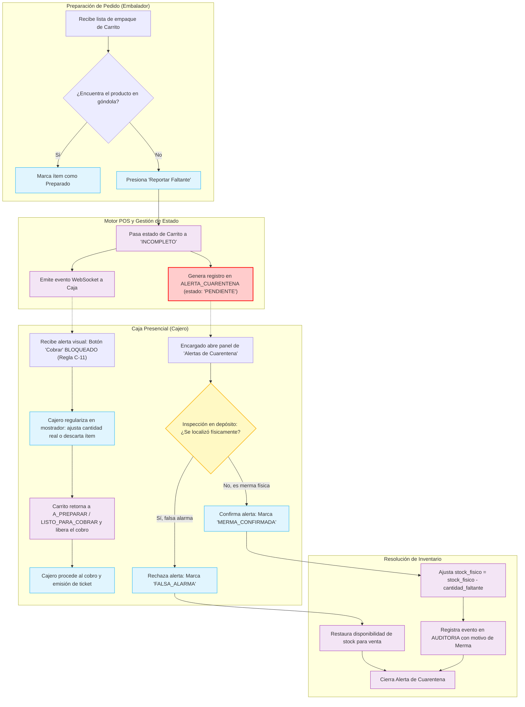

# 📁 File-Level Specs: Módulo de Inventario y Reconciliación de Códigos Huérfanos

A continuación se detalla el **Plano de Creación y Modificación de Archivos** para la construcción del **Módulo de Inventario y Reconciliación de Códigos Huérfanos (Artículo Comodín)** de POSLyon, bajo la metodología **Spec-Driven Development (SDD)**.

Este módulo regula:
1. La captura y venta presencial de productos no registrados u offline mediante el **Artículo Comodín** (`00000000-0000-0000-0000-000000000000`), manteniendo inmutables en `VENTA_DETALLE` el nombre, código y precio cobrado histórico.
2. La permisividad universal de `stock_fisico < 0` en caja física sin bloqueos en UI.
3. El flujo de **Cuarentena de Stock** y carritos en estado `INCOMPLETO` ante reportes de faltantes por embalador, bloqueando estrictamente el cobro en caja hasta su regularización en mostrador (Regla C-11).
4. El proceso de **Reconciliación de Códigos Huérfanos** en la Nube:
   - Creación de nuevo producto con la fórmula matemática:
     $$\text{stock\_inicial\_calculado} = \text{stock\_fisico\_actual} + \text{unidades\_vendidas\_historicas}$$
   - Vinculación a producto existente con ajuste auditado.
   - Cálculo automático de mermas/sobrantes lógicos por discrepancias entre `precio_unitario` cobrado y `precio_oficial`.

---

## 🏗️ Árbol de Archivos del Módulo

```text
poslyon/
├── libs/
│   └── domain-core/
│       └── src/
│           ├── constants/
│           │   └── comodin.constants.ts                # UUID_ARTICULO_COMODIN, UUID_SYSTEM_BOT
│           ├── enums/
│           │   ├── accion-reconciliacion.enum.ts       # CREAR_NUEVO, VINCULAR_EXISTENTE
│           │   ├── estado-cuarentena.enum.ts           # PENDIENTE, MERMA_CONFIRMADA, FALSA_ALARMA
│           │   ├── tipo-ajuste-stock.enum.ts           # RECONCILIACION_COMODIN, MERMA_FISICA, INVENTARIO_INICIAL
│           │   └── tipo-discrepancia-precio.enum.ts    # SOBRANTE_LOGICO, MERMA_LOGICA, PRECIO_EXACTO
│           ├── interfaces/
│           │   ├── producto-global.interface.ts        # Entidad maestra del catálogo central
│           │   ├── producto-sucursal.interface.ts      # Instancia local con stock físico y precios
│           │   ├── codigo-barra.interface.ts           # Mapeo N:1 de códigos de barras
│           │   ├── codigo-huerfano-resumen.interface.ts # Vista agregada para el panel del Administrador
│           │   ├── resultado-reconciliacion.interface.ts # Detalle de stock ajustado y mermas/sobrantes
│           │   └── alerta-cuarentena.interface.ts      # Manejo de stock faltante reportado en preparación
│           └── dtos/
│               ├── reconciliar-codigo-huerfano.dto.ts  # Payload validado para crear o vincular huérfano
│               ├── resolver-cuarentena.dto.ts          # Confirmación de merma o descarte de alerta
│               └── ajustar-stock-manual.dto.ts         # Ajuste por merma/sobrante con motivo obligatorio
├── apps/
│   ├── backend-cloud/
│   │   └── src/
│   │       └── modules/
│   │           └── inventario/
│   │               ├── entities/
│   │               │   ├── producto-global.entity.ts   # TypeORM Entity en PostgreSQL
│   │               │   ├── producto-sucursal.entity.ts # Precios y stock por sucursal
│   │               │   └── codigo-barra.entity.ts      # Mapeo relacional
│   │               ├── controllers/
│   │               │   ├── inventario.controller.ts    # CRUD catálogo, ajustes manuales
│   │               │   └── reconciliacion.controller.ts # GET /ventas/huerfanos, POST /reconciliar
│   │               └── services/
│   │                   ├── inventario.service.ts       # Gestión transaccional de existencias
│   │                   ├── reconciliacion.service.ts   # Algoritmo de deducción histórica y mermas
│   │                   └── cuarentena.service.ts       # Máquina de estados de cuarentena de stock
│   └── pos-desktop/
│       └── src/
│           ├── database/
│           │   ├── schema.ts                           # Esquema WatermelonDB con índices en codigo_barra
│           │   └── models/
│           │       ├── ProductoGlobal.ts               # Modelo reactivo local
│           │       ├── ProductoSucursal.ts             # Modelo con stock_fisico permisivo
│           │       └── CodigoBarra.ts                  # Modelo de búsqueda rápida
│           ├── store/
│           │   └── useInventarioStore.ts               # Búsqueda instantánea en SQLite y comodín
│           └── services/
│               ├── inventario-local.service.ts         # Manejo de venta con stock negativo y comodín
│               └── reconciliacion-local.service.ts     # Inserción de deltas de nuevos productos sincronizados
```

---

## 📐 Modelado Arquitectónico UML (Mermaid.js)

### 1. Diagrama Entidad-Relación (ERD) Exhaustivo del Módulo



---

### 2. Diagrama de Secuencia: Venta con Producto Comodín (Modo Offline)



---

### 3. Diagrama de Secuencia: Reconciliación en la Nube con Deducción Matemática y Mermas



---

### 4. Diagrama de Flujo: Stock en Cuarentena y Carrito Incompleto



---

## 📝 Especificación Detallada de Archivos Clave

### 1. `libs/domain-core/src/constants/comodin.constants.ts`
```typescript
/**
 * Identificador universal reservado para artículos no registrados / venta rápida offline.
 */
export const UUID_ARTICULO_COMODIN = '00000000-0000-0000-0000-000000000000';

/**
 * Identificador de sistema para procesos desatendidos, sync y reconciliación de fondo.
 */
export const UUID_SYSTEM_BOT = '00000000-0000-0000-0000-000000000001';
```

### 2. `libs/domain-core/src/enums/accion-reconciliacion.enum.ts`
```typescript
export enum AccionReconciliacion {
  CREAR_NUEVO = 'CREAR_NUEVO',
  VINCULAR_EXISTENTE = 'VINCULAR_EXISTENTE',
}
```

### 3. `libs/domain-core/src/enums/estado-cuarentena.enum.ts`
```typescript
export enum EstadoCuarentena {
  PENDIENTE = 'PENDIENTE',
  MERMA_CONFIRMADA = 'MERMA_CONFIRMADA',
  FALSA_ALARMA = 'FALSA_ALARMA',
}
```

### 4. `libs/domain-core/src/enums/tipo-discrepancia-precio.enum.ts`
```typescript
export enum TipoDiscrepanciaPrecio {
  PRECIO_EXACTO = 'PRECIO_EXACTO',
  SOBRANTE_LOGICO = 'SOBRANTE_LOGICO', // precio_cobrado > precio_oficial
  MERMA_LOGICA = 'MERMA_LOGICA',       // precio_cobrado < precio_oficial
}
```

### 5. `libs/domain-core/src/interfaces/codigo-huerfano-resumen.interface.ts`
```typescript
export interface ICodigoHuerfanoResumen {
  clave_agrupamiento: string; // codigo_comodin o 'SIN_CODIGO:' + TRIM(LOWER(nombre_comodin)) (Resolución O-27)
  codigo_comodin?: string | null; // NULL si fue producto digitado en mostrador sin código de barras
  id_sucursal: string; // Resolución C-22: Sucursal específica donde se originaron las ventas
  nombre_comodin_frecuente: string;
  unidades_vendidas_historicas: number;
  precio_promedio_cobrado: number;
  primera_venta: string; // ISO8601
  ultima_venta: string; // ISO8601
  total_facturado: number;
}
```

### 6. `libs/domain-core/src/interfaces/producto-global.interface.ts`
```typescript
export interface IProductoGlobal {
  id: string; // UUIDv4
  id_categoria: string;
  nombre: string;
  descripcion?: string | null;
  tipo_venta: 'UNIDAD' | 'PESABLE' | 'PACK';
  id_producto_base?: string | null;
  multiplicador_stock: number;
  version: number;
  activo: boolean;
  created_at: string;
  updated_at: string;
}
```

### 7. `libs/domain-core/src/interfaces/producto-sucursal.interface.ts`
```typescript
export interface IProductoSucursal {
  id_sucursal: string; // UUIDv4
  id_producto: string; // UUIDv4
  precio_costo: number;
  precio_minorista: number;
  precio_mayorista: number;
  stock_fisico: number; // Permite valores negativos (< 0) sin bloqueo
  stock_reservado: number;
  stock_minimo: number;
  version: number;
  updated_at: string;
}
```

### 8. `libs/domain-core/src/dtos/reconciliar-codigo-huerfano.dto.ts`
```typescript
import { IsUUID, IsEnum, IsString, IsNotEmpty, IsNumber, Min, IsOptional } from 'class-validator';
import { AccionReconciliacion } from '../enums/accion-reconciliacion.enum';

export class ReconciliarCodigoHuerfanoDto {
  @IsUUID('4')
  @IsNotEmpty()
  id_sucursal!: string; // Resolución C-22: Dimensión sucursal obligatoria para aislar existencias

  @IsOptional()
  @IsString()
  codigo_comodin?: string | null; // Opcional si fue comodín digitado sin código de barras (Resolución O-27)

  @IsOptional()
  @IsString()
  nombre_comodin?: string | null; // Requerido para reconciliar comodines sin código

  @IsEnum(AccionReconciliacion)
  accion!: AccionReconciliacion;

  // Campos requeridos si la acción es CREAR_NUEVO:
  @IsOptional()
  @IsString()
  @IsNotEmpty()
  nombre_oficial?: string;

  @IsOptional()
  @IsUUID('4')
  id_categoria?: string;

  @IsOptional()
  @IsNumber()
  @Min(0)
  precio_minorista?: number;

  @IsOptional()
  @IsNumber()
  @Min(0)
  stock_fisico_actual?: number; // Conteo real en góndola reportado por el admin

  // Campo requerido si la acción es VINCULAR_EXISTENTE:
  @IsOptional()
  @IsUUID('4')
  id_producto_existente?: string;

  @IsOptional()
  @IsNumber()
  @Min(0)
  ajuste_stock?: number; // Vía A (Resolución C-19): Ajuste físico manual opcional previo a la vinculación
}
```

### 9. `libs/domain-core/src/dtos/resolver-cuarentena.dto.ts`
```typescript
import { IsUUID, IsEnum, IsString, IsNotEmpty } from 'class-validator';
import { EstadoCuarentena } from '../enums/estado-cuarentena.enum';

export class ResolverCuarentenaDto {
  @IsUUID('4')
  id_alerta!: string;

  @IsEnum(EstadoCuarentena)
  estado_resolucion!: EstadoCuarentena.MERMA_CONFIRMADA | EstadoCuarentena.FALSA_ALARMA;

  @IsString()
  @IsNotEmpty()
  observacion!: string;
}
```

#### Matriz de Respuestas HTTP de Inventario y Reconciliación
*(Resolución S-07: Estandarización de Códigos HTTP)*

| Endpoint | Código HTTP | Significado RFC 9110 | Condición en el Sistema |
|:---|:---|:---|:---|
| `POST /api/reconciliacion/procesar` | **200 OK** | OK | Reconciliación exitosa. Producto oficial creado o vinculado, tickets históricos reasignados y stock deducido. |
| `POST /api/reconciliacion/procesar` | **400 Bad Request** | Bad Request | Faltan campos requeridos según la acción seleccionada (`CREAR_NUEVO` vs `VINCULAR_EXISTENTE`), o `id_sucursal` inválido. |
| `POST /api/reconciliacion/procesar` | **404 Not Found** | Not Found | Producto oficial destino no existe en el catálogo central para vinculación. |
| `POST /api/reconciliacion/procesar` | **409 Conflict** | Conflict | Desfase OCC en la versión de `PRODUCTO_SUCURSAL` o `PRODUCTO_GLOBAL`. |
| `POST /api/cuarentena/resolver` | **200 OK** | OK | Alerta de cuarentena resuelta (Merma confirmada o Falsa alarma registrada con auditoría). |
| `POST /api/cuarentena/resolver` | **404 Not Found** | Not Found | La alerta de cuarentena especificada no existe en la base de datos. |
| `POST /api/cuarentena/resolver` | **409 Conflict** | Conflict | La alerta ya fue resuelta previamente por otro usuario. |

---

## 💻 Implementación de Servicios y Lógica Transaccional

### 10. `apps/backend-cloud/src/modules/inventario/services/reconciliacion.service.ts`
```typescript
import { Injectable, BadRequestException, NotFoundException } from '@nestjs/common';
import { DataSource } from 'typeorm';
import {
  UUID_ARTICULO_COMODIN,
  AccionReconciliacion,
  TipoDiscrepanciaPrecio,
  ReconciliarCodigoHuerfanoDto,
  ICodigoHuerfanoResumen,
} from '@poslyon/domain-core';

@Injectable()
export class ReconciliacionService {
  constructor(private readonly dataSource: DataSource) {}

  /**
   * Obtiene la lista de códigos huérfanos agrupados pendientes de reconciliación,
   * opcionalmente filtrada por la sucursal de origen (Resolución C-22).
   */
  async obtenerCodigosHuerfanos(idSucursal?: string): Promise<ICodigoHuerfanoResumen[]> {
    const rawData = await this.dataSource.query(`
      SELECT 
        COALESCE(vd.codigo_comodin, CONCAT('SIN_CODIGO:', TRIM(LOWER(vd.nombre_comodin)))) AS clave_agrupamiento,
        vd.codigo_comodin,
        v.id_sucursal,
        MAX(vd.nombre_comodin) AS nombre_comodin_frecuente,
        SUM(vd.cantidad) AS unidades_vendidas_historicas,
        AVG(vd.precio_unitario) AS precio_promedio_cobrado,
        MIN(vd.created_at) AS primera_venta,
        MAX(vd.created_at) AS ultima_venta,
        SUM(vd.cantidad * (vd.precio_unitario - vd.monto_descuento)) AS total_facturado
      FROM venta_detalle vd
      INNER JOIN venta v ON vd.id_venta = v.id
      WHERE vd.id_producto = $1 
        AND ($2::uuid IS NULL OR v.id_sucursal = $2::uuid)
      GROUP BY 
        COALESCE(vd.codigo_comodin, CONCAT('SIN_CODIGO:', TRIM(LOWER(vd.nombre_comodin)))),
        vd.codigo_comodin,
        v.id_sucursal
      ORDER BY unidades_vendidas_historicas DESC
    `, [UUID_ARTICULO_COMODIN, idSucursal || null]);

    return rawData.map((r: any) => ({
      clave_agrupamiento: r.clave_agrupamiento,
      codigo_comodin: r.codigo_comodin,
      id_sucursal: r.id_sucursal,
      nombre_comodin_frecuente: r.nombre_comodin_frecuente,
      unidades_vendidas_historicas: Number(r.unidades_vendidas_historicas),
      precio_promedio_cobrado: Number(r.precio_promedio_cobrado),
      primera_venta: new Date(r.primera_venta).toISOString(),
      ultima_venta: new Date(r.ultima_venta).toISOString(),
      total_facturado: Number(r.total_facturado),
    }));
  }

  /**
   * Ejecuta la reconciliación atómica calculando stock_inicial, deducción histórica
   * aislada por sucursal y doble nivel de auditoría de mermas (Resoluciones C-21 y C-22).
   */
  async reconciliarCodigo(dto: ReconciliarCodigoHuerfanoDto, idUsuarioAdmin: string): Promise<string> {
    const queryRunner = this.dataSource.createQueryRunner();
    await queryRunner.connect();
    await queryRunner.startTransaction();

    try {
      // 1. Obtener todas las ventas huérfanas asociadas a este código o descripción y sucursal específica (Resoluciones C-22 y O-27)
      const ventasHuerfanas = await queryRunner.manager.query(`
        SELECT 
          vd.id, 
          vd.id_venta, 
          v.id_turno, 
          v.id_sucursal, 
          vd.cantidad, 
          vd.precio_unitario, 
          vd.monto_descuento,
          vd.nombre_comodin,
          vd.codigo_comodin
        FROM venta_detalle vd
        INNER JOIN venta v ON vd.id_venta = v.id
        WHERE vd.id_producto = $1 
          AND (
            ($2::text IS NOT NULL AND vd.codigo_comodin = $2::text)
            OR
            ($2::text IS NULL AND vd.codigo_comodin IS NULL AND TRIM(LOWER(vd.nombre_comodin)) = TRIM(LOWER($3::text)))
          )
          AND v.id_sucursal = $4
        FOR UPDATE OF vd
      `, [UUID_ARTICULO_COMODIN, dto.codigo_comodin || null, dto.nombre_comodin || null, dto.id_sucursal]);

      if (!ventasHuerfanas || ventasHuerfanas.length === 0) {
        throw new NotFoundException(`No existen ventas huérfanas pendientes para el código ${dto.codigo_comodin} en la sucursal ${dto.id_sucursal}`);
      }

      const unidadesVendidasHistoricas = ventasHuerfanas.reduce(
        (acc: number, curr: any) => acc + Number(curr.cantidad), 0
      );

      let targetProductoId: string;
      let precioOficial: number;

      if (dto.accion === AccionReconciliacion.CREAR_NUEVO) {
        if (!dto.nombre_oficial || !dto.id_categoria || dto.precio_minorista === undefined || dto.stock_fisico_actual === undefined) {
          throw new BadRequestException('Faltan campos obligatorios para crear el nuevo producto oficial.');
        }

        targetProductoId = crypto.randomUUID();
        precioOficial = dto.precio_minorista;

        // Fórmula matemática de SDD (Resolución C-18):
        // stock_inicial_calculado = stock_fisico_actual + unidades_vendidas_historicas
        const stockInicialCalculado = dto.stock_fisico_actual + unidadesVendidasHistoricas;

        // Crear producto global oficial (catálogo maestro centralizado)
        await queryRunner.manager.query(`
          INSERT INTO producto_global (id, id_categoria, nombre, tipo_venta, multiplicador_stock, version, activo, created_at, updated_at)
          VALUES ($1, $2, $3, 'UNIDAD', 1, 1, true, NOW(), NOW())
        `, [targetProductoId, dto.id_categoria, dto.nombre_oficial]);

        // Registrar código de barras
        await queryRunner.manager.query(`
          INSERT INTO codigo_barra (codigo, id_producto, tipo, activo)
          VALUES ($1, $2, 'PRINCIPAL', true)
        `, [dto.codigo_comodin, targetProductoId]);

        // Instanciar en la sucursal indicada con el stock inicial calculado (Resolución C-22)
        await queryRunner.manager.query(`
          INSERT INTO producto_sucursal (id_sucursal, id_producto, precio_costo, precio_minorista, precio_mayorista, stock_fisico, stock_reservado, stock_minimo, version, updated_at)
          VALUES ($1, $2, 0, $3, $3, $4, 0, 5, 1, NOW())
        `, [dto.id_sucursal, targetProductoId, precioOficial, stockInicialCalculado]);

      } else {
        // VINCULAR A EXISTENTE
        if (!dto.id_producto_existente) {
          throw new BadRequestException('Se requiere id_producto_existente para vincular.');
        }
        targetProductoId = dto.id_producto_existente;

        // Buscar stock de la sucursal específica (Resolución C-22)
        const prodRows = await queryRunner.manager.query(`
          SELECT ps.precio_minorista, ps.stock_fisico 
          FROM producto_sucursal ps 
          WHERE ps.id_producto = $1 AND ps.id_sucursal = $2
          FOR UPDATE
        `, [targetProductoId, dto.id_sucursal]);

        if (!prodRows || prodRows.length === 0) {
          throw new NotFoundException(`Producto existente ${targetProductoId} no encontrado en sucursal ${dto.id_sucursal}.`);
        }

        precioOficial = Number(prodRows[0].precio_minorista);

        // Doble Vía de Acción (Resolución C-19):
        if (dto.ajuste_stock !== undefined && dto.ajuste_stock !== null) {
          // Vía A: Ajuste físico integrado en góndola
          await queryRunner.manager.query(`
            UPDATE producto_sucursal 
            SET stock_fisico = $1, version = version + 1, updated_at = NOW() 
            WHERE id_producto = $2 AND id_sucursal = $3
          `, [dto.ajuste_stock, targetProductoId, dto.id_sucursal]);

          await queryRunner.manager.query(`
            INSERT INTO auditoria (id, id_usuario, tabla_afectada, id_registro_afectado, accion, valor_anterior, valor_nuevo, motivo, fecha)
            VALUES (gen_random_uuid(), $1, 'PRODUCTO_SUCURSAL', $2, 'AJUSTE_STOCK', $3, $4, 'Ajuste manual de stock físico previo a reconciliación', NOW())
          `, [
            idUsuarioAdmin,
            targetProductoId,
            JSON.stringify({ stock_previo: prodRows[0].stock_fisico, id_sucursal: dto.id_sucursal }), 
            JSON.stringify({ stock_ajustado: dto.ajuste_stock })
          ]);
        } else if (Number(prodRows[0].stock_fisico) < unidadesVendidasHistoricas) {
          // Vía B: Vinculación directa permisiva (Política C-12)
          // Permite que el stock resultante quede negativo sin trabar la operatoria
          await queryRunner.manager.query(`
            INSERT INTO auditoria (id, id_usuario, tabla_afectada, id_registro_afectado, accion, valor_anterior, valor_nuevo, motivo, fecha)
            VALUES (gen_random_uuid(), $1, 'PRODUCTO_SUCURSAL', $2, 'DESCUADRE_STOCK_RECONCILIACION', $3, $4, 'Vinculación de comodín con stock insuficiente (permite negativo)', NOW())
          `, [
            idUsuarioAdmin,
            targetProductoId,
            JSON.stringify({ stock_previo: prodRows[0].stock_fisico, id_sucursal: dto.id_sucursal }), 
            JSON.stringify({ 
              unidades_vendidas: unidadesVendidasHistoricas, 
              stock_proyectado: Number(prodRows[0].stock_fisico) - unidadesVendidasHistoricas 
            })
          ]);
        }

        // Asociar código adicional si no existe
        await queryRunner.manager.query(`
          INSERT INTO codigo_barra (codigo, id_producto, tipo, activo)
          VALUES ($1, $2, 'ADICIONAL', true)
          ON CONFLICT (codigo) DO NOTHING
        `, [dto.codigo_comodin, targetProductoId]);
      }

      // 2. Inmutabilidad de tickets históricos (Resolución C-20 y C-22):
      // Se preservan intactos: codigo_comodin, nombre_comodin y precio_unitario.
      // ÚNICAMENTE se actualiza la FK id_producto sobre las ventas de la sucursal específica.
      await queryRunner.manager.query(`
        UPDATE venta_detalle vd
        SET id_producto = $1
        FROM venta v
        WHERE vd.id_venta = v.id
          AND vd.id_producto = $2 
          AND vd.codigo_comodin = $3
          AND v.id_sucursal = $4
      `, [targetProductoId, UUID_ARTICULO_COMODIN, dto.codigo_comodin, dto.id_sucursal]);

      // 3. Descontar las unidades vendidas históricas del stock físico en la sucursal (Resolución C-22)
      await queryRunner.manager.query(`
        UPDATE producto_sucursal
        SET stock_fisico = stock_fisico - $1, version = version + 1, updated_at = NOW()
        WHERE id_producto = $2 AND id_sucursal = $3
      `, [unidadesVendidasHistoricas, targetProductoId, dto.id_sucursal]);

      // 4. Evaluar y auditar discrepancias de precio multiplicadas por cantidad (Resolución C-21)
      const balancePorTurno = new Map<string, { mermaAcumulada: number; sobranteAcumulado: number; balanceNeto: number }>();

      for (const item of ventasHuerfanas) {
        const cantidad = Number(item.cantidad);
        const precioCobrado = Number(item.precio_unitario);
        const diferenciaUnitaria = precioCobrado - precioOficial;
        const diferenciaTotal = diferenciaUnitaria * cantidad;

        if (diferenciaTotal !== 0) {
          const tipoDiscrepancia = diferenciaTotal > 0 
            ? TipoDiscrepanciaPrecio.SOBRANTE_LOGICO 
            : TipoDiscrepanciaPrecio.MERMA_LOGICA;

          // A. Registro individual forense por renglón en VENTA_DETALLE
          await queryRunner.manager.query(`
            INSERT INTO auditoria (id, id_usuario, tabla_afectada, id_registro_afectado, accion, valor_anterior, valor_nuevo, motivo, fecha)
            VALUES ($1, $2, 'VENTA_DETALLE', $3, 'RECONCILIACION_DISCREPANCIA', $4, $5, $6, NOW())
          `, [
            crypto.randomUUID(),
            idUsuarioAdmin,
            item.id,
            JSON.stringify({ 
              id_venta: item.id_venta,
              id_turno: item.id_turno,
              id_sucursal: item.id_sucursal,
              codigo_comodin: dto.codigo_comodin,
              nombre_comodin: item.nombre_comodin,
              precio_cobrado: precioCobrado, 
              cantidad: cantidad,
              subtotal_cobrado: precioCobrado * cantidad 
            }),
            JSON.stringify({ 
              id_producto_oficial: targetProductoId,
              precio_oficial: precioOficial, 
              subtotal_oficial: precioOficial * cantidad,
              diferencia_unitaria: diferenciaUnitaria,
              diferencia_total: diferenciaTotal,
              tipo_discrepancia: tipoDiscrepancia
            }),
            `Reconciliación código ${dto.codigo_comodin}: ${tipoDiscrepancia} de $${diferenciaTotal} ($${precioCobrado} vs $${precioOficial} x ${cantidad} un.) en Turno ${item.id_turno}`
          ]);

          // Acumulación en memoria del balance del turno (RF-13 / Escenario 6)
          const current = balancePorTurno.get(item.id_turno) || { mermaAcumulada: 0, sobranteAcumulado: 0, balanceNeto: 0 };
          if (diferenciaTotal < 0) {
            current.mermaAcumulada += diferenciaTotal;
          } else {
            current.sobranteAcumulado += diferenciaTotal;
          }
          current.balanceNeto += diferenciaTotal;
          balancePorTurno.set(item.id_turno, current);
        }
      }

      // B. Registro de evento consolidado por Turno en AUDITORIA para arqueo y cierre (RF-13 y Escenario 6)
      for (const [idTurno, balance] of balancePorTurno.entries()) {
        await queryRunner.manager.query(`
          INSERT INTO auditoria (id, id_usuario, tabla_afectada, id_registro_afectado, accion, valor_anterior, valor_nuevo, motivo, fecha)
          VALUES ($1, $2, 'TURNO_CAJA', $3, 'RECONCILIACION_DISCREPANCIA_TURNO', $4, $5, $6, NOW())
        `, [
          crypto.randomUUID(),
          idUsuarioAdmin,
          idTurno,
          JSON.stringify({ id_turno: idTurno, id_sucursal: dto.id_sucursal, codigo_comodin: dto.codigo_comodin }),
          JSON.stringify({ 
            merma_acumulada: balance.mermaAcumulada, 
            sobrante_acumulado: balance.sobranteAcumulado, 
            balance_neto: balance.balanceNeto 
          }),
          `Balance neto de reconciliación comodín en Turno ${idTurno}: Merma ${balance.mermaAcumulada}, Sobrante ${balance.sobranteAcumulado}, Neto ${balance.balanceNeto}`
        ]);
      }

      await queryRunner.commitTransaction();
      return targetProductoId;
    } catch (error) {
      await queryRunner.rollbackTransaction();
      throw error;
    } finally {
      await queryRunner.release();
    }
  }
}
```

### 11. `apps/backend-cloud/src/modules/inventario/services/cuarentena.service.ts`
```typescript
import { Injectable, NotFoundException, BadRequestException } from '@nestjs/common';
import { DataSource } from 'typeorm';
import { EstadoCuarentena, ResolverCuarentenaDto } from '@poslyon/domain-core';

@Injectable()
export class CuarentenaService {
  constructor(private readonly dataSource: DataSource) {}

  /**
   * Resuelve una alerta de cuarentena aplicando la deducción proporcional de merma
   * (stock_fisico = stock_fisico - cantidad_faltante) o cerrando la alerta por falsa alarma (Resolución C-23).
   */
  async resolverCuarentena(dto: ResolverCuarentenaDto, idUsuarioAdmin: string): Promise<void> {
    const queryRunner = this.dataSource.createQueryRunner();
    await queryRunner.connect();
    await queryRunner.startTransaction();

    try {
      const alertaRows = await queryRunner.manager.query(`
        SELECT id, id_sucursal, id_producto, cantidad_faltante, estado
        FROM alerta_cuarentena
        WHERE id = $1
        FOR UPDATE
      `, [dto.id_alerta]);

      if (!alertaRows || alertaRows.length === 0) {
        throw new NotFoundException(`Alerta de cuarentena ${dto.id_alerta} no encontrada.`);
      }

      const alerta = alertaRows[0];
      if (alerta.estado !== EstadoCuarentena.PENDIENTE) {
        throw new BadRequestException(`La alerta ${dto.id_alerta} ya se encuentra resuelta (${alerta.estado}).`);
      }

      const cantidadFaltante = Number(alerta.cantidad_faltante);

      if (dto.estado_resolucion === EstadoCuarentena.MERMA_CONFIRMADA) {
        // 1. Obtener y bloquear stock actual en la sucursal específica (Resolución C-22)
        const prodRows = await queryRunner.manager.query(`
          SELECT stock_fisico 
          FROM producto_sucursal 
          WHERE id_producto = $1 AND id_sucursal = $2
          FOR UPDATE
        `, [alerta.id_producto, alerta.id_sucursal]);

        const stockPrevio = prodRows && prodRows.length > 0 ? Number(prodRows[0].stock_fisico) : 0;
        const stockNuevo = stockPrevio - cantidadFaltante; // Resolución C-23: resta proporcional, no fija en 0

        // 2. Deducir merma física proporcional en la sucursal
        await queryRunner.manager.query(`
          UPDATE producto_sucursal
          SET stock_fisico = stock_fisico - $1, version = version + 1, updated_at = NOW()
          WHERE id_producto = $2 AND id_sucursal = $3
        `, [cantidadFaltante, alerta.id_producto, alerta.id_sucursal]);

        // 3. Asentar auditoría forense
        await queryRunner.manager.query(`
          INSERT INTO auditoria (id, id_usuario, tabla_afectada, id_registro_afectado, accion, valor_anterior, valor_nuevo, motivo, fecha)
          VALUES (gen_random_uuid(), $1, 'PRODUCTO_SUCURSAL', $2, 'MERMA_FISICA_CONFIRMADA', $3, $4, $5, NOW())
        `, [
          idUsuarioAdmin,
          alerta.id_producto,
          JSON.stringify({ stock_previo: stockPrevio, id_sucursal: alerta.id_sucursal, id_alerta: alerta.id }),
          JSON.stringify({ cantidad_merma: cantidadFaltante, stock_resultante: stockNuevo }),
          `Resolución Cuarentena: Merma física confirmada de ${cantidadFaltante} unidades. Obs: ${dto.observacion}`
        ]);
      } else {
        // Falsa Alarma: el producto fue hallado. Stock físico queda intacto.
        await queryRunner.manager.query(`
          INSERT INTO auditoria (id, id_usuario, tabla_afectada, id_registro_afectado, accion, valor_anterior, valor_nuevo, motivo, fecha)
          VALUES (gen_random_uuid(), $1, 'ALERTA_CUARENTENA', $2, 'FALSA_ALARMA_CUARENTENA', $3, $4, $5, NOW())
        `, [
          idUsuarioAdmin,
          alerta.id,
          JSON.stringify({ id_producto: alerta.id_producto, id_sucursal: alerta.id_sucursal, cantidad_reportada: cantidadFaltante }),
          JSON.stringify({ resolucion: 'FALSA_ALARMA', stock_fisico_inalterado: true }),
          `Resolución Cuarentena: Falsa alarma por hallazgo de producto. Obs: ${dto.observacion}`
        ]);
      }

      // 4. Actualizar estado de la alerta de cuarentena
      await queryRunner.manager.query(`
        UPDATE alerta_cuarentena
        SET estado = $1, id_usuario_resuelve = $2, fecha_resolucion = NOW()
        WHERE id = $3
      `, [dto.estado_resolucion, idUsuarioAdmin, alerta.id]);

      await queryRunner.commitTransaction();
    } catch (error) {
      await queryRunner.rollbackTransaction();
      throw error;
    } finally {
      await queryRunner.release();
    }
  }
}
```

### 12. `apps/pos-desktop/src/services/inventario-local.service.ts`
```typescript
import { Database } from '@nozbe/watermelondb';
import { UUID_ARTICULO_COMODIN } from '@poslyon/domain-core';

export interface ItemVentaRapidaParams {
  codigoComodin: string;
  nombreComodin: string;
  precioUnitario: number;
  cantidad: number;
}

export class InventarioLocalService {
  constructor(private readonly db: Database) {}

  /**
   * Busca un producto por código de barras local en SQLite.
   * Retorna null si no existe para activar el flujo del Producto Comodín.
   */
  async buscarPorCodigoBarra(codigo: string): Promise<any | null> {
    const codigos = await this.db.get('codigos_barra').query().fetch();
    const match = (codigos as any[]).find((c) => c.codigo === codigo && c.activo);
    if (!match) return null;

    return await this.db.get('productos_global').find(match.id_producto);
  }

  /**
   * Crea un ítem de Venta Rápida (Comodín) con snapshot de datos temporales.
   */
  crearItemComodin(params: ItemVentaRapidaParams) {
    return {
      id_producto: UUID_ARTICULO_COMODIN,
      nombre: params.nombreComodin,
      codigo_comodin: params.codigoComodin,
      nombre_comodin: params.nombreComodin,
      precio_unitario: params.precioUnitario,
      cantidad: params.cantidad,
      monto_descuento: 0,
      tipo_precio: 'MINORISTA',
    };
  }

  /**
   * Permisividad Universal de Stock Negativo:
   * Aplica deducción de stock sin importar si el resultado es menor a 0.
   */
  async descontarStockLocal(idProducto: string, cantidad: number): Promise<void> {
    if (idProducto === UUID_ARTICULO_COMODIN) {
      // El artículo comodín no descuenta stock en caja local porque aún no existe ficha física oficial
      return;
    }

    const prodSucursal = await this.db.get('productos_sucursal').find(idProducto);
    if (prodSucursal) {
      await prodSucursal.update((rec: any) => {
        rec.stock_fisico -= cantidad; // Permisivo: no lanza excepción si stock_fisico < 0
      });
    }
  }
}
```

### 13. `apps/pos-desktop/src/services/reconciliacion-local.service.ts`
*(Resolución RF-13 y RF-21: Ejecución 100% Local de Reconciliación de Códigos Huérfanos en SQLite para Plan Básico `BASICO_LOCAL`)*
```typescript
import { Database, Q } from '@nozbe/watermelondb';
import { v4 as uuidv4 } from 'uuid';
import {
  UUID_ARTICULO_COMODIN,
  ReconciliarCodigoHuerfanoDto,
  AccionReconciliacion,
  AccionAuditoria,
} from '@poslyon/domain-core';

export class ReconciliacionLocalService {
  constructor(private readonly db: Database) {}

  /**
   * Agrupa las ventas comodín en SQLite local aplicando la Clave Canónica de Agrupamiento (O-27):
   * COALESCE(codigo_comodin, 'SIN_CODIGO:' || TRIM(LOWER(nombre_comodin)))
   */
  async listarCodigosHuerfanosLocales(idSucursal: string) {
    const detallesComodin = await this.db
      .get('venta_detalles')
      .query(Q.where('id_producto', UUID_ARTICULO_COMODIN))
      .fetch();

    const grupos = new Map<string, any>();
    for (const d of detallesComodin as any[]) {
      const clave = d.codigo_comodin
        ? d.codigo_comodin
        : `SIN_CODIGO:${String(d.nombre_comodin || 'varios').trim().toLowerCase()}`;

      const actual = grupos.get(clave) || {
        clave_agrupamiento: clave,
        codigo_comodin: d.codigo_comodin || null,
        nombres_sugeridos: new Set<string>(),
        unidades_vendidas_historicas: 0,
        precio_promedio_cobrado: 0,
        suma_subtotales: 0,
      };
      if (d.nombre_comodin) actual.nombres_sugeridos.add(d.nombre_comodin);
      actual.unidades_vendidas_historicas += Number(d.cantidad);
      actual.suma_subtotales += Number(d.precio_unitario) * Number(d.cantidad);
      actual.precio_promedio_cobrado =
        actual.suma_subtotales / actual.unidades_vendidas_historicas;
      grupos.set(clave, actual);
    }

    return Array.from(grupos.values()).map((g) => ({
      ...g,
      nombres_sugeridos: Array.from(g.nombres_sugeridos),
    }));
  }

  /**
   * Ejecuta la transacción atómica en SQLite (`db.write`) para reconciliar un código huérfano
   * en el Plan Básico Monosucursal (cuando `feature_toggles.reconciliacion_local === true`),
   * preservando intactos los snapshots en VENTA_DETALLE y emitiendo la doble auditoría forense.
   */
  async reconciliarEnSqliteLocal(
    dto: ReconciliarCodigoHuerfanoDto,
    idUsuarioAdmin: string
  ): Promise<{ idProductoOficial: string; registrosReconciliados: number }> {
    return await this.db.write(async () => {
      const todosComodines = (await this.db
        .get('venta_detalles')
        .query(Q.where('id_producto', UUID_ARTICULO_COMODIN))
        .fetch()) as any[];

      const renglonesAfectados = todosComodines.filter((d) => {
        const clave = d.codigo_comodin
          ? d.codigo_comodin
          : `SIN_CODIGO:${String(d.nombre_comodin || 'varios').trim().toLowerCase()}`;
        return clave === dto.clave_agrupamiento;
      });

      const unidadesVendidas = renglonesAfectados.reduce(
        (acc, r) => acc + Number(r.cantidad),
        0
      );

      let idProductoOficial = dto.id_producto_existente || uuidv4();

      if (dto.accion === AccionReconciliacion.CREAR_NUEVO) {
        // Fórmula C-18: stock_inicial_calculado = stock_fisico_actual + unidades_vendidas_historicas
        const stockInicialCalculado = Number(dto.stock_fisico_actual) + unidadesVendidas;

        await this.db.get('productos_global').create((prod: any) => {
          prod._raw.id = idProductoOficial;
          prod.id_categoria = dto.id_categoria;
          prod.nombre = dto.nombre_oficial;
          prod.unidad_medida = dto.unidad_medida || 'UNIDAD';
          prod.activo = true;
        });

        if (dto.codigo_comodin && !dto.codigo_comodin.startsWith('SIN_CODIGO:')) {
          await this.db.get('codigos_barra').create((cb: any) => {
            cb._raw.id = uuidv4();
            cb.id_producto = idProductoOficial;
            cb.codigo = dto.codigo_comodin;
            cb.activo = true;
          });
        }

        // Inserts stock_inicial_calculado y descuenta las ventas históricas, quedando stock_fisico = stock_fisico_actual
        await this.db.get('productos_sucursal').create((ps: any) => {
          ps._raw.id = uuidv4();
          ps.id_producto = idProductoOficial;
          ps.id_sucursal = dto.id_sucursal;
          ps.precio_costo = dto.precio_costo_oficial;
          ps.precio_minorista = dto.precio_minorista_oficial;
          ps.precio_mayorista = dto.precio_mayorista_oficial ?? dto.precio_minorista_oficial;
          ps.stock_fisico = stockInicialCalculado - unidadesVendidas;
          ps.stock_reservado = 0;
          ps.stock_minimo = dto.stock_minimo ?? 0;
          ps.activo = true;
        });
      }

      // Auditoría Granular por Renglón y Acumulador por Turno (C-21 y C-22)
      const balancesPorTurno = new Map<string, { merma: number; sobrante: number }>();

      for (const renglon of renglonesAfectados) {
        const venta = (await this.db.get('ventas').find(renglon.id_venta)) as any;
        const idTurno = venta.id_turno_caja;
        const difUnitaria = Number(renglon.precio_unitario) - Number(dto.precio_minorista_oficial);
        const difTotal = difUnitaria * Number(renglon.cantidad);

        // Regla C-20: Solo muta id_producto; nombre_comodin, codigo_comodin y precio_unitario son inmutables
        await renglon.update((r: any) => {
          r.id_producto = idProductoOficial;
        });

        if (difTotal !== 0) {
          const tipoDiscrepancia = difTotal < 0 ? 'MERMA_LOGICA' : 'SOBRANTE_LOGICO';
          await this.db.get('auditoria').create((aud: any) => {
            aud._raw.id = uuidv4();
            aud.id_usuario = idUsuarioAdmin;
            aud.tabla_afectada = 'VENTA_DETALLE';
            aud.id_registro_afectado = renglon.id;
            aud.accion = AccionAuditoria.RECONCILIACION_DISCREPANCIA;
            aud.valor_anterior = JSON.stringify({
              id_venta: renglon.id_venta,
              id_turno: idTurno,
              id_sucursal: dto.id_sucursal,
              codigo_comodin: renglon.codigo_comodin,
              nombre_comodin: renglon.nombre_comodin,
              precio_cobrado: renglon.precio_unitario,
              cantidad: renglon.cantidad,
              subtotal_cobrado: Number(renglon.precio_unitario) * Number(renglon.cantidad),
            });
            aud.valor_nuevo = JSON.stringify({
              id_producto_oficial: idProductoOficial,
              precio_oficial: dto.precio_minorista_oficial,
              subtotal_oficial: Number(dto.precio_minorista_oficial) * Number(renglon.cantidad),
              diferencia_unitaria: difUnitaria,
              diferencia_total: difTotal,
              tipo_discrepancia: tipoDiscrepancia,
            });
            aud.motivo = `Reconciliación local de comodín (${tipoDiscrepancia}: ${difTotal})`;
            aud.fecha = new Date().toISOString();
          });

          const bal = balancesPorTurno.get(idTurno) || { merma: 0, sobrante: 0 };
          if (difTotal < 0) bal.merma += difTotal;
          else bal.sobrante += difTotal;
          balancesPorTurno.set(idTurno, bal);
        }
      }

      for (const [idTurno, bal] of balancesPorTurno.entries()) {
        await this.db.get('auditoria').create((aud: any) => {
          aud._raw.id = uuidv4();
          aud.id_usuario = idUsuarioAdmin;
          aud.tabla_afectada = 'TURNO_CAJA';
          aud.id_registro_afectado = idTurno;
          aud.accion = AccionAuditoria.RECONCILIACION_DISCREPANCIA_TURNO;
          aud.valor_anterior = JSON.stringify({
            id_turno: idTurno,
            id_sucursal: dto.id_sucursal,
            codigo_comodin: dto.clave_agrupamiento,
          });
          aud.valor_nuevo = JSON.stringify({
            merma_acumulada: bal.merma,
            sobrante_acumulado: bal.sobrante,
            balance_neto: bal.merma + bal.sobrante,
          });
          aud.motivo = `Balance neto consolidado de reconciliación local en Turno ${idTurno}`;
          aud.fecha = new Date().toISOString();
        });
      }

      return { idProductoOficial, registrosReconciliados: renglonesAfectados.length };
    });
  }
}
```

---

## 🔍 Protocolo de Auditoría de Trazabilidad (PAT)

### Métricas de Cobertura
- **% Elementos de Requisitos reflejados en Diagramas:** 100% (Venta Comodín, Permisividad de stock negativo, Cuarentena / Carrito incompleto, Fórmula de stock inicial calculado, Inmutabilidad de tickets históricos, Cálculo de mermas/sobrantes por discrepancia de precio y Ejecución Dual Local/Cloud según Plan Comercial RF-21).
- **% Elementos de Diagramas justificados en Código / Specs:** 100% (Constantes de UUID reservado, DTOs validados, algoritmos en `ReconciliacionService` para Plan Superior y `ReconciliacionLocalService` en WatermelonDB para Plan Básico).

### Matriz de Trazabilidad
| Requisito BDD / Regla de Negocio | Elemento en Diagramas UML | Implementación en Código / DTO |
| :--- | :--- | :--- |
| **UUID Reservado Comodín** | Constante en ERD y Secuencia #2 | `UUID_ARTICULO_COMODIN` (`00000000-0000-0000-0000-000000000000`) |
| **Inmutabilidad de Tickets** | Secuencia #3 (Paso 4: Update id_producto únicamente) | `UPDATE venta_detalle SET id_producto = $1` preservando comodín |
| **Fórmula Stock Inicial** | Secuencia #3 (Paso 3 y nota de cálculo) | `stockInicialCalculado = dto.stock_fisico_actual + unidadesVendidas` |
| **Permisividad Stock Negativo** | Secuencia #2 y ERD `PRODUCTO_SUCURSAL` | `InventarioLocalService.descontarStockLocal` sin excepción si `< 0` |
| **Bloqueo Carrito Incompleto** | Flujo #4 (Bloqueo de cobro y regularización en mostrador) | `validarPuedeCobrar` y `ALERTA_CUARENTENA` |
| **Auditoría Mermas/Sobrantes** | Secuencia #3 (Paso 6: Inserción en AUDITORIA) | Loop de evaluación de `precioCobrado - precioOficial` en service |
| **Cuarentena / Merma Física** | Flujo #4 (Resolución: Falsa Alarma vs Merma Confirmada) | `ResolverCuarentenaDto` y `EstadoCuarentena` enum |
| **Reconciliación Local en Plan Básico (RF-13 / RF-21)** | Secuencia #3 (Ejecución polimórfica SQLite local vs PostgreSQL Cloud) | `ReconciliacionLocalService.reconciliarEnSqliteLocal` (`reconciliacion_local: true`) |

---

## ✅ Checklist de Implementación SDD

- [ ] **Paso 1: Contratos y Dominio (`libs/domain-core`)**
  - [ ] Declarar constantes inmutables en `comodin.constants.ts`: `UUID_ARTICULO_COMODIN` y `UUID_SYSTEM_BOT`.
  - [ ] Crear enums: `AccionReconciliacion`, `EstadoCuarentena`, `TipoAjusteStock`, `TipoDiscrepanciaPrecio`.
  - [ ] Crear interfaces: `IProductoGlobal`, `IProductoSucursal`, `ICodigoBarra`, `ICodigoHuerfanoResumen`, `IAlertaCuarentena`.
  - [ ] Crear DTOs con `class-validator`: `ReconciliarCodigoHuerfanoDto`, `ResolverCuarentenaDto`, `AjustarStockManualDto`.
- [ ] **Paso 2: Persistencia y Lógica Local (`apps/pos-desktop`)**
  - [ ] Añadir modelos reactivos de WatermelonDB: `ProductoGlobal`, `ProductoSucursal`, `CodigoBarra`.
  - [ ] Implementar `InventarioLocalService` con método `crearItemComodin` y deducción permisiva `stock_fisico < 0`.
  - [ ] Actualizar `useCarritoStore` y `usePreparacionStore` para bloquear terminantemente el cobro en estado `INCOMPLETO`.
  - [ ] Configurar listeners de WebSockets para alertas visuales de faltantes en tiempo real.
- [ ] **Paso 3: Servidor Central y Sincronización (`apps/backend-cloud`)**
  - [ ] Crear entidades TypeORM en PostgreSQL para catálogo maestro y códigos de barra.
  - [ ] Implementar `ReconciliacionService` con agrupamiento de huérfanos y cálculo de la fórmula de stock inicial.
  - [ ] Implementar análisis automático de diferencias de precio y registro forense en `AUDITORIA` (`MERMA_LOGICA` / `SOBRANTE_LOGICO`).
  - [ ] Implementar `CuarentenaService` para ciclo de vida de alertas pendientes de depósito.
- [ ] **Paso 4: Verificación y Testing Automatizado**
  - [ ] Unit Test: Verificar que `stock_inicial_calculado` es exactamente `stock_fisico_actual + unidades_vendidas_historicas`.
  - [ ] Unit Test: Verificar que al reconciliar, `nombre_comodin`, `codigo_comodin` y `precio_unitario` en `VENTA_DETALLE` no se sobreescriben.
  - [ ] Integration Test: Simular venta huérfana cobrada a $1.000 con precio oficial de $1.200 y verificar creación de log de `MERMA_LOGICA` por -$200.
  - [ ] E2E Test: Simular reporte de faltante en preparación, bloqueo de botón cobro, regularización en mostrador y posterior cobro exitoso.
