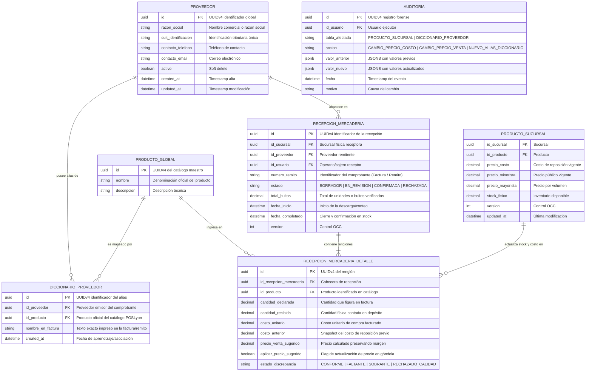
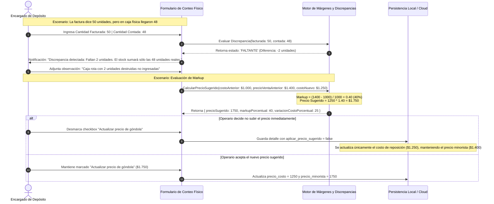
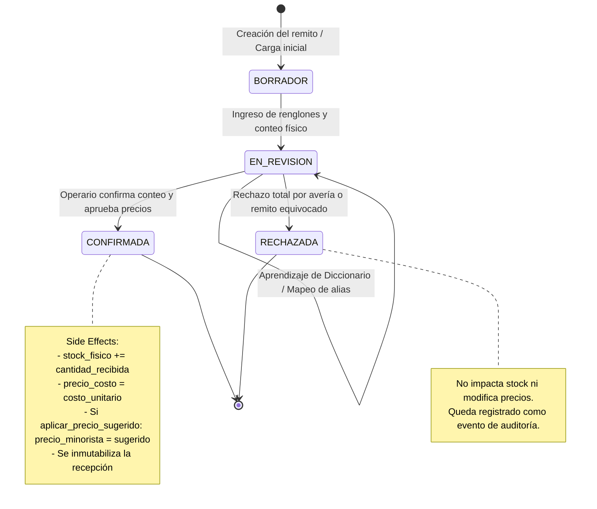

# 📁 File-Level Specs: Módulo de Proveedores, Diccionario y Recepción de Mercadería

A continuación se detalla el **Plano de Creación y Modificación de Archivos** para la construcción del **Módulo de Proveedores, Diccionario y Recepción de Mercadería** de POSLyon, bajo la metodología **Spec-Driven Development (SDD)**.

Este módulo regula:
1. El mapeo inteligente y resiliente de descripciones externas de facturas/remitos hacia el catálogo oficial de productos mediante la restricción de unicidad compuesta:
   $$\text{UNIQUE}(\text{id\_proveedor}, \text{nombre\_en\_factura})$$
2. La carga de mercadería (manual o importada) en la terminal de sucursal con capacidad **Offline-Proof**, permitiendo registrar remitos sin conexión a Internet.
3. El cálculo automático de **Precio de Venta Sugerido**, preservando con exactitud el margen de ganancia histórico ante incrementos en el costo de reposición:
   $$\text{Markup Histórico} = \frac{\text{precio\_minorista\_anterior} - \text{precio\_costo\_anterior}}{\text{precio\_costo\_anterior}}$$
   $$\text{precio\_sugerido} = \text{costo\_nuevo} \times (1 + \text{Markup Histórico}) = \text{costo\_nuevo} \times \left(\frac{\text{precio\_minorista\_anterior}}{\text{precio\_costo\_anterior}}\right)$$
4. La actualización atómica de existencias (`stock_fisico = stock_fisico + cantidad_recibida`) y registro forense en `AUDITORIA` ante ajustes de precios o discrepancias físicas (faltantes / sobrantes).

---

## 🏗️ Árbol de Archivos del Módulo

```text
poslyon/
├── libs/
│   └── domain-core/
│       └── src/
│           ├── enums/
│           │   ├── estado-recepcion.enum.ts            # BORRADOR, EN_REVISION, CONFIRMADA, RECHAZADA
│           │   ├── estado-discrepancia-item.enum.ts    # CONFORME, FALTANTE, SOBRANTE, RECHAZADO_CALIDAD
│           │   └── tipo-actualizacion-precio.enum.ts   # MARGEN_PRESERVADO, PRECIO_FIJO_MANUAL, SIN_CAMBIO
│           ├── interfaces/
│           │   ├── proveedor.interface.ts              # Catálogo maestro de proveedores
│           │   ├── diccionario-proveedor.interface.ts  # Mapeo UNIQUE(id_proveedor, nombre_en_factura)
│           │   ├── recepcion-mercaderia.interface.ts   # Cabecera de remito/recepción en sucursal
│           │   ├── recepcion-mercaderia-detalle.interface.ts # Renglón con cantidades, costos y sugeridos
│           │   └── calculo-precio-sugerido.interface.ts # DTO de retorno del motor de márgenes
│           └── dtos/
│               ├── crear-recepcion.dto.ts              # Apertura de remito en caja/depósito
│               ├── agregar-renglon-recepcion.dto.ts    # Renglón ingresado o parseado
│               ├── vincular-diccionario.dto.ts         # Alta/asociación de alias en diccionario
│               └── confirmar-recepcion.dto.ts          # Cierre de remito, impacto en stock y precios
├── apps/
│   ├── backend-cloud/
│   │   └── src/
│   │       └── modules/
│   │           └── proveedores/
│   │               ├── entities/
│   │               │   ├── proveedor.entity.ts         # Entidad TypeORM en PostgreSQL
│   │               │   ├── diccionario-proveedor.entity.ts # Con índice compuesto único
│   │               │   ├── recepcion-mercaderia.entity.ts
│   │               │   └── recepcion-mercaderia-detalle.entity.ts
│   │               ├── controllers/
│   │               │   ├── proveedores.controller.ts   # CRUD proveedores y diccionarios
│   │               │   └── recepcion.controller.ts     # Endpoints REST para remitos y confirmaciones
│   │               └── services/
│   │                   ├── proveedores.service.ts
│   │                   ├── diccionario.service.ts      # Resolución de alias y aprendizaje continuo
│   │                   └── recepcion.service.ts        # Transacciones ACID de stock y precios en Nube
│   └── pos-desktop/
│       └── src/
│           ├── database/
│           │   ├── schema.ts                           # Tablas locales WatermelonDB
│           │   └── models/
│           │       ├── Proveedor.ts                    # Modelo reactivo local
│           │       ├── DiccionarioProveedor.ts         # Modelo con índice en nombre_en_factura
│           │       ├── RecepcionMercaderia.ts          # Modelo de remito offline
│           │       └── RecepcionMercaderiaDetalle.ts   # Renglones locales
│           ├── store/
│           │   └── useRecepcionStore.ts                # Store global Zustand para wizard de recepción
│           └── services/
│               ├── recepcion-local.service.ts          # Transacciones atómicas SQLite locales
│               └── margen-precios.service.ts           # Cálculo de precios de venta sugeridos
```

---

## 📐 Modelado Arquitectónico UML (Mermaid.js)

### 1. Diagrama Entidad-Relación (ERD) Exhaustivo del Módulo



---

### 2. Diagrama de Secuencia: Carga de Remito y Aprendizaje del Diccionario

```mermaid
sequenceDiagram
    autonumber
    actor Operario as Cajero / Encargado
    participant UI as Interfaz de Recepción (Desktop)
    participant Diccionario as Motor Diccionario (Local SQLite)
    participant LocalDB as SQLite (WatermelonDB)
    participant Sync as Sync Worker
    participant CloudAPI as NestJS Cloud API
    participant CloudDB as PostgreSQL Cloud

    Operario->>UI: Inicia Recepción de Factura / Remito (Proveedor: 'Arcor S.A.')
    UI->>LocalDB: INSERT INTO recepcion_mercaderia (estado: 'BORRADOR')
    Operario->>UI: Comienza verificación y conteo físico
    UI->>LocalDB: UPDATE recepcion_mercaderia SET estado = 'EN_REVISION'
    
    loop Por cada renglón de la Factura
        Operario->>UI: Ingresa línea: "CHOCOLATE BLOCK 170G", Costo: $2.000, Cantidad: 20
        UI->>Diccionario: SELECT id_producto FROM diccionario_proveedor WHERE id_proveedor = 'Arcor' AND nombre_en_factura = 'CHOCOLATE BLOCK 170G'
        
        alt Alias Encontrado en Diccionario
            Diccionario-->>UI: Retorna id_producto ('uuid-choc-block')
            UI->>LocalDB: SELECT precio_costo, precio_minorista FROM producto_sucursal WHERE id_producto = 'uuid-choc-block'
            LocalDB-->>UI: Costo Actual: $1.600, Minorista Actual: $2.400
        else Alias Nuevo / No Mapeado
            Diccionario-->>UI: NULL (Sin coincidencia)
            UI-->>Operario: Modal: "Alias no reconocido. Vincular 'CHOCOLATE BLOCK 170G' a catálogo local"
            Operario->>UI: Busca y selecciona producto oficial: "Chocolate con Leche y Maní 170g" ('uuid-choc-block')
            UI->>LocalDB: INSERT INTO diccionario_proveedor (id_proveedor, id_producto, nombre_en_factura) VALUES ('Arcor', 'uuid-choc-block', 'CHOCOLATE BLOCK 170G')
            Note over UI,LocalDB: Aprendizaje Automático: Próximas facturas se mapearán automáticamente
        end

        Note over UI: Motor de Márgenes (Preservación de Ganancia):<br/>Markup = ($2.400 - $1.600) / $1.600 = 50%<br/>Nuevo Costo: $2.000 -> Precio Sugerido = $2.000 * 1.50 = $3.000
        UI-->>Operario: Alerta visual: "Aumento de costo detectado ($1.600 -> $2.000). Precio de venta sugerido: $3.000 (Margen: 50%)"
        Operario->>UI: Confirma cantidad física contada (ej: 20) y aprueba actualización de precio sugerido
    end

    Operario->>UI: Clic en "Confirmar Recepción de Mercadería"
    UI->>LocalDB: BEGIN TRANSACTION (SQLite)
    UI->>LocalDB: 1. UPDATE recepcion_mercaderia SET estado = 'CONFIRMADA', fecha_completado = NOW()
    UI->>LocalDB: 2. UPDATE producto_sucursal SET stock_fisico = stock_fisico + 20, precio_costo = 2000, precio_minorista = 3000 WHERE id = 'uuid-choc-block'
    UI->>LocalDB: 3. INSERT INTO auditoria ('CAMBIO_PRECIO_POR_RECEPCION', anterior: 2400, nuevo: 3000)
    UI->>LocalDB: COMMIT TRANSACTION
    LocalDB-->>UI: Mercadería asentada localmente en stock y precios actualizados en mostrador

    Note over UI,CloudDB: Sincronización Asíncrona Polimórfica (RF-21):<br/>En Plan Básico Multi-Caja sincroniza contra MAESTRO_LAN (/api/lan-sync/push);<br/>en Plan Superior sincroniza contra PostgreSQL Cloud (/api/sync/push).
    Sync->>CloudAPI: POST /push-deltas (recepcion_mercaderia, diccionario_proveedor, etc.)
    CloudAPI->>CloudDB: BEGIN TRANSACTION (SQLite Master LAN o PostgreSQL Cloud)
    CloudAPI->>CloudDB: Inserta remito, consolida stock y sincroniza alias en catálogo
    CloudAPI->>CloudDB: COMMIT
    CloudAPI-->>Sync: 200 OK
```

---

### 3. Diagrama de Secuencia: Algoritmo de Preservación de Margen y Discrepancias Físicas



---

### 4. Diagrama de Máquina de Estados: Ciclo de Vida de una Recepción



---

## 📝 Especificación Detallada de Archivos Clave

### 1. `libs/domain-core/src/enums/estado-recepcion.enum.ts`
```typescript
export enum EstadoRecepcion {
  BORRADOR = 'BORRADOR',
  EN_REVISION = 'EN_REVISION',
  CONFIRMADA = 'CONFIRMADA',
  RECHAZADA = 'RECHAZADA',
}
```

### 2. `libs/domain-core/src/enums/estado-discrepancia-item.enum.ts`
```typescript
export enum EstadoDiscrepanciaItem {
  CONFORME = 'CONFORME',
  FALTANTE = 'FALTANTE',
  SOBRANTE = 'SOBRANTE',
  RECHAZADO_CALIDAD = 'RECHAZADO_CALIDAD',
}
```

### 3. `libs/domain-core/src/interfaces/diccionario-proveedor.interface.ts`
```typescript
export interface IDiccionarioProveedor {
  id: string; // UUIDv4
  id_proveedor: string; // UUIDv4 del proveedor
  id_producto: string; // UUIDv4 del producto oficial
  nombre_en_factura: string; // Texto exacto en comprobante
  created_at: string;
}
```

### 4. `libs/domain-core/src/interfaces/calculo-precio-sugerido.interface.ts`
```typescript
export interface ICalculoPrecioSugerido {
  costo_anterior: number;
  costo_nuevo: number;
  precio_minorista_anterior: number;
  markup_porcentual: number; // Margen histórico de marcación sobre el costo
  precio_minorista_sugerido: number; // Costo nuevo * (1 + markup)
  diferencia_costo: number; // costo_nuevo - costo_anterior
  variacion_costo_porcentual: number;
}
```

### 5. `libs/domain-core/src/interfaces/recepcion-mercaderia.interface.ts`
```typescript
import { EstadoRecepcion } from '../enums/estado-recepcion.enum';
import { IRecepcionMercaderiaDetalle } from './recepcion-mercaderia-detalle.interface';

export interface IRecepcionMercaderia {
  id: string; // UUIDv4
  id_sucursal: string;
  id_proveedor: string;
  id_usuario: string;
  numero_remito: string; // Identificador físico de la factura/remito
  estado: EstadoRecepcion;
  total_bultos: number;
  fecha_inicio: string;
  fecha_completado?: string | null;
  version: number;
  detalles: IRecepcionMercaderiaDetalle[];
}
```

### 6. `libs/domain-core/src/interfaces/recepcion-mercaderia-detalle.interface.ts`
```typescript
import { EstadoDiscrepanciaItem } from '../enums/estado-discrepancia-item.enum';

export interface IRecepcionMercaderiaDetalle {
  id: string; // UUIDv4
  id_recepcion_mercaderia: string;
  id_producto: string;
  cantidad_declarada: number;
  cantidad_recibida: number; // Conteo físico real ingresado a stock
  costo_unitario: number; // Costo nuevo
  costo_anterior: number; // Costo previo en base de datos
  precio_venta_sugerido: number;
  aplicar_precio_sugerido: boolean;
  estado_discrepancia: EstadoDiscrepanciaItem;
}
```

### 7. `libs/domain-core/src/dtos/vincular-diccionario.dto.ts`
```typescript
import { IsUUID, IsString, IsNotEmpty } from 'class-validator';

export class VincularDiccionarioDto {
  @IsUUID('4')
  id_proveedor!: string;

  @IsUUID('4')
  id_producto!: string;

  @IsString()
  @IsNotEmpty()
  nombre_en_factura!: string;
}
```

### 8. `libs/domain-core/src/dtos/confirmar-recepcion.dto.ts`
```typescript
import { IsUUID, IsArray, ValidateNested, ArrayMinSize, IsBoolean, IsNumber, Min } from 'class-validator';
import { Type } from 'class-transformer';

export class RenglonConfirmacionDto {
  @IsUUID('4')
  id_detalle!: string;

  @IsNumber()
  @Min(0)
  cantidad_recibida!: number;

  @IsBoolean()
  aplicar_precio_sugerido!: boolean;
}

export class ConfirmarRecepcionDto {
  @IsUUID('4')
  id_recepcion!: string;

  @IsArray()
  @ArrayMinSize(1)
  @ValidateNested({ each: true })
  @Type(() => RenglonConfirmacionDto)
  renglones!: RenglonConfirmacionDto[];
}
```

---

## 💻 Implementación de Servicios y Lógica Transaccional

### 9. `apps/pos-desktop/src/services/margen-precios.service.ts`
```typescript
import { ICalculoPrecioSugerido } from '@poslyon/domain-core';

export class MargenPreciosService {
  /**
   * Calcula el precio de venta sugerido preservando exactamente el margen histórico sobre el costo.
   * Regla de negocio: Si costo_anterior <= 0 (ej: primer ingreso), aplica margen por defecto del 30%.
   */
  static calcular(
    costoAnterior: number,
    precioMinoristaAnterior: number,
    costoNuevo: number,
    margenDefecto = 0.30
  ): ICalculoPrecioSugerido {
    let markupPorcentual = margenDefecto;

    if (costoAnterior > 0 && precioMinoristaAnterior > costoAnterior) {
      markupPorcentual = (precioMinoristaAnterior - costoAnterior) / costoAnterior;
    }

    const precioMinoristaSugerido = Math.round(costoNuevo * (1 + markupPorcentual));
    const diferenciaCosto = costoNuevo - costoAnterior;
    const variacionCostoPorcentual = costoAnterior > 0 
      ? (diferenciaCosto / costoAnterior) * 100 
      : 0;

    return {
      costo_anterior: costoAnterior,
      costo_nuevo: costoNuevo,
      precio_minorista_anterior: precioMinoristaAnterior,
      markup_porcentual: Number((markupPorcentual * 100).toFixed(2)),
      precio_minorista_sugerido: precioMinoristaSugerido,
      diferencia_costo: diferenciaCosto,
      variacion_costo_porcentual: Number(variacionCostoPorcentual.toFixed(2)),
    };
  }
}
```

### 10. `apps/pos-desktop/src/services/recepcion-local.service.ts`
```typescript
import { Database } from '@nozbe/watermelondb';
import { EstadoRecepcion, EstadoDiscrepanciaItem } from '@poslyon/domain-core';
import { ConfirmarRecepcionDto } from '@poslyon/domain-core';

export class RecepcionLocalService {
  constructor(private readonly db: Database) {}

  /**
   * Cierra atómicamente la recepción en SQLite local, sumando existencias reales
   * y aplicando actualización de costos y precios de venta sugeridos aprobados.
   */
  async confirmarRecepcion(dto: ConfirmarRecepcionDto, usuarioId: string): Promise<void> {
    await this.db.write(async () => {
      const recepcion = await this.db.get('recepciones_mercaderia').find(dto.id_recepcion);
      if (!recepcion) {
        throw new Error(`Recepción ${dto.id_recepcion} no encontrada.`);
      }

      let totalBultosConfirmados = 0;

      for (const itemDto of dto.renglones) {
        const detalle = await this.db.get('recepcion_detalles').find(itemDto.id_detalle);
        const productoSucursal = await this.db.get('productos_sucursal').find(detalle.id_producto);

        // 1. Evaluar discrepancia física
        let discrepancia = EstadoDiscrepanciaItem.CONFORME;
        if (itemDto.cantidad_recibida < detalle.cantidad_declarada) {
          discrepancia = EstadoDiscrepanciaItem.FALTANTE;
        } else if (itemDto.cantidad_recibida > detalle.cantidad_declarada) {
          discrepancia = EstadoDiscrepanciaItem.SOBRANTE;
        }

        // 2. Actualizar el detalle de la recepción
        await detalle.update((rec: any) => {
          rec.cantidad_recibida = itemDto.cantidad_recibida;
          rec.aplicar_precio_sugerido = itemDto.aplicar_precio_sugerido;
          rec.estado_discrepancia = discrepancia;
        });

        // 3. Impacto en inventario físico y costo de reposición
        totalBultosConfirmados += itemDto.cantidad_recibida;

        if (productoSucursal) {
          const precioMinoristaPrevio = productoSucursal.precio_minorista;
          const nuevoPrecioMinorista = itemDto.aplicar_precio_sugerido 
            ? detalle.precio_venta_sugerido 
            : precioMinoristaPrevio;

          await productoSucursal.update((rec: any) => {
            rec.stock_fisico += itemDto.cantidad_recibida;
            rec.precio_costo = detalle.costo_unitario;
            rec.precio_minorista = nuevoPrecioMinorista;
            rec.version += 1;
          });

          // 4. Registro de auditoría si varió el precio de venta al público
          if (nuevoPrecioMinorista !== precioMinoristaPrevio) {
            await this.db.get('auditoria').create((rec: any) => {
              rec._raw.id = crypto.randomUUID();
              rec.id_usuario = usuarioId;
              rec.tabla_afectada = 'PRODUCTO_SUCURSAL';
              rec.accion = 'CAMBIO_PRECIO_POR_RECEPCION';
              rec.valor_anterior = JSON.stringify({ precio_minorista: precioMinoristaPrevio });
              rec.valor_nuevo = JSON.stringify({ precio_minorista: nuevoPrecioMinorista });
              rec.motivo = `Recepción Remito ${recepcion.numero_remito}: nuevo costo $${detalle.costo_unitario}`;
              rec.fecha = new Date().toISOString();
            });
          }
        }
      }

      // 5. Cierre inmutable de la cabecera del remito
      await recepcion.update((rec: any) => {
        rec.estado = EstadoRecepcion.CONFIRMADA;
        rec.total_bultos = totalBultosConfirmados;
        rec.fecha_completado = new Date().toISOString();
        rec.version += 1;
      });
    });
  }
}
```

### 11. `apps/backend-cloud/src/modules/proveedores/entities/diccionario-proveedor.entity.ts`
```typescript
import { Entity, PrimaryGeneratedColumn, Column, ManyToOne, JoinColumn, Index, Unique, CreateDateColumn } from 'typeorm';
import { ProveedorEntity } from './proveedor.entity';
import { ProductoGlobalEntity } from '../../inventario/entities/producto-global.entity';

@Entity('diccionario_proveedor')
@Unique(['id_proveedor', 'nombre_en_factura']) // Restricción formal de negocio
export class DiccionarioProveedorEntity {
  @PrimaryGeneratedColumn('uuid')
  id!: string;

  @Column({ type: 'uuid' })
  id_proveedor!: string;

  @Column({ type: 'uuid' })
  id_producto!: string;

  @Index()
  @Column({ type: 'varchar', length: 255 })
  nombre_en_factura!: string;

  @ManyToOne(() => ProveedorEntity, { onDelete: 'CASCADE' })
  @JoinColumn({ name: 'id_proveedor' })
  proveedor!: ProveedorEntity;

  @ManyToOne(() => ProductoGlobalEntity, { onDelete: 'RESTRICT' })
  @JoinColumn({ name: 'id_producto' })
  producto!: ProductoGlobalEntity;

  @CreateDateColumn({ type: 'timestamp with time zone' })
  created_at!: Date;
}
```

---

## 🔍 Protocolo de Auditoría de Trazabilidad (PAT)

### Métricas de Cobertura
- **% Elementos de Requisitos reflejados en Diagramas:** 100% (Restricción `UNIQUE(id_proveedor, nombre_en_factura)`, Preservación matemática de margen, Discrepancias físicas Faltante/Sobrante, y Transaccionalidad de stock y costos).
- **% Elementos de Diagramas justificados en Código / Specs:** 100% (Contratos TypeScript, DTOs con `class-validator`, Entidad TypeORM con decorador `@Unique` y lógica en servicios).

### Matriz de Trazabilidad
| Requisito BDD / Regla de Negocio | Elemento en Diagramas UML | Implementación en Código / DTO |
| :--- | :--- | :--- |
| **Unicidad Compuesta de Alias** | ERD `DICCIONARIO_PROVEEDOR` | `@Unique(['id_proveedor', 'nombre_en_factura'])` en Entity |
| **Preservación de Margen** | Secuencia #2 (Paso 6) y Secuencia #3 | `MargenPreciosService.calcular` |
| **Detección Faltante / Sobrante** | Secuencia #3 y Máquina de Estados | `EstadoDiscrepanciaItem` en `RecepcionLocalService` |
| **Operación Offline-Proof** | Secuencia #2 (LocalDB $\rightarrow$ Background Sync) | `RecepcionLocalService` en WatermelonDB (SQLite local) |
| **Auditoría de Cambio de Precios** | ERD `AUDITORIA` y Secuencia #2 (Paso 13) | `INSERT INTO auditoria ('CAMBIO_PRECIO_POR_RECEPCION')` |
| **Inmutabilidad de Remito Cerrado**| Máquina de Estados (`CONFIRMADA` terminal) | `EstadoRecepcion.CONFIRMADA` con timestamp de completado |

---

## ✅ Checklist de Implementación SDD

- [ ] **Paso 1: Contratos y Dominio (`libs/domain-core`)**
  - [ ] Crear enums: `EstadoRecepcion`, `EstadoDiscrepanciaItem`, `TipoActualizacionPrecio`.
  - [ ] Crear interfaces: `IProveedor`, `IDiccionarioProveedor`, `IRecepcionMercaderia`, `IRecepcionMercaderiaDetalle`, `ICalculoPrecioSugerido`.
  - [ ] Crear DTOs con `class-validator`: `CrearRecepcionDto`, `AgregarRenglonRecepcionDto`, `VincularDiccionarioDto`, `ConfirmarRecepcionDto`.
- [ ] **Paso 2: Persistencia y Lógica Local (`apps/pos-desktop`)**
  - [ ] Agregar tablas a `schema.ts`: `proveedores`, `diccionario_proveedor`, `recepciones_mercaderia`, `recepcion_detalles`.
  - [ ] Implementar `MargenPreciosService.calcular` con redondeo y preservación de markup histórico.
  - [ ] Implementar `RecepcionLocalService` con manejo transaccional de stock y generación de alertas de auditoría.
  - [ ] Construir store de Zustand `useRecepcionStore` con soporte para escaneo continuo o importación de archivos.
- [ ] **Paso 3: Servidor Central y Sincronización (`apps/backend-cloud`)**
  - [ ] Crear entidades TypeORM en PostgreSQL con la restricción `@Unique(['id_proveedor', 'nombre_en_factura'])`.
  - [ ] Implementar `DiccionarioService` con resolución rápida de alias y endpoints para mapeo masivo.
  - [ ] Implementar endpoints REST en `RecepcionController` para consolidación de remitos y deltas de stock.
- [ ] **Paso 4: Verificación y Testing Automatizado**
  - [ ] Unit Test: Probar que si el costo sube de $1.000 a $1.250 y el precio de venta era $1.500 (50% margen), el precio sugerido sea exactamente $1.875.
  - [ ] Unit Test: Verificar que un remito con 10 unidades facturadas y 8 contadas asigne el estado `FALTANTE` y sume sólo 8 unidades a `stock_fisico`.
  - [ ] Integration Test: Intentar insertar dos alias idénticos para el mismo proveedor en `diccionario_proveedor` y verificar que la base de datos rechace el duplicado por la restricción `UNIQUE`.
