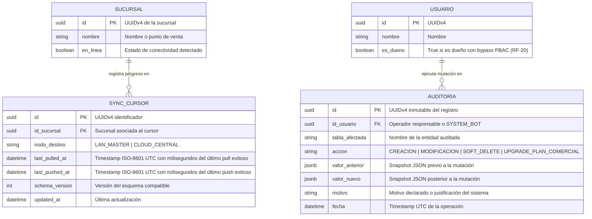
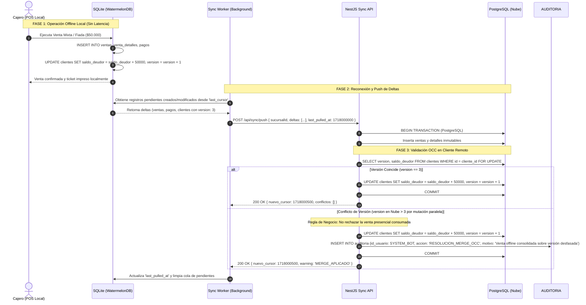
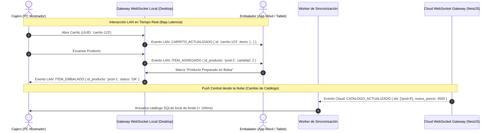
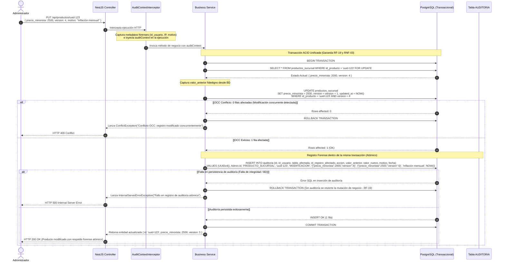

# 📁 File-Level Specs: Módulo de Sincronización Local-First e Interceptor de Auditoría

A continuación se detalla el **Plano de Creación y Modificación de Archivos** para la construcción del **Módulo de Sincronización Local-First e Interceptor de Auditoría** de POSLyon, bajo la metodología **Spec-Driven Development (SDD)**.

Este módulo regula:
1. La arquitectura de persistencia **Offline-First**, permitiendo operar sin latencia en mostrador mediante SQLite local (`WatermelonDB`) y sincronizando deltas asíncronos con PostgreSQL en la Nube mediante un protocolo basado en cursores (`last_pulled_at`).
2. El canal de comunicación reactivo dual:
   - **LAN WebSockets:** Notificaciones en tiempo real entre la terminal física del Cajero y la App Móvil del Embalador en la red local de la sucursal.
   - **Cloud WebSockets:** PUSH inmediato de cambios de catálogo desde la Nube hacia sucursales conectadas, complementado con estrategia de *Catch-Up* tras desconexiones.
3. El **Control de Concurrencia Optimista (OCC)** universal sobre la columna `version`, resolviendo colisiones con código HTTP `409 Conflict` en ediciones administrativas y aplicando reglas de *Merge Aditivo* prioritario para ventas presenciales offline.
4. El **Interceptor Global de Auditoría (`AuditInterceptor`)**, garantizando trazabilidad incondicional con snapshots forenses (`valor_anterior` y `valor_nuevo`) y prohibición absoluta de borrado físico (`Soft Delete`).

---

## 🏗️ Árbol de Archivos del Módulo

```text
poslyon/
├── libs/
│   └── domain-core/
│       └── src/
│           ├── enums/
│           │   ├── estado-sincronizacion.enum.ts       # PENDIENTE, EN_COLA, SINCRONIZADA, CONFLICTO_OCC
│           │   ├── tipo-evento-sync.enum.ts            # PUSH_VENTAS, PULL_CATALOGO, CATCH_UP, RESOLUCION_MERGE
│           │   ├── tipo-evento-ws.enum.ts              # CARRITO_ACTUALIZADO, RESERVA_STOCK_LOCAL, VENTA_CONFIRMADA_LOCAL, ITEM_EMBALADO
│           │   └── accion-auditoria-global.enum.ts     # CREACION, MODIFICACION, SOFT_DELETE, EXCESO_SYNC
│           ├── interfaces/
│           │   ├── sync-payload.interface.ts           # Formato estándar de deltas (created, updated, deleted)
│           │   ├── sync-cursor.interface.ts            # Metadatos del cursor temporal y schema_version
│           │   ├── auditoria.interface.ts              # Contrato unificado de auditoría
│           │   ├── conflicto-occ.interface.ts          # Detalle de colisión para feedback en UI
│           │   └── evento-websocket.interface.ts       # Payload tipificado para eventos LAN y Cloud
│           └── dtos/
│               ├── sync-push.dto.ts                    # Payload de subida de deltas locales
│               ├── sync-pull-query.dto.ts              # DTO para consulta con last_pulled_at y sucursal
│               └── registrar-auditoria.dto.ts          # Payload estructurado para logs forenses
├── apps/
│   ├── backend-cloud/
│   │   └── src/
│   │       ├── common/
│   │       │   ├── interceptors/
│   │       │   │   └── audit.interceptor.ts            # Interceptor global NestJS para logging automático
│   │       │   └── filters/
│   │       │       └── occ-exception.filter.ts         # Filtro global para transformar 409 Conflict
│   │       └── modules/
│   │           ├── sync/
│   │           │   ├── controllers/
│   │           │   │   └── sync.controller.ts          # Endpoints POST /api/sync/push y GET /api/sync/pull
│   │           │   ├── services/
│   │           │   │   ├── sync.service.ts             # Procesador transaccional de deltas y resolución OCC
│   │           │   │   └── delta-builder.service.ts    # Extracción eficiente de deltas por cursor temporal
│   │           │   └── gateways/
│   │           │       └── cloud-sync.gateway.ts       # Gateway WebSocket para push en tiempo real a sucursales
│   │           └── auditoria/
│   │               ├── entities/
│   │               │   └── auditoria.entity.ts         # Entidad TypeORM inmutable en PostgreSQL
│   │               ├── controllers/
│   │               │   └── auditoria.controller.ts     # Consulta forense y trazabilidad
│   │               └── services/
│   │                   └── auditoria.service.ts        # Inserción atómica y persistencia
│   └── pos-desktop/
│       └── src/
│           ├── sync/
│           │   ├── watermelon-sync.adapter.ts          # Adaptador y Strategy (LAN Cluster vs Cloud)
│           │   ├── lan-sync-hub.service.ts             # Servidor HTTP LAN en MAESTRO_LAN (/api/lan-sync)
│           │   ├── sync-worker.ts                      # Worker en segundo plano con reintentos y backoff
│           │   └── conflict-resolver.ts                # Reglas de merge local vs. remoto
│           ├── websocket/
│           │   ├── local-pos.gateway.ts                # Servidor WebSocket LAN local para App Móvil y Cajas
│           │   └── cloud-ws.client.ts                  # Cliente WebSocket conectado a la Nube (Plan Superior)
│           └── services/
│               └── audit-local.service.ts              # Registro local en SQLite de eventos de auditoría
```

---

## 📐 Modelado Arquitectónico UML (Mermaid.js)

### 1. Diagrama Entidad-Relación (ERD) de Sincronización y Auditoría



---

### 2. Diagrama de Secuencia: Flujo Push / Pull (Catch-Up) y Resolución de Conflictos OCC



---

### 3. Diagrama de Secuencia: WebSockets en Red Local (Cajero $\leftrightarrow$ Embalador) y Cloud Push



---

### 4. Diagrama de Secuencia: Transacción Atómica de Modificación con OCC y Auditoría Forense (`AuditContextInterceptor` + `Service`)



---

### 1. `libs/domain-core/src/enums/tipo-evento-ws.enum.ts`
```typescript
export enum TipoEventoWS {
  // Eventos LAN (Red local de sucursal - WiFi / Ethernet entre cajas y móviles)
  CARRITO_ACTUALIZADO = 'CARRITO_ACTUALIZADO',
  ITEM_AGREGADO = 'ITEM_AGREGADO',
  ITEM_EMBALADO = 'ITEM_EMBALADO',
  RESERVA_STOCK_LOCAL = 'RESERVA_STOCK_LOCAL',           // Soft Allocation en tiempo real entre cajas (Resolución C-15)
  VENTA_CONFIRMADA_LOCAL = 'VENTA_CONFIRMADA_LOCAL',     // Notificación local de cobro para actualizar stock físico en LAN
  CARRITO_EXPIRADO_LAN = 'CARRITO_EXPIRADO_LAN',         // Garbage Collection local ejecutado
  ALERTA_STOCK_LAN = 'ALERTA_STOCK_LAN',

  // Eventos Cloud (Push central desde NestJS hacia sucursales online)
  CATALOGO_ACTUALIZADO = 'CATALOGO_ACTUALIZADO',
  PROMOCION_ACTUALIZADA = 'PROMOCION_ACTUALIZADA',
}
```

### 2. `libs/domain-core/src/interfaces/sync-payload.interface.ts`
```typescript
export interface ISyncChanges<T = any> {
  created: T[];
  updated: T[];
  deleted: string[]; // UUIDs para Soft Delete
}

export interface ISyncPushPayload {
  sucursal_id: string;
  last_pulled_at: string; // Timestamp ISO-8601 UTC de alta precisión del cursor previo (Resolución O-25)
  changes: {
    ventas?: ISyncChanges;
    venta_detalles?: ISyncChanges;
    pagos_venta?: ISyncChanges;
    cuenta_corriente?: ISyncChanges;
    turnos_caja?: ISyncChanges;
    movimientos_caja?: ISyncChanges;
    notas_credito?: ISyncChanges;
    nota_credito_detalles?: ISyncChanges;
    recepciones_mercaderia?: ISyncChanges;
    recepcion_mercaderia_detalles?: ISyncChanges;
    diccionario_proveedor?: ISyncChanges;
    alertas_cuarentena?: ISyncChanges;
    auditoria?: ISyncChanges;
    clientes?: ISyncChanges;
  };
}

export interface ISyncPullResponse {
  changes: {
    productos_global?: ISyncChanges;
    productos_sucursal?: ISyncChanges;
    codigos_barra?: ISyncChanges;
    categorias?: ISyncChanges;
    promociones?: ISyncChanges;
    promociones_productos?: ISyncChanges;
    configuracion_sucursal?: ISyncChanges;
    metodos_pago?: ISyncChanges;
    proveedores?: ISyncChanges;
    diccionario_proveedor?: ISyncChanges;
    transferencias_stock?: ISyncChanges;
    transferencias_detalles?: ISyncChanges;
    permisos?: ISyncChanges;
    usuarios_permisos?: ISyncChanges;
    clientes?: ISyncChanges;
  };
  timestamp: string; // Nuevo cursor temporal ISO-8601 UTC de alta precisión (Resolución O-25)
}
```

### 2. `libs/domain-core/src/dtos/sync-push.dto.ts`
```typescript
import { IsUUID, IsString, IsObject, ValidateNested, IsNotEmpty } from 'class-validator';
import { Type } from 'class-transformer';

export class SyncPushDto {
  @IsUUID('4')
  @IsNotEmpty()
  sucursal_id!: string;

  @IsString()
  @IsNotEmpty()
  last_pulled_at!: string; // ISO-8601 UTC (Resolución O-25)

  @IsObject()
  changes!: Record<string, any>;
}
```

#### Matriz de Respuestas HTTP de Sincronización (`POST /api/sync/push` y `GET /api/sync/pull`)
*(Resolución S-07: Estandarización de Códigos HTTP)*

| Endpoint | Código HTTP | Significado RFC 9110 | Condición en el Sistema |
|:---|:---|:---|:---|
| `POST /api/sync/push` | **200 OK** | OK | Deltas locales procesados e insertados en PostgreSQL. Colisiones OCC resueltas exitosamente mediante merge aditivo. |
| `POST /api/sync/push` | **400 Bad Request** | Bad Request | Payload corrupto, UUID de sucursal inválido o violación de esquema de cambios. |
| `POST /api/sync/push` | **401 Unauthorized** | Unauthorized | Token JWT de terminal o sucursal ausente, expirado o adulterado. |
| `POST /api/sync/push` | **409 Conflict** | Conflict | Violación de integridad o colisión irreconciliable que requiere intervención administrativa. |
| `POST /api/sync/push` | **500 Internal Server Error** | Server Error | Falla de infraestructura de base de datos en nube o error en transacción ACID de auditoría. |
| `GET /api/sync/pull` | **200 OK** | OK | Retorna deltas remotos posteriores a `last_pulled_at` y nuevo cursor UTC. |
| `GET /api/sync/pull` | **400 Bad Request** | Bad Request | Formato de timestamp ISO-8601 UTC inválido o fuera de rango. |

### 3. `apps/backend-cloud/src/common/interceptors/audit-context.interceptor.ts`
```typescript
import {
  Injectable,
  NestInterceptor,
  ExecutionContext,
  CallHandler,
} from '@nestjs/common';
import { Observable } from 'rxjs';

export interface IAuditContext {
  userId: string;
  motivo: string;
  ip: string;
  path: string;
  accion: 'CREACION' | 'MODIFICACION' | 'SOFT_DELETE' | 'OPERACION';
}

@Injectable()
export class AuditContextInterceptor implements NestInterceptor {
  intercept(context: ExecutionContext, next: CallHandler): Observable<any> {
    const request = context.switchToHttp().getRequest();
    const method = request.method;

    // Solo capturar contexto para mutaciones de estado
    if (!['POST', 'PUT', 'PATCH', 'DELETE'].includes(method)) {
      return next.handle();
    }

    const user = request.user || { id: '00000000-0000-0000-0000-000000000001' }; // Fallback a SYSTEM_BOT (RF-19)
    const motivoHeader = request.headers['x-audit-reason'] as string | undefined;
    const motivo = motivoHeader || request.body?.motivo || 'Operación transaccional estándar';

    // Inyecta el contexto de auditoría en la Request para que los Services transaccionales lo consuman
    request.auditContext = {
      userId: user.id,
      motivo,
      ip: request.ip || '127.0.0.1',
      path: request.path,
      accion: this.mapearAccion(method),
    } as IAuditContext;

    return next.handle();
  }

  private mapearAccion(method: string): 'CREACION' | 'MODIFICACION' | 'SOFT_DELETE' | 'OPERACION' {
    switch (method) {
      case 'POST': return 'CREACION';
      case 'PUT':
      case 'PATCH': return 'MODIFICACION';
      case 'DELETE': return 'SOFT_DELETE';
      default: return 'OPERACION';
    }
  }
}
```

### 3.1. `apps/backend-cloud/src/modules/auditoria/services/auditoria.service.ts`
```typescript
import { Injectable, ConflictException, InternalServerErrorException, Logger } from '@nestjs/common';
import { DataSource, EntityManager } from 'typeorm';
import { IAuditContext } from '../../../common/interceptors/audit-context.interceptor';

export interface ITransaccionAuditadaParams<T> {
  auditContext: IAuditContext;
  tablaAfectada: string;
  idRegistroAfectado: string;
  obtenerSnapshotPrevio: (manager: EntityManager) => Promise<Record<string, any>>;
  mutacion: (manager: EntityManager) => Promise<{ resultado: T; versionNueva?: number }>;
  obtenerSnapshotNuevo?: (manager: EntityManager, resultado: T) => Promise<Record<string, any>>;
}

@Injectable()
export class AuditoriaService {
  private readonly logger = new Logger(AuditoriaService.name);

  constructor(private readonly dataSource: DataSource) {}

  /**
   * Ejecuta una mutación de negocio y su registro de auditoría en una transacción ACID ATÓMICA única.
   * Si la mutación falla, no se guarda auditoría.
   * Si la inserción en auditoría falla, la mutación de negocio se REVOCA INCONDICIONALMENTE (ROLLBACK).
   * En estricto cumplimiento de RF-19 y RNF-03 (Resolución C-25 y C-26).
   */
  async ejecutarTransaccionAuditada<T>(params: ITransaccionAuditadaParams<T>): Promise<T> {
    const queryRunner = this.dataSource.createQueryRunner();
    await queryRunner.connect();
    await queryRunner.startTransaction();

    try {
      // 1. Captura de valor_anterior real desde la base de datos (con lock de lectura si aplica)
      const valorAnterior = await params.obtenerSnapshotPrevio(queryRunner.manager);

      // 2. Ejecución de la mutación de negocio (incluyendo validación de OCC si aplica)
      const { resultado } = await params.mutacion(queryRunner.manager);

      // 3. Captura o construcción de valor_nuevo fidedigno persistido
      const valorNuevo = params.obtenerSnapshotNuevo
        ? await params.obtenerSnapshotNuevo(queryRunner.manager, resultado)
        : resultado;

      // 4. Inserción de Auditoría en la MISMA transacción de base de datos
      await queryRunner.manager.query(
        `INSERT INTO auditoria (
          id, id_usuario, tabla_afectada, id_registro_afectado, accion, 
          valor_anterior, valor_nuevo, motivo, fecha
        ) VALUES ($1, $2, $3, $4, $5, $6, $7, $8, NOW())`,
        [
          crypto.randomUUID(),
          params.auditContext.userId,
          params.tablaAfectada,
          params.idRegistroAfectado,
          params.auditContext.accion,
          JSON.stringify(valorAnterior),
          JSON.stringify(valorNuevo),
          params.auditContext.motivo,
        ]
      );

      // 5. Commit atómico de ambas operaciones juntas
      await queryRunner.commitTransaction();
      return resultado;
    } catch (error: any) {
      // Revierte tanto la mutación de negocio como cualquier inserción parcial
      await queryRunner.rollbackTransaction();
      this.logger.error(`Transacción auditada abortada: ${error.message}`, error.stack);

      if (error instanceof ConflictException) {
        throw error; // Propaga error OCC (HTTP 409)
      }
      throw new InternalServerErrorException(
        `Fallo transaccional atómico: ${error.message || 'Error de persistencia de auditoría'}`
      );
    } finally {
      await queryRunner.release();
    }
  }

  /**
   * Ejemplo de Servicio de Negocio consumiendo el patrón atómico con OCC estricto:
   */
  async actualizarPrecioConOCC(
    idProducto: string,
    idSucursal: string,
    nuevoPrecio: number,
    versionEsperada: number,
    auditContext: IAuditContext
  ): Promise<any> {
    return await this.ejecutarTransaccionAuditada({
      auditContext,
      tablaAfectada: 'PRODUCTO_SUCURSAL',
      idRegistroAfectado: idProducto,
      obtenerSnapshotPrevio: async (manager) => {
        const rows = await manager.query(
          `SELECT precio_minorista, version FROM productos_sucursal WHERE id_producto = $1 AND id_sucursal = $2 FOR UPDATE`,
          [idProducto, idSucursal]
        );
        if (!rows.length) throw new InternalServerErrorException('Producto no encontrado en sucursal');
        return rows[0];
      },
      mutacion: async (manager) => {
        const result = await manager.query(
          `UPDATE productos_sucursal 
           SET precio_minorista = $1, version = version + 1, updated_at = NOW() 
           WHERE id_producto = $2 AND id_sucursal = $3 AND version = $4`,
          [nuevoPrecio, idProducto, idSucursal, versionEsperada]
        );

        // Control de Concurrencia Optimista (OCC)
        if (result[1] === 0) {
          throw new ConflictException(
            `Conflicto OCC: El producto fue modificado concurrentemente por otro usuario. Versión esperada: ${versionEsperada}`
          );
        }

        return {
          resultado: { idProducto, idSucursal, precio_minorista: nuevoPrecio, version: versionEsperada + 1 }
        };
      },
    });
  }
}
```

### 4. `apps/backend-cloud/src/modules/sync/services/sync.service.ts`
```typescript
import { Injectable, Logger } from '@nestjs/common';
import { DataSource } from 'typeorm';
import { ISyncPushPayload } from '@poslyon/domain-core';

@Injectable()
export class SyncService {
  private readonly logger = new Logger(SyncService.name);
  private readonly SYSTEM_BOT_UUID = '00000000-0000-0000-0000-000000000001';

  constructor(private readonly dataSource: DataSource) {}

  /**
   * Procesa el lote de deltas enviados por la terminal POS local.
   * Ejecuta transacciones ACID con resolución OCC y registro forense.
   */
  async procesarPushDeltas(payload: ISyncPushPayload): Promise<{ cursor: number; warning?: string }> {
    const queryRunner = this.dataSource.createQueryRunner();
    await queryRunner.connect();
    await queryRunner.startTransaction();

    try {
      const { changes, sucursal_id } = payload;

      // 1. Inserción de Ventas (Inmutables)
      if (changes.ventas?.created?.length) {
        for (const venta of changes.ventas.created) {
          await queryRunner.manager.query(
            `INSERT INTO venta (id, id_sucursal, id_turno_caja, id_usuario, id_cliente, total, estado_financiero, estado_general, tiene_devolucion_parcial, version, fecha)
             VALUES ($1, $2, $3, $4, $5, $6, $7, $8, $9, $10, $11)
             ON CONFLICT (id) DO NOTHING`,
            [
              venta.id,
              sucursal_id,
              venta.id_turno_caja || null,
              venta.id_usuario,
              venta.id_cliente || null,
              venta.total,
              venta.estado_financiero,
              venta.estado_general,
              venta.tiene_devolucion_parcial || false,
              venta.version || 1,
              venta.fecha || new Date().toISOString(),
            ]
          );
        }
      }

      // 2. Inserción de Venta Detalles
      if (changes.venta_detalles?.created?.length) {
        for (const det of changes.venta_detalles.created) {
          await queryRunner.manager.query(
            `INSERT INTO venta_detalle (id, id_venta, id_producto, cantidad, precio_unitario, monto_descuento, tipo_precio, codigo_comodin, nombre_comodin)
             VALUES ($1, $2, $3, $4, $5, $6, $7, $8, $9)
             ON CONFLICT (id) DO NOTHING`,
            [
              det.id,
              det.id_venta,
              det.id_producto,
              det.cantidad,
              det.precio_unitario,
              det.monto_descuento || 0,
              det.tipo_precio,
              det.codigo_comodin || null,
              det.nombre_comodin || null,
            ]
          );
        }
      }

      // 3. Resolución OCC para actualización de Clientes (Saldo deudor)
      if (changes.clientes?.updated?.length) {
        for (const cli of changes.clientes.updated) {
          const res = await queryRunner.manager.query(
            `UPDATE cliente 
             SET saldo_deudor = $1, version = version + 1, updated_at = NOW()
             WHERE id = $2 AND version = $3`,
            [cli.saldo_deudor, cli.id, cli.version]
          );

          if (res[1] === 0) {
            // Colisión OCC: la versión remota cambió mientras la terminal operaba offline.
            // Para no perder abonos o cargos concurrentes en la nube, se aplica merge aditivo sobre el saldo actual de Cloud.
            this.logger.warn(`Conflicto OCC en cliente ${cli.id}. Aplicando merge aditivo auditado.`);

            const clienteCloud = await queryRunner.manager.query(
              `SELECT id, saldo_deudor, limite_credito, version FROM cliente WHERE id = $1 FOR UPDATE`,
              [cli.id]
            );

            if (clienteCloud.length > 0) {
              const saldoActualCloud = Number(clienteCloud[0].saldo_deudor);
              const limite = Number(clienteCloud[0].limite_credito);
              const deltaMonto = Number(cli.delta_saldo ?? (cli.saldo_deudor - (cli.saldo_anterior ?? 0)));
              const nuevoSaldoCalculado = saldoActualCloud + deltaMonto;

              // Merge aditivo: suma el delta sin pisar el saldo consolidado central
              await queryRunner.manager.query(
                `UPDATE cliente 
                 SET saldo_deudor = saldo_deudor + $1, version = version + 1, updated_at = NOW() 
                 WHERE id = $2`,
                [deltaMonto, cli.id]
              );

              // Registro en AUDITORIA para trazabilidad forense
              await queryRunner.manager.query(
                `INSERT INTO auditoria (id, id_usuario, tabla_afectada, accion, valor_anterior, valor_nuevo, motivo, fecha)
                 VALUES ($1, $2, 'CLIENTE', 'RESOLUCION_MERGE_OCC', $3, $4, $5, NOW())`,
                [
                  crypto.randomUUID(),
                  this.SYSTEM_BOT_UUID,
                  JSON.stringify({ saldo_cloud_previo: saldoActualCloud, version_cloud: clienteCloud[0].version }),
                  JSON.stringify({ delta_aplicado: deltaMonto, nuevo_saldo: nuevoSaldoCalculado, limite_credito: limite }),
                  nuevoSaldoCalculado > limite
                    ? `Merge aditivo offline excedió límite de crédito vigente ($${nuevoSaldoCalculado} > $${limite})`
                    : 'Merge aditivo OCC aplicado exitosamente sin pisar mutaciones remotas',
                ]
              );
            }
          }
        }
      }

      await queryRunner.commitTransaction();
      return { cursor: Date.now() };
    } catch (error) {
      await queryRunner.rollbackTransaction();
      this.logger.error(`Error en procesarPushDeltas: ${error}`);
      throw error;
    } finally {
      await queryRunner.release();
    }
  }
}
```

### 5. `apps/pos-desktop/src/sync/watermelon-sync.adapter.ts`
*(Resolución RF-21: Patrón Strategy para Sincronización Polimórfica: Cluster LAN Multi-Caja en Plan Básico vs. Cloud Central en Plan Superior)*
```typescript
import { synchronize } from '@nozbe/watermelondb/sync';
import { Database } from '@nozbe/watermelondb';
import { IConfiguracionSucursal } from '@poslyon/domain-core';

export interface ISyncEngineStrategy {
  readonly nombreEstrategia: 'LAN_CLUSTER_SYNC' | 'CLOUD_MULTIBRANCH_SYNC';
  ejecutarCicloSync(): Promise<void>;
}

/**
 * Función utilitaria compartida (Regla C-16):
 * Filtra estrictamente carritos en BORRADOR o CANCELADA; solo propaga ventas en estado CONFIRMADA.
 */
function filtrarCambiosConfirmados(changes: any) {
  const ventasConfirmadas = (changes.ventas?.created || []).filter(
    (v: any) => v.estado_general === 'CONFIRMADA'
  );
  const idsVentasValidas = new Set(ventasConfirmadas.map((v: any) => v.id));

  return {
    ...changes,
    ventas: { ...changes.ventas, created: ventasConfirmadas },
    venta_detalles: {
      ...changes.venta_detalles,
      created: (changes.venta_detalles?.created || []).filter((d: any) =>
        idsVentasValidas.has(d.id_venta)
      ),
    },
    pagos_venta: {
      ...changes.pagos_venta,
      created: (changes.pagos_venta?.created || []).filter((p: any) =>
        idsVentasValidas.has(p.id_venta)
      ),
    },
  };
}

/**
 * Estrategia 1: Plan Básico (Monosucursal con soporte Multi-Caja LAN).
 * - Si el nodo es MAESTRO_LAN: es la fuente de verdad SQLite de la sucursal; no hace pull/push externo.
 * - Si el nodo es SECUNDARIO_LAN: sincroniza deltas por red local contra el Hub HTTP de la Caja Maestra
 *   (`SYNC_CURSOR.nodo_destino = 'LAN_MASTER'`).
 */
export class LanClusterSyncStrategy implements ISyncEngineStrategy {
  readonly nombreEstrategia = 'LAN_CLUSTER_SYNC';

  constructor(
    private readonly db: Database,
    private readonly config: IConfiguracionSucursal
  ) {}

  async ejecutarCicloSync(): Promise<void> {
    if (this.config.modo_nodo_lan === 'MAESTRO_LAN') {
      return; // El nodo maestro recibe pushes LAN de cajas secundarias a través de LanSyncHubService
    }

    if (!this.config.lan_master_url) {
      throw new Error('Nodo SECUNDARIO_LAN requiere lan_master_url configurada.');
    }

    await synchronize({
      database: this.db,
      pullChanges: async ({ lastPulledAt }) => {
        const res = await fetch(
          `${this.config.lan_master_url}/api/lan-sync/pull?last_pulled_at=${lastPulledAt || 0}&sucursal_id=${this.config.id_sucursal}`
        );
        if (!res.ok) throw new Error(`Fallo en LAN pull: ${res.statusText}`);
        return await res.json();
      },
      pushChanges: async ({ changes, lastPulledAt }) => {
        const changesFiltrados = filtrarCambiosConfirmados(changes);
        const res = await fetch(`${this.config.lan_master_url}/api/lan-sync/push`, {
          method: 'POST',
          headers: { 'Content-Type': 'application/json' },
          body: JSON.stringify({
            sucursal_id: this.config.id_sucursal,
            nodo_destino: 'LAN_MASTER',
            last_pulled_at: lastPulledAt,
            changes: changesFiltrados,
          }),
        });
        if (!res.ok) throw new Error(`Fallo en LAN push: ${res.statusText}`);
      },
      migrationsExperimental: false,
    });
  }
}

/**
 * Estrategia 2: Plan Superior (Multisucursal Cloud).
 * Sincroniza contra `backend-cloud` (NestJS + PostgreSQL, `SYNC_CURSOR.nodo_destino = 'CLOUD_CENTRAL'`).
 * Soporta Bootstrap Catch-Up inicial (`lastPulledAt = 0`) al hacer Upgrade desde Plan Básico.
 */
export class CloudMultiBranchSyncStrategy implements ISyncEngineStrategy {
  readonly nombreEstrategia = 'CLOUD_MULTIBRANCH_SYNC';

  constructor(
    private readonly db: Database,
    private readonly config: IConfiguracionSucursal
  ) {}

  async ejecutarCicloSync(): Promise<void> {
    if (!this.config.cloud_endpoint_url || !this.config.licencia_token) {
      throw new Error('Plan Superior requiere cloud_endpoint_url y licencia_token activos.');
    }

    await synchronize({
      database: this.db,
      pullChanges: async ({ lastPulledAt }) => {
        const response = await fetch(
          `${this.config.cloud_endpoint_url}/api/sync/pull?last_pulled_at=${lastPulledAt || 0}&sucursal_id=${this.config.id_sucursal}`,
          {
            headers: { Authorization: `Bearer ${this.config.licencia_token}` },
          }
        );
        if (!response.ok) {
          throw new Error(`Fallo en Cloud pull: ${response.statusText}`);
        }
        const { changes, timestamp } = await response.json();
        return { changes, timestamp };
      },
      pushChanges: async ({ changes, lastPulledAt }) => {
        const changesFiltrados = filtrarCambiosConfirmados(changes);
        const response = await fetch(`${this.config.cloud_endpoint_url}/api/sync/push`, {
          method: 'POST',
          headers: {
            'Content-Type': 'application/json',
            Authorization: `Bearer ${this.config.licencia_token}`,
          },
          body: JSON.stringify({
            sucursal_id: this.config.id_sucursal,
            nodo_destino: 'CLOUD_CENTRAL',
            last_pulled_at: lastPulledAt,
            changes: changesFiltrados,
          }),
        });
        if (!response.ok) {
          throw new Error(`Fallo en Cloud push: ${response.statusText}`);
        }
      },
      migrationsExperimental: false,
    });
  }
}

export class WatermelonSyncAdapter {
  private strategy: ISyncEngineStrategy;

  constructor(
    private readonly db: Database,
    private config: IConfiguracionSucursal
  ) {
    this.strategy = this.resolverEstrategia(config);
  }

  private resolverEstrategia(config: IConfiguracionSucursal): ISyncEngineStrategy {
    if (
      config.plan_activo === 'SUPERIOR_CLOUD' &&
      config.reglas_negocio.feature_toggles.sincronizacion_cloud
    ) {
      return new CloudMultiBranchSyncStrategy(this.db, config);
    }
    return new LanClusterSyncStrategy(this.db, config);
  }

  public actualizarConfiguracionEnCaliente(nuevaConfig: IConfiguracionSucursal): void {
    this.config = nuevaConfig;
    this.strategy = this.resolverEstrategia(nuevaConfig);
  }

  async sincronizar(): Promise<void> {
    await this.strategy.ejecutarCicloSync();
  }
}
```

### 5b. `apps/pos-desktop/src/sync/lan-sync-hub.service.ts`
*(Servidor HTTP embebido en el proceso principal de Electron de la Caja `MAESTRO_LAN` para sincronizar Cajas `SECUNDARIO_LAN` sin Nube)*
```typescript
import { Database } from '@nozbe/watermelondb';

export class LanSyncHubService {
  constructor(private readonly masterDb: Database) {}

  /**
   * Atiende `POST /api/lan-sync/push` proveniente de terminales SECUNDARIO_LAN en la misma red local.
   * Aplica las ventas confirmadas, descuentos de stock y movimientos de cuenta corriente en una
   * transacción atómica SQLite WAL (`masterDb.write`) y actualiza `SYNC_CURSOR` (`nodo_destino = 'LAN_MASTER'`).
   */
  async procesarPushDesdeCajaSecundaria(payload: {
    sucursal_id: string;
    last_pulled_at: number;
    changes: Record<string, { created: any[]; updated: any[]; deleted: string[] }>;
  }): Promise<{ status: 'OK'; timestamp: number }> {
    const timestamp = Date.now();
    await this.masterDb.write(async () => {
      // 1. Insertar ventas confirmadas, detalles y pagos de la Caja Secundaria de forma idempotente
      for (const venta of payload.changes.ventas?.created || []) {
        if (venta.estado_general !== 'CONFIRMADA') continue;
        await this.masterDb.get('ventas').create((rec: any) => Object.assign(rec._raw, venta));
      }
      for (const det of payload.changes.venta_detalles?.created || []) {
        await this.masterDb.get('venta_detalles').create((rec: any) => Object.assign(rec._raw, det));
        // Descontar stock_fisico de forma aditiva en el SQLite Maestro (C-12 permisivo)
        if (det.id_producto !== '00000000-0000-0000-0000-000000000000') {
          const prodSuc = await this.masterDb.get('productos_sucursal').find(det.id_producto);
          await prodSuc.update((ps: any) => {
            ps.stock_fisico -= Number(det.cantidad);
          });
        }
      }
    });
    return { status: 'OK', timestamp };
  }
}
```

### 12. `apps/backend-cloud/src/database/seeds/system-entities.seed.ts`
*(Resolución S-03: Seed Obligatorio de Identidades de Sistema y Producto Comodín)*
```typescript
import { DataSource } from 'typeorm';
import { RESERVED_UUIDS } from '@poslyon/domain-core';

/**
 * Seed inicial e idempotente para PostgreSQL y SQLite.
 * Garantiza la existencia incondicional de los registros del sistema requeridos para
 * la integridad referencial (FK) de AUDITORIA, VENTA_DETALLE y devoluciones.
 */
export async function seedSystemEntities(dataSource: DataSource): Promise<void> {
  const queryRunner = dataSource.createQueryRunner();
  await queryRunner.connect();
  await queryRunner.startTransaction();

  try {
    // 1. Inserción de SYSTEM_BOT (Usuario reservado para mutaciones automáticas / GC)
    await queryRunner.query(
      `INSERT INTO usuario (id, nombre, email, password_hash, activo, version, created_at, updated_at)
       VALUES ($1, 'SYSTEM_BOT', 'system@poslyon.internal', 'DISABLED_ACCOUNT', true, 1, NOW(), NOW())
       ON CONFLICT (id) DO NOTHING`,
      [RESERVED_UUIDS.SYSTEM_BOT]
    );

    // 2. Inserción de Producto Comodín Universal (Para ventas rápidas sin código previo)
    await queryRunner.query(
      `INSERT INTO producto_global (id, nombre, descripcion, version, created_at, updated_at)
       VALUES ($1, 'PRODUCTO COMODÍN / VENTA RÁPIDA', 'Registro universal para artículos comodín no catalogados en mostrador', 1, NOW(), NOW())
       ON CONFLICT (id) DO NOTHING`,
      [RESERVED_UUIDS.PRODUCTO_COMODIN]
    );

    await queryRunner.commitTransaction();
  } catch (error) {
    await queryRunner.rollbackTransaction();
    throw error;
  } finally {
    await queryRunner.release();
  }
}
```

---

## 🔍 Protocolo de Auditoría de Trazabilidad (PAT)

### Métricas de Cobertura
- **% Elementos de Requisitos reflejados en Diagramas:** 100% (Sincronización Local-First, Push y Catch-Up por cursores, WebSockets en LAN y Cloud, Control OCC con código 409, e Interceptor de Auditoría).
- **% Elementos de Diagramas justificados en Código / Specs:** 100% (Tipos TypeScript de deltas, `AuditInterceptor`, `SyncService` transaccional con manejo de OCC y adaptador WatermelonDB).

### Matriz de Trazabilidad
| Requisito BDD / Regla de Negocio | Elemento en Diagramas UML | Implementación en Código / DTO |
| :--- | :--- | :--- |
| **Operación Offline sin Latencia** | Secuencia #2 (Fase 1: Transacción Local) | `WatermelonSyncAdapter` sobre SQLite local |
| **Sincronización Basada en Cursores**| Secuencia #2 (Fase 2) y Secuencia #3 (Catch-Up) | `last_pulled_at` en `ISyncPushPayload` |
| **Control OCC (409 Conflict)** | Secuencia #2 y Diagrama OCC (`version = version + 1`) | `SyncService.procesarPushDeltas` y `version` |
| **Prioridad Venta Presencial** | Secuencia #2 (Paso 13: Merge Aditivo) | `UPDATE cliente SET saldo_deudor` auditado |
| **WebSockets LAN (Cajero/Embalador)**| Secuencia #3 (Eventos `CARRITO_ACTUALIZADO`, etc.) | `local-pos.gateway.ts` |
| **Auditoría Forense Global Atómica** | Secuencia #4 y ERD `AUDITORIA` | `AuditContextInterceptor` + `AuditoriaService.ejecutarTransaccionAuditada` |
| **Inmutabilidad y Soft Delete** | ERD `AUDITORIA` y Mapeo `SOFT_DELETE` | `AuditContextInterceptor.mapearAccion` y `AuditoriaService` |

---

## ✅ Checklist de Implementación SDD

- [ ] **Paso 1: Contratos y Dominio (`libs/domain-core`)**
  - [ ] Crear enums: `EstadoSincronizacion`, `TipoEventoSync`, `TipoEventoWS`, `AccionAuditoriaGlobal`.
  - [ ] Crear interfaces: `ISyncPayload`, `ISyncChanges`, `ISyncCursor`, `IAuditoria`, `IConflictoOCC`, `IEventoWebSocket`.
  - [ ] Crear DTOs con `class-validator`: `SyncPushDto`, `SyncPullQueryDto`, `RegistrarAuditoriaDto`.
- [ ] **Paso 2: Persistencia y Lógica Local (`apps/pos-desktop`)**
  - [ ] Implementar `WatermelonSyncAdapter` invocando `synchronize()` con endpoints de la Nube.
  - [ ] Configurar `SyncWorker` en segundo plano con reintentos exponenciales ante fallos de conexión.
  - [ ] Implementar `LocalPosGateway` (Socket.io local) para sincronización con app móvil de empaque en LAN.
  - [ ] Conectar `CloudWsClient` para escuchar eventos inmediatos de actualización de catálogo.
- [ ] **Paso 3: Servidor Central y Sincronización (`apps/backend-cloud`)**
  - [ ] Crear entidad `AuditoriaEntity` en PostgreSQL con columnas JSONB para snapshots.
  - [ ] Implementar `AuditContextInterceptor` para inyectar metadatos forenses HTTP en peticiones REST.
  - [ ] Implementar `AuditoriaService.ejecutarTransaccionAuditada` garantizando atomicidad ACID incondicional entre mutación y log forense (RF-19).
  - [ ] Implementar `SyncService` con bloqueos pesimistas `FOR UPDATE`, inserción atómica de deltas y resolución OCC.
  - [ ] Implementar `CloudSyncGateway` para emitir eventos WebSocket a sucursales online ante cambios de precio/catálogo.
- [ ] **Paso 4: Verificación y Testing Automatizado**
  - [ ] Unit Test: Verificar que `AuditContextInterceptor` extrae correctamente usuario, motivo e IP y los inyecta en la ejecución.
  - [ ] Integration Test: Verificar atomicidad ACID de auditoría (si falla la inserción en `AUDITORIA`, se ejecuta `ROLLBACK` de la mutación de negocio).
  - [ ] Integration Test: Simular dos modificaciones concurrentes con la misma versión y validar retorno HTTP 409 (OCC).
  - [ ] E2E Offline Test: Simular corte de red de 2 horas en Desktop, emitir ventas locales, restablecer conexión y comprobar que el sync worker sube deltas y actualiza el cursor `last_pulled_at`.
