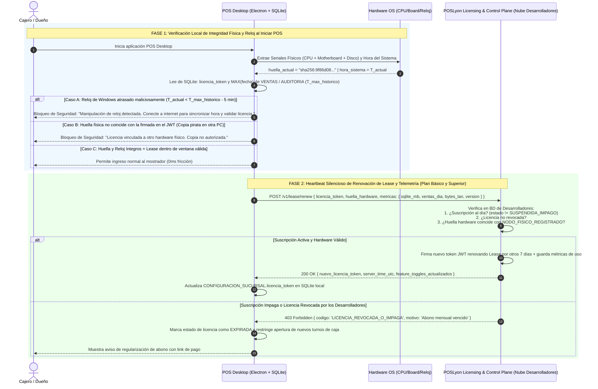
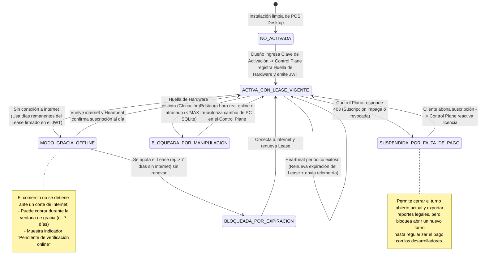

# Plan de Arquitectura (Blueprint Externo): Control Panel para Desarrolladores, Sistema Anti-Piratería, Telemetría y Simulador Local

> \[\!NOTE\] **Propósito y Alcance del Documento (Blueprint Externo para Etapa de Comercialización)** Este documento consolida las decisiones de arquitectura para la **futura aplicación de gestión comercial de los desarrolladores (`POSLyon Control Plane / Vendor Backoffice`)** y el **Simulador Local (`Dev Sandbox`)**. Se mantiene como un **plan externo independiente** para no sobrecargar el desarrollo inicial del núcleo operativo de POSLyon (`docs/`), pero dejando definidos desde hoy los contratos exactos para que, al momento de comercializar el software, el acoplamiento sea 100% transparente.

---

## 1\. Decisiones Arquitectónicas Confirmadas

### 1.1. Aislamiento en la Nube: Single-Tenant Aislado por Cliente (Opción B)

Cuando un comercio adquiere el **Plan Superior (`SUPERIOR_CLOUD`)**, el Control Plane aprovisiona una **instancia/base de datos PostgreSQL dedicada y 100% aislada para ese cliente** (por ejemplo, contenedor o base `poslyon_tenant_<cuit>` con su propio subdominio o ruta `https://donjose.cloud.poslyon.com`).

- **Ventaja crítica para el desarrollo actual de POSLyon:** Al ser *Single-Tenant por Base de Datos*, **las 21 tablas del ERD actual en `docs/` no necesitan ninguna columna `id_tenant`**. El esquema que ya está documentado para una empresa funciona de forma idéntica para 1 cliente o para 500 clientes aislados.  
- **Seguridad y Backups:** Imposibilidad física de cruzamiento de datos entre distintos comercios, facilidad para exportar o restaurar un backup de un cliente específico y medición exacta de cuánto almacenamiento en disco y RAM consume cada cliente.

### 1.2. Blindaje Anti-Piratería de Triple Capa (En Plan Básico y Plan Superior)

Para impedir que un tercero copie el instalador o la base SQLite a otra computadora, que use el software sin pagar su suscripción, o que atrase el reloj de Windows para engañar la fecha de vencimiento —pero sin detener la fila de cobro si al comercio se le cae el proveedor de internet por unas horas—, se implementa el patrón **Node-Locked Rolling Lease (Licencia Anclada a Hardware con Renovación Periódica)**:

1. **Capa 1 — Anclaje Criptográfico a Hardware físico (*Hardware Node-Locking*):**  
   - Al activarse en una PC de caja (`pos-desktop`), Electron calcula una huella digital única e irreversible del equipo físico (`huella_hardware = SHA256(CPU_ID + Motherboard_UUID + Disk_Serial)`).  
   - El servidor de licencias de los desarrolladores incluye ese hash dentro del JWT firmado (`licencia_token`).  
   - **Efecto Anti-Clonación:** Si alguien copia la carpeta del programa y el archivo SQLite a otra PC en otro kiosco "pirata", al iniciar `pos-desktop` la huella física de la nueva PC no coincidirá con la firmada dentro de `licencia_token` y el sistema **bloqueará el arranque inmediatamente**.  
2. **Capa 2 — Verificación Online Continua y *Rolling Lease* (En ambos planes):**  
   - **En Plan Superior (`SUPERIOR_CLOUD`):** Cada ciclo de sincronización (`/api/sync/pull` y `/api/sync/push`) valida el `licencia_token` y la `huella_hardware` contra el Control Plane. Si la licencia fue revocada por falta de pago, el servidor rechaza la sincronización con `HTTP 402 Payment Required / 403 Forbidden`.  
   - **En Plan Básico (`BASICO_LOCAL`):** Aunque sus ventas y catálogo viven 100% en la red local LAN, `pos-desktop` ejecuta un **Heartbeat de Validación de Licencia (`POST https://licensing.poslyon.com/v1/lease/renew`)** cada vez que inicia la aplicación y cada 12 horas en segundo plano.  
   - El token emitido tiene una **ventana de concesión corta (*Lease TTL*, ej. 7 días)** que se renueva automáticamente de forma transparente en cada *heartbeat* exitoso. Así, si el kiosco sufre un corte real de fibra óptica durante 48 horas puede seguir cobrando, pero si desconecta el cable a propósito para no pagar el abono mensual, el *lease* caduca y el POS entra en modo bloqueado hasta validar con la nube.  
3. **Capa 3 — Protección contra Atraso de Reloj de Windows (*Anti-Clock-Tampering*):**  
   - Un truco clásico de piratería en software offline es atrasar la fecha del sistema operativo para que el JWT parezca no vencido.  
   - Antes de validar la expiración del `licencia_token`, `pos-desktop` consulta en su propio SQLite local la marca de tiempo máxima histórica registrada (`MAX(fecha)` en `AUDITORIA` y `VENTA`, más el `ultimo_timestamp_verificado` firmado). Si el reloj actual de la PC es **anterior** al último ticket o evento de auditoría emitido (con un margen de tolerancia de 5 minutos), el sistema detecta manipulación de reloj (`CLOCK_TAMPERING_DETECTED`) y exige validación online inmediata contra el servidor de licencias antes de permitir abrir turno.

---

## 2\. Diagramas UML del Control Plane y Sistema Anti-Piratería (Mermaid.js)

### 2.1. Diagrama Entidad-Relación (ERD) del Control Plane (App de Desarrolladores)

```mermaid
erDiagram
    CUENTA_COMERCIAL ||--o| INSTANCIA_CLOUD_TENANT : "aloja en (Plan Superior)"
    CUENTA_COMERCIAL ||--o{ LICENCIA_EMITIDA : "posee"
    CUENTA_COMERCIAL ||--o{ NODO_FISICO_REGISTRADO : "autoriza"
    CUENTA_COMERCIAL ||--o{ METRICA_CONSUMO_DIARIO : "acumula uso en"
    NODO_FISICO_REGISTRADO ||--o{ TELEMETRIA_HEARTBEAT_LOG : "emite"

    CUENTA_COMERCIAL {
        uuid id PK "UUIDv4 del cliente comercial"
        string nombre_comercial "Ej: Autoservicio Don José"
        string identificador_fiscal UNIQUE "CUIT / RUT"
        string email_dueno "Contacto administrativo"
        string plan_contratado "BASICO_LOCAL | SUPERIOR_CLOUD"
        string estado_suscripcion "TRIAL | ACTIVA | PERIODO_GRACIA | SUSPENDIDA_IMPAGO | REVOCADA"
        int max_sucursales_permitidas "1 en Básico, N en Superior"
        int max_cajas_por_sucursal "Límite de nodos MAESTRO_LAN + SECUNDARIO_LAN"
        datetime proximo_vencimiento_abono "Fecha límite de pago de suscripción"
        datetime created_at
    }

    INSTANCIA_CLOUD_TENANT {
        uuid id PK "UUIDv4 de la instancia Single-Tenant"
        uuid id_cuenta_comercial FK "Cliente dueño del contenedor/BD"
        string db_name UNIQUE "Ej: poslyon_tenant_30712345678"
        string container_id "ID del contenedor Docker / Servicio"
        string cloud_endpoint_url UNIQUE "Ej: https://donjose.api.poslyon.com"
        string estado_instancia "PROVISIONING | RUNNING | STOPPED | BACKING_UP"
        decimal almacenamiento_db_mb "Espacio ocupado en PostgreSQL dedicado"
        datetime ultimo_backup_exitoso
    }

    LICENCIA_EMITIDA {
        uuid id PK "UUIDv4 del certificado"
        uuid id_cuenta_comercial FK "Cliente titular"
        uuid id_sucursal_asignada "UUID de SUCURSAL en el POS"
        string huella_hardware_vinculada "SHA-256 del equipo físico (Node-Locked)"
        string token_jwt "JWT Ed25519 con Lease TTL renovable"
        jsonb feature_toggles_habilitados "Mapa de features activas por contrato"
        datetime fecha_emision
        datetime fecha_expiracion_lease "Expira en N días si no renueva heartbeat"
        boolean revocada "True para bloqueo remoto inmediato"
    }

    NODO_FISICO_REGISTRADO {
        uuid id PK "UUIDv4 de la terminal"
        uuid id_cuenta_comercial FK "Cliente titular"
        uuid id_sucursal "UUID de SUCURSAL"
        string alias_terminal "Ej: Caja 1 Mostrador"
        string modo_nodo_lan "MAESTRO_LAN | SECUNDARIO_LAN | MOBILE_PICKER"
        string huella_hardware UNIQUE "Hash físico de CPU + Motherboard + Disco"
        string version_app "Ej: 1.0.4"
        string ip_publica_ultimo_acceso "IP desde donde reportó heartbeat"
        decimal tamano_sqlite_mb "Peso actual del SQLite local"
        datetime ultimo_heartbeat_utc
    }

    METRICA_CONSUMO_DIARIO {
        uuid id PK "UUIDv4"
        uuid id_cuenta_comercial FK "Cliente titular"
        uuid id_sucursal "Sucursal medida"
        date fecha "Día calendario (UTC)"
        bigint total_bytes_push_comprimidos "Tráfico de subida real (Brotli)"
        bigint total_bytes_pull_comprimidos "Tráfico de bajada real (Brotli)"
        bigint total_bytes_sin_comprimir "Tamaño bruto JSON (ahorro de ancho de banda)"
        int cantidad_ciclos_sync "Requests pull/push en el día"
        int total_ventas_reportadas "Volumen operativo diario"
        int latencia_promedio_ms "Rendimiento medio de red"
    }

    TELEMETRIA_HEARTBEAT_LOG {
        uuid id PK "UUIDv4"
        uuid id_nodo FK "Terminal que reportó"
        string tipo_evento "LEASE_RENEWAL | SYNC_METRIC | CLOCK_TAMPER_ALERT | CRASH_REPORT"
        jsonb payload_metricas "Detalle de bytes, memoria, errores o estado"
        datetime fecha_utc
    }
```

&nbsp;

---

### 2.2. Diagrama de Secuencia: Verificación Anti-Piratería (Hardware Node-Lock \+ Rolling Lease \+ Anti-Clock Tampering)



&nbsp;

---

### 2.3. Diagrama de Máquina de Estados: Ciclo de Vida de la Licencia en la Terminal Local



&nbsp;

---

## 3\. Código de Referencia para el Validador Anti-Piratería y Aprovisionamiento Single-Tenant

### 3.1. Validador de Huella de Hardware y Anti-Clock-Tampering (`libs/domain-core/src/security/license-guard.ts`)

Este módulo ligero es el único componente que vivirá dentro de `pos-desktop` cuando quieran activar la protección comercial:

```ts
import * as crypto from 'crypto';
import * as os from 'os';

export interface ILicensePayload {
  iss: string;
  sub: string; // id_sucursal
  comercio: string;
  plan_activo: 'BASICO_LOCAL' | 'SUPERIOR_CLOUD';
  hw_hash: string; // SHA-256 de la máquina autorizada (Node-Lock)
  max_cajas_lan: number;
  feature_toggles: Record<string, boolean>;
  iat: number; // Timestamp de emisión (segundos UTC)
  exp: number; // Timestamp de expiración del Lease (segundos UTC)
}

export class LicenseSecurityGuard {
  /**
   * Genera la huella física determinista del equipo (Node-Locking)
   * combinando identificadores de CPU, arquitectura, hostname y MAC de red física.
   */
  static obtenerHuellaHardwareLocal(machineUuidNativo: string): string {
    const cpuModel = os.cpus()[0]?.model || 'unknown-cpu';
    const arch = os.arch();
    const platform = os.platform();
    const rawFingerprint = `${machineUuidNativo}|${cpuModel}|${arch}|${platform}`;
    return crypto.createHash('sha256').update(rawFingerprint).digest('hex');
  }

  /**
   * Verifica offline la autenticidad criptográfica del token (Ed25519),
   * el anclaje al hardware físico y que el reloj de Windows no haya sido atrasado.
   */
  static verificarLicenciaLocal(params: {
    tokenJwt: string;
    publicKeyPem: string;
    huellaHardwareActual: string;
    ultimoTimestampRegistradoEnSqliteMs: number;
  }): { valida: boolean; motivoBloqueo?: string; payload?: ILicensePayload } {
    const partes = params.tokenJwt.split('.');
    if (partes.length !== 3) {
      return { valida: false, motivoBloqueo: 'FORMATO_LICENCIA_INVALIDO' };
    }

    const [headerB64, payloadB64, firmaB64] = partes;

    // 1. Verificar firma criptográfica Ed25519 (Imposible de falsificar sin la clave privada de los desarrolladores)
    const firmaValida = crypto.verify(
      null,
      Buffer.from(`${headerB64}.${payloadB64}`),
      params.publicKeyPem,
      Buffer.from(firmaB64, 'base64url')
    );

    if (!firmaValida) {
      return { valida: false, motivoBloqueo: 'FIRMA_CRIPTOGRAFICA_ADULTERADA' };
    }

    const payload: ILicensePayload = JSON.parse(
      Buffer.from(payloadB64, 'base64url').toString('utf8')
    );

    // 2. Verificar Node-Locking (Impedir que copien el programa y la BD a otra computadora)
    if (payload.hw_hash !== params.huellaHardwareActual) {
      return {
        valida: false,
        motivoBloqueo: 'HARDWARE_NO_AUTORIZADO_COPIA_DETECTADA',
      };
    }

    // 3. Verificar Anti-Clock-Tampering (Impedir que atrasen el reloj de Windows)
    const ahoraMs = Date.now();
    const toleranciaDerivaMs = 5 * 60 * 1000; // 5 minutos
    if (ahoraMs + toleranciaDerivaMs < params.ultimoTimestampRegistradoEnSqliteMs) {
      return {
        valida: false,
        motivoBloqueo: 'MANIPULACION_RELOJ_SISTEMA_DETECTADA',
      };
    }

    // 4. Verificar vigencia del Lease temporal
    if (ahoraMs > payload.exp * 1000) {
      return {
        valida: false,
        motivoBloqueo: 'LEASE_EXPIRADO_REQUIERE_VERIFICACION_ONLINE',
      };
    }

    return { valida: true, payload };
  }
}
```

&nbsp;

### 3.2. Orquestador de Aprovisionamiento Single-Tenant para el Plan Superior (En la futura App de Desarrolladores)

Cuando desde su panel administrativo ustedes pasen un cliente al **Plan Superior (`SUPERIOR_CLOUD`)**, el Control Plane creará su base de datos aislada de forma automática:

```ts
// poslyon-vendor-portal/src/provisioning/single-tenant-provisioner.service.ts
import { DataSource } from 'typeorm';

export class SingleTenantProvisionerService {
  constructor(private readonly adminPostgresConnection: DataSource) {}

  /**
   * Crea una base de datos PostgreSQL 100% aislada para el nuevo cliente del Plan Superior,
   * corre las migraciones del ERD oficial de POSLyon (21 tablas) y ejecuta el seed inicial.
   */
  async aprovisionarNuevoClientePlanSuperior(cuitCliente: string): Promise<{
    dbName: string;
    cloudEndpointUrl: string;
  }> {
    const sanitizedSlug = cuitCliente.replace(/[^a-zA-Z0-9]/g, '');
    const dbName = `poslyon_tenant_${sanitizedSlug}`;

    // 1. Crear la base de datos aislada para el cliente
    await this.adminPostgresConnection.query(`CREATE DATABASE "${dbName}"`);

    // 2. Conectar a la nueva base, ejecutar las migraciones de las 21 tablas y el seed S-03 (Producto Comodín y SYSTEM_BOT)
    // 3. Retornar el endpoint asignado para inyectarlo en el licencia_token del cliente
    return {
      dbName,
      cloudEndpointUrl: `https://${sanitizedSlug}.cloud.poslyon.com`,
    };
  }
}
```

&nbsp;

---

## 4\. Hoja de Ruta Recomendada (Qué hacer ahora vs. Qué hacer al comercializar)

1. **Etapa Actual (Desarrollo del Core de POSLyon — Basado en `docs/`):**  
   - Pueden comenzar a programar `libs/domain-core`, `apps/pos-desktop`, `apps/embalador-mobile` y `apps/backend-cloud` tal como están especificados hoy en `docs/`.  
   - Para probar múltiples cajas o sucursales en sus PCs de desarrollo, basta con iniciar `pos-desktop` pasándole distintas rutas de archivo SQLite por variable de entorno (`POS_DB_FILE=./suc1_caja1.db`, `POS_DB_FILE=./suc1_caja2.db`).  
2. **Etapa Pre-Lanzamiento Comercial (Construcción del Control Plane Externo):**  
   - Activar `LicenseSecurityGuard` en el arranque de `pos-desktop` y en el middleware de `backend-cloud`.  
   - Levantar el microservicio/panel de desarrolladores (`poslyon-vendor-portal`) con las 6 tablas del ERD de Control Plane (Sección 2.1) para emitir licencias vinculadas a hardware (`hw_hash`), recolectar los *heartbeats* de uso de red y aprovisionar las bases PostgreSQL *Single-Tenant* para los clientes del Plan Superior.