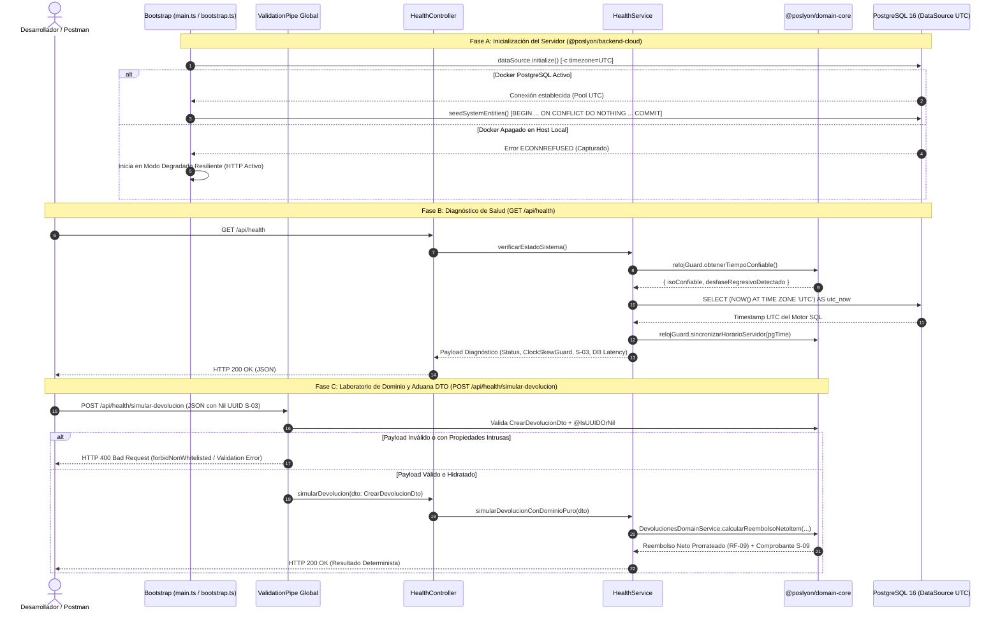

# 📘 Documento de Trazabilidad 06 — Bootstrap de `apps/backend-cloud`, Conexión PostgreSQL (TypeORM UTC), Seed S-03 y Healthcheck (Paso 1.1)

> **Fase del Plan de Construcción:** Nivel 1 — Infraestructura Base Backend (Paso 1.1)  
> **Fecha de Consolidación:** 2026-10-23  
> **Estado:** Completado y Verificado (`tsc --build` + `37/37` tests en Jest + Supertest pasando en `@poslyon/domain-core` y `@poslyon/backend-cloud`)  
> **Enfoque Pedagógico:** Mentoría Universitaria en Ingeniería de Sistemas (De 0 a 100: Progresión de Desacoplado a Acoplado)

---

## 1. Propósito de la Funcionalidad

En el **Nivel 0 (Pasos 0.1 a 0.5)** construimos el **Núcleo Funcional Puro** (`@poslyon/domain-core`): enumeraciones, contratos TypeScript, DTOs con validaciones declarativas (`class-validator` + `@IsUUIDOrNil`) y servicios matemáticos deterministas libres de I/O.

Con el **Paso 1.1** iniciamos el **Nivel 1 (Infraestructura Base Backend)** dando vida al **Cascarón Imperativo** (*Imperative Shell*) en `apps/backend-cloud` (`@poslyon/backend-cloud`). Este paquete actúa como el servidor central en la nube del ecosistema Híbrido Local-First de POSLyon y materializa cinco pilares arquitectónicos:

1. **Contenedor de Inversión de Control (IoC) en NestJS (`AppModule`, `bootstrap.ts`, `main.ts`):** Inicializa el servidor HTTP bajo el prefijo global `/api`, habilita CORS y desacopla la configuración del pipeline transversal (`configureApp`) para que tanto el servidor en producción como los tests de integración (`supertest`) ejecuten exactamente las mismas reglas.
2. **Aduana Perimetral contra *Mass Assignment* (`ValidationPipe` Global):** Intercepta cada request HTTP entrante, hidrata automáticamente el JSON plano a instancias reales de nuestros DTOs de `@poslyon/domain-core` (`transform: true`), filtra propiedades (`whitelist: true`) y rechaza con `HTTP 400 Bad Request` cualquier campo intruso no declarado (`forbidNonWhitelisted: true`).
3. **Módulo Global de Persistencia PostgreSQL en UTC Estricto (`DatabaseModule`):** Configura el `DataSource` de TypeORM hacia el motor `PostgreSQL 16` (`poslyon_cloud`) inyectando el parámetro de sesión `-c timezone=UTC` (Resolución **O-25 / S-10**) e implementando **Degradación Elegante (*Graceful Degradation*)** con reconexión bajo demanda si Docker Desktop no se encuentra corriendo al momento de iniciar el proceso Node.js.
4. **Seed Transaccional e Idempotente de Identidades Canónicas (`seedSystemEntities` — Resolución S-03):** Asegura mediante una transacción explícita ACID (`BEGIN ... COMMIT / ROLLBACK`) y cláusulas `ON CONFLICT (id) DO NOTHING` la existencia de `UUID_SYSTEM_BOT` (`00000000-0000-4000-8000-000000000001`) y `UUID_ARTICULO_COMODIN` (`00000000-0000-0000-0000-000000000000`).
5. **Controlador de Diagnóstico y Laboratorio en Vivo (`HealthController`):** Expone `GET /api/health` y dos endpoints interactivos (`POST /api/health/validar-venta-dto` y `POST /api/health/simular-devolucion`) para auditar desde Postman cómo el Cascarón Imperativo consume los DTOs y servicios puros de `@poslyon/domain-core`.

---

## 2. Matriz de Trazabilidad Bidireccional (De Extremo a Extremo)

| Requisito / Resolución SDD | Diagrama UML / Entidades ERD | Especificación File-Level (`docs/file-level-specs/`) | Archivo Implementado y Líneas | Suite de Pruebas (Jest / Supertest) |
| :--- | :--- | :--- | :--- | :--- |
| **RNF-01 / O-25 / S-10** (Conexión PostgreSQL Cloud con zona horaria `UTC` estricta y guarda de reloj monótono) | `Diagrama de Secuencia Sync Pull/Push` · Cursor temporal `updated_at` UTC | `file-level-specs-modulo-sync.md` (§11, §12): Opciones de sesión PostgreSQL `-c timezone=UTC` y `RelojMonotonoGuard` | [`database.config.ts`](file:///d:/Contr/Archivos/POSLyon-Monolitico/apps/backend-cloud/src/config/database.config.ts#L1-L27)<br>[`database.module.ts`](file:///d:/Contr/Archivos/POSLyon-Monolitico/apps/backend-cloud/src/database/database.module.ts#L1-L69)<br>[`health.service.ts`](file:///d:/Contr/Archivos/POSLyon-Monolitico/apps/backend-cloud/src/modules/health/health.service.ts#L29-L87) | [`health.controller.spec.ts`](file:///d:/Contr/Archivos/POSLyon-Monolitico/apps/backend-cloud/src/modules/health/health.controller.spec.ts#L62-L82) |
| **Resolución S-03 / RF-12 / RNF-03** (Seed idempotente de `SYSTEM_BOT` y `PRODUCTO_COMODIN` con Nil UUID) | `ERD`: `USUARIO.id`, `PRODUCTO_GLOBAL.id`, `AUDITORIA.id_usuario`, `VENTA_DETALLE.id_producto` | `file-level-specs-modulo-sync.md` (§12 - Seed Inicial e Idempotente para PostgreSQL y SQLite) | [`system-entities.seed.ts`](file:///d:/Contr/Archivos/POSLyon-Monolitico/apps/backend-cloud/src/database/seeds/system-entities.seed.ts#L1-L80) | [`health.controller.spec.ts`](file:///d:/Contr/Archivos/POSLyon-Monolitico/apps/backend-cloud/src/modules/health/health.controller.spec.ts#L62-L82) y [`#L159-L180`](file:///d:/Contr/Archivos/POSLyon-Monolitico/apps/backend-cloud/src/modules/health/health.controller.spec.ts#L159-L180) |
| **Seguridad Perimetral de Contratos DTO (OWASP API3:2023)** | `Diagramas de Secuencia API REST` (Aduana HTTP 400 previa a capa de aplicación) | `file-level-specs-ventas-pos-caja.md` (§4) y `file-level-specs-modulo-devoluciones.md` (§4) | [`bootstrap.ts`](file:///d:/Contr/Archivos/POSLyon-Monolitico/apps/backend-cloud/src/bootstrap.ts#L1-L28)<br>[`main.ts`](file:///d:/Contr/Archivos/POSLyon-Monolitico/apps/backend-cloud/src/main.ts#L1-L20)<br>[`app.module.ts`](file:///d:/Contr/Archivos/POSLyon-Monolitico/apps/backend-cloud/src/app.module.ts#L1-L16) | [`health.controller.spec.ts`](file:///d:/Contr/Archivos/POSLyon-Monolitico/apps/backend-cloud/src/modules/health/health.controller.spec.ts#L84-L127) |
| **Acoplamiento Cascarón Imperativo ↔ Núcleo Funcional Puro (RF-08 / RF-09 / S-03)** | `Secuencia Ventas Pagos Mixtos` y `Secuencia Devoluciones` | `file-level-specs-modulo-devoluciones.md` (§3, §4): Hidratación de `CrearDevolucionDto` con `@IsUUIDOrNil` e invocación de `DevolucionesDomainService` | [`health.controller.ts`](file:///d:/Contr/Archivos/POSLyon-Monolitico/apps/backend-cloud/src/modules/health/health.controller.ts#L1-L34)<br>[`health.service.ts`](file:///d:/Contr/Archivos/POSLyon-Monolitico/apps/backend-cloud/src/modules/health/health.service.ts#L92-L158)<br>[`health.module.ts`](file:///d:/Contr/Archivos/POSLyon-Monolitico/apps/backend-cloud/src/modules/health/health.module.ts#L1-L9) | [`health.controller.spec.ts`](file:///d:/Contr/Archivos/POSLyon-Monolitico/apps/backend-cloud/src/modules/health/health.controller.spec.ts#L129-L157) |

---

## 3. Explicación Universitaria de 0 a 100 (De Desacoplado a Acoplado)

### 3.1. Del Núcleo Funcional Puro al Cascarón Imperativo (IoC e Inyección de Dependencias)

En la arquitectura **Functional Core, Imperative Shell** (Gary Bernhardt) combinada con **Clean Architecture**, separamos estrictamente dos mundos:
1. **`@poslyon/domain-core` (Nivel 0 — Desacoplado):** Clases y funciones puras que no saben que existe HTTP, ni NestJS, ni PostgreSQL.
2. **`@poslyon/backend-cloud` (Nivel 1 — Acoplado):** El servidor que escucha sockets TCP/HTTP, abre conexiones a PostgreSQL y coordina transacciones, pero **delega las decisiones de negocio y validaciones** a `@poslyon/domain-core`.

Para estructurar `@poslyon/backend-cloud` utilizamos el **Contenedor de Inversión de Control (IoC)** de **NestJS**:
- En lugar de que [`HealthService`](file:///d:/Contr/Archivos/POSLyon-Monolitico/apps/backend-cloud/src/modules/health/health.service.ts#L17-L24) instancie manualmente su conexión a base de datos haciendo `new DataSource(...)` (lo cual acoplaría el servicio a credenciales físicas e impediría testearlo sin una base de datos real), declaramos un token de inyección simbólico `POSLYON_DATA_SOURCE` en [`database.module.ts`](file:///d:/Contr/Archivos/POSLyon-Monolitico/apps/backend-cloud/src/database/database.module.ts#L6).
- Gracias a este diseño basado en el **Principio de Inversión de Dependencias (DIP — la "D" de SOLID)**, durante la ejecución real NestJS inyecta el `DataSource` conectado a PostgreSQL, mientras que en [`health.controller.spec.ts`](file:///d:/Contr/Archivos/POSLyon-Monolitico/apps/backend-cloud/src/modules/health/health.controller.spec.ts#L49-L50) podemos interceptar el proveedor con `.overrideProvider(POSLYON_DATA_SOURCE).useValue(mockDataSource)` en milisegundos.

### 3.2. Seguridad Perimetral contra *Mass Assignment* (`ValidationPipe` en `bootstrap.ts`)

Uno de los vectores de ataque más frecuentes en APIs REST financieras (clasificado en **OWASP API Security Top 10 — API3:2023 Broken Object Property Level Authorization / Mass Assignment**) ocurre cuando un cliente malicioso envía propiedades adicionales en el cuerpo JSON (por ejemplo, `"es_dueno": true`, `"saldo_actual": 0` o `"campo_malicioso_no_declarado": "..."`) esperando que el ORM las persista directamente en la base de datos.

En [`bootstrap.ts`](file:///d:/Contr/Archivos/POSLyon-Monolitico/apps/backend-cloud/src/bootstrap.ts#L18-L27) blindamos toda la API mediante tres banderas conjuntas en el `ValidationPipe` global:
- `whitelist: true`: Analiza los metadatos de `class-validator` compilados en `@poslyon/domain-core` y descarta cualquier propiedad que no posea al menos un decorador de validación.
- `forbidNonWhitelisted: true`: En lugar de ignorar silenciosamente las propiedades intrusas, aborta inmediatamente la petición devolviendo `HTTP 400 Bad Request` indicando exactamente qué propiedad ilegal fue detectada (`property campo_malicioso_no_declarado should not exist`).
- `transform: true` con `enableImplicitConversion: false`: Usa `class-transformer` para convertir el JSON plano deserializado por Express en una **instancia real en memoria** de la clase DTO (`dto instanceof CrearVentaDto === true`), respetando los `@Type(() => ...)` declarados en el Paso 0.4 sin realizar coerciones implícitas peligrosas (por ejemplo, evitando que el string `"false"` se convierta silenciosamente en el booleano `true`).

### 3.3. Sincronización Temporal Distribuida: Por qué forzamos `-c timezone=UTC` (O-25 / S-10)

En un sistema POS Híbrido donde conviven un servidor Cloud (que puede estar alojado en AWS `us-east-1` o en una PC con hora local `America/Argentina/Buenos_Aires` `UTC-3`) y múltiples terminales locales SQLite, el motor de sincronización incremental (`Sync Pull` / `Sync Push`) utiliza marcas de tiempo (`updated_at > :last_sync_timestamp`) como cursores de corte.

Si una sesión de PostgreSQL formatea o interpreta un `TIMESTAMP` asumiendo la hora local del sistema operativo (`-03:00`) mientras que otra lo hace en `UTC` (`+00:00`), se produce una ventana ciega de 3 horas en la que las actualizaciones de precios o stock no se descargan a las cajas registradoras.

Para erradicar esta anomalía de raíz:
1. En [`database.module.ts`](file:///d:/Contr/Archivos/POSLyon-Monolitico/apps/backend-cloud/src/database/database.module.ts#L35-L39) pasamos `extra: { options: '-c timezone=UTC' }` al driver nativo `pg`. Esto instruye al protocolo de arranque de PostgreSQL para que toda sesión del pool opere en `UTC` sin importar la configuración regional del host Windows o Linux.
2. En [`health.service.ts`](file:///d:/Contr/Archivos/POSLyon-Monolitico/apps/backend-cloud/src/modules/health/health.service.ts#L45-L55), cada vez que se verifica la salud de PostgreSQL (`SELECT (NOW() AT TIME ZONE 'UTC') AS utc_now`), el reloj devuelto por el motor SQL alimenta a `this.relojGuard.sincronizarHorarioServidor(...)` (`RelojMonotonoGuard` de `@poslyon/domain-core`), manteniendo sincronizado el *High-Watermark* monótono del servidor de aplicación con el motor relacional.

### 3.4. Seed Transaccional e Idempotente de Identidades Canónicas (`seedSystemEntities` — S-03)

Como establecimos en el Paso 0.2 y Paso 0.4, POSLyon prohíbe las claves foráneas huérfanas (`NULL`) en tablas financieras y de auditoría:
- Las ventas rápidas de mostrador de productos no catalogados apuntan al **Nil UUID** (`00000000-0000-0000-0000-000000000000` — `UUID_ARTICULO_COMODIN`).
- Las acciones automáticas del motor de sincronización o tareas programadas apuntan a `UUID_SYSTEM_BOT` (`00000000-0000-4000-8000-000000000001`).

En [`system-entities.seed.ts`](file:///d:/Contr/Archivos/POSLyon-Monolitico/apps/backend-cloud/src/database/seeds/system-entities.seed.ts#L18-L80) implementamos el seed siguiendo cuatro garantías de ingeniería:
1. **Inspección de Catálogo (`to_regclass`):** Antes de ejecutar los `INSERT`, consulta `to_regclass('public.usuario')` y `to_regclass('public.producto_global')`. Si estamos en el Paso 1.1 (antes de correr las migraciones de entidades del Nivel 2), el seed detecta que las tablas aún no existen, confirma la transacción limpiamente e informa el estado en `/api/health`; en cuanto las tablas existan en el Nivel 2, sembrará ambos registros automáticamente.
2. **Idempotencia Matemática (`ON CONFLICT (id) DO NOTHING`):** Puede ejecutarse $1, 10 \text{ o } 10.000$ veces en cada reinicio del servidor sin lanzar errores de clave duplicada (`23505 unique_violation`) ni sobrescribir datos existentes.
3. **Atomicidad ACID Explícita (`QueryRunner`):** Abre una transacción dedicada (`startTransaction()`), confirma con `commitTransaction()`, o ejecuta `rollbackTransaction()` en el bloque `catch` garantizando siempre la liberación del cliente al pool en el bloque `finally` (`release()`).

---

## 4. Diagramas UML de la Arquitectura Implementada (Mermaid.js)

### 4.1. Diagrama de Secuencia — Arranque Resiliente, Healthcheck y Aduana `ValidationPipe`



---

## 5. Bitácora Pedagógica de Decisiones de Arquitectura (ADR)

| ID Decisión | Problema Arquitectónico | Antipatrón Descartado (Cómo NO hacerlo) | Diseño Profesional Adoptado en POSLyon |
| :--- | :--- | :--- | :--- |
| **ADR-013** | Configuración del pipeline HTTP para Producción vs. Testing | Configurar `ValidationPipe` y `setGlobalPrefix('api')` únicamente dentro de `main.ts`. Esto provoca que los tests de integración con `supertest` prueben una aplicación sin pipes ni prefijos, dando falsos positivos. | Extraer la función pura de configuración [`configureApp(app)`](file:///d:/Contr/Archivos/POSLyon-Monolitico/apps/backend-cloud/src/bootstrap.ts#L8-L28) en `bootstrap.ts` e invocarla idénticamente tanto en [`main.ts`](file:///d:/Contr/Archivos/POSLyon-Monolitico/apps/backend-cloud/src/main.ts#L11) como en [`health.controller.spec.ts`](file:///d:/Contr/Archivos/POSLyon-Monolitico/apps/backend-cloud/src/modules/health/health.controller.spec.ts#L54). |
| **ADR-014** | Comportamiento del servidor cuando el contenedor Docker no está encendido en la máquina del desarrollador | Dejar que `TypeORMModule.forRoot()` aborte el proceso de Node.js con `process.exit(1)` tras 10 reintentos fallidos, impidiendo siquiera probar los endpoints de validación de DTOs o servicios puros en Postman. | Implementar un proveedor personalizado `POSLYON_DATA_SOURCE` en [`DatabaseModule`](file:///d:/Contr/Archivos/POSLyon-Monolitico/apps/backend-cloud/src/database/database.module.ts#L20-L60) con degradación elegante (*Graceful Degradation*) y auto-reconexión perezosa en [`HealthService`](file:///d:/Contr/Archivos/POSLyon-Monolitico/apps/backend-cloud/src/modules/health/health.service.ts#L40-L42) apenas el usuario levanta `npm run db:up`. |
| **ADR-015** | Siembra de registros del sistema (`SYSTEM_BOT` y `PRODUCTO_COMODIN`) | Pedirle al administrador que inserte filas a mano en pgAdmin o usar un script suelto que falla en la segunda ejecución por clave primaria duplicada. | Implementar [`seedSystemEntities`](file:///d:/Contr/Archivos/POSLyon-Monolitico/apps/backend-cloud/src/database/seeds/system-entities.seed.ts#L18-L80) dentro de una transacción ACID con `ON CONFLICT (id) DO NOTHING` y verificación previa de existencia de tablas con `to_regclass`. |

---

## 6. Guía de Pruebas Automatizadas y Laboratorio en Postman

### 6.1. Ejecución de la Suite de Integración y Unidad (Jest + Supertest)

Desde la raíz del monorepo, ejecutar:

```powershell
npm run build
npm test
```

**Resultado verificado:**
- `PASS domain-core libs/domain-core/src/dtos/dtos-validacion.spec.ts`
- `PASS domain-core libs/domain-core/src/services/servicios-puros-dominio.spec.ts`
- `PASS backend-cloud apps/backend-cloud/src/modules/health/health.controller.spec.ts`
- **Total:** `3 Test Suites Passed`, `37 Tests Passed` (`0 errors`).

### 6.2. Laboratorio Interactivo en Postman (Servidor en Vivo)

Para levantar el servidor de `@poslyon/backend-cloud` en modo desarrollo:

```powershell
# (Opcional) Si tenés Docker Desktop abierto, levantá PostgreSQL 16:
npm run db:up

# Iniciá el servidor NestJS (funciona tanto con Docker encendido como en modo degradado si Docker está cerrado):
npm run start:dev --workspace=@poslyon/backend-cloud
```

El servidor quedará escuchando en `http://localhost:3000`. Podés ejecutar las siguientes **3 pruebas en Postman**:

#### Prueba 1: Diagnóstico Integral del Sistema (`GET http://localhost:3000/api/health`)
- **Método:** `GET`
- **URL:** `http://localhost:3000/api/health`
- **Qué verifica:** Estado del servicio, marca de tiempo confiable protegida por `RelojMonotonoGuard` (S-10), exposición de los UUIDs canónicos (`UUID_ARTICULO_COMODIN` y `UUID_SYSTEM_BOT`) y estado de conexión/latencia a PostgreSQL 16 en UTC.

#### Prueba 2: Aduana Perimetral `ValidationPipe` (`POST http://localhost:3000/api/health/validar-venta-dto`)
- **Método:** `POST`
- **URL:** `http://localhost:3000/api/health/validar-venta-dto`
- **Body (raw JSON):**
```json
{
  "id_sucursal": "550e8400-e29b-41d4-a716-446655440000",
  "id_turno_caja": "6ba7b810-9dad-41d1-80b4-00c04fd430c8",
  "id_usuario": "7c9e6679-7425-40de-944b-e07fc1f90ae7",
  "id_cliente": "550e8400-e29b-41d4-a716-446655440000",
  "total": 25000,
  "pagos": [
    {
      "id_metodo_pago": "6ba7b810-9dad-41d1-80b4-00c04fd430c8",
      "monto": 10000
    }
  ]
}
```
- **Qué verifica:** Hidratación a `CrearVentaDto` e inferencia automática del estado `PARCIAL` con `$15.000` de saldo a cuenta corriente. Si agregás un campo extra como `"hack": true`, verás cómo el `ValidationPipe` lo bloquea con `HTTP 400 Bad Request`.

#### Prueba 3: Simulación de Devolución con Artículo Comodín Nil UUID (`POST http://localhost:3000/api/health/simular-devolucion`)
- **Método:** `POST`
- **URL:** `http://localhost:3000/api/health/simular-devolucion`
- **Body (raw JSON):**
```json
{
  "id_venta": "550e8400-e29b-41d4-a716-446655440000",
  "id_turno_caja": "6ba7b810-9dad-41d1-80b4-00c04fd430c8",
  "tipo_devolucion": "EFECTIVO_CAJA",
  "motivo": "DEFECTO_FABRICA",
  "items": [
    {
      "id_producto": "00000000-0000-0000-0000-000000000000",
      "cantidad": 2
    }
  ]
}
```
- **Qué verifica:** El decorador `@IsUUIDOrNil` admite el Nil UUID `00000000-0000-0000-0000-000000000000` (Resolución S-03) en el pipeline HTTP de NestJS e invoca a `DevolucionesDomainService` para calcular el reembolso neto prorrateado (`$2.500`), el número de Nota de Crédito (`NC-SUC01-00000001`) y el bloqueo de reingreso a góndola (`reingresa_a_inventario_vendible_s08: false` por ser `DEFECTO_FABRICA`).
