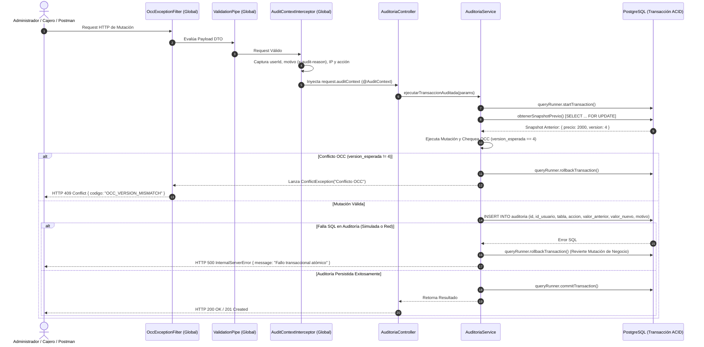

# 📘 Documento de Trazabilidad 07 — Módulo Transversal de Auditoría Forense e Inmutabilidad (Paso 1.2)

> **Fase del Plan de Construcción:** Nivel 1 — Infraestructura Base Backend (Paso 1.2)  
> **Fecha de Consolidación:** 2026-10-23  
> **Estado:** Completado y Verificado (`tsc --build` + `42/42` tests en Jest + Supertest pasando en `@poslyon/domain-core` y `@poslyon/backend-cloud`)  
> **Enfoque Pedagógico:** Mentoría Universitaria en Ingeniería de Sistemas (De 0 a 100: Progresión de Desacoplado a Acoplado)

---

## 1. Propósito de la Funcionalidad

El **Paso 1.2** establece el corazón de la **Integridad y Trazabilidad Forense** del ecosistema POSLyon en `apps/backend-cloud`. En sistemas de Punto de Venta y Gestión Comercial, la pérdida de trazabilidad sobre modificaciones de precios, stock, ventas fiadas o transferencias de mercadería es inadmisible y representa una de las mayores fuentes de fraude interno y discrepancias contables.

Para resolver este desafío de raíz bajo las directivas de `AGENTS.md` y las especificaciones SDD (Resoluciones **C-25, C-26, RF-19 y RNF-03**), este módulo implementa:

1. **Entidad Inmutable de Auditoría Forense (`AuditoriaEntity` — `AUDITORIA`):** Mapea la tabla append-only en PostgreSQL con identificadores UUIDv4, FK al operador o `UUID_SYSTEM_BOT`, tipificación estricta mediante el enum canónico `AccionAuditoria` y columnas `JSONB` (`valor_anterior` y `valor_nuevo`) para registrar snapshots estructurales completos del antes y el después de cada mutación.
2. **Interceptor Global de Ciclo de Vida HTTP (`AuditContextInterceptor`):** Inspecciona cada petición HTTP de mutación (`POST`, `PUT`, `PATCH`, `DELETE`), extrae la identidad del usuario (`x-user-id`, `req.user` o `UUID_SYSTEM_BOT`), el motivo justificado (`x-audit-reason` o `body.motivo`), la IP de origen y la ruta, e inyecta un `IAuditContext` inmutable en el contexto de ejecución. Incluye el decorador de parámetros `@AuditContext()` para controladores NestJS.
3. **Servicio Transaccional Atómico (`AuditoriaService.ejecutarTransaccionAuditada` — C-25 / C-26):** Garantiza que la mutación de negocio y el asentamiento forense en `AUDITORIA` ocurran dentro del **mismo bloque transaccional ACID (`BEGIN ... COMMIT`)**. Si la mutación de negocio falla, no se genera auditoría huérfana; y crucialmente, **si la persistencia del log de auditoría falla, la mutación de negocio se REVOCA INCONDICIONALMENTE (`ROLLBACK`)**.
4. **Filtro Global de Concurrencia Optimista (`OccExceptionFilter`):** Captura excepciones `ConflictException` y errores `OptimisticLockVersionMismatchError` de TypeORM, transformando colisiones de versión concurrente en respuestas estandarizadas con código de estado `HTTP 409 Conflict` (`OCC_VERSION_MISMATCH`).
5. **Controlador Forense y Laboratorio Transaccional (`AuditoriaController`):** Expone endpoints para consulta histórica y el laboratorio `/api/auditoria/laboratorio-transaccion-auditada` para validar en Postman y tests el comportamiento atómico y la detección de colisiones OCC.

---

## 2. Matriz de Trazabilidad Bidireccional (De Extremo a Extremo)

| Requisito / Resolución SDD | Diagrama UML / Entidades ERD | Especificación File-Level (`docs/file-level specs/`) | Archivo Implementado y Líneas | Suite de Pruebas (Jest / Supertest) |
| :--- | :--- | :--- | :--- | :--- |
| **RF-19 / RNF-03** (Auditoría inmutable con snapshots JSONB del antes y después) | `ERD`: `AUDITORIA` (`id`, `id_usuario`, `tabla_afectada`, `id_registro_afectado`, `accion`, `valor_anterior`, `valor_nuevo`, `motivo`, `fecha`) | `File-Level Specs_ Módulo Sincronización Local-First e Interceptor de Auditoría.md` (§1, ERD) | [`auditoria.entity.ts`](file:///d:/Contr/Archivos/POSLyon-Monolitico/apps/backend-cloud/src/modules/auditoria/entities/auditoria.entity.ts#L1-L51) | [`auditoria.controller.spec.ts`](file:///d:/Contr/Archivos/POSLyon-Monolitico/apps/backend-cloud/src/modules/auditoria/auditoria.controller.spec.ts#L94-L115) |
| **Resoluciones C-25 / C-26** (Transaccionalidad atómica: si falla auditoría se revierte mutación de negocio) | `Diagrama de Secuencia Transacción Atómica con OCC y Auditoría` | `File-Level Specs_ Módulo Sincronización Local-First e Interceptor de Auditoría.md` (§4, §3.1) | [`auditoria.service.ts`](file:///d:/Contr/Archivos/POSLyon-Monolitico/apps/backend-cloud/src/modules/auditoria/services/auditoria.service.ts#L44-L121) | [`auditoria.controller.spec.ts`](file:///d:/Contr/Archivos/POSLyon-Monolitico/apps/backend-cloud/src/modules/auditoria/auditoria.controller.spec.ts#L161-L177) |
| **Control OCC y Transformación HTTP 409** (Resolución universal sobre columna `version`) | `Diagrama OCC (version = version + 1)` | `File-Level Specs_ Módulo Sincronización Local-First e Interceptor de Auditoría.md` (§3, §4, §3.1) | [`occ-exception.filter.ts`](file:///d:/Contr/Archivos/POSLyon-Monolitico/apps/backend-cloud/src/common/filters/occ-exception.filter.ts#L1-L68)<br>[`bootstrap.ts`](file:///d:/Contr/Archivos/POSLyon-Monolitico/apps/backend-cloud/src/bootstrap.ts#L19-L20) | [`auditoria.controller.spec.ts`](file:///d:/Contr/Archivos/POSLyon-Monolitico/apps/backend-cloud/src/modules/auditoria/auditoria.controller.spec.ts#L143-L159) |
| **Inyección de Metadatos Forenses HTTP** (Extracción no intrusiva de usuario, IP, path y motivo) | `Diagrama de Secuencia API REST Interceptor` | `File-Level Specs_ Módulo Sincronización Local-First e Interceptor de Auditoría.md` (§3) | [`audit-context.interceptor.ts`](file:///d:/Contr/Archivos/POSLyon-Monolitico/apps/backend-cloud/src/common/interceptors/audit-context.interceptor.ts#L1-L94) | [`auditoria.controller.spec.ts`](file:///d:/Contr/Archivos/POSLyon-Monolitico/apps/backend-cloud/src/modules/auditoria/auditoria.controller.spec.ts#L94-L125) |

---

## 3. Explicación Universitaria de 0 a 100 (De Desacoplado a Acoplado)

### 3.1. Snapshots Forenses Inmutables (`JSONB`) vs. Mutaciones In-Place

En bases de datos relacionales tradicionales, un diseño novato suele actualizar registros directamente con `UPDATE producto SET precio = 2500` sin guardar rastro alguno de qué valor existía antes. Si un auditor o el dueño del comercio pregunta quién cambió el precio el lunes por la mañana y cuánto costaba el producto el domingo a la tarde, el sistema es incapaz de responder.

Para resolver esto con rigor de grado universitario:
- Diseñamos la tabla `AUDITORIA` bajo el principio de **Log de Solo Anexión (*Append-Only Log*)**: está prohibido ejecutar `UPDATE` o `DELETE` sobre esta tabla.
- Almacenamos el estado del registro alterado en dos columnas `JSONB`: `valor_anterior` (capturado antes de la mutación) y `valor_nuevo` (capturado tras la mutación). Gracias a `JSONB`, PostgreSQL almacena los datos de forma binaria indexable, permitiendo realizar consultas forenses profundas (por ejemplo: `WHERE valor_anterior->>'precio_minorista' != valor_nuevo->>'precio_minorista'`).

### 3.2. Atomicidad Transaccional C-25 / C-26: La Regla de Indivisibilidad

Uno de los errores más graves en sistemas corporativos consiste en ejecutar la mutación de negocio en la base de datos y luego, en un bloque suelto o evento desacoplado ("fire-and-forget"), intentar guardar el log de auditoría. Si el servidor sufre una interrupción o la base de datos rechaza la auditoría:
- El precio o el stock ya cambiaron en la base de datos.
- La bitácora forense nunca se guardó.
- Se rompe el principio de **No Repudio**.

En POSLyon, la directiva es inflexible:
$$\text{Mutación de Negocio} \iff \text{Asentamiento de Auditoría}$$
En [`AuditoriaService.ejecutarTransaccionAuditada`](file:///d:/Contr/Archivos/POSLyon-Monolitico/apps/backend-cloud/src/modules/auditoria/services/auditoria.service.ts#L44-L121), ambas operaciones se ejecutan dentro del mismo `queryRunner` de TypeORM:
```typescript
await queryRunner.startTransaction();
try {
  const valorAnterior = await params.obtenerSnapshotPrevio(queryRunner.manager);
  const { resultado } = await params.mutacion(queryRunner.manager);
  const valorNuevo = await params.obtenerSnapshotNuevo(queryRunner.manager, resultado);
  await queryRunner.manager.query(INSERT_AUDITORIA, [...]);
  await queryRunner.commitTransaction(); // Atomicidad absoluta
} catch (error) {
  await queryRunner.rollbackTransaction(); // Se deshacen AMBAS operaciones
  throw error;
}
```

### 3.3. Control de Concurrencia Optimista (OCC) y HTTP 409 Conflict

En una arquitectura Híbrida Local-First, múltiples actores pueden editar el mismo registro:
- El encargado en el Panel Web actualiza el precio minorista de $2000 a $2500.
- Simultáneamente, una terminal de caja offline sincroniza una venta previa donde el producto tenía versión 4.

Para evitar que una transacción sobreescriba ciegamente (*Lost Update Problem*) los cambios de otra sin usar bloqueos pesimistas permanentes (que arruinarían el rendimiento de lectura del mostrador), cada entidad auditable incluye una columna entera `version`:
1. El cliente envía `version: 4` (la versión que leyó al abrir su pantalla).
2. El servicio ejecuta:
   $$\text{UPDATE } \dots \text{ SET } \dots, \text{version} = \text{version} + 1 \text{ WHERE id} = \dots \text{ AND version} = 4$$
3. Si entre que el usuario leyó la pantalla y envió el formulario otro operario modificó el registro (elevando la versión a 5), la consulta SQL afectará **0 filas**.
4. Al detectar 0 filas afectadas, el servicio lanza un `ConflictException` que [`OccExceptionFilter`](file:///d:/Contr/Archivos/POSLyon-Monolitico/apps/backend-cloud/src/common/filters/occ-exception.filter.ts#L29-L67) intercepta para responder con `HTTP 409 Conflict` y código `OCC_VERSION_MISMATCH`.

---

## 4. Diagrama UML de Secuencia — Transacción Auditada con OCC



---

## 5. Bitácora Pedagógica de Decisiones de Arquitectura (ADR)

| ID Decisión | Problema Arquitectónico | Antipatrón Descartado (Cómo NO hacerlo) | Diseño Profesional Adoptado en POSLyon |
| :--- | :--- | :--- | :--- |
| **ADR-016** | Captura de metadatos forenses en cada endpoint | Pasar manualmente el objeto de auditoría como parámetro en cada método de controlador y servicio (*Prop-Drilling* propenso a olvidos). | Implementar [`AuditContextInterceptor`](file:///d:/Contr/Archivos/POSLyon-Monolitico/apps/backend-cloud/src/common/interceptors/audit-context.interceptor.ts#L43-L94) globalmente en [`bootstrap.ts`](file:///d:/Contr/Archivos/POSLyon-Monolitico/apps/backend-cloud/src/bootstrap.ts#L22-L23), asociando el contexto forense al request y exponiendo el decorador [`@AuditContext()`](file:///d:/Contr/Archivos/POSLyon-Monolitico/apps/backend-cloud/src/common/interceptors/audit-context.interceptor.ts#L18-L34). |
| **ADR-017** | Atomicidad entre mutación de negocio y bitácora forense | Ejecutar la mutación de negocio en una transacción y enviar un evento asíncrono o job en segundo plano para guardar la auditoría. Si el broker o la BD fallan, la mutación queda impune sin log forense. | Implementar [`AuditoriaService.ejecutarTransaccionAuditada`](file:///d:/Contr/Archivos/POSLyon-Monolitico/apps/backend-cloud/src/modules/auditoria/services/auditoria.service.ts#L44-L121) en un único bloque `BEGIN ... COMMIT`, revocando la mutación con `ROLLBACK` incondicional si la auditoría falla. |
| **ADR-018** | Manejo de colisiones concurrentes (OCC) | Dejar que TypeORM lance errores no capturados o responder con HTTP 500 genérico. | Implementar [`OccExceptionFilter`](file:///d:/Contr/Archivos/POSLyon-Monolitico/apps/backend-cloud/src/common/filters/occ-exception.filter.ts#L29-L67) globalmente para retornar HTTP 409 Conflict normalizado con código `OCC_VERSION_MISMATCH` y metadatos forenses. |

---

## 6. Guía de Pruebas Automatizadas y Laboratorio en Postman

### 6.1. Suite Automatizada en Jest + Supertest

Ejecutar en la terminal:
```powershell
npm run build ; if ($?) { npm test }
```
**Resultado verificado:**
- `PASS domain-core libs/domain-core/src/services/servicios-puros-dominio.spec.ts`
- `PASS domain-core libs/domain-core/src/dtos/dtos-validacion.spec.ts`
- `PASS backend-cloud apps/backend-cloud/src/modules/health/health.controller.spec.ts`
- `PASS backend-cloud apps/backend-cloud/src/modules/auditoria/auditoria.controller.spec.ts`
- **Total:** `4 Test Suites Passed`, `42 Tests Passed` (`0 errors`).

### 6.2. Laboratorio Interactivo en Postman

Con el servidor corriendo (`npm run start:dev --workspace=@poslyon/backend-cloud`):

#### Prueba 1: Registro Forense Directo con `RegistrarAuditoriaDto`
- **Método:** `POST`
- **URL:** `http://localhost:3000/api/auditoria`
- **Headers:** `x-audit-reason: Auditoría manual de prueba`
- **Body (raw JSON):**
```json
{
  "id_usuario": "00000000-0000-4000-8000-000000000001",
  "tabla_afectada": "PRODUCTO_SUCURSAL",
  "id_registro_afectado": "550e8400-e29b-41d4-a716-446655440000",
  "accion": "MODIFICACION",
  "valor_anterior": { "precio_minorista": 1000, "version": 1 },
  "valor_nuevo": { "precio_minorista": 1500, "version": 2 },
  "motivo": "Ajuste inflacionario programado por el administrador"
}
```

#### Prueba 2: Laboratorio Transaccional — Éxito Atómico OCC
- **Método:** `POST`
- **URL:** `http://localhost:3000/api/auditoria/laboratorio-transaccion-auditada`
- **Headers:** `x-audit-reason: Ajuste mensual de lista de precios`
- **Body (raw JSON):**
```json
{
  "id_registro": "550e8400-e29b-41d4-a716-446655440000",
  "tabla": "PRODUCTO_SUCURSAL",
  "precio_anterior": 2000,
  "precio_nuevo": 2500,
  "version_esperada": 4,
  "version_actual_en_bd": 4
}
```
- **Respuesta esperada:** `HTTP 200 OK` con `version: 5` y `estado_transaccion: "MUTACION_APLICADA_Y_AUDITADA_ATOMICAMENTE"`.

#### Prueba 3: Laboratorio Transaccional — Detección de Colisión OCC (HTTP 409)
- **Método:** `POST`
- **URL:** `http://localhost:3000/api/auditoria/laboratorio-transaccion-auditada`
- **Body (raw JSON):**
```json
{
  "id_registro": "550e8400-e29b-41d4-a716-446655440000",
  "precio_anterior": 2000,
  "precio_nuevo": 2500,
  "version_esperada": 3,
  "version_actual_en_bd": 4
}
```
- **Respuesta esperada:** `HTTP 409 Conflict` con payload `OCC_VERSION_MISMATCH`.
