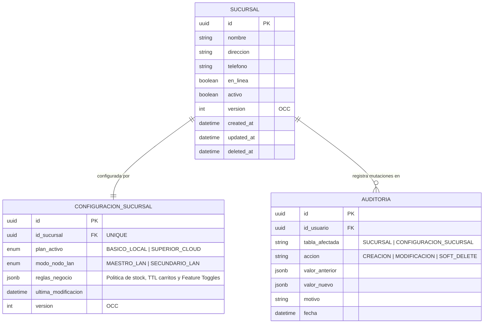

# 📘 Documento de Trazabilidad 08 — Módulo de Sucursales y Configuración Transversal (Paso 2.1)

> **Fase del Plan de Construcción:** Nivel 2 — Módulos Maestros (Paso 2.1)  
> **Fecha de Consolidación:** 2026-10-23  
> **Estado:** Completado y Verificado (`tsc --build` + `47/47` tests en Jest + Supertest pasando en el monorepo)  
> **Enfoque Pedagógico:** Mentoría Universitaria en Ingeniería de Sistemas (De 0 a 100: Progresión de Desacoplado a Acoplado)

---

## 1. Propósito de la Funcionalidad

El **Paso 2.1** inaugura el **Nivel 2 (Módulos Maestros)** del backend de POSLyon en `apps/backend-cloud`. El módulo de Sucursales y Configuración materializa el principio de **Invariancia de Esquema $N=1$ (RF-21)**: una misma arquitectura de datos y un mismo motor de backend atienden con idéntica elegancia a un quiosco barrial de una sola caja registradora (Plan `BASICO_LOCAL`) o a una cadena comercial con decenas de tiendas distribuidas geográficamente (Plan `SUPERIOR_CLOUD`).

Este módulo implementa:
1. **Entidad de Sucursal (`SucursalEntity` — `SUCURSAL`):** Registra el punto de venta con identificador UUIDv4, datos postales, teléfono, control de concurrencia optimista (`version`), marca de sincronización (`en_linea`) y soporte incondicional para **Borrado Lógico (*Soft Delete*)** mediante `activo = false` y `deleted_at`.
2. **Entidad de Configuración One-to-One (`ConfiguracionSucursalEntity` — `CONFIGURACION_SUCURSAL`):** Vinculada de forma unívoca a la sucursal (`id_sucursal UNIQUE FK`), modela el plan comercial activo (`BASICO_LOCAL` vs. `SUPERIOR_CLOUD`), el rol topológico en la red de área local (`MAESTRO_LAN`, `SECUNDARIO_LAN`, `MOBILE_PICKER`) y alberga las reglas comerciales y feature toggles en columnas `JSONB`.
3. **Extensibilidad sin Mutaciones DDL (`JSONB`):** Permite encender o apagar funcionalidades dinámicamente (`sincronizacion_cloud`, `transferencias_inter_sucursal`, `politica_stock: UNIVERSAL_PERMISIVO` de la Resolución **C-12**) sin necesidad de alterar el esquema relacional (`ALTER TABLE`) ni interrumpir las operaciones en góndola.
4. **Alta Atómica Auditada:** Al crear una sucursal, el servicio crea simultáneamente la sucursal, su configuración con valores por defecto del plan y el registro forense en `AUDITORIA` dentro de una transacción ACID unificada (`AuditoriaService.ejecutarTransaccionAuditada`).
5. **Control OCC y Soft Delete Auditado:** Las modificaciones y bajas lógicas exigen la versión esperada y el motivo forense obligatorio, disparando `HTTP 409 Conflict` ante desfasajes concurrentes y registrando `AccionAuditoria.SOFT_DELETE`.

---

## 2. Matriz de Trazabilidad Bidireccional (De Extremo a Extremo)

| Requisito / Resolución SDD | Diagrama UML / Entidades ERD | Especificación File-Level (`docs/file-level specs/`) | Archivo Implementado y Líneas | Suite de Pruebas (Jest / Supertest) |
| :--- | :--- | :--- | :--- | :--- |
| **RF-21 / RNF-01** (Invariancia de Esquema N=1 y gestión de sucursales con soft delete) | `ERD`: `SUCURSAL` (`id`, `nombre`, `direccion`, `en_linea`, `activo`, `version`, `deleted_at`) | `File-Level Specs_ Módulo Core POS.md` y `plan_control_panel_vendor_saas.md` | [`sucursal.entity.ts`](file:///d:/Contr/Archivos/POSLyon-Monolitico/apps/backend-cloud/src/modules/sucursales/entities/sucursal.entity.ts#L1-L56) | [`sucursales.controller.spec.ts`](file:///d:/Contr/Archivos/POSLyon-Monolitico/apps/backend-cloud/src/modules/sucursales/sucursales.controller.spec.ts#L168-L188) |
| **RF-21 / C-12** (Configuración One-to-One con reglas JSONB y política de stock permisiva) | `ERD`: `CONFIGURACION_SUCURSAL` (`id`, `id_sucursal`, `plan_activo`, `modo_nodo_lan`, `reglas_negocio`, `version`) | `libs/domain-core/src/interfaces/configuracion-sucursal.interface.ts` | [`configuracion-sucursal.entity.ts`](file:///d:/Contr/Archivos/POSLyon-Monolitico/apps/backend-cloud/src/modules/sucursales/entities/configuracion-sucursal.entity.ts#L1-L71) | [`sucursales.controller.spec.ts`](file:///d:/Contr/Archivos/POSLyon-Monolitico/apps/backend-cloud/src/modules/sucursales/sucursales.controller.spec.ts#L168-L199) |
| **Control OCC en Sucursales (HTTP 409)** | `Diagrama de Secuencia OCC (version = version + 1)` | `File-Level Specs_ Módulo Sincronización Local-First e Interceptor de Auditoría.md` (§3, §4) | [`sucursales.service.ts`](file:///d:/Contr/Archivos/POSLyon-Monolitico/apps/backend-cloud/src/modules/sucursales/services/sucursales.service.ts#L134-L191)<br>[`actualizar-sucursal.dto.ts`](file:///d:/Contr/Archivos/POSLyon-Monolitico/apps/backend-cloud/src/modules/sucursales/dtos/actualizar-sucursal.dto.ts#L1-L32) | [`sucursales.controller.spec.ts`](file:///d:/Contr/Archivos/POSLyon-Monolitico/apps/backend-cloud/src/modules/sucursales/sucursales.controller.spec.ts#L214-L244) |
| **Soft Delete Auditado (RF-19)** | `Diagrama de Transacción Auditada con AuditoriaService` | `File-Level Specs_ Módulo Sincronización Local-First e Interceptor de Auditoría.md` (§3.1) | [`sucursales.service.ts`](file:///d:/Contr/Archivos/POSLyon-Monolitico/apps/backend-cloud/src/modules/sucursales/services/sucursales.service.ts#L274-L327) | [`sucursales.controller.spec.ts`](file:///d:/Contr/Archivos/POSLyon-Monolitico/apps/backend-cloud/src/modules/sucursales/sucursales.controller.spec.ts#L262-L272) |

---

## 3. Explicación Universitaria de 0 a 100 (De Desacoplado a Acoplado)

### 3.1. Invariancia de Esquema $N=1$: Por qué una tienda y cien tiendas usan la misma tabla

En el diseño de software para empresas de retail, un error clásico de novatos es crear bases de datos diferentes o tablas separadas según si el cliente tiene una sola tienda o una cadena (por ejemplo, omitir la columna `id_sucursal` en las tablas maestras en una instalación local pequeña). Cuando el comercio prospera y abre una segunda sucursal, toda la base de datos colapsa y debe ser reescrita desde cero.

En POSLyon implementamos el principio de **Invariancia de Esquema $N=1$ (RF-21)**:
- Para el motor de datos, una tienda solitaria es un caso particular de una red donde $N=1$.
- Toda venta, turno de caja y producto en góndola siempre está asociado a un `id_sucursal`.
- El comportamiento del sistema se modula dinámicamente a través de `CONFIGURACION_SUCURSAL.plan_activo`:
  - `PlanComercial.BASICO_LOCAL`: Desactiva la sincronización Cloud y opera con costo Cloud \$0.
  - `PlanComercial.SUPERIOR_CLOUD`: Habilita WebSockets, catálogo centralizado, transferencias inter-sucursales (2PC) y cuentas corrientes multi-tienda.

### 3.2. Columnas `JSONB`: Extensibilidad Ágil sin Mutaciones DDL

Las reglas comerciales de una sucursal evolucionan constantemente: tiempos de vencimiento de carritos de preventa (`ttl_carrito_minutos`), comportamiento ante desabastecimiento (`politica_stock`), o habilitación de hardware local.

Si creáramos una columna relacional en la tabla por cada nuevo ajuste, cada nueva funcionalidad requeriría ejecutar un `ALTER TABLE configuracion_sucursal ADD COLUMN ...` en producción, bloqueando tablas y aumentando la fricción en despliegues.

Al modelar `reglas_negocio` como un documento `JSONB`:
1. El esquema de base de datos permanece limpio, liviano e inmutable.
2. TypeScript en `@poslyon/domain-core` proporciona **Seguridad de Tipos Estricta en Tiempo de Compilación** a través de la interfaz [`IReglasNegocioSucursal`](file:///d:/Contr/Archivos/POSLyon-Monolitico/libs/domain-core/src/interfaces/configuracion-sucursal.interface.ts#L18-L25).
3. PostgreSQL almacena el JSON en formato binario descompuesto, permitiendo indización mediante operadores GIN y consultas eficientes (por ejemplo, `reglas_negocio->'feature_toggles'->>'sincronizacion_cloud' = 'true'`).

### 3.3. Borrado Lógico (*Soft Delete*) e Integridad Referencial

En un sistema ERP/POS, la ejecución de un `DELETE FROM sucursal WHERE id = ...` físico es una catástrofe que rompería las claves foráneas de todas las ventas, cierres de caja y auditorías históricas acumuladas a lo largo de los años.

En [`sucursales.service.ts`](file:///d:/Contr/Archivos/POSLyon-Monolitico/apps/backend-cloud/src/modules/sucursales/services/sucursales.service.ts#L274-L327):
- El registro nunca desaparece del disco.
- Se ejecuta `UPDATE sucursal SET activo = false, deleted_at = NOW(), version = version + 1`.
- Los listados operacionales filtran por defecto `WHERE activo = true`.
- Los informes fiscales y arqueos históricos mantienen intacta su integridad referencial incondicional.

---

## 4. Diagrama UML — Arquitectura y Ciclo de Vida de Sucursal



---

## 5. Bitácora Pedagógica de Decisiones de Arquitectura (ADR)

| ID Decisión | Problema Arquitectónico | Antipatrón Descartado (Cómo NO hacerlo) | Diseño Profesional Adoptado en POSLyon |
| :--- | :--- | :--- | :--- |
| **ADR-019** | Relación entre la Sucursal y sus Reglas de Negocio | Fusionar todas las columnas de reglas comerciales (plan, toggles, topología LAN) directamente dentro de la tabla `SUCURSAL`. Esto ensucia la entidad operativa con configuración de infraestructura y complica la sincronización. | Desacoplar la entidad física `SUCURSAL` de su entidad de comportamiento [`CONFIGURACION_SUCURSAL`](file:///d:/Contr/Archivos/POSLyon-Monolitico/apps/backend-cloud/src/modules/sucursales/entities/configuracion-sucursal.entity.ts#L1-L71) mediante una relación One-to-One estricta con clave foránea única. |
| **ADR-020** | Creación de Sucursal sin Configuración Inicial | Permitir que una sucursal exista sin configuración, requiriendo que la UI llame a un segundo endpoint para inicializarla (riesgo de registros huérfanos e inconsistencias). | Ejecutar la creación de la sucursal y su configuración por defecto dentro de la misma transacción atómica en [`SucursalesService.crearSucursal`](file:///d:/Contr/Archivos/POSLyon-Monolitico/apps/backend-cloud/src/modules/sucursales/services/sucursales.service.ts#L70-L128). |
| **ADR-021** | Concurrencia en cambios de Plan o Reglas | Permitir que dos administradores editen las reglas de la tienda al mismo tiempo y que el último guardado sobreescriba ciegamente los cambios del anterior. | Aplicar control OCC sobre la columna `version` tanto en `SUCURSAL` como en `CONFIGURACION_SUCURSAL`, devolviendo `HTTP 409 Conflict` ante desfasajes. |

---

## 6. Guía de Pruebas Automatizadas y Laboratorio en Postman

### 6.1. Suite Automatizada en Jest + Supertest

Ejecutar en la terminal:
```powershell
npm run build ; if ($?) { npm test }
```
**Resultado verificado:**
- `PASS domain-core libs/domain-core/src/services/servicios-puros-dominio.spec.ts`
- `PASS domain-core libs/domain-core/src/dtos/dtos-validacion.spec.ts`
- `PASS backend-cloud apps/backend-cloud/src/modules/health/health.controller.spec.ts`
- `PASS backend-cloud apps/backend-cloud/src/modules/auditoria/auditoria.controller.spec.ts`
- `PASS backend-cloud apps/backend-cloud/src/modules/sucursales/sucursales.controller.spec.ts`
- **Total:** `5 Test Suites Passed`, `47 Tests Passed` (`0 errors`).

### 6.2. Laboratorio Interactivo en Postman

Con el servidor corriendo (`npm run start:dev --workspace=@poslyon/backend-cloud`):

#### Prueba 1: Crear Sucursal con Configuración One-to-One
- **Método:** `POST`
- **URL:** `http://localhost:3000/api/sucursales`
- **Headers:** `x-audit-reason: Apertura comercial de nueva sucursal`
- **Body (raw JSON):**
```json
{
  "nombre": "Sucursal Palermo Soho",
  "direccion": "Honduras 4800, CABA",
  "telefono": "011-4832-9000",
  "plan_activo": "BASICO_LOCAL",
  "modo_nodo_lan": "MAESTRO_LAN"
}
```
- **Respuesta esperada:** `HTTP 201 Created` conteniendo la sucursal con `version: 1` y su `configuracion` con `politica_stock: "UNIVERSAL_PERMISIVO"`.

#### Prueba 2: Actualizar Sucursal con Control OCC
- **Método:** `PUT`
- **URL:** `http://localhost:3000/api/sucursales/:id`
- **Body (raw JSON):**
```json
{
  "nombre": "Sucursal Palermo Soho Flagship",
  "direccion": "Honduras 4800, CABA",
  "version": 1,
  "motivo": "Ampliación de salón y cambio de nombre comercial"
}
```
- **Respuesta esperada:** `HTTP 200 OK` con `version: 2`. Si se repite el mismo request con `version: 1`, el sistema devuelve `HTTP 409 Conflict`.

#### Prueba 3: Upgrade de Plan Comercial a Cloud Multi-Sucursal
- **Método:** `PUT`
- **URL:** `http://localhost:3000/api/sucursales/:id/configuracion`
- **Body (raw JSON):**
```json
{
  "plan_activo": "SUPERIOR_CLOUD",
  "version": 1,
  "motivo": "Contratación de Plan Cloud con sincronización centralizada",
  "reglas_negocio": {
    "feature_toggles": {
      "sincronizacion_cloud": true,
      "transferencias_inter_sucursal": true
    }
  }
}
```
- **Respuesta esperada:** `HTTP 200 OK` reflejando el nuevo plan y reglas fusionadas.
