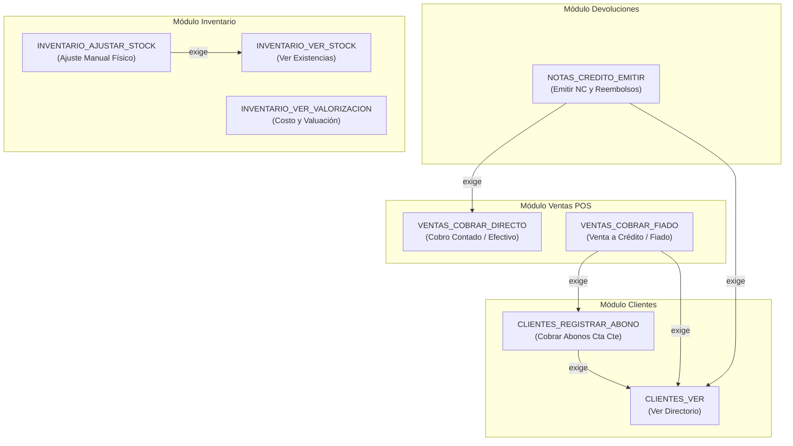

# 📘 Documento de Trazabilidad 09 — Módulo de Seguridad, Usuarios y Control PBAC (Paso 2.2)

> **Fase del Plan de Construcción:** Nivel 2 — Módulos Maestros (Paso 2.2)  
> **Fecha de Consolidación:** 2026-10-23  
> **Estado:** Completado y Verificado (`tsc --build` + `55/55` tests en Jest + Supertest pasando en el monorepo)  
> **Enfoque Pedagógico:** Mentoría Universitaria en Ingeniería de Sistemas (De 0 a 100: Progresión de Desacoplado a Acoplado)

---

## 1. Propósito de la Funcionalidad

El **Paso 2.2** implementa el sistema integral de **Identidad, Autenticación y Autorización Granular** de POSLyon en `apps/backend-cloud`, respondiendo estrictamente al requisito **RF-20 (Control de Acceso Basado en Permisos Granulares — PBAC y Grafo de Dependencias)**.

A diferencia de los sistemas tradicionales basados en roles rígidos enlatados (como `ADMIN`, `CAJERO`), POSLyon concibe la autorización como un conjunto de **capacidades atómicas (`PERMISO`)** estructuradas en un **Grafo Acíclico Dirigido (DAG)** y moduladas por la jerarquía natural del negocio:

1. **Usuario Dueño (*Tenant Owner* — Bypass RF-20):** Identificado por `es_dueno = true`. Es el titular comercial que contrata el software SaaS; posee acceso universal irrestricto incondicional sobre todos los módulos, sucursales y configuraciones del sistema sin requerir registros en tablas de permisos.
2. **Operadores de Sucursal (`USUARIO_SUCURSAL` y `USUARIO_PERMISO`):** Empleados dados de alta por el Dueño y asignados a una o más tiendas físicas, con facultades operativas delimitadas por sucursal o a nivel global.
3. **Grafo DAG de Dependencias Operativas (Resolución O-01 / RF-20):** Cada permiso declara sus dependencias previas (por ejemplo, habilitar `VENTAS_COBRAR_FIADO` exige y valida la existencia de `CLIENTES_VER` y `CLIENTES_REGISTRAR_ABONO`). El backend valida algorítmicamente este grafo, rechazando asignaciones incoherentes con `HTTP 400 Bad Request`.
4. **Sembrado Idempotente del Catálogo Canónico de Permisos:** Se inicializan de forma automática en el arranque las capacidades fundamentales del sistema (`CLIENTES_VER`, `CLIENTES_REGISTRAR_ABONO`, `VENTAS_COBRAR_DIRECTO`, `VENTAS_COBRAR_FIADO`, `NOTAS_CREDITO_EMITIR`, `INVENTARIO_VER_STOCK`, `INVENTARIO_AJUSTAR_STOCK`, `INVENTARIO_VER_VALORIZACION`, `SUCURSALES_CONFIGURAR`).
5. **Criptografía de Contraseñas Segura (KDF `scrypt`):** Se utiliza `crypto.scryptSync` nativo de Node.js con salt aleatorio de 16 bytes para evitar ataques de diccionario y rainbow tables sin dependencias nativas externas de compilación C++.
6. **Guardia Transversal PBAC (`PermisosGuard` y `@RequirePermissions`):** Intercepta la ejecución HTTP, valida la autenticidad del usuario, evalúa el bypass del Dueño y comprueba las asignaciones en la base de datos.

---

## 2. Matriz de Trazabilidad Bidireccional (De Extremo a Extremo)

| Requisito / Resolución SDD | Diagrama UML / Entidades ERD | Especificación File-Level (`docs/file-level specs/`) | Archivo Implementado y Líneas | Suite de Pruebas (Jest / Supertest) |
| :--- | :--- | :--- | :--- | :--- |
| **RF-20 / O-01** (Bypass absoluto del Dueño comercial `es_dueno = true`) | `ERD`: `USUARIO.es_dueno` | `docs/ERS POSLyon` (§6, RF-20) | [`usuario.entity.ts`](file:///d:/Contr/Archivos/POSLyon-Monolitico/apps/backend-cloud/src/modules/usuarios/entities/usuario.entity.ts#L29-L30)<br>[`permisos.guard.ts`](file:///d:/Contr/Archivos/POSLyon-Monolitico/apps/backend-cloud/src/modules/usuarios/guards/permisos.guard.ts#L69-L73) | [`usuarios.controller.spec.ts`](file:///d:/Contr/Archivos/POSLyon-Monolitico/apps/backend-cloud/src/modules/usuarios/usuarios.controller.spec.ts#L280-L289) |
| **RF-20 / O-01** (Grafo Acíclico Dirigido DAG de dependencias de permisos) | `ERD`: `PERMISO.dependencias` (JSONB) | `docs/ERS POSLyon` (§6, RF-20) | [`permiso.entity.ts`](file:///d:/Contr/Archivos/POSLyon-Monolitico/apps/backend-cloud/src/modules/usuarios/entities/permiso.entity.ts#L32-L33)<br>[`permisos.service.ts`](file:///d:/Contr/Archivos/POSLyon-Monolitico/apps/backend-cloud/src/modules/usuarios/services/permisos.service.ts#L152-L188) | [`usuarios.controller.spec.ts`](file:///d:/Contr/Archivos/POSLyon-Monolitico/apps/backend-cloud/src/modules/usuarios/usuarios.controller.spec.ts#L248-L278) |
| **RF-20 / PBAC** (Asociación granular usuario-sucursal-permiso) | `ERD`: `USUARIO_SUCURSAL`, `USUARIO_PERMISO` | `docs/ERS POSLyon` (§6, RF-20) y `docs/Arquitectura, diseños y diagramas POSLyon` | [`usuario-sucursal.entity.ts`](file:///d:/Contr/Archivos/POSLyon-Monolitico/apps/backend-cloud/src/modules/usuarios/entities/usuario-sucursal.entity.ts#L1-L50)<br>[`usuario-permiso.entity.ts`](file:///d:/Contr/Archivos/POSLyon-Monolitico/apps/backend-cloud/src/modules/usuarios/entities/usuario-permiso.entity.ts#L1-L56) | [`usuarios.controller.spec.ts`](file:///d:/Contr/Archivos/POSLyon-Monolitico/apps/backend-cloud/src/modules/usuarios/usuarios.controller.spec.ts#L261-L278) |
| **RNF-04 / RF-19** (Control OCC y auditoría forense en mutaciones de usuario) | `ERD`: `USUARIO.version`, `AUDITORIA` | `File-Level Specs_ Módulo Sincronización Local-First e Interceptor de Auditoría.md` | [`usuarios.service.ts`](file:///d:/Contr/Archivos/POSLyon-Monolitico/apps/backend-cloud/src/modules/usuarios/services/usuarios.service.ts#L99-L167) | [`usuarios.controller.spec.ts`](file:///d:/Contr/Archivos/POSLyon-Monolitico/apps/backend-cloud/src/modules/usuarios/usuarios.controller.spec.ts#L215-L246) |

---

## 3. Explicación Universitaria de 0 a 100 (De Desacoplado a Acoplado)

### 3.1. Del Antipatrón RBAC Rígido al Modelo PBAC con Grafo DAG

En sistemas tradicionales se suele crear un enum rígido:
```typescript
// ❌ ANTIPATRÓN: RBAC rígido
enum Rol { ADMIN, CAJERO, ENCARGADO }
```
Este enfoque fracasa inmediatamente en la realidad de los comercios minoristas:
- ¿Qué pasa si el dueño quiere que un cajero de confianza pueda consultar el saldo de cuentas corrientes de clientes pero NO pueda anular tickets ni ver cuánto dinero total hay en el depósito?
- Con roles rígidos, el programador se ve forzado a crear `CAJERO_CON_FIADO`, `CAJERO_SIN_FIADO`, `CAJERO_ESPECIAL`, terminando en una explosión combinatoria inmanejable.

En POSLyon implementamos **Permission-Based Access Control (PBAC)**:
- Cada acción es una capacidad atómica independiente (`VENTAS_COBRAR_DIRECTO`, `CLIENTES_REGISTRAR_ABONO`, `INVENTARIO_VER_VALORIZACION`).
- Los roles de mostrador son simplemente *presets* cosméticos de conveniencia en la interfaz de usuario.
- **Grafo DAG de Dependencias:** Para evitar que un usuario tenga permisos desarticulados (por ejemplo, permiso para vender al fiado pero sin permiso para ver el saldo deudor del cliente), cada permiso declara formalmente sus pre-requisitos en la columna `JSONB` `dependencias`. En [`PermisosService.validarGrafoDependencias`](file:///d:/Contr/Archivos/POSLyon-Monolitico/apps/backend-cloud/src/modules/usuarios/services/permisos.service.ts#L152-L188), el backend verifica que el conjunto seleccionado contenga la clausura transitiva de pre-requisitos, rechazando estados incoherentes con `HTTP 400 Bad Request`.

### 3.2. Bypass del Dueño (`es_dueno = true` — RF-20)

El titular del comercio que contrata POSLyon es el dueño patrimonial de todos los datos y sucursales. Obligar al Dueño a tener filas en `USUARIO_PERMISO` para cada permiso nuevo que se añada a la plataforma generaría fricción inútil y riesgo de bloqueo administrativo.

En [`PermisosGuard`](file:///d:/Contr/Archivos/POSLyon-Monolitico/apps/backend-cloud/src/modules/usuarios/guards/permisos.guard.ts#L69-L73):
```typescript
if (usuario.es_dueno === true) {
  request.user = { ...usuario, es_dueno: true };
  return true; // Bypass absoluto e irrestricto (RF-20)
}
```
Si el usuario es el Dueño, la evaluación de permisos atómicos se omite por completo con costo computacional $O(1)$.

### 3.3. Hashing de Contraseñas con KDF `scrypt`

Guardar contraseñas en texto plano o con algoritmos obsoletos como MD5 o SHA-1 (o incluso SHA-256 simple sin salt) es una vulnerabilidad crítica ante filtraciones de bases de datos.

En [`UsuariosService.hashPassword`](file:///d:/Contr/Archivos/POSLyon-Monolitico/apps/backend-cloud/src/modules/usuarios/services/usuarios.service.ts#L29-L33):
- Generamos un salt criptográficamente seguro de 16 bytes con `randomBytes(16)`.
- Aplicamos la función de derivación de claves `scrypt` (`scryptSync(password, salt, 64)`).
- `scrypt` es una función diseñada para ser **Memory-Hard**, lo que neutraliza los ataques de fuerza bruta masiva mediante placas de video (GPU) o hardware dedicado (ASIC).
- Al estar incluido en el módulo nativo `crypto` de Node.js, POSLyon no requiere bibliotecas externas de C++ (como `node-gyp` o binarios nativos de `bcrypt`), garantizando compatibilidad idéntica y sin fricciones entre Fedora Linux y Windows.

---

## 4. Diagrama UML — Grafo de Dependencias PBAC y Autorización



---

## 5. Bitácora Pedagógica de Decisiones de Arquitectura (ADR)

| ID Decisión | Problema Arquitectónico | Antipatrón Descartado (Cómo NO hacerlo) | Diseño Profesional Adoptado en POSLyon |
| :--- | :--- | :--- | :--- |
| **ADR-022** | Modelo de Control de Accesos | Implementar un sistema de roles rígidos (`enum Rol { ADMIN, CAJERO }`) cableado en el código, requiriendo recompilar la aplicación cada vez que el comercio define un nuevo perfil laboral. | Diseñar **PBAC con Grafo DAG** (RF-20): capacidades atómicas en la tabla [`PERMISO`](file:///d:/Contr/Archivos/POSLyon-Monolitico/apps/backend-cloud/src/modules/usuarios/entities/permiso.entity.ts#L1-L41) con dependencias estructuradas en JSONB y asignación granular en [`USUARIO_PERMISO`](file:///d:/Contr/Archivos/POSLyon-Monolitico/apps/backend-cloud/src/modules/usuarios/entities/usuario-permiso.entity.ts#L1-L56). |
| **ADR-023** | Dependencia cruzada entre permisos | Permitir que la UI asigne permisos huérfanos o contradictorios (por ejemplo, permitir cobrar fiado a un operador que no tiene acceso al directorio de clientes). | Implementar validación algorítmica de pre-requisitos en [`PermisosService.validarGrafoDependencias`](file:///d:/Contr/Archivos/POSLyon-Monolitico/apps/backend-cloud/src/modules/usuarios/services/permisos.service.ts#L152-L188), respondiendo con `HTTP 400 Bad Request` ante inconsistencias. |
| **ADR-024** | Privilegios del Titular / Dueño del SaaS | Asignar al Dueño todos los permisos en la base de datos y forzarlo a sincronizar cada nuevo permiso agregado en futuras versiones de la plataforma. | Incluir la columna booleana `es_dueno` en [`USUARIO`](file:///d:/Contr/Archivos/POSLyon-Monolitico/apps/backend-cloud/src/modules/usuarios/entities/usuario.entity.ts#L29-L30) y programar el **Bypass Dueño (RF-20)** en [`PermisosGuard`](file:///d:/Contr/Archivos/POSLyon-Monolitico/apps/backend-cloud/src/modules/usuarios/guards/permisos.guard.ts#L69-L73) para otorgar autorización inmediata incondicional. |

---

## 6. Guía de Pruebas Automatizadas y Laboratorio en Postman

### 6.1. Suite Automatizada en Jest + Supertest

Ejecutar en la terminal:
```powershell
npm run build ; if ($?) { npm test }
```
**Resultado verificado:**
- `PASS domain-core libs/domain-core/src/services/servicios-puros-dominio.spec.ts`
- `PASS domain-core libs/domain-core/src/dtos/dtos-validacion.spec.ts`
- `PASS backend-cloud apps/backend-cloud/src/modules/health/health.controller.spec.ts`
- `PASS backend-cloud apps/backend-cloud/src/modules/auditoria/auditoria.controller.spec.ts`
- `PASS backend-cloud apps/backend-cloud/src/modules/sucursales/sucursales.controller.spec.ts`
- `PASS backend-cloud apps/backend-cloud/src/modules/usuarios/usuarios.controller.spec.ts`
- **Total:** `6 Test Suites Passed`, `55 Tests Passed` (`0 errors`).

### 6.2. Laboratorio Interactivo en Postman

Con el servidor corriendo (`npm run start:dev --workspace=@poslyon/backend-cloud`):

#### Prueba 1: Alta de Usuario Operador
- **Método:** `POST`
- **URL:** `http://localhost:3000/api/usuarios`
- **Headers:** `x-audit-reason: Contratación de personal de mostrador`
- **Body (raw JSON):**
```json
{
  "nombre": "Mariana Cajera",
  "email": "mariana.caja@poslyon.com",
  "password": "PasswordSegura2026!",
  "es_dueno": false
}
```

#### Prueba 2: Asignación de Permisos con Inconsistencia DAG (HTTP 400)
- **Método:** `POST`
- **URL:** `http://localhost:3000/api/permisos/asignar/:idUsuario`
- **Body (raw JSON):**
```json
{
  "codigos_permisos": [
    "VENTAS_COBRAR_FIADO"
  ],
  "motivo": "Intento de habilitar cobro fiado sin acceso a clientes"
}
```
- **Respuesta esperada:** `HTTP 400 Bad Request` indicando que `VENTAS_COBRAR_FIADO` exige `CLIENTES_VER` y `CLIENTES_REGISTRAR_ABONO`.

#### Prueba 3: Laboratorio Guard y Bypass Dueño (RF-20)
- **Método:** `GET`
- **URL:** `http://localhost:3000/api/permisos/laboratorio-guard-rf20`
- **Header:** `x-user-id: <UUID_DEL_DUENO>`
- **Respuesta esperada:** `HTTP 200 OK` con `status: "AUTORIZADO_POR_PBAC"`. Si se envía el UUID de un cajero sin el permiso `VENTAS_COBRAR_DIRECTO`, el sistema responde con `HTTP 403 Forbidden`.
