# 📘 Documento de Trazabilidad 10 — Módulo de Catálogo e Inventario Base (Paso 2.3)

> **Fase del Plan de Construcción:** Nivel 2 — Módulos Maestros (Paso 2.3)  
> **Fecha de Consolidación:** 2026-10-23  
> **Estado:** Completado y Verificado (`tsc --build` + `61/61` tests en Jest + Supertest pasando en el monorepo)  
> **Enfoque Pedagógico:** Mentoría Universitaria en Ingeniería de Sistemas (De 0 a 100: Progresión de Desacoplado a Acoplado)

---

## 1. Propósito de la Funcionalidad

El **Paso 2.3** consolida la columna vertebral operativa y comercial de POSLyon en `apps/backend-cloud`: el **Catálogo Central Global y el Aislamiento de Existencias/Precios por Sucursal**.

En el comercio minorista tradicional (supermercados, distribuidoras, tiendas multitienda), existe una tensión fundamental entre la definición universal de un producto (su nombre intrínseco, unidad de medida, packs y códigos de barra) y su realidad física y contable en cada local (cada tienda tiene su propio stock, su costo de reposición y su política de precios minoristas o mayoristas).

Para resolver esta dualidad sin duplicar datos ni provocar desincronizaciones, este módulo implementa:

1. **Desacoplamiento Estructural (Catálogo Central vs. Existencias por Tienda — RF-02 / RF-04 / RF-21):**
   - `PRODUCTO_GLOBAL`: Almacena la identidad intrínseca compartida entre todas las tiendas (`id`, `nombre`, `tipo_venta`, `multiplicador_stock`, soporte del RFC 4122 Nil UUID para el Artículo Comodín).
   - `PRODUCTO_SUCURSAL`: Instancia física y contable del producto en una sucursal específica (`precio_costo`, `precio_minorista`, `precio_mayorista`, `stock_fisico`, `stock_reservado`).
2. **Relación 1:N de Códigos de Barra (`CODIGO_BARRA`):** Un mismo producto puede asociarse a múltiples códigos de barra (EAN-13, EAN-8, código interno de balanza, código de bulto mayorista) con indicación de código principal (`es_principal`).
3. **Política Permisiva de Existencias de Mostrador (`UNIVERSAL_PERMISIVO` — Resolución C-12):** La columna `stock_fisico` en `PRODUCTO_SUCURSAL` admite **valores negativos** ($< 0$), garantizando que jamás se bloquee una venta rápida en caja registradora porque el operario de depósito no terminó de registrar el remito de mercadería.
4. **Soporte para Packs y Cajas Cerradas (RF-04 / Resolución O-26):** Modela productos compuestos (`tipo_venta = 'PACK'`) con factor de conversión `multiplicador_stock` y referencia opcional a `id_producto_base`.
5. **Control de Concurrencia Optimista (OCC) y Auditoría Atómica:** Toda actualización de precios de góndola, datos maestros o ajuste manual de inventario exige la versión esperada (`version`), respondiendo con `HTTP 409 Conflict` ante colisiones concurrentes y asentando snapshots `JSONB` en `AUDITORIA` dentro de una transacción ACID unificada (`AuditoriaService.ejecutarTransaccionAuditada`).

---

## 2. Matriz de Trazabilidad Bidireccional (De Extremo a Extremo)

| Requisito / Resolución SDD | Diagrama UML / Entidades ERD | Especificación File-Level (`docs/file-level specs/`) | Archivo Implementado y Líneas | Suite de Pruebas (Jest / Supertest) |
| :--- | :--- | :--- | :--- | :--- |
| **RF-04 / RF-21** (Desacoplamiento Catálogo Central `PRODUCTO_GLOBAL` vs. Tiendas `PRODUCTO_SUCURSAL`) | `ERD`: `PRODUCTO_GLOBAL`, `PRODUCTO_SUCURSAL` | `File-Level Specs_ Módulo Core POS.md` y `File-Level Specs_ Módulo Inventario y Reconciliación de Códigos Huérfanos.md` | [`producto-global.entity.ts`](file:///d:/Contr/Archivos/POSLyon-Monolitico/apps/backend-cloud/src/modules/catalogo/entities/producto-global.entity.ts#L1-L76)<br>[`producto-sucursal.entity.ts`](file:///d:/Contr/Archivos/POSLyon-Monolitico/apps/backend-cloud/src/modules/catalogo/entities/producto-sucursal.entity.ts#L1-L79) | [`catalogo.controller.spec.ts`](file:///d:/Contr/Archivos/POSLyon-Monolitico/apps/backend-cloud/src/modules/catalogo/catalogo.controller.spec.ts#L173-L203) |
| **RF-02 / C-12** (Política permisiva de stock con valores negativos permitidos) | `Diagrama de Estados Inventario` · Guarda `UNIVERSAL_PERMISIVO` | `libs/domain-core/src/interfaces/configuracion-sucursal.interface.ts` y `File-Level Specs_ Módulo Inventario y Reconciliación de Códigos Huérfanos.md` | [`catalogo.service.ts`](file:///d:/Contr/Archivos/POSLyon-Monolitico/apps/backend-cloud/src/modules/catalogo/services/catalogo.service.ts#L248-L297)<br>[`catalogo.controller.ts`](file:///d:/Contr/Archivos/POSLyon-Monolitico/apps/backend-cloud/src/modules/catalogo/controllers/catalogo.controller.ts#L65-L73) | [`catalogo.controller.spec.ts`](file:///d:/Contr/Archivos/POSLyon-Monolitico/apps/backend-cloud/src/modules/catalogo/catalogo.controller.spec.ts#L246-L265) |
| **Códigos de Barra 1:N y Búsqueda Ultrarrápida** | `ERD`: `CODIGO_BARRA` (`id_producto`, `codigo`, `es_principal`) | `File-Level Specs_ Módulo Core POS.md` | [`codigo-barra.entity.ts`](file:///d:/Contr/Archivos/POSLyon-Monolitico/apps/backend-cloud/src/modules/catalogo/entities/codigo-barra.entity.ts#L1-L37)<br>[`catalogo.service.ts`](file:///d:/Contr/Archivos/POSLyon-Monolitico/apps/backend-cloud/src/modules/catalogo/services/catalogo.service.ts#L302-L334) | [`catalogo.controller.spec.ts`](file:///d:/Contr/Archivos/POSLyon-Monolitico/apps/backend-cloud/src/modules/catalogo/catalogo.controller.spec.ts#L205-L217) |
| **Control OCC en Precios y Stock (HTTP 409)** | `Diagrama de Secuencia OCC (version = version + 1)` | `File-Level Specs_ Módulo Sincronización Local-First e Interceptor de Auditoría.md` (§3, §4) | [`catalogo.service.ts`](file:///d:/Contr/Archivos/POSLyon-Monolitico/apps/backend-cloud/src/modules/catalogo/services/catalogo.service.ts#L190-L243)<br>[`actualizar-precios-sucursal.dto.ts`](file:///d:/Contr/Archivos/POSLyon-Monolitico/apps/backend-cloud/src/modules/catalogo/dtos/actualizar-precios-sucursal.dto.ts#L1-L32) | [`catalogo.controller.spec.ts`](file:///d:/Contr/Archivos/POSLyon-Monolitico/apps/backend-cloud/src/modules/catalogo/catalogo.controller.spec.ts#L219-L244) |

---

## 3. Explicación Universitaria de 0 a 100 (De Desacoplado a Acoplado)

### 3.1. Por qué separamos `PRODUCTO_GLOBAL` de `PRODUCTO_SUCURSAL`

Un error frecuente en sistemas monolíticos o POS para principiantes es colocar el precio y el stock directamente en la tabla de productos:
```sql
-- ❌ ANTIPATRÓN: Tabla única de producto
CREATE TABLE producto (
  id UUID,
  nombre VARCHAR,
  precio_minorista NUMERIC, -- ¿Precio de qué sucursal?
  stock NUMERIC             -- ¿Stock de qué depósito?
);
```
Cuando la empresa abre una sucursal en el Centro y otra en las afueras (con distintos costos de flete, alquileres y existencias físicas), el modelo colapsa.

En POSLyon aplicamos la normalización y el principio de **Invariancia $N=1$**:
- **`PRODUCTO_GLOBAL`:** Almacena la metadata universal. "Yerba Playadito 1kg" es la misma entidad ontológica en cualquier tienda del país.
- **`PRODUCTO_SUCURSAL`:** Almacena la relación contable de esa entidad en una tienda específica. La sucursal Palermo puede venderla a \$4.500 con stock 12, mientras que la sucursal Córdoba puede venderla a \$4.200 con stock 50.
- Si el comercio tiene una única tienda ($N=1$), simplemente posee un registro en `PRODUCTO_SUCURSAL` por cada `PRODUCTO_GLOBAL`. Cuando abre la segunda tienda, la base de datos no sufre ninguna mutación DDL.

### 3.2. La Regla de Negocio Crítica: Stock Permisivo (`UNIVERSAL_PERMISIVO` — C-12)

En ciencias de la computación teórica, un sistema estricto rechazaría cualquier operación donde $\text{stock\_fisico} - \text{cantidad} < 0$. Sin embargo, en el mundo real del comercio minorista:
- Un cliente llega a la caja con 3 botellas de gaseosa en la mano.
- El cajero pasa el escáner.
- El sistema dice: "Stock actual: 1. No se puede vender".
- El cliente y el cajero están viendo físicamente las 3 botellas en la cinta transportadora. El desfasaje ocurrió simplemente porque el camión de reparto llegó hace una hora y el encargado todavía no cargó la factura en el sistema.

Bloquear la venta provocaría colas, discusiones y pérdida directa de facturación. En POSLyon, la directiva está formalizada en la **Resolución C-12**:
- El sistema opera bajo la política `UNIVERSAL_PERMISIVO`.
- Las ventas y los ajustes manuales permiten que `stock_fisico` tome valores negativos (por ejemplo, $-2$).
- Posteriormente, el módulo de **Reconciliación y Recepción de Mercadería** suma los bultos reales del remito compensando el saldo negativo y regularizando la contabilidad sin haber detenido la atención al público ni un solo segundo.

### 3.3. Códigos de Barra Múltiples (1:N) vs. Columna Única

Muchos productos masivos poseen más de un código de barras a lo largo de su ciclo de vida:
- El fabricante cambia el diseño del packaging o lanza una edición especial con un código EAN distinto.
- El comercio asigna un código de barra interno impreso por una balanza electrónica.
- Se vende el producto por unidad o por bulto cerrado.

Al modelar [`CodigoBarraEntity`](file:///d:/Contr/Archivos/POSLyon-Monolitico/apps/backend-cloud/src/modules/catalogo/entities/codigo-barra.entity.ts#L1-L37) como una tabla hija con índice único sobre `codigo`, el endpoint `GET /api/catalogo/codigo-barra/:codigo` ejecuta un `JOIN` eficiente con `PRODUCTO_GLOBAL` y `PRODUCTO_SUCURSAL`, devolviendo instantáneamente la información para la terminal de mostrador sin importar cuál de los códigos válidos haya sido escaneado.

---

## 4. Diagrama UML — Modelo Entidad-Relación de Catálogo e Inventario

```mermaid
erDiagram
    CATEGORIA ||--o{ PRODUCTO_GLOBAL : "clasifica"
    PRODUCTO_GLOBAL ||--o{ CODIGO_BARRA : "identificado por"
    PRODUCTO_GLOBAL ||--o{ PRODUCTO_SUCURSAL : "instanciado en tienda"
    SUCURSAL ||--o{ PRODUCTO_SUCURSAL : "mantiene existencias de"
    PRODUCTO_GLOBAL ||--o{ AUDITORIA : "registra mutaciones en"
    PRODUCTO_SUCURSAL ||--o{ AUDITORIA : "registra cambios de precio y stock"

    CATEGORIA {
        uuid id PK
        string nombre "UNIQUE"
        string descripcion
        boolean activo
        int version "OCC"
    }

    PRODUCTO_GLOBAL {
        uuid id PK "Admite Nil UUID Comodin"
        uuid id_categoria FK
        string nombre
        string descripcion
        enum tipo_venta "UNIDAD | PESABLE | PACK"
        uuid id_producto_base FK "Auto-referencial para PACKs"
        decimal multiplicador_stock
        boolean activo
        int version "OCC"
    }

    CODIGO_BARRA {
        uuid id PK
        uuid id_producto FK
        string codigo "UNIQUE"
        boolean es_principal
    }

    PRODUCTO_SUCURSAL {
        uuid id PK
        uuid id_sucursal FK
        uuid id_producto FK
        decimal precio_costo
        decimal precio_minorista
        decimal precio_mayorista
        decimal stock_fisico "Permite negativos C-12"
        decimal stock_reservado
        decimal stock_minimo
        int version "OCC"
        boolean activo
    }
```



---

## 5. Bitácora Pedagógica de Decisiones de Arquitectura (ADR)

| ID Decisión | Problema Arquitectónico | Antipatrón Descartado (Cómo NO hacerlo) | Diseño Profesional Adoptado en POSLyon |
| :--- | :--- | :--- | :--- |
| **ADR-025** | Ubicación de precios y existencias | Almacenar precios y existencias físicas directamente en la tabla de productos central, imposibilitando operar con más de una tienda física o depósito. | Desacoplar la identidad global en [`PRODUCTO_GLOBAL`](file:///d:/Contr/Archivos/POSLyon-Monolitico/apps/backend-cloud/src/modules/catalogo/entities/producto-global.entity.ts#L1-L76) y aislar precios y stock por tienda en [`PRODUCTO_SUCURSAL`](file:///d:/Contr/Archivos/POSLyon-Monolitico/apps/backend-cloud/src/modules/catalogo/entities/producto-sucursal.entity.ts#L1-L79) con clave única compuesta `(id_producto, id_sucursal)`. |
| **ADR-026** | Venta y ajuste de stock cuando no hay inventario registrado en sistema | Bloquear la venta con una excepción de stock insuficiente, provocando pérdida de ventas cuando el producto está físicamente frente al cajero. | Implementar la política permisiva `UNIVERSAL_PERMISIVO` (Resolución **C-12**) admitiendo `stock_fisico < 0`, auditando el ajuste y delegando la regularización a la recepción de mercadería posterior. |
| **ADR-027** | Asignación de códigos de barra | Limitar el producto a una sola columna `codigo_barra VARCHAR(50)`, forzando al comercio a dar de alta dos veces el mismo producto si cambia el EAN o si se imprime código de balanza. | Modelar la entidad independiente [`CODIGO_BARRA`](file:///d:/Contr/Archivos/POSLyon-Monolitico/apps/backend-cloud/src/modules/catalogo/entities/codigo-barra.entity.ts#L1-L37) con relación 1:N y soporte de múltiples identificadores escaneables por artículo. |

---

## 6. Guía de Pruebas Automatizadas y Laboratorio en Postman

### 6.1. Suite Automatizada en Jest + Supertest

Ejecutar en la terminal:
```powershell
npm run build ; if ($?) { npm test }
```
**Resultado verificado:**
- `PASS domain-core libs/domain-core/src/services/servicios-puros-dominio.spec.ts`
- `PASS domain-core libs/domain-core/src/dtos/dtos-validacion.spec.ts`
- `PASS backend-cloud apps/backend-cloud/src/modules/health/health.controller.spec.ts`
- `PASS backend-cloud apps/backend-cloud/src/modules/auditoria/auditoria.controller.spec.ts`
- `PASS backend-cloud apps/backend-cloud/src/modules/sucursales/sucursales.controller.spec.ts`
- `PASS backend-cloud apps/backend-cloud/src/modules/usuarios/usuarios.controller.spec.ts`
- `PASS backend-cloud apps/backend-cloud/src/modules/catalogo/catalogo.controller.spec.ts`
- **Total:** `7 Test Suites Passed`, `61 Tests Passed` (`0 errors`).

### 6.2. Laboratorio Interactivo en Postman

Con el servidor corriendo (`npm run start:dev --workspace=@poslyon/backend-cloud`):

#### Prueba 1: Alta de Producto con Códigos de Barra y Precios Iniciales
- **Método:** `POST`
- **URL:** `http://localhost:3000/api/catalogo/productos`
- **Headers:** `x-audit-reason: Incorporación de nueva línea de gaseosas`
- **Body (raw JSON):**
```json
{
  "nombre": "Gaseosa Cola 2.25L",
  "descripcion": "Envase retornable",
  "tipo_venta": "UNIDAD",
  "codigos_barra": [
    "7791234567890",
    "7791234567891"
  ],
  "precios_sucursales": [
    {
      "id_sucursal": "550e8400-e29b-41d4-a716-446655440001",
      "precio_costo": 650,
      "precio_minorista": 1300,
      "precio_mayorista": 1150,
      "stock_inicial": 24
    }
  ]
}
```

#### Prueba 2: Búsqueda Rápida para Punto de Venta (Mostrador)
- **Método:** `GET`
- **URL:** `http://localhost:3000/api/catalogo/codigo-barra/7791234567890?idSucursal=550e8400-e29b-41d4-a716-446655440001`
- **Respuesta esperada:** `HTTP 200 OK` retornando los datos del producto, precio minorista ($1.300) y stock actual de la sucursal indicada.

#### Prueba 3: Ajuste Manual de Stock Permisivo Negativo (C-12)
- **Método:** `POST`
- **URL:** `http://localhost:3000/api/catalogo/ajustar-stock`
- **Body (raw JSON):**
```json
{
  "id_producto": "550e8400-e29b-41d4-a716-446655440050",
  "id_sucursal": "550e8400-e29b-41d4-a716-446655440051",
  "tipo_ajuste": "AJUSTE_MANUAL",
  "cantidad_nueva": -3,
  "expected_version": 1,
  "motivo": "Ajuste de arqueo físico: faltante registrado en góndola (C-12)"
}
```
- **Respuesta esperada:** `HTTP 200 OK` con `stock_fisico: -3` y `version: 2`, auditado en la tabla `AUDITORIA`.
