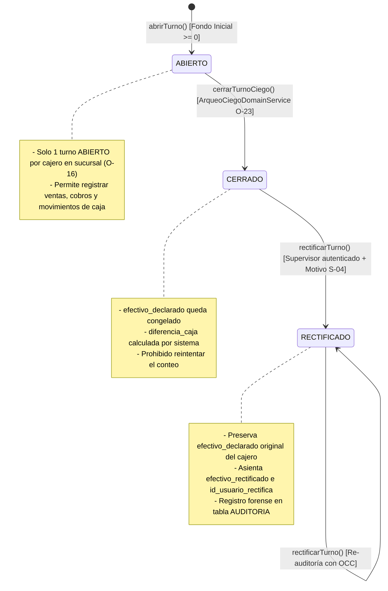

# 📘 Documento de Trazabilidad 11 — Módulo de Turnos de Caja, Movimientos y Arqueo Ciego (Paso 3.1)

> **Fase del Plan de Construcción:** Nivel 3 — Módulos Operativos y Financieros (Paso 3.1)  
> **Fecha de Consolidación:** 2026-10-23  
> **Estado:** Completado y Verificado (`tsc --build` + `67/67` tests en Jest + Supertest pasando en el monorepo)  
> **Enfoque Pedagógico:** Mentoría Universitaria en Ingeniería de Sistemas (De 0 a 100: Progresión de Desacoplado a Acoplado)

---

## 1. Propósito de la Funcionalidad

El **Paso 3.1** inaugura el **Nivel 3 (Módulos Operativos y Financieros)** de POSLyon en `apps/backend-cloud`. Regula el ciclo de vida del dinero físico y digital en el punto de venta a través de la máquina de estados de `TURNO_CAJA`, los movimientos directos de gaveta en `MOVIMIENTO_CAJA`, el catálogo de `METODO_PAGO` y el protocolo de **Arqueo Ciego Obligatorio (RF-17 y Resoluciones O-16 / O-23)**.

Este módulo implementa cinco garantías de ingeniería de grado universitario:

1. **Exclusividad Operativa de Turno Abierto (Resolución O-16):** Un cajero solo puede poseer **un único turno en estado `ABIERTO`** por sucursal en un momento dado, impidiendo la dispersión de cobros y asegurando la asignación unívoca de responsabilidades financieras.
2. **Arqueo Ciego Inmutable (*Blind Cash Count* — RF-17 / O-23):** Al finalizar la jornada, el cajero cuenta físicamente los billetes de la gaveta y declara el total (`efectivo_declarado_ciego`) **sin que el sistema le revele el saldo teórico esperado**. Esta cifra queda congelada incondicionalmente para prevenir ajustes oportunistas o encubrimiento de diferencias.
3. **Cálculo Determinista de Arqueo con Dominio Puro:** El backend delega el cómputo de la gaveta en el servicio determinista [`ArqueoCiegoDomainService`](file:///d:/Contr/Archivos/POSLyon-Monolitico/libs/domain-core/src/services/reloj-y-arqueo.domain-service.ts#L145) de `@poslyon/domain-core`, aplicando la fórmula completa:
   $$\text{EfectivoEsperado} = \text{MontoInicial} + \text{VentasEfectivo} + \text{AbonosEfectivo} + \text{Ingresos} - \text{Devoluciones} - \text{Sangrías} - \text{PagosProveedores}$$
   $$\text{DiferenciaCaja} = \text{EfectivoDeclarado} - \text{EfectivoEsperado}$$
4. **Rectificación Forense Supervisada (Resolución O-16 / S-04):** Si el arqueo arroja descuadre y un supervisor audita la caja física (por ejemplo, hallando billetes trabados en el compartimento inferior), el supervisor asienta `efectivo_rectificado` con justificación documental obligatoria. El turno transiciona a `RECTIFICADO`, pero la declaración histórica original del cajero en `efectivo_declarado` **se preserva intacta**.
5. **Movimientos Directos de Gaveta:** Registro tipado de entradas (`INGRESO`) y salidas (`EGRESO`) con discriminación de medios (`afecta_caja_fisica = true` para efectivo vs. false para transferencias/billeteras).

---

## 2. Matriz de Trazabilidad Bidireccional (De Extremo a Extremo)

| Requisito / Resolución SDD | Diagrama UML / Entidades ERD | Especificación File-Level (`docs/file-level specs/`) | Archivo Implementado y Líneas | Suite de Pruebas (Jest / Supertest) |
| :--- | :--- | :--- | :--- | :--- |
| **RF-17 / O-23** (Arqueo ciego obligatorio y congelamiento de declaración del cajero) | `ERD`: `TURNO_CAJA` (`monto_inicial_efectivo`, `efectivo_declarado`, `diferencia_caja`, `estado`) | `File-Level Specs_ Módulo Core POS.md` y `docs/ERS POSLyon` (§6, RF-17) | [`turno-caja.entity.ts`](file:///d:/Contr/Archivos/POSLyon-Monolitico/apps/backend-cloud/src/modules/caja/entities/turno-caja.entity.ts#L1-L76)<br>[`caja.service.ts`](file:///d:/Contr/Archivos/POSLyon-Monolitico/apps/backend-cloud/src/modules/caja/services/caja.service.ts#L170-L281) | [`caja.controller.spec.ts`](file:///d:/Contr/Archivos/POSLyon-Monolitico/apps/backend-cloud/src/modules/caja/caja.controller.spec.ts#L225-L257) |
| **Resolución O-16** (Exclusividad de turno abierto por cajero y sucursal) | `Diagrama de Máquina de Estados de Turno de Caja` | `libs/domain-core/src/enums/estado-turno-caja.enum.ts` | [`caja.service.ts`](file:///d:/Contr/Archivos/POSLyon-Monolitico/apps/backend-cloud/src/modules/caja/services/caja.service.ts#L48-L70) | [`caja.controller.spec.ts`](file:///d:/Contr/Archivos/POSLyon-Monolitico/apps/backend-cloud/src/modules/caja/caja.controller.spec.ts#L188-L208) |
| **Resolución O-16 / S-04** (Rectificación forense supervisada sin alterar declaración histórica) | `Máquina de Estados`: Transición `CERRADO -> RECTIFICADO` | `File-Level Specs_ Módulo Sincronización Local-First e Interceptor de Auditoría.md` | [`turno-caja.entity.ts`](file:///d:/Contr/Archivos/POSLyon-Monolitico/apps/backend-cloud/src/modules/caja/entities/turno-caja.entity.ts#L52-L61)<br>[`caja.service.ts`](file:///d:/Contr/Archivos/POSLyon-Monolitico/apps/backend-cloud/src/modules/caja/services/caja.service.ts#L289-L362) | [`caja.controller.spec.ts`](file:///d:/Contr/Archivos/POSLyon-Monolitico/apps/backend-cloud/src/modules/caja/caja.controller.spec.ts#L259-L309) |
| **Movimientos Directos de Caja** (Sangrías, ingresos de cambio y control de caja física) | `ERD`: `MOVIMIENTO_CAJA`, `METODO_PAGO` | `libs/domain-core/src/interfaces/movimiento-caja.interface.ts` | [`movimiento-caja.entity.ts`](file:///d:/Contr/Archivos/POSLyon-Monolitico/apps/backend-cloud/src/modules/caja/entities/movimiento-caja.entity.ts#L1-L69)<br>[`metodo-pago.entity.ts`](file:///d:/Contr/Archivos/POSLyon-Monolitico/apps/backend-cloud/src/modules/caja/entities/metodo-pago.entity.ts#L1-L36) | [`caja.controller.spec.ts`](file:///d:/Contr/Archivos/POSLyon-Monolitico/apps/backend-cloud/src/modules/caja/caja.controller.spec.ts#L210-L223) |

---

## 3. Explicación Universitaria de 0 a 100 (De Desacoplado a Acoplado)

### 3.1. Por qué el Arqueo Ciego (*Blind Cash Count*) es una Salvaguarda Antifraude

En sistemas de punto de venta mal diseñados, cuando el cajero presiona el botón "Cerrar Caja", la pantalla le muestra:
> *"El sistema espera que tengas \$54.320 en efectivo. ¿Cuánto tenés?"*

Este diseño promueve el fraude y el error por complacencia:
- Si el cajero cuenta \$54.000 (le faltan \$320), sabiendo que el sistema espera \$54.320, escribe "\$54.320" para que la pantalla no le marque error, tapando la discrepancia con dinero de su bolsillo o posponiendo el problema.
- Si el cajero cuenta \$55.000 (le sobran \$680 porque se olvidó de registrar un cobro o dio mal un vuelto), el cajero retira los \$680 sobrantes para su provecho personal y escribe exactamente "\$54.320", haciendo que la caja "cierre perfecta".

En POSLyon implementamos el principio de **Arqueo Ciego Obligatorio (RF-17 / O-23)**:
- La pantalla de cierre de caja únicamente le pregunta al cajero: *"Ingrese el total de billetes y monedas contados físicamente en gaveta"*.
- El cajero ingresa el importe (por ejemplo, \$55.000).
- El backend procesa el valor, invoca a [`ArqueoCiegoDomainService`](file:///d:/Contr/Archivos/POSLyon-Monolitico/libs/domain-core/src/services/reloj-y-arqueo.domain-service.ts#L145) y asienta `diferencia_caja = +680` (`SOBRANTE`), congelando el turno como `CERRADO`. No hay posibilidad de reintentar el conteo tras conocer el valor esperado.

### 3.2. Preservación del Registro Histórico ante Rectificación Forense

Si tras cerrar el turno con un faltante de \$2.000, el encargado de la tienda revisa el puesto de trabajo y encuentra un fajo de billetes caído detrás de la gaveta:
- **Antipatrón común:** Modificar directamente el campo `efectivo_declarado = efectivo_declarado + 2000`. Esto borra la evidencia del error humano del cajero y elimina la trazabilidad de auditoría.
- **Diseño Profesional POSLyon:** El campo `efectivo_declarado` **jamás se modifica**. El supervisor ejecuta `POST /api/caja/turnos/:id/rectificar`, el cual completa `efectivo_rectificado = 54320`, asienta `id_usuario_rectifica`, fecha y motivo (`motivo_rectificacion`), y transiciona el estado a `RECTIFICADO`. De esta forma, cualquier auditor puede observar tanto la declaración imperfecta original como la intervención correctiva posterior.

---

## 4. Diagrama UML — Máquina de Estados de Turno de Caja



---

## 5. Bitácora Pedagógica de Decisiones de Arquitectura (ADR)

| ID Decisión | Problema Arquitectónico | Antipatrón Descartado (Cómo NO hacerlo) | Diseño Profesional Adoptado en POSLyon |
| :--- | :--- | :--- | :--- |
| **ADR-028** | Modalidad de Cierre de Caja | Mostrar al cajero el total acumulado en el sistema antes de que cuente el dinero en efectivo. | Implementar **Arqueo Ciego Obligatorio** (RF-17 / O-23) a través de [`caja.service.ts`](file:///d:/Contr/Archivos/POSLyon-Monolitico/apps/backend-cloud/src/modules/caja/services/caja.service.ts#L170-L281), delegando la fórmula matemática en [`ArqueoCiegoDomainService`](file:///d:/Contr/Archivos/POSLyon-Monolitico/libs/domain-core/src/services/reloj-y-arqueo.domain-service.ts#L145) y congelando la declaración. |
| **ADR-029** | Concurrencia de Turnos Abiertos por Cajero | Permitir que un cajero abra múltiples turnos en paralelo en la misma terminal o sucursal, dispersando los cobros de tickets. | Exigir la regla de **Turno Único Abierto** (Resolución O-16), rechazando con `HTTP 409 Conflict` cualquier intento de apertura si el usuario ya posee un turno `ABIERTO` en esa sucursal. |
| **ADR-030** | Corrección de Descuadres por Supervisión | Permitir que el supervisor sobreescriba o borre el registro del cierre previo. | Implementar el estado `RECTIFICADO` (Resolución O-16 / S-04) preservando `efectivo_declarado` del cajero y asentando `efectivo_rectificado` con auditoría forense incondicional. |

---

## 6. Guía de Pruebas Automatizadas y Laboratorio en Postman

### 6.1. Suite Automatizada en Jest + Supertest

Ejecutar en la terminal:
```powershell
npm run build ; if ($?) { npm test }
```
**Resultado verificado:**
- `PASS domain-core libs/domain-core/src/services/servicios-puros-dominio.spec.ts`
- `PASS domain-core libs/domain-core/src/dtos/dtos-validacion.spec.ts`
- `PASS backend-cloud apps/backend-cloud/src/modules/health/health.controller.spec.ts`
- `PASS backend-cloud apps/backend-cloud/src/modules/auditoria/auditoria.controller.spec.ts`
- `PASS backend-cloud apps/backend-cloud/src/modules/sucursales/sucursales.controller.spec.ts`
- `PASS backend-cloud apps/backend-cloud/src/modules/caja/caja.controller.spec.ts`
- `PASS backend-cloud apps/backend-cloud/src/modules/usuarios/usuarios.controller.spec.ts`
- `PASS backend-cloud apps/backend-cloud/src/modules/catalogo/catalogo.controller.spec.ts`
- **Total:** `8 Test Suites Passed`, `67 Tests Passed` (`0 errors`).

### 6.2. Laboratorio Interactivo en Postman

Con el servidor corriendo (`npm run start:dev --workspace=@poslyon/backend-cloud`):

#### Prueba 1: Apertura de Turno con Fondo Fijo de Cambio
- **Método:** `POST`
- **URL:** `http://localhost:3000/api/caja/turnos/abrir`
- **Body (raw JSON):**
```json
{
  "id_sucursal": "550e8400-e29b-41d4-a716-446655440001",
  "id_usuario": "550e8400-e29b-41d4-a716-446655440010",
  "monto_inicial_efectivo": 15000
}
```
- **Respuesta esperada:** `HTTP 201 Created` con `estado: "ABIERTO"` y `monto_inicial_efectivo: 15000`.

#### Prueba 2: Movimiento de Extracción / Sangría de Gaveta
- **Método:** `POST`
- **URL:** `http://localhost:3000/api/caja/movimientos`
- **Body (raw JSON):**
```json
{
  "id_turno_caja": "<ID_TURNO_ABIERTO>",
  "id_usuario": "550e8400-e29b-41d4-a716-446655440010",
  "tipo_movimiento": "EGRESO",
  "monto": 5000,
  "concepto": "SANGRIA_RETIRO",
  "afecta_caja_fisica": true,
  "motivo": "Retiro parcial de efectivo por exceso de billetes en mostrador"
}
```

#### Prueba 3: Cierre Ciego de Turno (Arqueo Ciego RF-17 / O-23)
- **Método:** `POST`
- **URL:** `http://localhost:3000/api/caja/turnos/<ID_TURNO>/cerrar-ciego`
- **Body (raw JSON):**
```json
{
  "efectivo_declarado_ciego": 10500,
  "version": 1,
  "motivo": "Fin de turno de la tarde"
}
```
- **Respuesta esperada:** `HTTP 200 OK` con `estado: "CERRADO"`, `efectivo_declarado: 10500`, y el desglose de arqueo ciego indicando si el balance fue `EXACTO`, `SOBRANTE` o `FALTANTE`.
