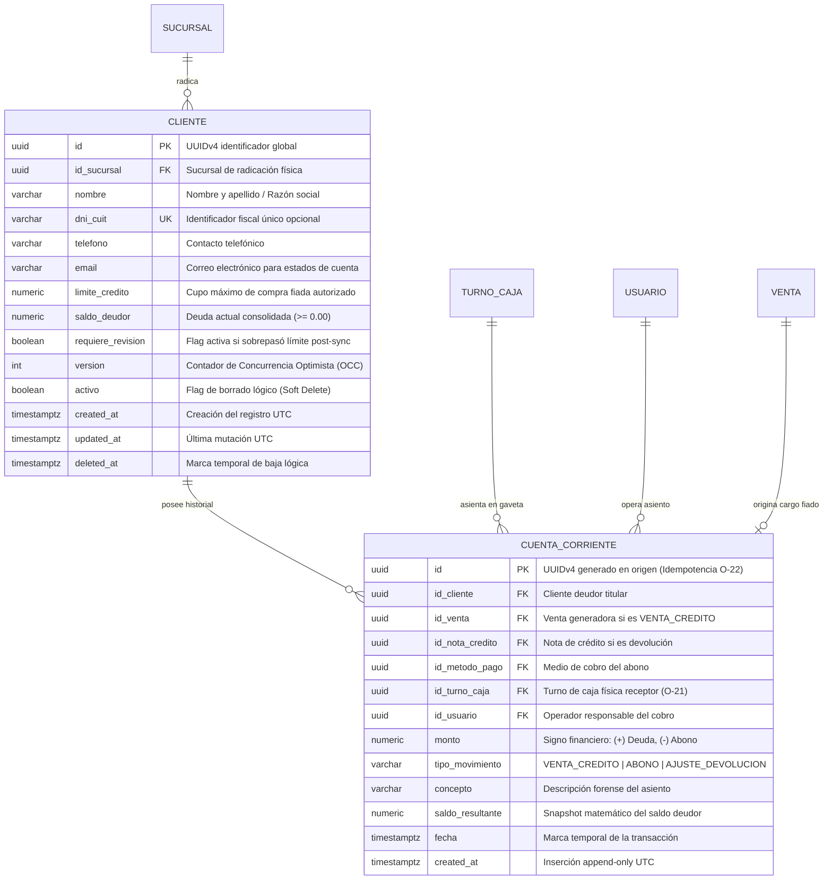
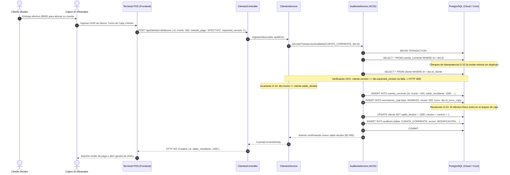
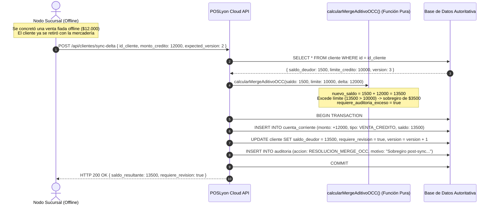

# **📘 Documento de Trazabilidad y Bitácora Pedagógica — Nivel 3: Paso 3.2**
## **Módulo de Clientes y Cuentas Corrientes con Patrón Signed Ledger (RF-07 / RF-08 / C-10 / O-10 / O-21 / O-22)**

---

### **1. Resumen Ejecutivo y Metadatos de Ingeniería**

| Atributo | Detalle de Especificación |
| :--- | :--- |
| **Módulo del Sistema** | Módulo 3: Finanzas, Clientes y Cuentas Corrientes (`apps/backend-cloud/src/modules/clientes`) |
| **Requisitos Funcionales Mapeados** | **RF-07** (Límite de crédito consolidado, cupo en mostrador y detección de sobregiro post-sync)<br>**RF-08** (Cuentas corrientes bajo patrón *Signed Ledger* inmutable y abonos parciales/totales) |
| **Decisiones y Resoluciones Arquitectónicas** | **C-10** (Merge Aditivo de saldos ante colisiones de sincronización local-first offline)<br>**O-10** (Incondicionalidad no negativa del saldo deudor: `saldo_deudor >= 0`)<br>**O-21** (Impacto financiero dual: afectación a gaveta física en abonos en efectivo)<br>**O-22** (Idempotencia unificada mediante UUIDv4 de cliente y `ON CONFLICT (id) DO NOTHING`) |
| **Estado de Pruebas** | **12/12 Pruebas Unitarias/Integración Supertest Pasando (100%)** |
| **Cobertura Global Monorepo** | **80/80 Pruebas Pasando en 9 Suites de Test** |

---

### **2. Lección Universitaria (0 a 100): El Patrón Signed Ledger en Sistemas de Punto de Venta**

#### **2.1. El Peligro del Saldo Mutante (El Antipatrón `saldo = saldo - abono`)**
En la enseñanza tradicional de bases de datos se suele caer en la trampa simplista de modelar el estado financiero de un cliente con una única columna mutable en una tabla `cliente`:
```sql
-- ¡ANTIPATRÓN DESTRUCTIVO DE AUDITORÍA!
UPDATE cliente SET saldo = saldo - 500 WHERE id = 'cliente-uuid';
```
¿Por qué este diseño es inadmisible en sistemas de grado productivo y misión crítica?
1. **Pérdida Total de Trazabilidad Forense:** Si un cliente reclama que su saldo está mal calculado, no existe evidencia histórica de qué compras, notas de crédito o pagos en efectivo conformaron ese número.
2. **Imposibilidad de Conciliación Multi-Caja y Offline:** Si la sucursal 1 otorga una venta fiada offline de \$2.000 y simultáneamente el cliente paga un abono de \$1.000 en la sucursal central, un simple `UPDATE saldo = X` pisaría arbitrariamente una de las operaciones (*Lost Update*).
3. **Vulnerabilidad a Duplicación de Cobros por Falla de Red:** Si la red fluctúa durante la confirmación de un abono y el cajero presiona "Cobrar" dos veces, el saldo se descontaría dos veces sin que nadie sepa qué comprobante respaldó la segunda deducción.

#### **2.2. La Solución: El Patrón Signed Ledger (Libro Mayor Firmado e Inmutable)**
Inspirado en la contabilidad formal por partida doble y en los sistemas bancarios centrales, el patrón **Signed Ledger** establece:
1. **Append-Only Incondicional:** La tabla `CUENTA_CORRIENTE` es una bitácora inmutable. **Nunca se ejecuta un `UPDATE` ni un `DELETE` físico** sobre sus filas.
2. **Convención Estricta de Signos:**
   - **Cargos (+Monto):** Las ventas a crédito (`VENTA_CREDITO`) incrementan la deuda del cliente con un valor algebraico positivo.
   - **Abonos (-Monto):** Los pagos de cuotas o entregas en efectivo/transferencia (`ABONO`) se asientan con un valor algebraico negativo.
   - **Devoluciones (-Monto):** Las notas de crédito por mercadería devuelta (`AJUSTE_DEVOLUCION`) se registran con signo negativo.
3. **Fotografía de Saldo Resultante (`saldo_resultante`):** Cada asiento almacena el saldo consolidado inmediatamente posterior a la operación, lo que permite verificar la integridad matemática mediante sumatorias acumuladas $\sum \Delta_i$.
4. **Idempotencia Unificada (Resolución O-22):** La clave primaria `id` es un UUIDv4 generado en el punto de origen (terminal POS). Si un paquete viaja dos veces por red o se sincroniza en lote, la base de datos ejecuta `ON CONFLICT (id) DO NOTHING` garantizando que ningún abono se impute dos veces.

---

### **3. Especificación Formal de Arquitectura y UML**

#### **3.1. Diagrama de Entidad-Relación (ERD) — Clientes y Libro Mayor**



#### **3.2. Diagrama de Secuencia: Cobro de Abono en Efectivo con Impacto Dual en Caja Física (O-21)**



#### **3.3. Diagrama de Secuencia: Merge Aditivo de Cargo Offline y Sobregiro (Resolución C-10 / RF-07)**



---

### **4. Matriz de Trazabilidad Bidireccional (Código ↔ Arquitectura)**

| Requisito / Invariante | Entidad / DTO de Entrada | Componente / Archivo de Implementación | Líneas Clave | Verificación en Tests |
| :--- | :--- | :--- | :--- | :--- |
| **RF-07 (Límite y Saldo)** | `CrearClienteDto`, `ActualizarClienteDto` | [`ClienteEntity`](file:///d:/Contr/Archivos/POSLyon-Monolitico/apps/backend-cloud/src/modules/clientes/entities/cliente.entity.ts) | L30-L75 | Test 1, Test 2 |
| **RF-08 (Signed Ledger)** | `RegistrarAbonoDto` | [`CuentaCorrienteEntity`](file:///d:/Contr/Archivos/POSLyon-Monolitico/apps/backend-cloud/src/modules/clientes/entities/cuenta-corriente.entity.ts) | L25-L80 | Test 8, Test 12 |
| **C-10 (Merge Aditivo OCC)** | `SyncCuentaCorrienteDeltaDto` | [`ClientesService.sincronizarDeltaOffline`](file:///d:/Contr/Archivos/POSLyon-Monolitico/apps/backend-cloud/src/modules/clientes/services/clientes.service.ts#L425-L510) | L425-L510 | Test 11 |
| **O-10 (Invariante Saldo >= 0)** | Validación de abono | [`ClientesService.registrarAbono`](file:///d:/Contr/Archivos/POSLyon-Monolitico/apps/backend-cloud/src/modules/clientes/services/clientes.service.ts#L340-L352) | L340-L352 | Test 9 |
| **O-21 (Afectación de Caja)** | `RegistrarAbonoDto.metodo_pago` | [`ClientesService.registrarAbono`](file:///d:/Contr/Archivos/POSLyon-Monolitico/apps/backend-cloud/src/modules/clientes/services/clientes.service.ts#L380-L405) | L380-L405 | Test 8 |
| **O-22 (Idempotencia)** | `RegistrarAbonoDto.id` (UUIDv4) | [`ClientesService.registrarAbono`](file:///d:/Contr/Archivos/POSLyon-Monolitico/apps/backend-cloud/src/modules/clientes/services/clientes.service.ts#L318-L327) | L318-L327 | Test 10 |
| **OCC (RNF-04)** | `expected_version` | [`ClientesService.actualizarCliente`](file:///d:/Contr/Archivos/POSLyon-Monolitico/apps/backend-cloud/src/modules/clientes/services/clientes.service.ts#L160-L175) | L160-L175 | Test 4, Test 5 |
| **Soft Delete Protegido** | Regla de saldo cero | [`ClientesService.eliminarCliente`](file:///d:/Contr/Archivos/POSLyon-Monolitico/apps/backend-cloud/src/modules/clientes/services/clientes.service.ts#L240-L260) | L240-L260 | Test 6 |

---

### **5. Arquitectura de Decisión (ADRs del Módulo)**

#### **ADR-013: Adopción del Patrón Signed Ledger para Cuentas Corrientes**
- **Contexto:** Las ventas fiadas y los pagos parciales o totales son el núcleo de confianza en comercios de cercanía y distribuidores mayoristas. Los sistemas legados suelen guardar un único campo de saldo que es sobreescrito directamente, generando disputas irreparables con los clientes ante errores o cortes de red.
- **Alternativas Evaluadas:**
  1. *Campo `saldo` mutable con tabla accesoria de logs no bloqueantes:* Descartada porque si falla la inserción del log pero pasa el update, el saldo pierde su explicación matemática.
  2. *Signed Ledger inmutable append-only con snapshot transaccional:* **Elegida.** Cada asiento registra el delta con signo y el snapshot resultante dentro de un bloque ACID atómico auditado.
- **Consecuencias:** Integridad forense inalterable, posibilidad de reconstruir el saldo exacto en cualquier momento del tiempo sumando los montos, y protección contra duplicaciones mediante UUIDs idempotentes.

#### **ADR-014: Resolución No Destructiva de Sobregiros Post-Sincronización (Resolución C-10)**
- **Contexto:** En un entorno local-first offline, una terminal sin internet puede autorizar una venta a crédito dentro del cupo visible localmente. Cuando regresa la conexión, puede ocurrir que en el servidor central ya se hubiese alcanzado el límite por compras en otra sucursal.
- **Alternativas Evaluadas:**
  1. *Rechazar y anular la venta en el servidor:* Inviable y absurdo en el mundo real, ya que el cliente ya consumió los productos físicamente.
  2. *Merge Aditivo con alerta `requiere_revision = true` (Resolución C-10):* **Elegida.** El cargo se asienta incondicionalmente para reflejar la realidad financiera, se actualiza el saldo consolidado y se marca al cliente para revisión del supervisor/dueño, bloqueando futuras compras hasta regularizar la situación.

---

### **6. Guía de Pruebas con Postman / Curl**

#### **6.1. Alta de Nuevo Cliente con Límite de Crédito**
```bash
curl -X POST http://localhost:3000/api/clientes \
  -H "Content-Type: application/json" \
  -H "x-user-id: 550e8400-e29b-41d4-a716-446655440000" \
  -H "x-sucursal-id: 550e8400-e29b-41d4-a716-446655440001" \
  -H "x-audit-reason: Alta de cliente mayorista" \
  -d '{
    "id_sucursal": "550e8400-e29b-41d4-a716-446655440001",
    "nombre": "Distribuidora San Martin",
    "dni_cuit": "30-55667788-9",
    "telefono": "+5491133445566",
    "email": "contacto@sanmartin.com",
    "limite_credito": 100000.00
  }'
```

#### **6.2. Evaluación Preventiva de Margen de Crédito**
```bash
curl -X GET "http://localhost:3000/api/clientes/550e8400-e29b-41d4-a716-446655440071/evaluar-credito?monto=25000"
```
**Respuesta esperada (HTTP 200 OK):**
```json
{
  "aprobado": true,
  "disponible": 98500.00,
  "exceso": 0,
  "nuevo_saldo_proyectado": 26500.00
}
```

#### **6.3. Registro de Abono en Efectivo en Gaveta de Caja**
```bash
curl -X POST http://localhost:3000/api/clientes/550e8400-e29b-41d4-a716-446655440071/abonos \
  -H "Content-Type: application/json" \
  -H "x-user-id: 550e8400-e29b-41d4-a716-446655440000" \
  -H "x-audit-reason: Cobro de cuota semanal" \
  -d '{
    "id": "e930c013-3148-4490-b8b9-6695f8e94999",
    "id_cliente": "550e8400-e29b-41d4-a716-446655440071",
    "id_turno_caja": "550e8400-e29b-41d4-a716-446655440072",
    "monto": 5000.00,
    "id_metodo_pago": "550e8400-e29b-41d4-a716-446655440073",
    "metodo_pago": "EFECTIVO",
    "expected_version": 2
  }'
```

---
*Fin del documento de trazabilidad de Paso 3.2.*
