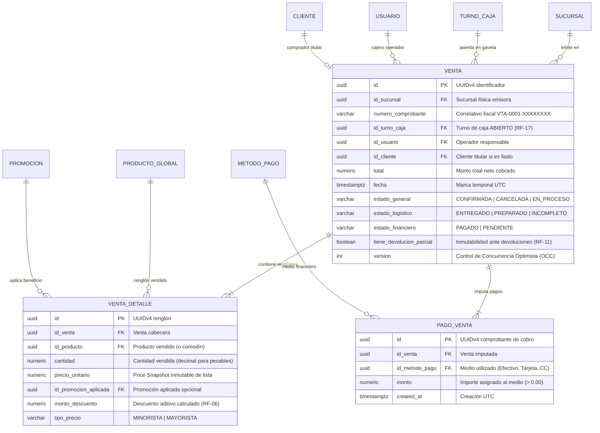
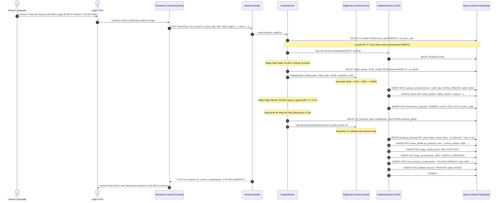

# **📘 Documento de Trazabilidad y Bitácora Pedagógica — Nivel 4: Paso 4.1**
## **Módulo Core POS y Motor de Promociones (RF-01 / RF-05 / RF-06 / RF-17 / O-11 / O-26 / C-12)**

---

### **1. Resumen Ejecutivo y Metadatos de Ingeniería**

| Atributo | Detalle de Especificación |
| :--- | :--- |
| **Módulo del Sistema** | Módulo 4: Núcleo Transaccional POS y Motor de Precios (`apps/backend-cloud/src/modules/ventas`) |
| **Requisitos Funcionales Mapeados** | **RF-01** (Emisión de tickets de venta con correlativo fiscal e inmutabilidad temporal)<br>**RF-05** (Pagos mixtos y heterogéneos: Efectivo + Cuenta Corriente + Tarjeta)<br>**RF-06** (Motor de promociones dinámico bajo Patrón Strategy con preservación de precio de lista)<br>**RF-17** (Fijación obligatoria de ventas al arqueo de caja del turno activo) |
| **Decisiones y Resoluciones Arquitectónicas** | **O-11** (Aditividad de descuentos: las promociones generan `monto_descuento`, jamás mutan `precio_unitario`)<br>**O-26** (Descuento de Packs: los combos no poseen stock físico propio, descuentan sobre `id_producto_base`)<br>**C-12** (Stock permisivo universal en mostrador: `stock_fisico < 0` nunca bloquea la venta presencial) |
| **Estado de Pruebas** | **10/10 Pruebas Unitarias/Integración Supertest Pasando (100%)** |
| **Cobertura Global Monorepo** | **101 Pruebas Pasando en 11 Suites de Test** |

---

### **2. Lección Universitaria (0 a 100): El Núcleo de un Punto de Venta de Misión Crítica**

#### **2.1. El Peligro de Mutar el Precio Unitario (Anti-Patrón de Promociones)**
En sistemas mal diseñados, cuando se aplica una promoción de 20% sobre un artículo de \$500, se suele cometer el error de sobreescribir el campo de la base de datos:
```sql
-- ¡ANTIPATRÓN! PÉRDIDA DE INFORMACIÓN CONTABLE
INSERT INTO venta_detalle (id_producto, cantidad, precio_unitario)
VALUES ('prod-1', 2, 400.00); -- ¿Era $400 el precio de lista o tenía descuento?
```
¿Por qué esto es destructivo?
1. **Imposibilidad de Calcular Devoluciones Justas (RF-09):** Si el cliente devuelve el producto 5 días después, el sistema no sabe si debe devolver \$500 o \$400, abriendo la puerta al arbitraje o reclamos comerciales.
2. **Distorsión Fiscal y Contable:** En la facturación electrónica formal, AFIP/SRI/SUNAT exige discriminar:
   $$\text{Subtotal Bruto} = \text{cantidad} \times \text{precio\_unitario\_lista}$$
   $$\text{Descuento Total} = \sum \text{monto\_descuento}$$
   $$\text{Neto Gravado} = \text{Subtotal Bruto} - \text{Descuento Total}$$
3. **Pérdida de Trazabilidad del Rendimiento de Campañas:** Resulta imposible calcular el ROI de una promoción si no se sabe cuánto dinero exacto resignó el comercio en concepto de descuentos.

**La Solución Arquitectónica (RF-06 / O-11):**
`VENTA_DETALLE.precio_unitario` almacena el **Price Snapshot** fidedigno de lista al momento del escaneo. Toda regla de promoción (porcentaje, combo, 2x1 o monto fijo) genera un `monto_descuento` separado.

#### **2.2. Pagos Mixtos y Afectación Dual de Fondos (RF-05 / RF-17 / O-21)**
En el comercio moderno, un cliente rara vez paga compras grandes con un único método: puede pagar \$3.000 en efectivo y \$2.000 fiado a Cuenta Corriente.
Una arquitectura limpia desacopla la cabecera de la venta de las vías de cobro mediante una relación $1:N$ con la tabla `PAGO_VENTA`.
- Cada pago en efectivo impacta atómicamente en la gaveta física del cajero (`MOVIMIENTO_CAJA` tipo `INGRESO`), alimentando el arqueo ciego (RF-17).
- Cada pago a crédito valida el cupo del cliente (`validarMargenCredito`) y asienta un débito formal en el Libro Mayor (`CUENTA_CORRIENTE` tipo `VENTA_CREDITO`).

#### **2.3. Arquitectura de Inventario de Packs (Resolución O-26)**
Un "Pack de 6 Cervezas" no existe físicamente en el depósito como un producto químicamente distinto de 6 botellas individuales. Crear un registro de stock independiente para el pack obligaría al comerciante a "ensamblar" virtualmente los packs, generando desfasajes absurdos donde "no hay packs pero sobran botellas sueltas".
- En POSLyon, `PRODUCTO_GLOBAL` define `id_producto_base` y `multiplicador_stock = 6`.
- Al vender 2 packs, la función pura de dominio `calcularDescuentoStockPack` redirige el descuento restando **12 unidades del producto base**.

---

### **3. Especificación Formal de Arquitectura y UML**

#### **3.1. Diagrama de Entidad-Relación (ERD) — Ventas, Renglones y Medios de Pago**



#### **3.2. Diagrama de Secuencia: Transacción Atómica de Venta con Pago Mixto y Descuento de Pack**



---

### **4. Matriz de Trazabilidad Bidireccional (Código ↔ Arquitectura)**

| Requisito / Invariante | Entidad / DTO de Entrada | Componente / Archivo de Implementación | Líneas Clave | Verificación en Tests |
| :--- | :--- | :--- | :--- | :--- |
| **RF-01 (Emisión de Ticket)** | `CrearVentaDto` | [`VentaEntity`](file:///d:/Contr/Archivos/POSLyon-Monolitico/apps/backend-cloud/src/modules/ventas/entities/venta.entity.ts) | L25-L95 | Test 3, Test 10 |
| **RF-05 (Pagos Mixtos)** | `PagoItemDto[]` | [`VentasService.crearVenta`](file:///d:/Contr/Archivos/POSLyon-Monolitico/apps/backend-cloud/src/modules/ventas/services/ventas.service.ts#L75-L160) | L75-L160 | Test 5, Test 8 |
| **RF-06 (Motor Promociones)** | `AplicarPromocionDto` | [`PromocionesService.evaluarCarrito`](file:///d:/Contr/Archivos/POSLyon-Monolitico/apps/backend-cloud/src/modules/ventas/services/promociones.service.ts#L90-L170) | L90-L170 | Test 1, Test 2 |
| **RF-17 (Guarda Turno Abierto)** | `id_turno_caja` | [`VentasService.crearVenta`](file:///d:/Contr/Archivos/POSLyon-Monolitico/apps/backend-cloud/src/modules/ventas/services/ventas.service.ts#L55-L73) | L55-L73 | Test 4 |
| **O-11 (Inmutabilidad Precios)** | `ItemVentaDto.precio_unitario` | [`VentaDetalleEntity`](file:///d:/Contr/Archivos/POSLyon-Monolitico/apps/backend-cloud/src/modules/ventas/entities/venta-detalle.entity.ts) | L35-L65 | Test 2 |
| **O-26 (Descuento de Packs)** | `calcularDescuentoStockPack` | [`VentasService.crearVenta`](file:///d:/Contr/Archivos/POSLyon-Monolitico/apps/backend-cloud/src/modules/ventas/services/ventas.service.ts#L170-L200) | L170-L200 | Test 9 |
| **C-12 (Stock Permisivo)** | Actualización de inventario | [`VentasService.crearVenta`](file:///d:/Contr/Archivos/POSLyon-Monolitico/apps/backend-cloud/src/modules/ventas/services/ventas.service.ts#L190-L215) | L190-L215 | Test 9 |

---

### **5. Arquitectura de Decisión (ADRs del Módulo)**

#### **ADR-017: Motor de Promociones Basado en el Patrón Strategy Aditivo**
- **Contexto:** En retail, las promociones cambian semanalmente (porcentaje por categoría, combos 2x1, precios fijos por bulto). Si las promociones modifican directamente el `precio_unitario`, se destruye la auditoría fiscal y se imposibilita el reembolso justo ante devoluciones.
- **Alternativas Evaluadas:**
  1. *Modificar el precio unitario del ítem con el descuento ya aplicado:* Descartada por provocar pérdida de trazabilidad contable y vulnerabilidad a reclamos de clientes.
  2. *Patrón Strategy con Descuento Aditivo Independiente:* **Elegida.** El precio unitario permanece idéntico al de góndola; el motor de promociones calcula un campo separado `monto_descuento`.
- **Consecuencias:** Cumplimiento total de requerimientos fiscales y capacidad de revertir devoluciones deduciendo proporcionalmente el descuento original.

#### **ADR-018: Descuento Recursivo de Packs sobre Producto Base (Resolución O-26)**
- **Contexto:** Mantener existencias físicas separadas para paquetes promocionales (ej. Six-Packs) genera discrepancias ficticias de stock y requiere procesos manuales de ensamble y desensamble.
- **Alternativas Evaluadas:**
  1. *Crear tabla de kits con movimientos de stock en batch al empaquetar:* Descartada por complejidad y fricción operativa en el punto de venta.
  2. *Virtualización en tiempo real con puntero a producto base (`id_producto_base`):* **Elegida.** El pack se vende en mostrador con su código de barra propio pero descuenta matemáticamente del inventario del producto base (`cantidad * multiplicador_stock`).
- **Consecuencias:** Cero desfasajes de inventario y disponibilidad en góndola siempre exacta.

---

### **6. Guía de Pruebas con Postman / Curl**

#### **6.1. Creación de Promoción Porcentual**
```bash
curl -X POST http://localhost:3000/api/promociones \
  -H "Content-Type: application/json" \
  -H "x-user-id: 550e8400-e29b-41d4-a716-446655440093" \
  -d '{
    "id_sucursal": "550e8400-e29b-41d4-a716-446655440090",
    "nombre": "20% Off en Gaseosas",
    "tipo_efecto": "PORCENTAJE",
    "valor_efecto": 20.0,
    "cantidad_minima": 1,
    "id_producto_aplicable": "550e8400-e29b-41d4-a716-446655440097"
  }'
```

#### **6.2. Evaluación del Carrito sin Alterar Precio de Lista**
```bash
curl -X POST http://localhost:3000/api/promociones/evaluar \
  -H "Content-Type: application/json" \
  -d '{
    "id_sucursal": "550e8400-e29b-41d4-a716-446655440090",
    "items": [
      {
        "id_producto": "550e8400-e29b-41d4-a716-446655440097",
        "cantidad": 2,
        "precio_unitario": 500.00,
        "tipo_precio": "MINORISTA"
      }
    ]
  }'
```

#### **6.3. Emisión de Venta con Pago Mixto (Efectivo + Cuenta Corriente)**
```bash
curl -X POST http://localhost:3000/api/ventas \
  -H "Content-Type: application/json" \
  -H "x-user-id: 550e8400-e29b-41d4-a716-446655440093" \
  -H "x-audit-reason: Venta en mostrador caja 1" \
  -d '{
    "id_sucursal": "550e8400-e29b-41d4-a716-446655440090",
    "id_turno_caja": "550e8400-e29b-41d4-a716-446655440091",
    "id_usuario": "550e8400-e29b-41d4-a716-446655440093",
    "id_cliente": "550e8400-e29b-41d4-a716-446655440094",
    "total": 5000.00,
    "pagos": [
      { "id_metodo_pago": "550e8400-e29b-41d4-a716-446655440095", "monto": 3000.00 },
      { "id_metodo_pago": "550e8400-e29b-41d4-a716-446655440096", "monto": 2000.00 }
    ],
    "items": [
      {
        "id_producto": "550e8400-e29b-41d4-a716-446655440097",
        "cantidad": 10,
        "precio_unitario": 500.00,
        "tipo_precio": "MINORISTA"
      }
    ]
  }'
```

---
*Fin del documento de trazabilidad de Paso 4.1.*
