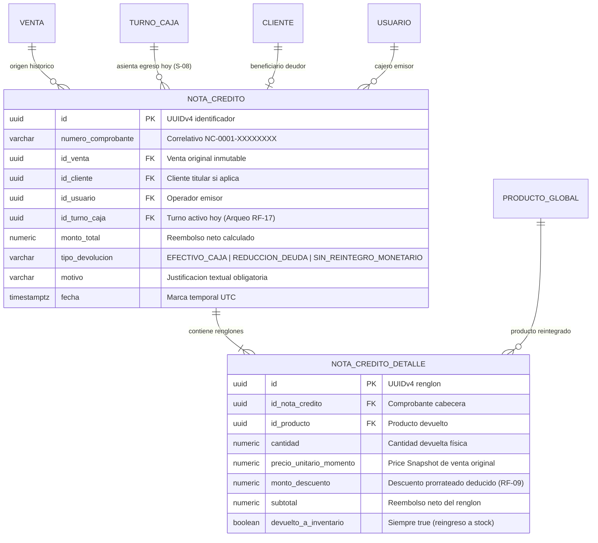
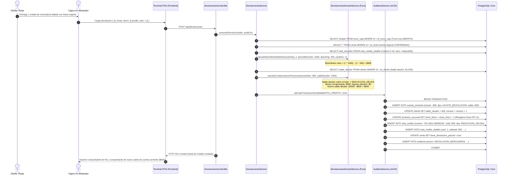

# **📘 Documento de Trazabilidad y Bitácora Pedagógica — Nivel 4: Paso 4.2**
## **Módulo de Devoluciones, Notas de Crédito y Compensación Mixta (RF-09 / RF-10 / RF-11 / O-15 / O-19 / S-08)**

---

### **1. Resumen Ejecutivo y Metadatos de Ingeniería**

| Atributo | Detalle de Especificación |
| :--- | :--- |
| **Módulo del Sistema** | Módulo 4: Finanzas Post-Venta y Reclamaciones (`apps/backend-cloud/src/modules/devoluciones`) |
| **Requisitos Funcionales Mapeados** | **RF-09** (Deducción proporcional obligatoria de descuentos promocionales en devoluciones)<br>**RF-10** (Compensación Mixta: amortización prioritaria de deuda en Cuenta Corriente vs egreso de efectivo)<br>**RF-11** (Inmutabilidad del ticket original mediante flag `tiene_devolucion_parcial = true`) |
| **Decisiones y Resoluciones Arquitectónicas** | **O-15** (Guarda de venta pendiente: prohíbe egreso monetario de caja si el dinero original nunca ingresó)<br>**O-19** (Control algorítmico anti-doble devolución sobre el historial acumulado de notas de crédito)<br>**S-08** (Desacoplamiento temporal: la nota de crédito impacta en el `id_turno_caja` de hoy, no del día de la venta) |
| **Estado de Pruebas** | **6/6 Pruebas Unitarias/Integración Supertest Pasando (100%)** |
| **Cobertura Global Monorepo** | **107 Pruebas Pasando en 12 Suites de Test** |

---

### **2. Lección Universitaria (0 a 100): El Problema del Arbitraje de Promociones en Devoluciones**

#### **2.1. La Estafa del Descuento No Prorrateado (Anti-Patrón de Devolución Ingenua)**
Supongamos un escenario real de retail:
- Un comercio lanza una promoción: *"Lleva 2 gaseosas de \$1.000 y obtén \$200 de descuento total"*.
- El cliente compra 2 botellas:
  - Subtotal Bruto = \$2.000
  - Descuento Promocional = -\$200
  - **Total Pagado = \$1.800 (\$900 por botella)**
- Al día siguiente, el cliente regresa con una sola botella y solicita la devolución.

¿Qué ocurre en un sistema ingenuo sin trazabilidad matemática?
El sistema consulta el catálogo o el precio de lista (`precio_unitario = 1000`) y le devuelve \$1.000 en mano al cliente.
**Consecuencia:** El cliente se quedó con una botella y pagó solo \$800 (\$1.800 pagados - \$1.000 devueltos), logrando un descuento del 50% que jamás fue autorizado por el negocio (*Arbitraje de Promociones*).

#### **2.2. La Solución Matemática: Prorrateo Unitario de Beneficios (RF-09 / C-04)**
El motor de dominio implementa la deducción proporcional del beneficio:
$$\text{descuento\_unitario\_prorrateado} = \frac{\text{monto\_descuento\_total\_original}}{\text{cantidad\_vendida\_original}} = \frac{\$200}{2} = \$100/\text{unidad}$$
$$\text{subtotal\_reembolso\_neto} = (\text{cantidad\_a\_devolver} \times \text{precio\_unitario}) - (\text{cantidad\_a\_devolver} \times \text{descuento\_unitario})$$
$$\text{subtotal\_reembolso\_neto} = (1 \times \$1.000) - (1 \times \$100) = \$900,00$$
El cliente recibe exactamente los \$900 netos que abonó por esa unidad, erradicando el arbitraje con exactitud centesimal.

#### **2.3. Compensación Mixta y Priorización Financiera (RF-10)**
¿Cómo debe pagarse la devolución a un cliente habitual con cuenta corriente?
Si el cliente posee un saldo deudor pendiente de \$1.500 en su cuenta corriente y devuelve mercadería por \$900:
- **No se le entrega dinero en efectivo de la caja física.**
- Se aplica el principio financiero de compensación de créditos y deudas: los \$900 se imputan como un asiento inmutable en el Libro Mayor (`CUENTA_CORRIENTE` con tipo `AJUSTE_DEVOLUCION` y monto algebraico negativo `-$900`), reduciendo su deuda a \$600.
- Si el monto devuelto superase la deuda (ej. devuelve \$2.000 y debía \$1.500), se cancela la deuda por completo (\$1.500) y únicamente el remanente (\$500) se entrega en billetes físicos, registrando el egreso de gaveta en el turno de caja activo de hoy (Resolución S-08).

---

### **3. Especificación Formal de Arquitectura y UML**

#### **3.1. Diagrama de Entidad-Relación (ERD) — Notas de Crédito y Desacoplamiento Temporal**



#### **3.2. Diagrama de Secuencia: Devolución con Amortización de Deuda en Cuenta Corriente (RF-10 / S-08)**



---

### **4. Matriz de Trazabilidad Bidireccional (Código ↔ Arquitectura)**

| Requisito / Invariante | Entidad / DTO de Entrada | Componente / Archivo de Implementación | Líneas Clave | Verificación en Tests |
| :--- | :--- | :--- | :--- | :--- |
| **RF-09 (Prorrateo Promocional)** | `ItemDevolucionDto` | [`DevolucionesDomainService.calcularReembolsoNetoItem`](file:///d:/Contr/Archivos/POSLyon-Monolitico/libs/domain-core/src/services/devoluciones.domain-service.ts#L41-L88) | L41-L88 | Test 1 |
| **RF-10 (Compensación Mixta)** | `TipoDevolucion` | [`DevolucionesDomainService.calcularCompensacionFinanciera`](file:///d:/Contr/Archivos/POSLyon-Monolitico/libs/domain-core/src/services/devoluciones.domain-service.ts#L94-L145) | L94-L145 | Test 3 |
| **RF-11 (Inmutabilidad Ticket)** | `tiene_devolucion_parcial` | [`DevolucionesService.procesarDevolucion`](file:///d:/Contr/Archivos/POSLyon-Monolitico/apps/backend-cloud/src/modules/devoluciones/services/devoluciones.service.ts#L290-L305) | L290-L305 | Test 1 |
| **O-15 (Guarda Venta Pendiente)** | `confirmar_sin_dinero` | [`DevolucionesDomainService.calcularCompensacionFinanciera`](file:///d:/Contr/Archivos/POSLyon-Monolitico/libs/domain-core/src/services/devoluciones.domain-service.ts#L111-L125) | L111-L125 | Test 5 |
| **O-19 (Anti-Doble Devolución)** | Historial notas de crédito | [`DevolucionesDomainService.calcularReembolsoNetoItem`](file:///d:/Contr/Archivos/POSLyon-Monolitico/libs/domain-core/src/services/devoluciones.domain-service.ts#L60-L67) | L60-L67 | Test 4 |
| **S-08 (Desacoplamiento Temporal)** | `id_turno_caja` hoy | [`DevolucionesService.procesarDevolucion`](file:///d:/Contr/Archivos/POSLyon-Monolitico/apps/backend-cloud/src/modules/devoluciones/services/devoluciones.service.ts#L55-L75) | L55-L75 | Test 2 |

---

### **5. Arquitectura de Decisión (ADRs del Módulo)**

#### **ADR-019: Desacoplamiento Temporal entre la Venta y la Nota de Crédito (Resolución S-08)**
- **Contexto:** En sistemas contables tradicionales con cajas rígidas, hacer una devolución de una venta ocurrida hace 3 semanas intentaba reabrir el turno histórico o requería permisos extraordinarios de anulación de asientos ya cerrados.
- **Alternativas Evaluadas:**
  1. *Reabrir el turno de caja de la fecha original:* Inadmisible porque altera los balances contables e impositivos ya presentados y cerrados.
  2. *Desacoplamiento Temporal:* **Elegida.** La venta original permanece inalterable; la Nota de Crédito valida los precios y condiciones del pasado, pero se emite e impacta en el `id_turno_caja` del cajero presente en el turno de hoy.
- **Consecuencias:** Auditoría transparente, cero recálculos de arqueos del pasado y congruencia total de fondos en el mostrador.

#### **ADR-020: Regla de Reingreso Físico Incondicional al Inventario (RF-11)**
- **Contexto:** Cuando un cliente devuelve un producto en mostrador, el inventario de la tienda debe reflejar de inmediato la existencia real del artículo físico recibido.
- **Alternativas Evaluadas:**
  1. *Dejar el producto en un limbo contable hasta que un supervisor decida si lo descarta o lo reingresa:* Descartada para operaciones minoristas ágiles.
  2. *Reingreso Incondicional Inmediato:* **Elegida.** La Nota de Crédito suma de inmediato `stock_fisico = stock_fisico + cantidad`. Si el producto está defectuoso o vencido, el encargado de stock realiza posteriormente un ajuste manual tipificado (`AJUSTE_STOCK_MERMA`), garantizando trazabilidad separada para la merma.
- **Consecuencias:** Visibilidad en tiempo real de góndola y separación estricta entre la devolución del cliente y el descarte de mercadería dañada.

---

### **6. Guía de Pruebas con Postman / Curl**

#### **6.1. Devolución Parcial con Reintegro de Efectivo en Caja Activa**
```bash
curl -X POST http://localhost:3000/api/devoluciones \
  -H "Content-Type: application/json" \
  -H "x-user-id: 550e8400-e29b-41d4-a716-446655440093" \
  -H "x-audit-reason: Devolución por cambio de talle" \
  -d '{
    "id_venta": "550e8400-e29b-41d4-a716-446655440113",
    "id_turno_caja": "550e8400-e29b-41d4-a716-446655440111",
    "tipo_devolucion": "EFECTIVO_CAJA",
    "motivo": "Mercadería devuelta en buen estado",
    "items": [
      {
        "id_producto": "550e8400-e29b-41d4-a716-446655440115",
        "cantidad": 1
      }
    ]
  }'
```

#### **6.2. Devolución Imputada a Cuenta Corriente (Compensación de Deuda)**
```bash
curl -X POST http://localhost:3000/api/devoluciones \
  -H "Content-Type: application/json" \
  -H "x-user-id: 550e8400-e29b-41d4-a716-446655440093" \
  -H "x-audit-reason: Compensación a cuenta corriente" \
  -d '{
    "id_venta": "550e8400-e29b-41d4-a716-446655440118",
    "id_turno_caja": "550e8400-e29b-41d4-a716-446655440111",
    "tipo_devolucion": "REDUCCION_DEUDA",
    "motivo": "Reintegro a favor del saldo deudor",
    "items": [
      {
        "id_producto": "550e8400-e29b-41d4-a716-446655440115",
        "cantidad": 1
      }
    ]
  }'
```

---
*Fin del documento de trazabilidad de Paso 4.2.*
