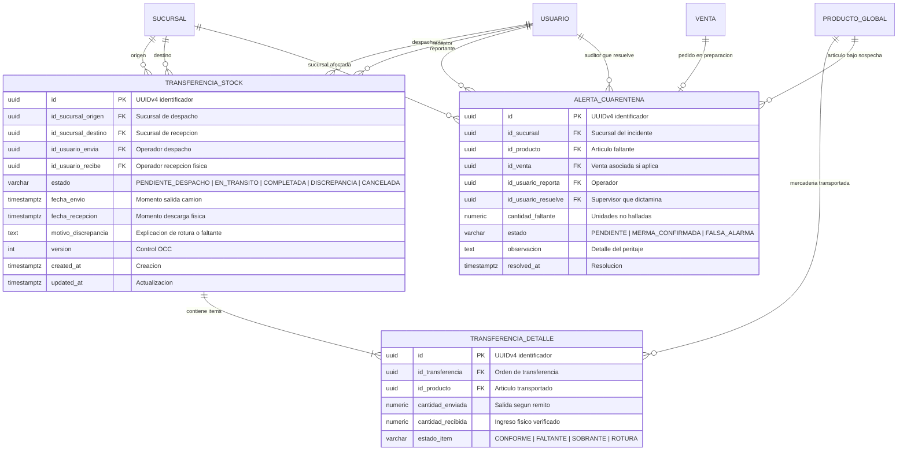
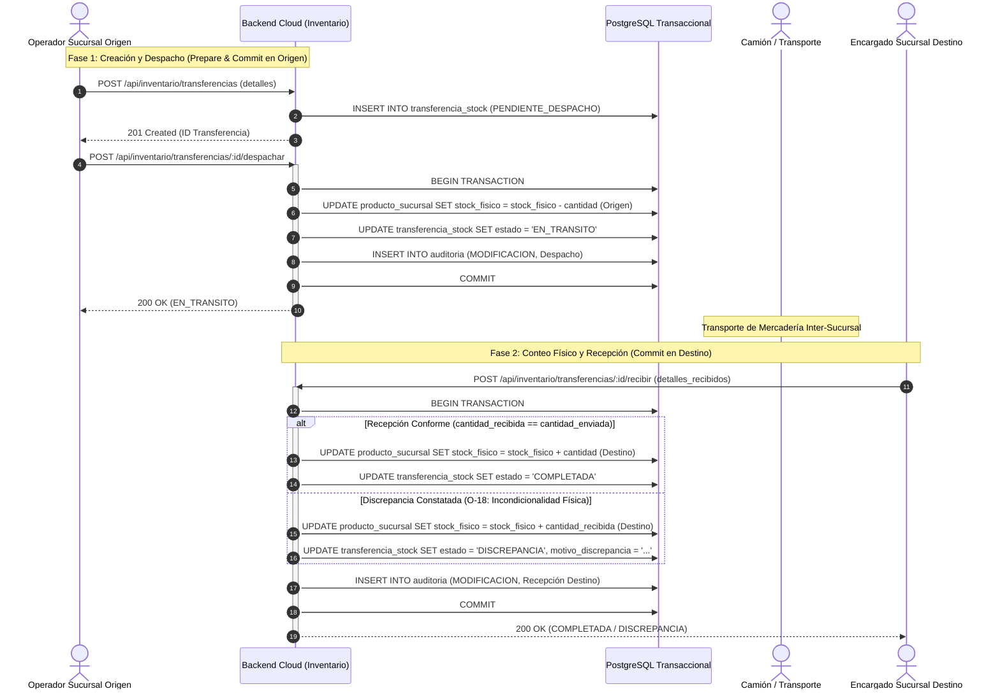
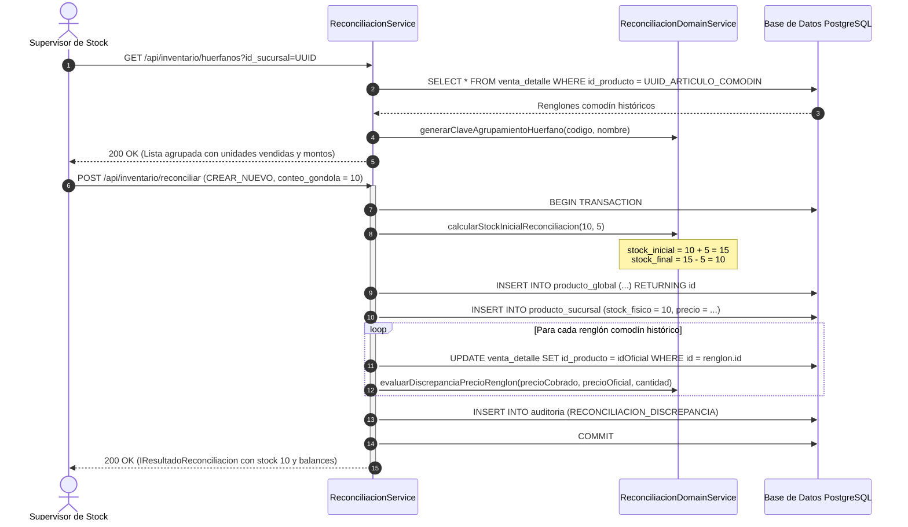

# **📘 Documento de Trazabilidad y Bitácora Pedagógica — Nivel 4: Paso 4.3**
## **Módulo de Reconciliación de Huérfanos, Cuarentena de Stock y Transferencias Inter-Sucursal 2PC (RF-13 / RF-16 / C-18 / C-21 / C-23 / C-24 / O-18 / O-27)**

---

### **1. Resumen Ejecutivo y Metadatos de Ingeniería**

| Atributo | Detalle de Especificación |
| :--- | :--- |
| **Módulo del Sistema** | Módulo de Inventario Avanzado y Reconciliación Transaccional (`apps/backend-cloud/src/modules/inventario-avanzado`) |
| **Requisitos Funcionales Mapeados** | **RF-13** (Algoritmo de Reconciliación de Códigos Huérfanos y Artículos Comodín offline)<br>**RF-16** (Transferencias Inter-Sucursal bajo protocolo Two-Phase Commit 2PC)<br>**RF-02** (Ajuste Manual de Inventario con concurrencia OCC) |
| **Decisiones y Resoluciones Arquitectónicas** | **C-18** (Ecuación de cálculo de stock inicial de inserción sin alterar el conteo real en góndola)<br>**C-21** (Auditoría multinivel de discrepancias de precios: Nivel 1 por renglón y Nivel 2 agrupado por turno)<br>**C-23** (Resolución no destructiva de Cuarentena de Stock: deducción de faltante neto sin anular remanentes)<br>**C-24** (Handshake dual inter-sucursal validado por roles)<br>**O-18** (Incondicionalidad física: solo la cantidad verificada físicamente ingresa a inventario)<br>**O-27** (Clave canónica de agrupamiento de comodines con o sin código de barras) |
| **Estado de Pruebas** | **10/10 Pruebas Unitarias/Integración Supertest Pasando (100%)** |
| **Cobertura Global Monorepo** | **117 Pruebas Pasando en 13 Suites de Test** |

---

### **2. Lección Universitaria (0 a 100): Reconciliación de Huérfanos, Cuarentena y Transacciones Distribuidas 2PC**

#### **2.1. El Problema del Artículo Comodín y la Reconciliación de Stock (RF-12 / RF-13 / C-18)**
En un punto de venta minorista moderno con capacidad offline, los cajeros no pueden detener la fila si ingresa un producto nuevo sin registrar en catálogo o con un código de barra no reconocido. Para garantizar la continuidad del negocio:
1. El cajero digita o escanea el producto asignándole un precio y nombre provisional (artículo comodín `UUID_ARTICULO_COMODIN`).
2. Al finalizar la jornada o en días posteriores, el encargado de stock realiza el conteo físico en góndola y procede a oficializar el producto en el sistema.

**La Ecuación Matemática de Reconciliación (Resolución C-18):**
Si el encargado cuenta **10 unidades** físicas en el estante hoy, pero en los últimos 3 días se vendieron **5 unidades** como comodín bajo ese código:
- Si creamos el producto con stock inicial de 10 unidades y luego reasignamos los tickets pasados para descontar las 5 unidades vendidas, el stock quedaría incorrectamente en $10 - 5 = 5$ unidades (falsedad ideológica de inventario).
- La fórmula formal de reconciliación establece:
  $$\text{stock\_inicial\_calculado} = \text{stock\_fisico\_contado\_en\_góndola} + \text{unidades\_vendidas\_históricas}$$
  $$\text{stock\_inicial\_calculado} = 10 + 5 = 15\text{ unidades}$$
- Al impactar retroactivamente la deducción de las 5 unidades históricas:
  $$\text{stock\_fisico\_final} = \text{stock\_inicial\_calculado} - \text{unidades\_vendidas\_históricas} = 15 - 5 = 10\text{ unidades}$$
  El stock en base de datos queda **idéntico al conteo real en góndola (10 unidades)**, preservando la coherencia ontológica y la trazabilidad contable.

#### **2.2. Discrepancias Financieras Multinivel (Resolución C-21)**
Cuando un producto comodín se cobró a un precio provisorio (por ejemplo \$1.400) y su precio oficial de catálogo es \$1.600:
- **Nivel 1 (Por Renglón):** Se calcula la diferencia unitaria:
  $$\text{diferencia\_unitaria} = \text{precio\_cobrado} - \text{precio\_oficial} = 1.400 - 1.600 = -\$200$$
  $$\text{diferencia\_total} = -\$200 \times 2\text{ unidades} = -\$400\text{ (MERMA\_LÓGICA)}$$
- **Nivel 2 (Por Turno de Caja):** Dado que los turnos de caja pasados ya fueron cerrados e inmutabilizados bajo arqueo ciego (RF-17), el sistema **no altera retroactivamente el balance financiero del cajero**. En su lugar, emite un informe forense consolidado de mermas y sobrantes lógicos en el Panel Nube de Supervisión.

#### **2.3. Cuarentena de Stock No Destructiva (Resolución C-23)**
Durante la preparación guiada de un pedido de preventa o delivery, un operario puede constatar que de 10 paquetes teóricos faltan 2.
- Se genera una `ALERTA_CUARENTENA` con `cantidad_faltante = 2` en estado `PENDIENTE`.
- Al auditar el depósito, si se confirma la merma (`MERMA_CONFIRMADA`):
  El sistema **no resetea a cero** destructivamente el stock de la góndola. Resta estrictamente las unidades extraviadas ($10 - 2 = 8$), preservando la comercialización del remanente físico legítimo.

#### **2.4. Protocolo Two-Phase Commit (2PC) Inter-Sucursal (RF-16 / C-24 / O-18)**
En una empresa multisucursal, la mercadería física no se teletransporta instantáneamente:
- **Fase 1 (Prepare / Commit en Origen):** Cuando el camión sale de la Sucursal Origen, el stock se descuenta de dicha sucursal y la orden pasa a `EN_TRANSITO`. La mercadería está en el camión, no en los estantes.
- **Fase 2 (Commit en Destino):** Cuando el camión llega a la Sucursal Destino, el encargado realiza el conteo físico de recepción.
  Bajo el principio de **Incondicionalidad Física (O-18)**:
  - Solo ingresa al inventario de destino la cantidad **realmente descargada**.
  - Si se enviaron 5 unidades y llegaron 4 (1 rota o extraviada en viaje), se suman 4 al stock destino y la transferencia finaliza en estado `DISCREPANCIA`, disparando la auditoría de pérdida.
- **Manejo de Contingencia (Rollback 2PC):** Si el viaje se anula o el camión sufre un siniestro y regresa, la acción `cancelar` restituye el stock a la sucursal de origen.

---

### **3. Especificación Formal de Arquitectura y UML**

#### **3.1. Diagrama de Entidad-Relación (ERD) — Inventario Avanzado y Transferencias**



#### **3.2. Diagrama de Secuencia: Protocolo Two-Phase Commit (2PC) Inter-Sucursal**



#### **3.3. Diagrama de Secuencia: Algoritmo de Reconciliación de Códigos Huérfanos (RF-13 / C-18)**



---

### **4. Matriz de Trazabilidad Bidireccional**

| Requisito / Regla | Componente Arquitectónico | Archivo Fuente y Líneas | Prueba Automatizada (`spec.ts`) |
| :--- | :--- | :--- | :--- |
| **RF-13 / C-18** (Ecuación Reconciliación Stock) | [`ReconciliacionService`](file:///d:/Contr/Archivos/POSLyon-Monolitico/apps/backend-cloud/src/modules/inventario-avanzado/services/reconciliacion.service.ts) | [reconciliacion.service.ts#L160-L190](file:///d:/Contr/Archivos/POSLyon-Monolitico/apps/backend-cloud/src/modules/inventario-avanzado/services/reconciliacion.service.ts#L160-L190) | `POST /api/inventario/reconciliar (CREAR_NUEVO)` |
| **C-21** (Mermas y Sobrantes por Turno) | [`ReconciliacionDomainService`](file:///d:/Contr/Archivos/POSLyon-Monolitico/libs/domain-core/src/services/reconciliacion.domain-service.ts) | [reconciliacion.domain-service.ts#L84-L162](file:///d:/Contr/Archivos/POSLyon-Monolitico/libs/domain-core/src/services/reconciliacion.domain-service.ts#L84-L162) | `POST /api/inventario/reconciliar` (evaluación discrepancias) |
| **O-27** (Clave de Agrupamiento Canónica) | [`ReconciliacionService`](file:///d:/Contr/Archivos/POSLyon-Monolitico/apps/backend-cloud/src/modules/inventario-avanzado/services/reconciliacion.service.ts) | [reconciliacion.service.ts#L48-L86](file:///d:/Contr/Archivos/POSLyon-Monolitico/apps/backend-cloud/src/modules/inventario-avanzado/services/reconciliacion.service.ts#L48-L86) | `GET /api/inventario/huerfanos` |
| **C-23** (Cuarentena No Destructiva) | [`CuarentenaService`](file:///d:/Contr/Archivos/POSLyon-Monolitico/apps/backend-cloud/src/modules/inventario-avanzado/services/cuarentena.service.ts) | [cuarentena.service.ts#L104-L126](file:///d:/Contr/Archivos/POSLyon-Monolitico/apps/backend-cloud/src/modules/inventario-avanzado/services/cuarentena.service.ts#L104-L126) | `PATCH /api/inventario/cuarentena/resolver (MERMA_CONFIRMADA)` |
| **RF-02** (Ajuste Manual con OCC) | [`CuarentenaService`](file:///d:/Contr/Archivos/POSLyon-Monolitico/apps/backend-cloud/src/modules/inventario-avanzado/services/cuarentena.service.ts) | [cuarentena.service.ts#L148-L188](file:///d:/Contr/Archivos/POSLyon-Monolitico/apps/backend-cloud/src/modules/inventario-avanzado/services/cuarentena.service.ts#L148-L188) | `POST /api/inventario/stock/ajuste-manual (OCC 409)` |
| **RF-16 / C-24** (2PC Fase 1: Despacho) | [`Transferencias2pcService`](file:///d:/Contr/Archivos/POSLyon-Monolitico/apps/backend-cloud/src/modules/inventario-avanzado/services/transferencias-2pc.service.ts) | [transferencias-2pc.service.ts#L87-L175](file:///d:/Contr/Archivos/POSLyon-Monolitico/apps/backend-cloud/src/modules/inventario-avanzado/services/transferencias-2pc.service.ts#L87-L175) | `POST /api/inventario/transferencias/:id/despachar` |
| **O-18** (2PC Fase 2: Incondicionalidad) | [`Transferencias2pcService`](file:///d:/Contr/Archivos/POSLyon-Monolitico/apps/backend-cloud/src/modules/inventario-avanzado/services/transferencias-2pc.service.ts) | [transferencias-2pc.service.ts#L195-L290](file:///d:/Contr/Archivos/POSLyon-Monolitico/apps/backend-cloud/src/modules/inventario-avanzado/services/transferencias-2pc.service.ts#L195-L290) | `POST /api/inventario/transferencias/:id/recibir (DISCREPANCIA)` |
| **2PC Rollback** (Restitución a Origen) | [`Transferencias2pcService`](file:///d:/Contr/Archivos/POSLyon-Monolitico/apps/backend-cloud/src/modules/inventario-avanzado/services/transferencias-2pc.service.ts) | [transferencias-2pc.service.ts#L315-L370](file:///d:/Contr/Archivos/POSLyon-Monolitico/apps/backend-cloud/src/modules/inventario-avanzado/services/transferencias-2pc.service.ts#L315-L370) | `POST /api/inventario/transferencias/:id/cancelar` |

---

### **5. Registro de Decisiones de Arquitectura (ADR)**

#### **ADR-016: Two-Phase Commit de Negocio vs. Transacciones Distribuidas XA**
- **Contexto:** Las sucursales pueden estar geográficamente dispersas y experimentar caídas intermitentes de conectividad a Internet.
- **Alternativa Descartada:** Protocolo XA / WS-AtomicTransaction coordinado a nivel de base de datos Postgres (imposible si una sucursal está desconectada o utiliza SQLite local).
- **Decisión Adoptada:** Two-Phase Commit a nivel de Máquina de Estados de Negocio (`PENDIENTE_DESPACHO` $\to$ `EN_TRANSITO` $\to$ `COMPLETADA` / `DISCREPANCIA`).
- **Consecuencia Positiva:** Desacoplamiento total de redes físicas; la mercadería viaja documentada con remito y el estado de tránsito persiste en el servidor central sin riesgo de locks bloqueantes.

#### **ADR-017: No Modificación Retroactiva de Cierres de Turno (Invarianza Histórica)**
- **Contexto:** Al reconciliar un producto vendido a \$1.400 que en realidad costaba \$1.600, existe una pérdida contable de \$200 por unidad.
- **Alternativa Descartada:** Modificar la tabla `TURNO_CAJA` y `ARQUEO_CIEGO` del día en que se produjo la venta.
- **Decisión Adoptada:** Mantener inmutables los registros de caja ya cerrados. Asentar la merma lógica exclusivamente en el log forense de auditoría `AUDITORIA` bajo la acción `RECONCILIACION_DISCREPANCIA`.

---

### **6. Guía de Ejecución de Pruebas en Postman / cURL**

#### **6.1. Reconciliar Código Huérfano con Creación de Nuevo Producto (RF-13 / C-18)**
```bash
curl -X POST http://localhost:3000/api/inventario/reconciliar \
  -H "Content-Type: application/json" \
  -H "x-user-id: 550e8400-e29b-41d4-a716-446655440099" \
  -d '{
    "id_sucursal": "550e8400-e29b-41d4-a716-446655440201",
    "codigo_comodin": "7791234567890",
    "accion": "CREAR_NUEVO",
    "nombre_oficial": "Galletitas Chocolate Rellenas 150g",
    "id_categoria": "550e8400-e29b-41d4-a716-446655440203",
    "precio_minorista": 1600,
    "stock_fisico_actual": 10
  }'
```

#### **6.2. Despachar Transferencia Inter-Sucursal (Fase 1 2PC)**
```bash
curl -X POST http://localhost:3000/api/inventario/transferencias/550e8400-e29b-41d4-a716-446655440207/despachar \
  -H "Content-Type: application/json" \
  -H "x-user-id: 550e8400-e29b-41d4-a716-446655440099" \
  -d '{
    "expected_version": 1
  }'
```

#### **6.3. Recepción con Discrepancia Física (Fase 2 2PC)**
```bash
curl -X POST http://localhost:3000/api/inventario/transferencias/550e8400-e29b-41d4-a716-446655440207/recibir \
  -H "Content-Type: application/json" \
  -H "x-user-id: 550e8400-e29b-41d4-a716-446655440099" \
  -d '{
    "expected_version": 2,
    "detalles_recibidos": [
      {
        "id_producto": "550e8400-e29b-41d4-a716-446655440204",
        "cantidad_recibida": 4,
        "estado_item": "FALTANTE"
      }
    ],
    "motivo_discrepancia": "Falta 1 unidad rota en transporte"
  }'
```
