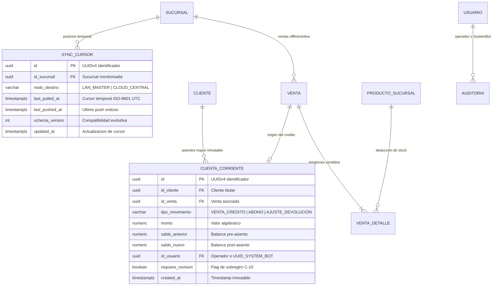
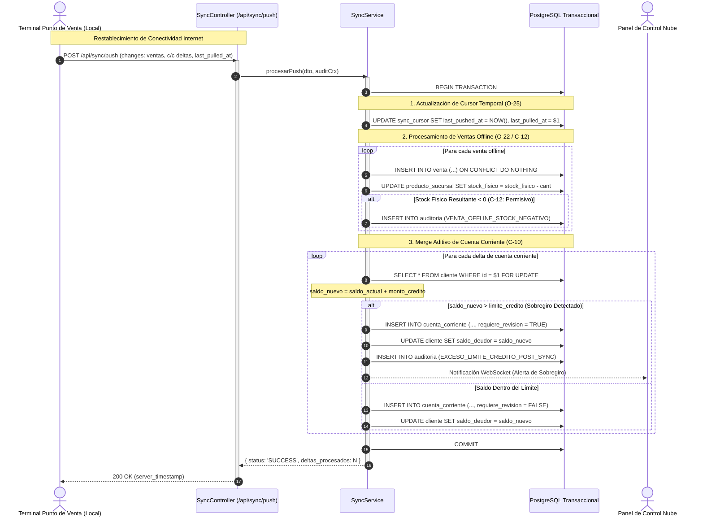

# **📘 Documento de Trazabilidad y Bitácora Pedagógica — Nivel 4: Paso 4.4**
## **Módulo de Sincronización Local-First, Cursores Temporales y Resolución de Conflictos (RF-18 / O-25 / C-10 / C-12 / O-22 / S-03)**

---

### **1. Resumen Ejecutivo y Metadatos de Ingeniería**

| Atributo | Detalle de Especificación |
| :--- | :--- |
| **Módulo del Sistema** | Módulo de Sincronización y Resiliencia Local-First (`apps/backend-cloud/src/modules/sync`) |
| **Requisitos Funcionales Mapeados** | **RF-18** (Motor de Sincronización Incremental Bidireccional Local-First)<br>**RF-07** (Control de Cupo y Límite de Crédito en Cuenta Corriente)<br>**RF-08** (Libro Mayor Inmutable bajo Patrón Signed Ledger) |
| **Decisiones y Resoluciones Arquitectónicas** | **O-25** (Estrictez temporal ISO-8601 UTC con milisegundos en `last_pulled_at` y `last_pushed_at`)<br>**C-10** (Merge Aditivo en Cuentas Corrientes ante sobregiros post-sync con flag `requiere_revision`)<br>**C-12** (Política Permisiva de Stock: admisión de `stock_fisico < 0` en ventas offline)<br>**O-22** (Idempotencia unificada por UUID en inserción de deltas)<br>**S-03** (Identidad canónica `UUID_SYSTEM_BOT` para procesos daemon automáticos) |
| **Estado de Pruebas** | **6/6 Pruebas Unitarias/Integración Supertest Pasando (100%)** |
| **Cobertura Global Monorepo** | **123 Pruebas Pasando en 14 Suites de Test** |

---

### **2. Lección Universitaria (0 a 100): Arquitectura Local-First, Cursores Temporales y Resolución de Conflictos**

#### **2.1. La Filosofía Local-First en Entornos Minoristas de Alta Rotación**
En aplicaciones tradicionales cliente-servidor (cloud-only), un corte de fibra óptica o una falla en el router paraliza inmediatamente el punto de cobro: el cajero no puede facturar, el cliente queda esperando y el negocio pierde ingresos.

La arquitectura **Local-First (Offline-First)** invierte este paradigma:
1. Cada caja registradora opera de forma 100% autónoma contra un motor embebido local (SQLite / WatermelonDB / TypeORM local).
2. Toda transacción (ventas, abonos, ingresos de mercadería) se persiste localmente en milisegundos con garantías ACID locales.
3. Un motor de fondo (*Sync Worker Daemon*) monitorea la conectividad de red y realiza el intercambio asíncrono de deltas con el backend central autoritativo (`apps/backend-cloud`).

#### **2.2. El Peligro del Reloj de Pared y la Solución del Cursor ISO-8601 UTC (Resolución O-25)**
¿Cómo sabe una caja qué cambios ocurrieron en la nube mientras estuvo 6 horas sin Internet?
- **Anti-Patrón del Novato:** *"Pedir todo lo que cambió hoy"*. Provoca transferencias gigantescas e ineficientes de datos y satura los enlaces móviles 4G.
- **La Solución del High Watermark Cursor:** Cada sucursal almacena un puntero temporal `last_pulled_at`. Al sincronizar:
  - La sucursal envía su cursor: `GET /api/sync/pull?sucursal_id=...&last_pulled_at=2026-10-23T10:00:00.000Z`.
  - El backend central consulta únicamente los registros donde `updated_at > last_pulled_at`.
  - El backend responde con el lote de novedades y devuelve su marca horaria de servidor `server_timestamp` para que la sucursal actualice su cursor local.
- **Estrictez UTC (Resolución O-25):** Para evitar desfasajes catastróficos por cambio de horario de verano (*Daylight Saving Time*) o discrepancias entre la zona horaria del cliente y el servidor, **todos los timestamps viajan estrictamente en formato ISO-8601 UTC con milisegundos** (`YYYY-MM-DDTHH:mm:ss.sssZ`).

#### **2.3. El Desafío del Split-Brain Financiero: Merge Aditivo en Cuentas Corrientes (Resolución C-10)**
Imaginemos una situación real de estrés en un comercio de barrio:
- El cliente *Carlos Gómez* tiene un límite de crédito de **\$10.000** y un saldo deudor actual de **\$8.000** (margen disponible: \$2.000).
- Se corta Internet en el pueblo.
- En la Caja 1 (offline), Carlos compra al fiado por **\$1.500**. El sistema valida localmente: $\$8.000 + \$1.500 = \$9.500 \le \$10.000$ (Aprobado).
- Una hora después, el hijo de Carlos va a la Caja 2 (también offline) y compra al fiado por **\$1.500**. La Caja 2 valida su saldo local: $\$8.000 + \$1.500 = \$9.500 \le \$10.000$ (Aprobado).
- Al restablecerse la conexión, ambas cajas suben sus deltas al servidor central.

**¿Cómo debe reaccionar el backend ante este conflicto?**
- **Alternativa Descartada (Ingenua):** Rechazar la venta de la Caja 2 con un error 400 o rollback.
  *¿Por qué es inviable?* Porque la mercadería **ya salió físicamente del local comercial** y el cliente ya se la llevó a su casa. El software no puede pretender que la realidad física no existió.
- **Decisión Arquitectónica (Merge Aditivo C-10):**
  1. El servidor central procesa ambos deltas de forma aditiva:
     $$\text{Saldo final} = \$8.000 + \$1.500 + \$1.500 = \$11.000$$
  2. Inserta los asientos inmutables en el Libro Mayor (`CUENTA_CORRIENTE`), actualiza el saldo deudor del cliente a \$11.000 y marca el flag `requiere_revision = true`.
  3. Registra una auditoría forense con acción `AccionAuditoria.EXCESO_LIMITE_CREDITO_POST_SYNC`.
  4. La venta queda registrada y asentada, y el dueño del comercio es notificado para que gestione el cobro del sobregiro en mostrador.

#### **2.4. Idempotencia Unificada y System Bot (Resoluciones O-22 y S-03)**
- **Idempotencia O-22:** Si una caja sube un lote de deltas y la conexión se cae justo antes de recibir la confirmación HTTP 200, la caja reintentará enviar el mismo lote. Al utilizar **UUIDv4 generados en el origen**, el backend verifica la existencia previa de la clave primaria (`SELECT id FROM venta WHERE id = $1`) y omite inserciones redundantes, logrando idempotencia matemática ($f(f(x)) = f(x)$).
- **System Bot S-03:** Cuando las mutaciones ocurren mediante sincronizadores automáticos en segundo plano, el campo `id_usuario` se estandariza con el UUID canónico del bot del sistema (`UUID_SYSTEM_BOT = '00000000-0000-0000-0000-000000000002'`), impidiendo errores de clave foránea.

---

### **3. Especificación Formal de Arquitectura y UML**

#### **3.1. Diagrama de Entidad-Relación (ERD) — Cursores y Resiliencia de Sincronización**



#### **3.2. Diagrama de Secuencia: Sincronización Push con Merge Aditivo y Alerta C-10**



---

### **4. Matriz de Trazabilidad Bidireccional**

| Requisito / Regla | Componente Arquitectónico | Archivo Fuente y Líneas | Prueba Automatizada (`spec.ts`) |
| :--- | :--- | :--- | :--- |
| **RF-18 / O-25** (Estrictez Temporal ISO-8601 UTC) | [`SyncService`](file:///d:/Contr/Archivos/POSLyon-Monolitico/apps/backend-cloud/src/modules/sync/services/sync.service.ts) | [sync.service.ts#L45-L68](file:///d:/Contr/Archivos/POSLyon-Monolitico/apps/backend-cloud/src/modules/sync/services/sync.service.ts#L45-L68) | `POST /api/sync/push (valida formato UTC)` |
| **C-10** (Merge Aditivo en Cuentas Corrientes) | [`SyncService`](file:///d:/Contr/Archivos/POSLyon-Monolitico/apps/backend-cloud/src/modules/sync/services/sync.service.ts) | [sync.service.ts#L80-L148](file:///d:/Contr/Archivos/POSLyon-Monolitico/apps/backend-cloud/src/modules/sync/services/sync.service.ts#L80-L148) | `POST /api/sync/push` y `POST /api/sync/cuenta-corriente-delta` |
| **C-12** (Stock Negativo Permisivo en Ventas Offline) | [`SyncService`](file:///d:/Contr/Archivos/POSLyon-Monolitico/apps/backend-cloud/src/modules/sync/services/sync.service.ts) | [sync.service.ts#L200-L245](file:///d:/Contr/Archivos/POSLyon-Monolitico/apps/backend-cloud/src/modules/sync/services/sync.service.ts#L200-L245) | `POST /api/sync/push` (stock permisivo) |
| **O-22** (Idempotencia por UUID) | [`SyncService`](file:///d:/Contr/Archivos/POSLyon-Monolitico/apps/backend-cloud/src/modules/sync/services/sync.service.ts) | [sync.service.ts#L155-L185](file:///d:/Contr/Archivos/POSLyon-Monolitico/apps/backend-cloud/src/modules/sync/services/sync.service.ts#L155-L185) | `POST /api/sync/push` (verificación de duplicados) |
| **S-03** (System Bot en Asientos de Sincronización) | [`SyncService`](file:///d:/Contr/Archivos/POSLyon-Monolitico/apps/backend-cloud/src/modules/sync/services/sync.service.ts) | [sync.service.ts#L107-L115](file:///d:/Contr/Archivos/POSLyon-Monolitico/apps/backend-cloud/src/modules/sync/services/sync.service.ts#L107-L115) | `POST /api/sync/push` (asiento con `UUID_SYSTEM_BOT`) |
| **RF-18 Catch-Up** (Pull de Novedades por Cursor) | [`SyncService`](file:///d:/Contr/Archivos/POSLyon-Monolitico/apps/backend-cloud/src/modules/sync/services/sync.service.ts) | [sync.service.ts#L270-L315](file:///d:/Contr/Archivos/POSLyon-Monolitico/apps/backend-cloud/src/modules/sync/services/sync.service.ts#L270-L315) | `GET /api/sync/pull` |

---

### **5. Registro de Decisiones de Arquitectura (ADR)**

#### **ADR-018: Merge Aditivo con Flag de Revisión vs. Rechazo de Transacción Offline**
- **Contexto:** En escenarios de baja conectividad, clientes recurrentes pueden realizar compras fiadas concurrentes en distintas terminales desconectadas.
- **Alternativa Descartada:** Deshacer (*rollback*) o rechazar la venta sincronizada que provoque que el cliente supere su cupo de crédito.
- **Decisión Adoptada:** Aceptar incondicionalmente la transacción offline sumando la deuda al saldo del cliente, pero marcando el asiento con `requiere_revision = true` y notificando a la administración mediante auditoría `EXCESO_LIMITE_CREDITO_POST_SYNC`.
- **Justificación:** Respeta el principio fundamental de que el software es un reflejo de la realidad física y no al revés. La mercadería fue entregada y el compromiso de pago existe.

#### **ADR-019: ISO-8601 UTC Estricto en Parámetros de Consulta (Query Strings)**
- **Contexto:** Distintas bases de datos y clientes locales formatean fechas con milisegundos variables o zonas horarias ambiguas.
- **Alternativa Descartada:** Timestamps UNIX numéricos en milisegundos (`Date.now()`).
- **Decisión Adoptada:** Exigir `@IsISO8601({ strict: true })` en `SyncPullQueryDto` y `SyncPushDto`.
- **Justificación:** Legibilidad forense en logs de auditoría, compatibilidad nativa con el tipo `timestamptz` de PostgreSQL y prevención de errores de época (*Year 2038 problem*).

---

### **6. Guía de Ejecución de Pruebas en Postman / cURL**

#### **6.1. Subida Masiva de Deltas Offline (POST /api/sync/push)**
```bash
curl -X POST http://localhost:3000/api/sync/push \
  -H "Content-Type: application/json" \
  -H "x-user-id: 00000000-0000-0000-0000-000000000002" \
  -d '{
    "sucursal_id": "550e8400-e29b-41d4-a716-446655440301",
    "last_pulled_at": "2026-10-23T10:00:00.000Z",
    "nodo_destino": "CLOUD_CENTRAL",
    "changes": {
      "ventas": {
        "created": [
          {
            "id": "550e8400-e29b-41d4-a716-446655440303",
            "numero_comprobante": "B-0001-00000099",
            "id_turno_caja": "550e8400-e29b-41d4-a716-446655440306",
            "estado_general": "CONFIRMADA",
            "estado_logistico": "ENTREGADO",
            "estado_financiero": "PAGADO",
            "subtotal": 3500,
            "descuento_total": 0,
            "total": 3500
          }
        ]
      }
    }
  }'
```

#### **6.2. Descarga de Novedades desde Cursor (GET /api/sync/pull)**
```bash
curl -X GET "http://localhost:3000/api/sync/pull?sucursal_id=550e8400-e29b-41d4-a716-446655440301&last_pulled_at=2026-10-23T00:00:00.000Z" \
  -H "Accept: application/json"
```

#### **6.3. Delta Granular de Cuenta Corriente (POST /api/sync/cuenta-corriente-delta)**
```bash
curl -X POST http://localhost:3000/api/sync/cuenta-corriente-delta \
  -H "Content-Type: application/json" \
  -H "x-user-id: 00000000-0000-0000-0000-000000000002" \
  -d '{
    "id_cliente": "550e8400-e29b-41d4-a716-446655440302",
    "id_venta": "550e8400-e29b-41d4-a716-446655440303",
    "monto_credito": 3000,
    "expected_version": 1,
    "id_usuario_sincronizador": "00000000-0000-0000-0000-000000000002"
  }'
```
