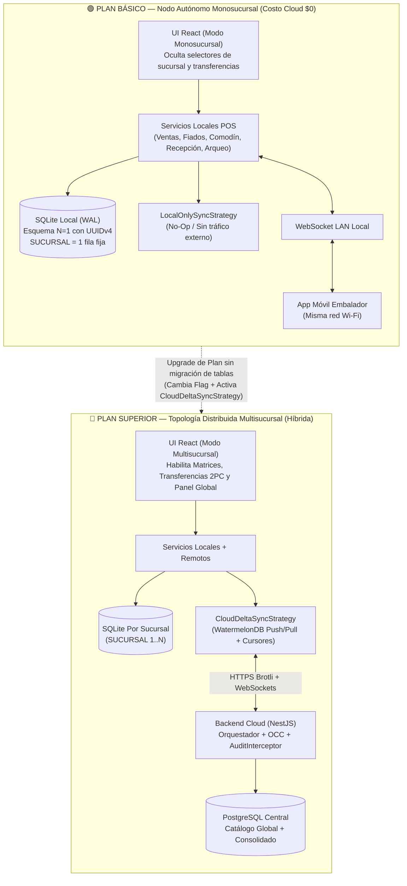
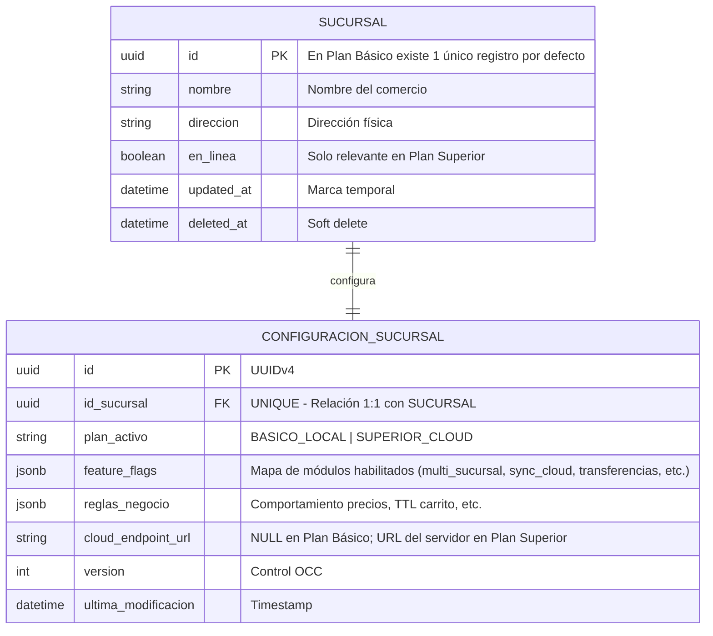
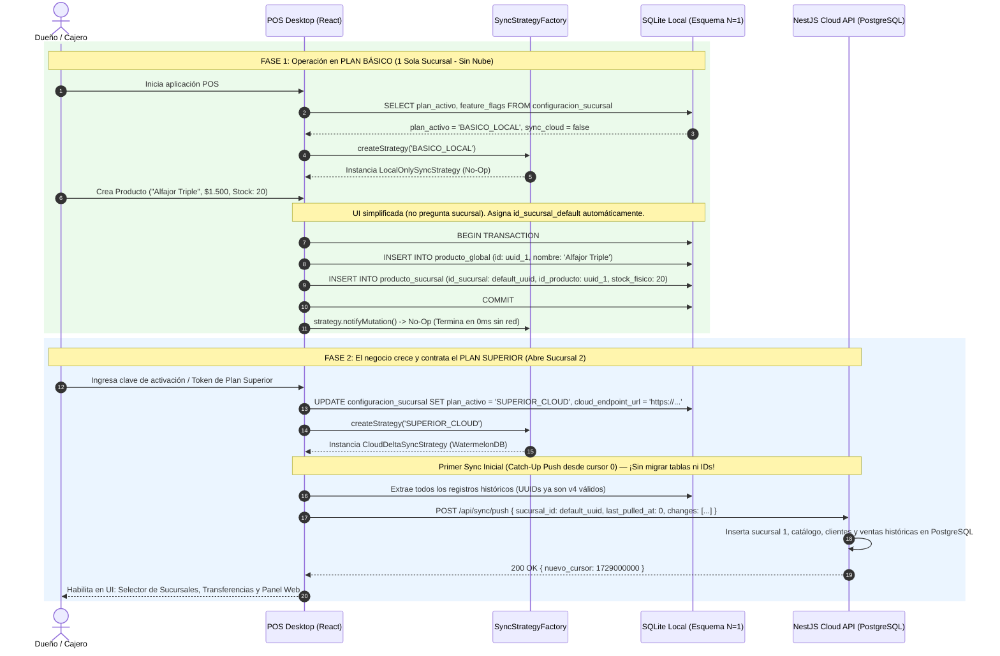
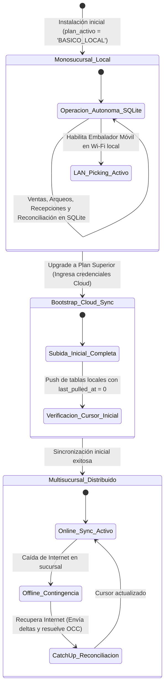

# Plan de Arquitectura y Documentación: Estrategia Comercial por Planes (Monosucursal Local vs. Multisucursal Cloud)

## 1\. Descripción del Objetivo (Goal Description)

Transformar la especificación arquitectónica de **POSLyon** para que el soporte distribuido (múltiples sucursales, sincronización con la nube, transferencias inter-sucursal y panel web centralizado) pase a ser un **Plan Superior (Pro / Enterprise)**, mientras que el **Plan Básico (Starter / Local)** opere de forma **100 % local en una única sucursal**, eliminando para ese segmento toda dependencia de servidores en la nube, latencia de red y conflictos de sincronización remota.

El objetivo de diseño es lograr esta separación **con una única base de código** y **cero migraciones destructivas de base de datos** cuando un negocio crezca y decida pasar del Plan Básico al Plan Superior.

---

## 2\. Respuesta Arquitectónica

> **¿Alcanza solo con Feature Flags?** **No.** Los *Feature Flags* sirven para ocultar o mostrar pantallas y botones en el frontend (como esconder el menú de "Transferencias entre Sucursales"), pero si la lógica de negocio o el modelo de datos están acoplados a la nube, apagar un flag dejaría al Plan Básico sin poder administrar su catálogo, reconciliar códigos huérfanos o auditar cierres de caja.

Para que el sistema funcione como **Monosucursal 100 % Local** en el Plan Básico y se convierta en **Multisucursal Cloud** en el Plan Superior sin reescribir código ni migrar datos, se deben combinar **4 pilares arquitectónicos**:

### Pilar 1: Esquema de Datos Invariante $N=1$ (*Upgrade-Ready Schema*)

El error más costoso en sistemas POS es diseñar una base de datos simple para el Plan Básico (con IDs autoincrementales `1, 2, 3` y una sola tabla `PRODUCTO` con stock incluido) y otra distinta para el Plan Superior. Si se hace eso, cuando el cliente compra su segunda sucursal, migrar sus datos a la nube rompe todas las claves foráneas.

* **La Regla $N=1$:** En el Plan Básico, la base SQLite local utiliza **exactamente el mismo esquema relacional** que el Plan Superior:  
  * Mantiene **UUIDv4** en todas las entidades.  
  * Mantiene la tabla `SUCURSAL` con **1 único registro pre-cargado** (`id_sucursal_default`).  
  * Mantiene la separación `PRODUCTO_GLOBAL` \+ `PRODUCTO_SUCURSAL`, pero en el Plan Básico el servicio local crea y actualiza ambas tablas en un solo paso transparente para el usuario (ocultando los selectores de sucursal en la UI).  
  * Mantiene las columnas `version` (OCC), `updated_at` y `deleted_at` (*Soft Delete*).  
* **Beneficio directo:** Cuando el cliente contrata el Plan Superior, **no hay que migrar ni transformar su base de datos**. Simplemente se enciende el motor de sincronización y su SQLite local sube todo su historial a PostgreSQL en el primer *Push* porque sus UUIDs y su `id_sucursal` ya son universalmente válidos.

### Pilar 2: Patrón *Strategy* \+ *Ports & Adapters* (Inyección del Motor de Sincronización)

En lugar de ensuciar los servicios con condicionales `if (plan === 'SUPERIOR')`, se desacopla la replicación mediante una interfaz (`ISyncEngineStrategy`):

* **`LocalOnlySyncStrategy` (Plan Básico):** Implementación nula (*Null Object Pattern* / *No-Op*). Las ventas pasan de `BORRADOR` a `CONFIRMADA` en SQLite local y el flujo termina ahí. No levanta workers de subida a la nube ni abre WebSockets hacia servidores externos. Costo de servidor en la nube para vos como proveedor: **\$0**.  
* **`CloudDeltaSyncStrategy` (Plan Superior):** Implementación activa con `WatermelonSyncAdapter`, cursores `last_pulled_at`, resolución de conflictos OCC contra PostgreSQL y `CloudWsClient`.

### Pilar 3: Reubicación de Funciones Administrativas (*Local Admin vs. Cloud Admin*)

En la documentación actual, tareas como **Reconciliar Códigos Huérfanos (Comodín)**, **Crear Productos/Promociones** o **Ver Auditoría** ocurren únicamente en el "Panel Web en la Nube".

* En el **Plan Básico**, no hay nube. Por lo tanto, los servicios de Reconciliación, Catálogo y Auditoría deben vivir en un módulo compartido o ejecutable localmente dentro de `pos-desktop` contra SQLite, protegido por el rol `ADMIN` en la misma PC de la sucursal.  
* En el **Plan Superior**, esas mismas pantallas consumen la API de `backend-cloud` para afectar a todas las sucursales.

### Pilar 4: *Feature Flags* \+ *Code Splitting* por Nivel de Plan

Ahora sí, sobre los 3 pilares anteriores, los **Feature Flags** gobiernan qué módulos se cargan en memoria y qué opciones ve el usuario:

| Capacidad / Módulo | Plan Básico (1 Sucursal Local) | Plan Superior (Multisucursal Cloud) | Mecanismo Técnico |
| :---- | :---- | :---- | :---- |
| **Cobro, Carrito, Promociones, Fiados, Devoluciones, Arqueo** | ✅ Activo (100 % SQLite) | ✅ Activo (SQLite \+ Sync Cloud) | Core POS común (`domain-core`) |
| **App Móvil Embalador (Picking)** | ✅ Opcional por Wi-Fi LAN local | ✅ Activo por Wi-Fi LAN local | `LocalPosGateway` (WebSocket en PC Caja) |
| **Creación de Productos y Precios** | ✅ Formulario simple (1 sucursal implícita) | ✅ Formulario matricial con propagación a $N$ sucursales | Feature Flag `multi_sucursal_ui` |
| **Reconciliación de Producto Comodín** | ✅ Ejecución local en SQLite (sin red) | ✅ Ejecución centralizada en Nube por sucursal | Strategy `IReconciliacionRepository` |
| **Sincronización Cloud (Push/Pull Deltas)** | ❌ Desactivado (`LocalOnlySyncStrategy`) | ✅ Activo (`CloudDeltaSyncStrategy`) | Strategy \+ DI \+ Code Splitting |
| **Transferencias de Stock (2PC)** | ❌ Oculto / No descargado (0 KB) | ✅ Activo con Handshake en Nube | Feature Flag `transferencias_sucursales` \+ `React.lazy` |
| **Clonación Masiva de Catálogo (Escenario 2\)** | ❌ Oculto / No descargado (0 KB) | ✅ Activo | Feature Flag `clonacion_sucursales` \+ `React.lazy` |

&nbsp;

---

## 3\. Especificación mediante Diagramas UML (Mermaid.js)

### 3.1 Diagrama de Arquitectura y Topología por Planes



&nbsp;

### 3.2 Extensión del ERD para Licenciamiento y Configuración de Plan

Se incorpora la estructura de licenciamiento dentro de `CONFIGURACION_SUCURSAL` (o tabla `LICENCIA_SISTEMA`) para gobernar los *Feature Flags* tanto en modo 100 % desconectado como en la nube:



&nbsp;

### 3.3 Diagrama de Secuencia: Operación en Plan Básico y Upgrade Transparente al Plan Superior



&nbsp;

### 3.4 Diagrama de Máquina de Estados: Modos Operativos del Nodo POS



&nbsp;

---

## 4\. Decisiones de Diseño y Preguntas Abiertas (Open Questions)

> \[\!WARNING\] Para ajustar este plan antes de tocar la documentación, conviene definir estos **3 puntos de modelo de negocio**:

1. **¿Múltiples cajas dentro de la misma sucursal en el Plan Básico?**  
   * *Opción A (Recomendada para Plan Básico):* El Plan Básico admite **1 PC de Caja principal** (donde vive el archivo SQLite) \+ **App Móvil de Embalador** por Wi-Fi local. Si un local tiene 3 cajas cobrando en simultáneo, requiere el Plan Intermedio/Superior o que las cajas secundarias se conecten por red local (LAN) al SQLite/API de la Caja 1\.  
   * *Opción B:* Permitir múltiples PCs de caja en el Plan Básico sincronizando entre sí por LAN sin pasar por la nube.  
2. **¿Cómo se activa el Plan Superior en la práctica?**  
   * *Opción A:* Mediante un archivo de licencia firmado (JWT offline) o clave de activación en `CONFIGURACION_SUCURSAL`, que desbloquea los *Feature Flags* y configura la URL del backend en la nube.  
3. **¿Dónde se ejecutan las tareas del Administrador en el Plan Básico?**  
   * En el Plan Básico no existe el "Panel Web en la Nube". Por lo tanto, las vistas de **Reconciliación de Códigos Huérfanos**, **Gestión de Catálogo/Precios** y **Auditoría** deben estar disponibles dentro de la misma aplicación de escritorio (`pos-desktop`) cuando inicia sesión un usuario con rol `ADMIN`.

---

## 5\. Plan de Impacto en la Documentación (`Proposed Changes`)

A continuación se detalla exactamente **qué documentos habrá que modificar** (una vez corregidas las inconsistencias actuales del reporte de auditoría previo) para reflejar la arquitectura en dos niveles:

### Componente 1: Documentos Maestros de Arquitectura y Requisitos

#### \[MODIFY\] [ARCHITECTURE.md](file:///d:/Contr/Downloads/POSLyon/docs/ARCHITECTURE.md)

* Incorporar la sección **"Estrategia de Planes y Topología Evolutiva (Plan Básico Monosucursal vs. Plan Superior Multisucursal)"**.  
* Clasificar los 5 módulos especificando qué partes pertenecen al *Core Local (Plan Básico)* y cuáles se activan como *Add-ons de Sincronización y Multisucursal (Plan Superior)*.

#### \[MODIFY\] [POSLyon.md](file:///d:/Contr/Downloads/POSLyon/docs/POSLyon.md)

* **Sección "Arquitectura: ¿Monolítico o Microservicios? ¿Local o Nube?" ([L5-L59](file:///d:/Contr/Downloads/POSLyon/docs/POSLyon.md#L5-L59)):** Explicar que el sistema opera bajo una arquitectura **Local-Only por defecto (Plan Básico)** y escala a **Local-First con Backend Cloud (Plan Superior)** mediante el patrón *Strategy*.  
* **Sección "Catálogo global vs. inventario local" ([L66](file:///d:/Contr/Downloads/POSLyon/docs/POSLyon.md#L66)):** Aclarar la **Regla de Invariancia $N=1$** (en el Plan Básico la tabla `PRODUCTO_SUCURSAL` existe por detrás con una sucursal única por defecto para permitir un *upgrade* instantáneo en el futuro, pero la UI muestra un formulario unificado).  
* **Sección "Funcionalidad a futuro" ([L713-L939](file:///d:/Contr/Downloads/POSLyon/docs/POSLyon.md#L713-L939)):** Promover esta sección a **"Arquitectura de Planes de Suscripción y Feature Flags"**, agregando la tabla comparativa entre Plan Básico y Plan Superior y el flujo de *Upgrade sin Migración*.

#### \[MODIFY\] [Documento de Educción de Requisitos de Software (ERS).md](file:///d:/Contr/Downloads/POSLyon/docs/Documento%20de%20Educci%C3%B3n%20de%20Requisitos%20de%20Software%20%28ERS%29.md)

* Etiquetar cada Requisito Funcional según su alcance de plan:  
  * **`[CORE - AMBOS PLANES]`:** RF-01 a RF-15, RF-17, RF-19 (ajustando la redacción para que en el Plan Básico no exijan paso por la nube).  
  * **`[EXCLUSIVO PLAN SUPERIOR]`:** **RF-16** (Transferencias entre Sucursales), **RF-18** (Sincronización por Cursores/Deltas hacia la nube) y **RF-07 (sub-punto Post-Sync)** (el conflicto OCC de límite de crédito contra la nube solo aplica en el Plan Superior; en el Plan Básico la validación de límite es 100 % local e inmediata).

---

### Componente 2: Diagramas Estructurales, de Estados y de Secuencia

#### \[MODIFY\] [Diagrama de Entidad-Relación (ERD).md](file:///d:/Contr/Downloads/POSLyon/docs/Diagrama%20de%20Entidad-Relaci%C3%B3n%20%28ERD%29.md)

* Agregar en `CONFIGURACION_SUCURSAL` los atributos `plan_activo` (`BASICO_LOCAL` | `SUPERIOR_CLOUD`), `feature_flags` (`jsonb`) y `cloud_endpoint_url`.  
* Documentar que la entidad `SYNC_CURSOR` y el atributo `SUCURSAL.en_linea` permanecen inactivos en el Plan Básico.

#### \[MODIFY\] [Diagrama de Casos de Uso (Interacciones por Rol).md](file:///d:/Contr/Downloads/POSLyon/docs/Diagrama%20de%20Casos%20de%20Uso%20%28Interacciones%20por%20Rol%29.md)

* Dividir el *subgraph* de Administración en dos bloques visuales:  
  * **Administración Local (Plan Básico y Superior):** Crear/Editar Productos, Modificar Precios, Reconciliar Códigos Huérfanos, Configurar Sucursal, Ver Reportes Locales.  
  * **Administración Multisucursal (Exclusivo Plan Superior):** Crear/Editar Sucursales (`UC1`), Rotar Usuarios entre Sucursales (`UC2`), Ver Reportes Globales (`UC3`), Transferir Stock a otra Sucursal (`UC11`, `UC26`, `UC27`).

#### \[MODIFY\] Diagramas que pasan a ser Exclusivos o Condicionales del Plan Superior

1. [**Diagrama de secuencia de transferencia de stock entre sucursales.md**](file:///d:/Contr/Downloads/POSLyon/docs/Diagrama%20de%20secuencia%20de%20transferencia%20de%20stock%20entre%20sucursales.md)**:** Marcar el documento completo como `[MÓDULO ADD-ON: PLAN SUPERIOR]`.  
2. [**Diagrama de secuencia de Gestión de productos entre sucursales \- Escenario 1.md**](file:///d:/Contr/Downloads/POSLyon/docs/Diagrama%20de%20secuencia%20de%20Gesti%C3%B3n%20de%20productos%20entre%20sucursales%20-%20Escenario%201.md) **y [Escenario 2.md](file:///d:/Contr/Downloads/POSLyon/docs/Diagrama%20de%20secuencia%20de%20Gesti%C3%B3n%20de%20productos%20entre%20sucursales%20-%20Escenario%202.md):** Añadir nota de comportamiento en Plan Básico (el Escenario 1 inserta automáticamente en la única sucursal local sin mostrar *checkboxes*; el Escenario 2 de clonación masiva es exclusivo del Plan Superior).  
3. [**Diagrama de Actividad\_ Resolución de Creación Offline\_ El *Producto Comodín*.md**](file:///d:/Contr/Downloads/POSLyon/docs/Diagrama%20de%20Actividad_%20Resoluci%C3%B3n%20de%20Creaci%C3%B3n%20Offline_%20El%20_Producto%20Comod%C3%ADn_.md) **y [Diagrama de secuencia de limpieza de productos de venta rápida.md](file:///d:/Contr/Downloads/POSLyon/docs/Diagrama%20de%20secuencia%20de%20limpieza%20de%20productos%20de%20venta%20r%C3%A1pida.md):** Renombrar conceptualmente de "Creación Offline" a **"Venta Rápida / Producto Comodín"**, porque en el Plan Básico un producto también puede no estar cargado en el catálogo aunque no exista "nube". En el Plan Básico, el *swimlane* de reconciliación ocurre en la misma PC local sobre SQLite.  
4. [**Diagrama de Máquina de Estados Ciclo de Vida del Carrito.md**](file:///d:/Contr/Downloads/POSLyon/docs/Diagrama%20de%20M%C3%A1quina%20de%20Estados%20Ciclo%20de%20Vida%20del%20Carrito.md)**:** En el *Side Effect* del estado `Confirmada`, cambiar `"Dispara Push a Nube"` por `"Notifica a ISyncEngineStrategy (No-Op en Plan Básico / Push a Nube en Plan Superior)"`.

---

### Componente 3: File-Level Specs (Módulos 1 al 5\)

#### \[MODIFY\] [File-Level Specs\_ Módulo Sincronización Local-First e Interceptor de Auditoría.md](file:///d:/Contr/Downloads/POSLyon/docs/File-Level%20Specs_%20M%C3%B3dulo%20Sincronizaci%C3%B3n%20Local-First%20e%20Interceptor%20de%20Auditor%C3%ADa.md)

* Agregar la interfaz `ISyncEngineStrategy`, la clase `LocalOnlySyncStrategy` (Plan Básico) y la fábrica `SyncStrategyFactory`.  
* Separar la auditoría en `AuditLocalService` (que escribe en la tabla `auditoria` de SQLite en el Plan Básico) y `AuditInterceptor` (en NestJS para el Plan Superior).

#### \[MODIFY\] [File-Level Specs\_ Módulo Inventario y Reconciliación de Códigos Huérfanos.md](file:///d:/Contr/Downloads/POSLyon/docs/File-Level%20Specs_%20M%C3%B3dulo%20Inventario%20y%20Reconciliaci%C3%B3n%20de%20C%C3%B3digos%20Hu%C3%A9rfanos.md)

* Permitir que la lógica de `ReconciliacionService` pueda ejecutarse localmente en `pos-desktop` (`reconciliacion-local.service.ts`) para los clientes del Plan Básico que no poseen `backend-cloud`.

---

## 6\. Código de Referencia (Patrón Strategy \+ Feature Flags \+ Esquema $N=1$)

```ts
// libs/domain-core/src/interfaces/plan-config.interface.ts
export enum PlanComercial {
  BASICO_LOCAL = 'BASICO_LOCAL',       // 1 Sucursal, 100% SQLite, 0 Cloud
  SUPERIOR_CLOUD = 'SUPERIOR_CLOUD',   // N Sucursales, Sync Cloud + PostgreSQL
}

export interface IFeatureFlags {
  multiSucursalUI: boolean;            // false en Básico, true en Superior
  cloudSync: boolean;                  // false en Básico, true en Superior
  transferenciasEntreSucursales: boolean; // false en Básico, true en Superior
  clonacionCatalogoMasiva: boolean;    // false en Básico, true en Superior
  pickingMovilLan: boolean;            // Disponible en ambos planes (vía Wi-Fi local)
}

export interface ISyncEngineStrategy {
  inicializar(): Promise<void>;
  notificarMutacionLocal(tabla: string, registroId: string): Promise<void>;
  ejecutarUpgradeInicialACloud?(): Promise<void>;
}
```

&nbsp;

```ts
// apps/pos-desktop/src/sync/strategies/local-only-sync.strategy.ts
import { ISyncEngineStrategy } from '@poslyon/domain-core';

/**
 * Estrategia para el PLAN BÁSICO (Monosucursal).
 * No realiza llamadas de red ni requiere backend en la nube.
 */
export class LocalOnlySyncStrategy implements ISyncEngineStrategy {
  async inicializar(): Promise<void> {
    // No abre WebSockets a la nube ni inicia workers de sincronización remota
  }

  async notificarMutacionLocal(_tabla: string, _registroId: string): Promise<void> {
    // No-Op: los datos ya quedaron persistidos de forma segura en SQLite (WAL)
  }
}
```

&nbsp;

---

## 7\. Protocolo de Auditoría de Trazabilidad (PAT) del Nuevo Plan

* **Métricas de Cobertura del Diseño Propuesto:**  
  * **100 %** de los casos de uso de una sucursal única funcionan en el Plan Básico sin conexión a servidores externos.  
  * **100 %** de compatibilidad de claves primarias (`UUIDv4`) y foráneas (`id_sucursal`) al escalar del Plan Básico al Plan Superior.

| Requisito de Negocio (Planes) | Elemento en Diagramas UML | Impacto Documental | Implementación en Código |
| :---- | :---- | :---- | :---- |
| **Plan Básico sin sincronización Cloud** | Diagrama 3.1 (`PlanBasico`) y Secuencia 3.3 (Fase 1\) | `POSLyon.md`, `ERS.md`, `Spec Sync` | `LocalOnlySyncStrategy` (*No-Op*) |
| **Invariancia de Esquema ($N=1$)** | ERD 3.2 (`SUCURSAL` con 1 fila \+ `CONFIGURACION_SUCURSAL`) | `Diagrama ERD.md`, `POSLyon.md` | Auto-asignación de `DEFAULT_SUCURSAL_ID` |
| **Administración Local en Plan Básico** | Secuencia 3.3 y Casos de Uso | `Diagrama Casos de Uso.md`, `Spec Inventario` | `reconciliacion-local.service.ts` |
| **Upgrade sin migración de tablas** | Secuencia 3.3 (Fase 2\) y Máquina de Estados 3.4 | `POSLyon.md` (Sección Planes) | `CloudDeltaSyncStrategy` con `last_pulled_at = 0` |
| **Ocultamiento de UI Multisucursal** | Diagrama 3.1 (`UI_B` vs `UI_S`) | `Escenario 1/2`, `Transferencias` | `IFeatureFlags` \+ `React.lazy()` |

&nbsp;

---

## 8\. Plan de Verificación (Verification Plan)

Cuando decidamos aplicar esta evolución sobre la documentación (luego de sanear las inconsistencias del reporte anterior):

1. **Verificación de Aislamiento del Plan Básico:** Comprobar que ningún diagrama ni flujo etiquetado como `[CORE - PLAN BÁSICO]` invoque a `CloudAPI` o `PostgreSQL`.  
2. **Verificación de Invariancia de Esquema:** Validar en el ERD que ninguna tabla cambie su estructura ni sus tipos de datos entre el Plan Básico y el Plan Superior.  
3. **Validación Sintáctica Mermaid:** Renderizar los nuevos diagramas de topología, secuencia de upgrade y máquina de estados de plan con `@mermaid-js/mermaid-cli`.